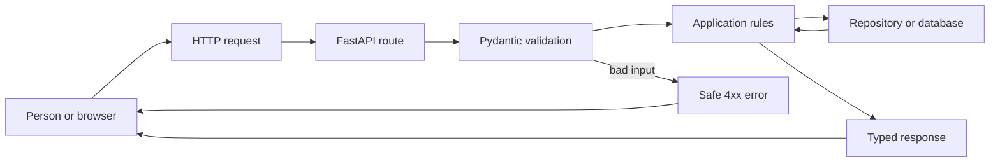

# FastAPI: Python APIs From First Principles

This is a complete beginner course for building a small, safe HTTP API with
Python and FastAPI. It starts with Python itself, then teaches the web request,
then adds validation, storage, tests, and deployment. The words are simple, but
the engineering rules are real.

## 1. The one-minute picture

Imagine a school library:

- the browser is a student asking a question;
- the API is the librarian at the desk;
- a route is the desk window for one kind of question;
- a Pydantic model is the form that checks the answer;
- the service is the librarian's rule book;
- the database is the catalog;
- the response is the answer sent back to the student.

A Python API is a Python program that listens for requests, checks them,
performs a useful action, and returns a predictable response.



## 2. Audience and prerequisites

This course is for a person who can use a terminal but may be new to Python
and backend work. You need:

- a computer and a text editor;
- Python 3.11 or newer;
- a terminal;
- basic comfort with folders and commands;
- patience to read an error message before changing code.

The first project uses an in-memory list so the learner can understand HTTP
before learning database administration. The later project uses SQLite locally
and leaves a clear boundary for PostgreSQL in a hosted environment.

## 3. What you will be able to do

By the end you can:

- create and activate a virtual environment;
- write functions, classes, modules, and typed Python;
- explain a request, response, route, status code, and JSON body;
- build `GET`, `POST`, `PUT`, and `DELETE` endpoints;
- validate input with Pydantic;
- keep route handlers thin and rules in a service;
- store data behind a repository boundary;
- return safe errors and protect secrets;
- test routes with an HTTP test client;
- read the automatic OpenAPI document;
- run the API locally and package it for deployment.

## 4. A-to-Z topic map

| Letter | Topic | Simple question |
| --- | --- | --- |
| A | API and application | What promise does the program make? |
| B | Basics and booleans | How does Python hold a value? |
| C | Collections and CRUD | How do we create, read, update, and delete? |
| D | Dependencies and data | What does this function need? |
| E | Exceptions and errors | What happens when work fails? |
| F | FastAPI and functions | How does a URL call Python code? |
| G | GET and good boundaries | How do we read safely? |
| H | HTTP and headers | How do computers speak? |
| I | Input validation | How do we reject nonsense early? |
| J | JSON and JSON Schema | How do we exchange structured data? |
| K | Keys and idempotency | Can a repeated request create a duplicate? |
| L | Logging and layers | How do we find the first broken boundary? |
| M | Modules and models | How do files and data shapes fit together? |
| N | Null, `None`, and names | What does missing mean? |
| O | OpenAPI and ownership | How can another programmer use the API? |
| P | Pydantic and persistence | Where do rules and stored data live? |
| Q | Query parameters | How do we filter or paginate? |
| R | Responses and repositories | What shape comes back? |
| S | Security and status codes | Who may do what, and what happened? |
| T | Tests and transactions | How do we prove behavior? |
| U | URLs and user input | Which values are untrusted? |
| V | Virtual environments and versioning | How do we keep dependencies separate? |
| W | Workers and webhooks | What work should happen later? |
| X | XML and external formats | How do we handle a non-JSON partner? |
| Y | YAML configuration | Where should environment settings live? |
| Z | Zero-to-deployed API | Can someone run and operate it? |

## 5. Recommended learning order

1. Install Python and create a virtual environment.
2. Learn values, collections, functions, and control flow.
3. Learn modules, exceptions, typing, and tests.
4. Learn HTTP, JSON, routes, and status codes.
5. Build a read-only FastAPI endpoint.
6. Add request and response models.
7. Add create, update, delete, and error paths.
8. Move business rules into a service and storage into a repository.
9. Add a database, authentication concepts, logs, and OpenAPI.
10. Package, test, and deploy the small API.

## 6. Python foundations

### Values and collections

```python
name: str = "Asha"
count: int = 3
is_ready: bool = True
names: list[str] = ["Asha", "Sam"]
by_id: dict[int, str] = {1: "Asha"}
```

A type annotation tells a human and a type checker what a value should be. It
does not make untrusted web input safe by itself. Request models still need
runtime validation.

### Functions and decisions

```python
def clean_text(value: str | None) -> str | None:
    if value is None:
        return None
    cleaned = value.strip()
    return cleaned or None
```

A function should have one clear job. A route should not contain every database
query and business rule in one long block.

### Exceptions

```python
class ItemNotFound(Exception):
    """The requested item does not exist."""


def find_item(item_id: int) -> dict[str, object]:
    raise ItemNotFound from None
```

The API layer can translate a known exception to `404`. It should not return a
Python traceback, SQL statement, local path, or secret to a caller.

### Modules and virtual environments

Create an isolated environment so one project cannot break another project:

```bash
python3 -m venv .venv
source .venv/bin/activate
python -m pip install --upgrade pip
python -m pip install fastapi uvicorn pydantic pytest httpx
```

Keep dependencies in `pyproject.toml` or a locked requirements file. Do not
install into the system Python when the project is meant to be repeatable.

## 7. HTTP and JSON

A request has a method, URL, headers, and sometimes a body. A response has a
status code, headers, and sometimes a body.

| Method | Meaning | Typical success |
| --- | --- | --- |
| `GET` | read | `200 OK` |
| `POST` | create or start work | `201 Created` or `202 Accepted` |
| `PUT` | replace one resource | `200 OK` |
| `PATCH` | change part of a resource | `200 OK` |
| `DELETE` | remove or disable | `204 No Content` |

Use nouns in paths, such as `/notes` and `/notes/{note_id}`. Put filtering in
query parameters, such as `/notes?topic=python&page=1`. JSON is data, not a
place to execute code.

## 8. The first FastAPI application

Create `app/main.py`:

```python
from fastapi import FastAPI

app = FastAPI(title="Study Notes API", version="1.0.0")


@app.get("/health")
def health() -> dict[str, str]:
    return {"status": "ok"}
```

Run it:

```bash
uvicorn app.main:app --reload --port 8000
```

Open `http://127.0.0.1:8000/docs` for interactive documentation. The API
contract is generated from the route and model declarations, but the generated
document still needs human review.

## 9. Request and response models

```python
from pydantic import BaseModel, Field


class NoteCreate(BaseModel):
    title: str = Field(min_length=1, max_length=120)
    body: str = Field(min_length=1, max_length=20_000)
    topic: str = Field(min_length=1, max_length=60)


class Note(NoteCreate):
    id: int
```

The model checks shape and limits. The service still decides business meaning,
such as whether the topic is allowed or whether the caller owns the note.

## 10. CRUD with a small repository

```python
from fastapi import HTTPException

notes: dict[int, Note] = {}
next_id = 1


@app.get("/notes", response_model=list[Note])
def list_notes() -> list[Note]:
    return list(notes.values())


@app.post("/notes", response_model=Note, status_code=201)
def create_note(request: NoteCreate) -> Note:
    global next_id
    note = Note(id=next_id, **request.model_dump())
    notes[next_id] = note
    next_id += 1
    return note


@app.get("/notes/{note_id}", response_model=Note)
def get_note(note_id: int) -> Note:
    note = notes.get(note_id)
    if note is None:
        raise HTTPException(status_code=404, detail="Note not found")
    return note
```

This is useful for the first lesson, but global mutable state is not a durable
production store. A later version should inject a repository and use a database.

## 11. Keep the layers understandable

Use this dependency direction:

```text
HTTP route -> service -> repository -> database or external API
```

- The route translates HTTP and declares request/response models.
- The service applies business rules and transaction decisions.
- The repository reads and writes data.
- The database stores durable records.

Do not let a route concatenate SQL. Do not let a browser receive database
credentials. Do not let a model invent a folder, SQL statement, or permission.

## 12. Query parameters, pagination, and filtering

A list endpoint must have a limit so one request cannot accidentally load an
unbounded collection.

```python
from fastapi import Query


@app.get("/notes", response_model=list[Note])
def list_notes(
    topic: str | None = None,
    limit: int = Query(default=20, ge=1, le=100),
    offset: int = Query(default=0, ge=0),
) -> list[Note]:
    values = list(notes.values())
    if topic is not None:
        values = [note for note in values if note.topic == topic]
    return values[offset : offset + limit]
```

For a real database, use an indexed query and a stable ordering. Do not fetch
every row and filter a million records in Python.

## 13. Errors and safe boundaries

Create a stable error shape such as:

```json
{
  "message": "The note was not found.",
  "code": "NOTE_NOT_FOUND",
  "requestId": "request-123"
}
```

Map errors deliberately:

- malformed input: `400`;
- missing authentication: `401`;
- insufficient permission: `403`;
- missing note: `404`;
- duplicate resource: `409`;
- too much input: `413`;
- dependency outage: `503`;
- unexpected failure: generic `500`.

Do not return `str(exception)` when it can contain a filesystem path, SQL,
provider response, or secret. Log diagnostic details on the server with a
request ID and redact private values.

## 14. Persistence choices

Start with a repository protocol:

```python
from typing import Protocol


class NoteRepository(Protocol):
    def list(self, limit: int, offset: int) -> list[Note]: ...
    def get(self, note_id: int) -> Note | None: ...
    def save(self, note: Note) -> Note: ...
```

SQLite is a good one-user local database. PostgreSQL is a better shared service
for concurrent clients, transactions, migrations, and future users. Store large
PDFs or images in files or private object storage; keep only metadata and a
relative key in the database.

## 15. Authentication and authorization

Authentication asks, "Who are you?" Authorization asks, "What may you do?"
They are different questions.

For a real API:

- use HTTPS;
- keep signing keys and database passwords in the server environment;
- validate the token at the API boundary;
- authorize access to the specific note or category;
- use short-lived access tokens or secure sessions;
- rate-limit login and sensitive actions;
- never trust a hidden button as a permission check.

A learning project can use a fake user ID. It must label the fake behavior and
must not pretend that a hard-coded password is production security.

## 16. Async work and background jobs

Use `async def` when the framework and libraries are doing non-blocking I/O.
Do not make CPU-heavy parsing magically fast by adding `async`.

For long work:

```text
POST /exports -> 202 + job_id
queue -> worker creates the file
GET /exports/{job_id} -> pending, running, complete, or failed
```

A worker needs retries, a time limit, idempotency, a dead-letter path, and a
way for the user to see failure. Do not process a huge book or video inside a
short HTTP request without a measured reason.

## 17. Testing

Test behavior at the boundary:

```python
from fastapi.testclient import TestClient

from app.main import app

client = TestClient(app)


def test_health() -> None:
    response = client.get("/health")
    assert response.status_code == 200
    assert response.json() == {"status": "ok"}
```

Add tests for valid input, missing input, oversized input, unknown IDs,
duplicate creates, authorization failures, database failures, and repeated
writes. Unit-test service rules separately from route binding. Use a temporary
or mocked database; never run tests against a personal production catalog.

## 18. OpenAPI, logging, and operations

FastAPI can produce OpenAPI JSON and a browser documentation page. Treat that
contract as an artifact: review paths, schemas, security requirements, and
error responses before sharing it.

Useful operational signals include:

- request count and latency by route;
- `4xx` and `5xx` counts;
- database latency and pool exhaustion;
- queue depth and job age;
- structured logs with request IDs;
- traces for calls that cross services.

A health endpoint should distinguish process health from dependency readiness.
Do not report a green library when the database or object store is unavailable.

## 19. Project layout

A small but maintainable API can look like this:

```text
fastapi-course/
+-- pyproject.toml
+-- app/
|   +-- main.py
|   +-- config.py
|   +-- routes/
|   +-- models/
|   +-- services/
|   +-- repositories/
|   +-- errors.py
|   +-- logging_config.py
+-- tests/
+-- README.md
```

Keep configuration parsing, HTTP binding, business rules, and storage in
separate places. Split a file when it becomes hard to scan, not merely because
another language uses more files.

## 20. Practice labs

### Lab 1: Python warm-up

Write `clean_text` tests for `None`, empty text, spaces, and a name with spaces.
Explain why normalization at the boundary reduces later branches.

### Lab 2: First route

Add `/health` and `/about`. Write down the method, path, status, and JSON shape.

### Lab 3: Note CRUD

Create, list, read, update, and delete one synthetic note. Add a test for an
unknown ID and a test for a title longer than the allowed limit.

### Lab 4: Service boundary

Move the note dictionary behind a repository class. Keep the route behavior the
same. Explain what the service owns.

### Lab 5: Storage failure

Make the repository raise a controlled exception. Return `503` with a safe code
and prove that the response does not contain a local path or traceback.

### Lab 6: Capstone

Build a study-note API with categories, pagination, bookmarks, and completion
state. Write the API contract first. Add authorization rules before the UI.

## 21. Definition of done

- [ ] I can explain a Python variable, function, module, and exception.
- [ ] I can create and activate a virtual environment.
- [ ] I can explain an HTTP request and response.
- [ ] I can build a typed FastAPI route.
- [ ] I can validate request data with Pydantic.
- [ ] I can return deliberate status codes and safe errors.
- [ ] I can explain route, service, repository, and database responsibilities.
- [ ] I can add a focused test before changing behavior.
- [ ] I can describe who owns authentication and authorization.
- [ ] I can run the API and inspect its OpenAPI document.
- [ ] I can name one failure mode and its recovery plan.

## 22. Safe commands and version note

Use a project environment and fake data:

```bash
python -m venv .venv
source .venv/bin/activate
python -m pip install -e .
pytest
uvicorn app.main:app --reload --port 8000
```

Check the current Python, FastAPI, Pydantic, and Starlette documentation when
implementing. Library APIs change. This guide teaches the stable ideas and does
not replace the version-pinned documentation for a real project.

## 23. Fresh-machine generation contract

This file is a complete generator specification for a new agent. The agent may
receive only this Markdown file and must create the entire `FastAPI`
course, its ordered lesson files, `images` folder, local SVG diagrams, runnable
examples, labs, and validation notes. It must not require the old repository or
any transferred image file.

### 23.1 Why Python and FastAPI exist

The course must explain the path before teaching decorators. Python was created
to make programs readable and productive, with a large standard library and a
clear interactive workflow. It trades some compile-time strictness and raw CPU
speed for fast development, rich libraries, and an approachable syntax.

FastAPI builds on Python type hints, ASGI, Starlette, and Pydantic to make HTTP
routes, validation, JSON schemas, and interactive OpenAPI documentation fit
together. The course must compare:

```text
raw Python -> functions and standard-library HTTP building blocks
WSGI era -> common synchronous web deployment model
ASGI       -> async-capable Python server interface
FastAPI    -> typed routes, validation, OpenAPI, and dependency boundaries
```

Explain what each layer improves and what it does not solve. FastAPI does not
automatically provide authorization, a database transaction, a safe file path,
or production observability.

### 23.2 Creation order and exact target tree

Create `FastAPI`, then `FastAPI/images`, then these files:

```text
FastAPI/
|-- README.md
|-- 00-fastapi-course-blueprint.md
|-- 01-learning-map.md
|-- 02-why-python-and-web-framework-history.md
|-- 03-installation-venv-and-project-layout.md
|-- 04-values-types-and-control-flow.md
|-- 05-functions-scope-and-composition.md
|-- 06-collections-comprehensions-and-datastructures.md
|-- 07-modules-packages-and-dependencies.md
|-- 08-exceptions-context-managers-and-errors.md
|-- 09-typing-dataclasses-and-model-design.md
|-- 10-files-paths-json-and-configuration.md
|-- 11-http-urls-headers-and-json-contracts.md
|-- 12-first-fastapi-application.md
|-- 13-pydantic-validation-and-schemas.md
|-- 14-dependency-injection-and-application-layers.md
|-- 15-routing-query-path-and-body-inputs.md
|-- 16-crud-services-and-safe-errors.md
|-- 17-sqlite-sql-and-repository-boundaries.md
|-- 18-postgresql-migrations-and-transactions.md
|-- 19-authentication-authorization-and-api-security.md
|-- 20-async-work-workers-and-background-jobs.md
|-- 21-testing-openapi-and-contracts.md
|-- 22-logging-observability-docker-and-deployment.md
|-- 23-capstone-study-notes-api.md
|-- 24-glossary-practice-and-checklist.md
`-- images/
    |-- python-runtime-and-venv.svg
    |-- python-request-to-response.svg
    |-- python-fastapi-route-validation.svg
    |-- python-pydantic-schema-flow.svg
    |-- python-layered-api.svg
    |-- python-sqlite-postgresql-boundary.svg
    |-- python-authentication-security-boundary.svg
    |-- python-async-worker-job-flow.svg
    |-- python-testing-openapi-loop.svg
    `-- python-deployment-health.svg
```

### 23.3 Lesson manifest and coverage

| File | Required scope |
| --- | --- |
| `01-learning-map.md` | Explain prerequisites, order, study routine, projects, and mastery checkpoints. |
| `02-why-python-and-web-framework-history.md` | Explain Python's goals, interpreter/runtime, typing trade-offs, WSGI, ASGI, FastAPI, and alternatives. |
| `03-installation-venv-and-project-layout.md` | Teach Python versions, `venv`, pip, `pyproject.toml`, lock strategy, imports, and a maintainable API tree. |
| `04-values-types-and-control-flow.md` | Teach strings, numbers, booleans, `None`, lists, dictionaries, conditions, loops, and truthiness. |
| `05-functions-scope-and-composition.md` | Teach parameters, return types, defaults, keyword arguments, scope, closures, pure functions, and small boundaries. |
| `06-collections-comprehensions-and-datastructures.md` | Teach list/set/dict/tuple, comprehensions, iterators, complexity, sorting, and choosing data structures. |
| `07-modules-packages-and-dependencies.md` | Teach imports, packages, public APIs, dependency pinning, virtual environments, and supply-chain awareness. |
| `08-exceptions-context-managers-and-errors.md` | Teach exception classes, `try`, `finally`, context managers, cleanup, chaining, and HTTP error translation. |
| `09-typing-dataclasses-and-model-design.md` | Teach annotations, unions, protocols, dataclasses, generics, runtime validation, and type-checker limits. |
| `10-files-paths-json-and-configuration.md` | Teach `pathlib`, safe roots, encoding, JSON, environment variables, secrets, and bounded file work. |
| `11-http-urls-headers-and-json-contracts.md` | Teach HTTP methods, URLs, status codes, headers, bodies, content types, retries, and API contracts. |
| `12-first-fastapi-application.md` | Teach app creation, ASGI server, route decorators, startup, docs, and a first health endpoint. |
| `13-pydantic-validation-and-schemas.md` | Teach BaseModel, fields, nested data, serialization, response models, limits, and schema review. |
| `14-dependency-injection-and-application-layers.md` | Teach FastAPI dependencies, route/service/repository layers, overrides, ownership, and transactions. |
| `15-routing-query-path-and-body-inputs.md` | Teach path/query/header/body binding, pagination, filtering, ordering, content limits, and versioning. |
| `16-crud-services-and-safe-errors.md` | Build CRUD, normalization, not-found/conflict errors, request IDs, and safe exception handlers. |
| `17-sqlite-sql-and-repository-boundaries.md` | Teach SQLite, SQL parameters, indexes, transactions, connection ownership, and local repository tests. |
| `18-postgresql-migrations-and-transactions.md` | Teach PostgreSQL, pooling, migrations, isolation, concurrency, durable metadata, and object storage. |
| `19-authentication-authorization-and-api-security.md` | Teach identity, tokens/sessions, scopes, resource authorization, HTTPS, CORS, CSRF, rate limits, and secrets. |
| `20-async-work-workers-and-background-jobs.md` | Teach async I/O, blocking code, task queues, retries, idempotency, cancellation, and job status. |
| `21-testing-openapi-and-contracts.md` | Teach pytest, TestClient, fixtures, mocks, database isolation, failure tests, OpenAPI, and contract checks. |
| `22-logging-observability-docker-and-deployment.md` | Teach structured logs, metrics, traces, health/readiness, Docker, environment config, rollback, and backups. |
| `23-capstone-study-notes-api.md` | Build a complete notes API with categories, bookmarks, completion, auth boundary, persistence, tests, and deployment. |
| `24-glossary-practice-and-checklist.md` | Define every Python/FastAPI word and give worked practice, review, and final mastery questions. |
```

### 23.4 Diagram generation manifest

Create local SVG source with a 1200 by 700 `viewBox`, large labels, arrow
markers, a legend, and no external assets. Include Mermaid or text fallback in
each lesson.

| SVG | Required picture | Lesson |
| --- | --- | --- |
| `python-runtime-and-venv.svg` | source, interpreter, virtual environment, packages, process, and terminal | `02`, `03` |
| `python-request-to-response.svg` | client, HTTP, ASGI, route, model, service, repository, and response | `11`, `12` |
| `python-fastapi-route-validation.svg` | path/body input, FastAPI binding, Pydantic failure or route execution | `12`, `13`, `15` |
| `python-pydantic-schema-flow.svg` | JSON, model validation, typed object, response schema, and error | `13` |
| `python-layered-api.svg` | route, dependency, service, repository, database/provider | `14`, `16` |
| `python-sqlite-postgresql-boundary.svg` | local SQLite and hosted PostgreSQL behind one repository contract | `17`, `18` |
| `python-authentication-security-boundary.svg` | client, token/session, API, authorization, data, and denied path | `19` |
| `python-async-worker-job-flow.svg` | request, queue, worker, progress, retry, cancellation, and result | `20` |
| `python-testing-openapi-loop.svg` | code, tests, OpenAPI, client, failure, and correction loop | `21` |
| `python-deployment-health.svg` | lockfile, build, container, environment, health, smoke test, and rollback | `22`, `23` |
```

### 23.5 Required recipe for every lesson

Every lesson must contain a plain-language analogy, definitions, Python history or
previous approach, why the selected library helps, a complete runnable example,
line-by-line explanation, a Mermaid or text flow, its matching SVG, three
real-time use cases, failure/security behavior, trade-offs, a lab, a broken
example to debug, checkpoint questions, and official source/version notes.

Use a continuing Study Notes API with fake notes and users. Explain which parts
are educational shortcuts, such as an in-memory dictionary, and what must
change for production. Do not call a hard-coded password authentication. Do
not claim `async` makes CPU work faster. Explain the database, object-storage,
authorization, and worker boundaries explicitly.

### 23.6 Fresh-machine validation

Confirm all 26 Markdown paths and all 10 SVG paths exist, all links resolve,
all code fences are balanced, all A-to-Z topics map to lessons, and no file is
a placeholder. Run the examples with a virtual environment when available,
then run `pytest` and a health/`/docs` check. Test invalid bodies, oversized
input, unknown IDs, duplicate writes, traversal, unauthorized reads, database
failure, provider timeout, cancelled job, and restart.

Use official Python, FastAPI, Starlette, Pydantic, Uvicorn, PostgreSQL, SQLite,
OpenAPI, Docker, and OWASP documentation. Record versions and dates. If
internet access or a runtime is unavailable, report it honestly rather than
inventing a successful command.
