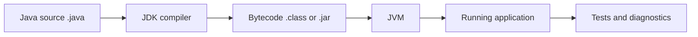

# Java From Zero to Backend

This is a complete Java course for a learner who wants to understand backend
code before learning Spring Boot. It uses a small schedule and study-notes
example, but the ideas work for any Java service.

## 1. The one-minute picture

Java is a language for giving careful instructions to a computer. The Java
compiler checks the instructions and makes bytecode. The Java Virtual Machine,
or JVM, runs that bytecode.



For backend work, Java is usually joined with a build tool such as Gradle, a
web framework such as Spring Boot, a database driver, and a test framework.

## 2. Audience and prerequisites

You need a terminal, a text editor, Java 17 or newer, and curiosity. You do not
need to know Spring, Oracle, or object-oriented programming first. Learn the
language in small steps and run every example.

## 3. Outcomes

You will be able to:

- install a JDK and explain the JVM;
- write variables, conditions, loops, methods, and classes;
- read records, interfaces, collections, generics, and lambdas;
- handle `null`, exceptions, dates, and files;
- understand packages, visibility, memory, and threads;
- write unit tests and build a JAR;
- read a Spring Boot controller, service, and repository;
- keep domain rules separate from HTTP and SQL.

## 4. A-to-Z topic map

| Letter | Topic | Question to answer |
| --- | --- | --- |
| A | Application and API | What job does this program perform? |
| B | Build, bytecode, and booleans | How does source become a running program? |
| C | Classes, conditions, and collections | How are values grouped and chosen? |
| D | Data types and dates | What kind of value is this? |
| E | Exceptions and enums | How is an unusual path represented? |
| F | Fields and functions | Where does state live and what action changes it? |
| G | Generics | How can a collection stay type-safe? |
| H | Heap and stack | Where do objects and method calls live? |
| I | Interfaces and inheritance | How can code depend on a promise? |
| J | JDK, JAR, and JVM | Which tool runs which part? |
| K | Keywords | What do words such as `final` and `static` mean? |
| L | Lambdas and lists | How can collection work be expressed clearly? |
| M | Methods and memory | What should one method own? |
| N | Null and naming | How do we represent missing data? |
| O | Objects and OOP | What does an object protect? |
| P | Packages and records | How are code and data organized? |
| Q | Queues and concurrency | How does work wait safely? |
| R | References and resources | What does a variable point to? |
| S | Strings, streams, SQL, and security | How does data move through a program? |
| T | Tests, threads, and time | How do we prove behavior and schedule work? |
| U | Unicode and user input | How should text be handled? |
| V | Visibility and value objects | Who may call or change this? |
| W | Wrappers and writing files | How do primitive values meet objects? |
| X | XML and external formats | How does Java talk to older systems? |
| Y | YAML and build configuration | Where do environment values belong? |
| Z | Zero-to-service project | Can the language become a useful API? |

## 5. Recommended order

1. Install the JDK and run one class.
2. Learn values, variables, operators, conditions, and loops.
3. Write methods and small tests.
4. Learn classes, objects, encapsulation, records, and interfaces.
5. Learn collections, generics, exceptions, dates, and streams.
6. Learn packages, Gradle, JSON, HTTP, JDBC, and concurrency concepts.
7. Read a Spring Boot vertical slice.
8. Build a small typed service and test its rules.

## 6. First Java program

```java
public class HelloStudy {
    public static void main(String[] args) {
        String subject = "Java";
        System.out.println("Learning " + subject);
    }
}
```

Compile and run:

```bash
javac HelloStudy.java
java HelloStudy
```

`main` is the starting method for this small program. A Spring Boot application
has a different-looking entry point, but it still needs a starting point.

## 7. Values, variables, and operators

```java
String title = "HTTP basics";
int lessonNumber = 1;
boolean complete = false;
LocalDate published = LocalDate.of(2026, 10, 2);
```

Java is statically typed. The compiler knows the intended type before the
program runs. Use `.equals` for object value comparison:

```java
if (title.equals("HTTP basics")) {
    System.out.println("Found the lesson");
}
```

Use `Objects.equals(a, b)` when either object may be `null`.

## 8. Decisions and loops

```java
if (lessonNumber > 0 && !complete) {
    System.out.println("Keep studying");
}

for (String word : List.of("request", "response")) {
    System.out.println(word);
}
```

Use a `switch` when named alternatives make the rule clearer:

```java
String label = switch (status) {
    case "new" -> "Not started";
    case "done" -> "Finished";
    default -> "Unknown";
};
```

## 9. Methods and clean boundaries

```java
static String cleanText(String value) {
    String cleaned = value == null ? "" : value.trim();
    return cleaned;
}
```

A method should have one understandable job. If a method validates HTTP input,
executes SQL, formats a screen message, and sends email, it is doing too much.
Separate those responsibilities behind clear methods or classes.

## 10. Classes and encapsulation

```java
public final class Counter {
    private int value;

    public void increment() {
        value += 1;
    }

    public int value() {
        return value;
    }
}
```

The field is private. Callers cannot change it directly. Encapsulation protects
invariants, such as never letting a counter become negative.

## 11. Records and value objects

```java
public record StudyNote(long id, String title, String topic) {
}
```

A record is a compact immutable data carrier. Java creates the constructor,
accessors, equality, hash code, and string representation. The accessor is
`title()`, not `getTitle()`.

Use records for request and response data when behavior does not need mutable
identity. Use a class when the object owns complex state transitions or
invariants.

## 12. Interfaces and dependency direction

```java
public interface NoteRepository {
    List<StudyNote> findByTopic(String topic);
    StudyNote save(StudyNote note);
}
```

A service can depend on this promise while one implementation uses memory and
another uses PostgreSQL. This is the basic idea behind a repository port and
adapter.

```text
Controller -> Service -> Repository interface -> Memory or database adapter
```

An interface is useful when the boundary is real. Do not create ten empty
interfaces only to make a diagram look sophisticated.

## 13. Collections and generics

```java
List<String> topics = List.of("Java", "APIs");
Set<String> uniqueTopics = new HashSet<>(topics);
Map<Long, StudyNote> notesById = new HashMap<>();
```

- `List` keeps order and can contain duplicates.
- `Set` keeps unique values.
- `Map` finds a value by key.
- A generic such as `List<StudyNote>` tells the compiler what belongs inside.

Choose the collection from the operation you need, not from habit.

## 14. Null, Optional, and validation

`null` means there is no object. An empty string is still a string. Normalize
untrusted text at a boundary:

```java
static String blankToNull(String value) {
    if (value == null || value.isBlank()) {
        return null;
    }
    return value.trim();
}
```

Use `Optional<StudyNote>` as a return value when "may not exist" is the normal
contract. Do not use `Optional` for every field or as a replacement for learning
which values are required.

## 15. Exceptions and error paths

```java
if (title == null || title.isBlank()) {
    throw new IllegalArgumentException("Title is required");
}
```

An exception describes an operation that cannot fulfill its contract. A web
boundary should translate it into a safe status and error body. Do not catch an
exception, ignore it, and pretend that the write succeeded.

## 16. Dates and time

Use the `java.time` API:

```java
LocalDate lessonDate = LocalDate.of(2026, 10, 2);
Instant createdAt = Instant.now();
```

`LocalDate` is a calendar date without a time zone. `Instant` is a point on the
UTC timeline. Choose the type from the business meaning. Do not store every
date as an unstructured string.

## 17. Lambdas and streams

```java
List<String> titles = notes.stream()
        .map(StudyNote::title)
        .filter(title -> title.startsWith("API"))
        .sorted()
        .toList();
```

A stream is a pipeline, not a database query. It is useful for small in-memory
transformations. Use a database query for filtering a large table.

A normal loop is often clearer than a long stream. Readability is the goal.

## 18. Files, JSON, HTTP, and JDBC

Keep external systems behind boundaries:

- `Path` and `Files` handle local files;
- Jackson or another library maps JSON to typed records;
- `HttpClient` calls another HTTP service;
- JDBC or Spring JDBC uses parameterized SQL;
- a repository owns database mapping.

Never build SQL with string concatenation from user input:

```java
String sql = "select id, title from notes where topic = :topic";
```

Use the parameter API of the database library. A type-safe parameter is a
small security boundary.

## 19. Concurrency and memory

The stack holds method calls and local references. The heap holds objects. The
JVM manages object memory, but a program can still leak resources by leaving
files, database connections, or threads open.

Concurrency means more than one piece of work can make progress. Shared mutable
maps need a deliberate design. Prefer immutable values, bounded executors, and
clear ownership. Learn `ExecutorService`, `CompletableFuture`, and thread-safety
before adding parallel work to a web service.

## 20. Packages, visibility, and Gradle

A useful package layout is:

```text
com.example.study/
+-- controller/
+-- service/
+-- repository/
+-- domain/
+-- configuration/
```

- `public` exposes an API widely.
- package-private keeps an implementation local to its package.
- `private` protects a field or helper.
- `final` prevents reassignment or inheritance where appropriate.

Gradle compiles, tests, resolves dependencies, and packages the application.
The build file is part of the project contract. Pin versions and keep secrets
out of it.

## 21. Testing Java behavior

A unit test usually follows Arrange, Act, Assert:

```java
@Test
void blankTitleIsRejected() {
    ScheduleService service = new ScheduleService(repository);

    assertThrows(IllegalArgumentException.class,
            () -> service.create("  ", "Java"));
}
```

Test successful behavior, invalid input, missing records, duplicate actions,
database failure, and boundary values. A high percentage is useful only when
assertions prove the important behavior.

## 22. From Java to Spring Boot

When reading a Spring application, identify these pieces:

```text
@RestController -> HTTP binding
@Service       -> business rules
@Repository    -> storage adapter
record         -> request or response data
@Configuration -> application setup
```

Spring creates many objects for you, but the Java rules still apply. Learn the
plain language first so annotations do not feel like magic symbols.

## 23. Practice labs

1. Write a `record Book(String title, String author)` and print its accessors.
2. Implement `blankToNull` and test four input cases.
3. Create a `Map<Long, StudyNote>` and find an item safely.
4. Define a repository interface and an in-memory implementation.
5. Write a service method that rejects two conflicting member choices.
6. Read a controller and list its route, request, response, and service call.
7. Build a tiny Gradle project with one unit test.
8. Explain why a database failure should not become an empty successful list.

## 24. Definition of done

- [ ] I can explain JDK, JVM, compiler, bytecode, JAR, and Gradle.
- [ ] I can write typed variables, conditions, loops, and methods.
- [ ] I can explain classes, objects, encapsulation, records, and interfaces.
- [ ] I can choose between a list, set, and map.
- [ ] I can explain generics, `null`, exceptions, and dates.
- [ ] I can read a stream without hiding its behavior.
- [ ] I can describe where HTTP, JSON, SQL, and files belong.
- [ ] I can write a focused unit test.
- [ ] I can explain why dependency direction matters.
- [ ] I can trace a Spring controller into a service and repository.

## 25. Commands and version note

For a Gradle project:

```bash
./gradlew test
./gradlew build
```

Use Java 17 as the baseline for the accompanying Spring lessons. Check the
current JDK and Gradle documentation when using a newer release because syntax,
plugins, and library versions change.

## 26. Fresh-machine generation contract

This file is a standalone generator. A new agent receiving only this Markdown
file must create a complete `Java` course, its ordered lessons, an `images`
folder, local diagrams, examples, labs, and validation records. It must not
depend on the existing Study Library or ask for missing files.

### 26.1 Creation order and target tree

Create `Java`, then `Java/images`, then the files below in order. The blueprint
is the instruction file; the numbered lessons are the student course.

```text
Java/
|-- README.md
|-- 00-java-course-blueprint.md
|-- 01-learning-map.md
|-- 02-why-java-and-language-history.md
|-- 03-jdk-jvm-compiler-and-first-program.md
|-- 04-variables-types-and-operators.md
|-- 05-control-flow-and-methods.md
|-- 06-classes-objects-and-encapsulation.md
|-- 07-inheritance-composition-and-polymorphism.md
|-- 08-interfaces-abstract-types-and-sealed-choices.md
|-- 09-records-enums-and-value-objects.md
|-- 10-collections-and-generics.md
|-- 11-null-optional-and-validation.md
|-- 12-exceptions-and-error-design.md
|-- 13-dates-time-strings-and-unicode.md
|-- 14-lambdas-streams-and-functional-style.md
|-- 15-files-json-http-and-jdbc.md
|-- 16-concurrency-threads-and-executors.md
|-- 17-jvm-memory-resources-and-performance.md
|-- 18-packages-visibility-and-modules.md
|-- 19-gradle-dependencies-and-builds.md
|-- 20-testing-debugging-and-quality.md
|-- 21-security-and-safe-input.md
|-- 22-java-backend-project-structure.md
|-- 23-java-to-spring-boot-bridge.md
|-- 24-capstone-study-notes-service.md
|-- 25-glossary-practice-and-checklist.md
`-- images/
    |-- java-source-compiler-jvm-flow.svg
    |-- java-types-and-control-flow.svg
    |-- java-class-object-encapsulation.svg
    |-- java-inheritance-composition-polymorphism.svg
    |-- java-interface-and-implementation.svg
    |-- java-records-collections-generics.svg
    |-- java-exception-and-resource-flow.svg
    |-- java-files-http-jdbc-boundaries.svg
    |-- java-thread-executor-and-memory.svg
    `-- java-testing-and-spring-bridge.svg
```

### 26.2 Lesson manifest

| File | Required scope |
| --- | --- |
| `01-learning-map.md` | Explain prerequisites, order, study loop, projects, and readiness checks. |
| `02-why-java-and-language-history.md` | Explain the problem Java solved, C/C++ influences, portability, JVM trade-offs, releases, and when another language fits better. |
| `03-jdk-jvm-compiler-and-first-program.md` | Teach JDK, compiler, bytecode, JVM, classpath, JAR, `main`, and the compile-run loop. |
| `04-variables-types-and-operators.md` | Teach primitives, references, literals, casts, operators, equality, immutability, and type safety. |
| `05-control-flow-and-methods.md` | Teach `if`, `switch`, loops, expressions, parameters, return values, overloads, recursion, and method boundaries. |
| `06-classes-objects-and-encapsulation.md` | Teach fields, constructors, object identity, invariants, visibility, composition, and lifecycle. |
| `07-inheritance-composition-and-polymorphism.md` | Compare inheritance and composition, overriding, substitutability, abstract classes, and design costs. |
| `08-interfaces-abstract-types-and-sealed-choices.md` | Teach interfaces, default methods, abstract types, sealed classes, dependency direction, and test doubles. |
| `09-records-enums-and-value-objects.md` | Teach records, enums, value equality, validation, serialization, and when mutable classes are required. |
| `10-collections-and-generics.md` | Teach List, Set, Map, queues, iteration, variance, generic methods, ordering, and complexity. |
| `11-null-optional-and-validation.md` | Teach null, absence, `Optional`, blank text, boundary normalization, and validation without hiding bugs. |
| `12-exceptions-and-error-design.md` | Teach checked/unchecked exceptions, cause chains, custom errors, resource cleanup, and API translation. |
| `13-dates-time-strings-and-unicode.md` | Teach `LocalDate`, `Instant`, zones, formatting, parsing, text encoding, Unicode, and locale. |
| `14-lambdas-streams-and-functional-style.md` | Teach lambdas, method references, streams, collectors, side effects, and when loops are clearer. |
| `15-files-json-http-and-jdbc.md` | Teach NIO files, safe paths, JSON mapping, `HttpClient`, JDBC parameters, transactions, and resources. |
| `16-concurrency-threads-and-executors.md` | Teach threads, races, locks, atomics, executors, futures, interruption, bounded work, and virtual-thread awareness. |
| `17-jvm-memory-resources-and-performance.md` | Teach stack, heap, garbage collection, leaks, profiling, connection pools, and performance measurement. |
| `18-packages-visibility-and-modules.md` | Teach packages, public/package/private/protected, module concepts, API surface, and dependency cycles. |
| `19-gradle-dependencies-and-builds.md` | Teach Gradle tasks, repositories, dependency scopes, reproducible builds, tests, artifacts, and secrets. |
| `20-testing-debugging-and-quality.md` | Teach JUnit, assertions, mocks, fixtures, parameterized tests, debugging, coverage, and failure tests. |
| `21-security-and-safe-input.md` | Teach SQL injection, path safety, deserialization, secrets, authentication concepts, authorization, and logging. |
| `22-java-backend-project-structure.md` | Connect controller, service, repository, domain, configuration, database, tests, and dependency flow. |
| `23-java-to-spring-boot-bridge.md` | Explain what Spring adds, what remains plain Java, beans, injection, annotations, MVC, and profiles. |
| `24-capstone-study-notes-service.md` | Build and test a small typed service with CRUD, validation, repository, persistence, errors, and operations. |
| `25-glossary-practice-and-checklist.md` | Define all vocabulary, give worked answers, spaced review, and a final mastery checklist. |
```

### 26.3 Diagram generation manifest

Create each SVG as local text with a 1200 by 700 `viewBox`, readable labels,
arrow markers, and no external assets. Put an equivalent Mermaid or text flow
inside the associated lesson.

| SVG | Required picture | Lesson |
| --- | --- | --- |
| `java-source-compiler-jvm-flow.svg` | source, compiler, bytecode, classpath, JVM, program, and tests | `03` |
| `java-types-and-control-flow.svg` | values entering variables, conditions, loops, methods, and results | `04`, `05` |
| `java-class-object-encapsulation.svg` | class blueprint, object, private state, public method, invariant | `06` |
| `java-inheritance-composition-polymorphism.svg` | superclass, subclass, composed collaborator, and interface call | `07` |
| `java-interface-and-implementation.svg` | service depending on interface with memory and database adapters | `08`, `22` |
| `java-records-collections-generics.svg` | record data moving through List, Set, Map, and typed methods | `09`, `10` |
| `java-exception-and-resource-flow.svg` | try, resource, success, exception, cleanup, and safe caller error | `12` |
| `java-files-http-jdbc-boundaries.svg` | file, JSON, HTTP client, repository, JDBC, and database boundaries | `15` |
| `java-thread-executor-and-memory.svg` | request, executor, task, queue, heap, completion, and cancellation | `16`, `17` |
| `java-testing-and-spring-bridge.svg` | unit test, HTTP test, Spring bean, controller, service, repository | `20`, `23` |
```

### 26.4 Required recipe for every lesson

Every generated file must contain a plain-language analogy; words and symbols
defined; the older problem and why Java's feature was introduced; advantages,
costs, and alternatives; a complete small example; explanation of important
lines; one Mermaid or text flow; its matching SVG; three real-world use cases;
failure and security behavior; a runnable exercise; an incorrect example to
debug; checkpoint questions; and the official source/version note.

Use one continuing example: a typed Study Notes service. Use a second example
when helpful: a schedule row, bank transfer, file import, or concurrent job.
Explain why Java is useful for long-lived, typed, concurrent backend systems,
and when Python, JavaScript, Go, or another language may be the better choice.

### 26.5 Validation and source rules

Confirm all 27 Markdown paths and all 10 SVG paths exist, all links resolve,
all code fences are balanced, all examples use fake data, and all A-to-Z topics
map to a lesson. Run `./gradlew test` and `./gradlew build` when a Gradle
project exists. Use official Java SE, JDK, Oracle JDBC, Gradle, JUnit, OWASP,
and Spring documentation, recording versions and dates. If internet access or
a JDK is missing, report it rather than inventing a result.
