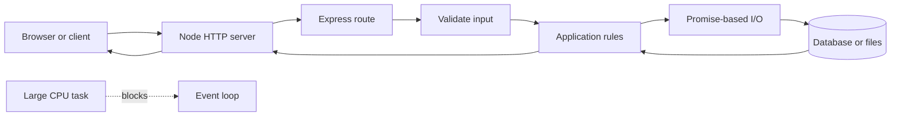

# Node.js From JavaScript Runtime to Tested API

This is a standalone Node.js course for learning how JavaScript runs outside the
browser and how to use it to build a safe HTTP API. It starts with the runtime,
then teaches asynchronous work, modules, HTTP, Express, storage, tests, and
operations.

## 1. The one-minute picture

Node.js is a program that runs JavaScript using the V8 engine. It is good at
waiting for many small input/output operations without creating one blocked
thread for every request. It is not magic: CPU-heavy work can still block the
event loop and slow every request.



## 2. Audience and prerequisites

You need a terminal and basic programming curiosity. Knowing a little browser
JavaScript helps but is not required. Use Node.js 22 or a current LTS release,
pnpm, a text editor, and fake data.

## 3. Outcomes

You will be able to:

- explain V8, the Node runtime, the event loop, and promises;
- use ESM modules, package scripts, and environment configuration;
- read and write files safely with asynchronous APIs;
- create an HTTP server and an Express route;
- validate requests, return safe errors, and design REST endpoints;
- keep business rules and persistence behind clear boundaries;
- use streams for bounded data movement;
- write tests and handle graceful shutdown;
- protect secrets, paths, tokens, and expensive work;
- package and deploy a small Node API.

## 4. A-to-Z topic map

| Letter | Topic | Question to answer |
| --- | --- | --- |
| A | Async and APIs | What work waits, and what promise is made? |
| B | Buffers and backpressure | How do bytes move without unlimited memory? |
| C | CommonJS and configuration | How do modules and settings load? |
| D | Dependencies and debugging | What does the program need and how do we inspect it? |
| E | Event loop and errors | What runs later and what can fail? |
| F | Files, fetch, and functions | How does Node access the outside world? |
| G | Globals and graceful shutdown | What is shared and how does the process stop? |
| H | HTTP and headers | How does the server speak? |
| I | Input validation and identity | Which values and users can be trusted? |
| J | JSON and jobs | How do data and background work fit? |
| K | Keys and keep-alive | How are secrets and connections managed? |
| L | Logging and lifecycle | How can an operator see the process? |
| M | Modules and middleware | How is code composed and request work shared? |
| N | npm and Node runtime | How are packages installed and scripts run? |
| O | Observability and ownership | Who can diagnose a failure? |
| P | Promises and performance | How do we avoid blocking the loop? |
| Q | Queues and query parameters | How are bursts and filters bounded? |
| R | REST and routing | What resources and paths exist? |
| S | Streams, security, and status | How do bytes, trust, and outcomes work? |
| T | TypeScript and testing | How do we catch mistakes before deployment? |
| U | URLs and untrusted input | How are paths and URLs validated? |
| V | Validation and versioning | How can a contract evolve? |
| W | Workers and webhooks | Where does CPU or later work run? |
| X | eXternal services | What if another provider is slow? |
| Y | YAML and your environment | Where do deployment values live? |
| Z | Zero-downtime shutdown | How does a release finish current work? |

## 5. Recommended order

1. Install Node and run a script.
2. Learn JavaScript values, functions, objects, and arrays.
3. Learn modules, package scripts, and TypeScript types.
4. Learn promises, async/await, the event loop, and errors.
5. Build a raw HTTP server.
6. Add Express routing, middleware, validation, and JSON responses.
7. Add service, repository, database, authentication, and tests.
8. Add streams, workers, logging, shutdown, and deployment.

## 6. First program and package setup

```bash
mkdir node-study-api
cd node-study-api
pnpm init
pnpm add express
pnpm add -D typescript tsx @types/node @types/express
```

Use ESM when the project chooses it:

```json
{
  "type": "module",
  "scripts": {
    "dev": "tsx watch src/server.ts",
    "typecheck": "tsc --noEmit",
    "start": "node dist/server.js"
  }
}
```

Pin dependencies with a lockfile. Do not commit `.env` values. Use `.env.example`
with names but no secrets.

## 7. JavaScript and TypeScript basics

```ts
const title: string = "Node basics";
const lessonNumber: number = 1;
const topics: string[] = ["HTTP", "JSON"];

function cleanText(value: string | undefined): string | undefined {
  const cleaned = value?.trim();
  return cleaned || undefined;
}
```

TypeScript catches many mistakes before runtime, but request data is still
untrusted at runtime. Validate bodies, query strings, headers, and environment
values with a schema library or explicit checks.

## 8. The event loop and promises

Node starts work, registers an I/O operation, and later runs its callback or
promise continuation. A slow filesystem or network operation should not block
the JavaScript thread, but a large synchronous loop will.

```ts
const response = await fetch("https://example.test/health");
if (!response.ok) {
  throw new Error("Provider health check failed");
}
const body: unknown = await response.json();
```

Handle rejection. Do not create an unobserved promise and assume it will finish.
Set timeouts for remote calls and abort work that exceeds the budget.

## 9. Raw HTTP server

```ts
import { createServer } from "node:http";

const server = createServer((_request, response) => {
  response.writeHead(200, { "content-type": "application/json" });
  response.end(JSON.stringify({ status: "ok" }));
});

server.listen(4445, "127.0.0.1");
```

A raw server teaches the boundary. Express can later parse JSON, route paths,
and run middleware, but the underlying HTTP request and response still exist.

## 10. Express routes and middleware

```ts
import express from "express";

const app = express();
app.use(express.json({ limit: "1mb" }));

app.get("/health", (_request, response) => {
  response.json({ status: "ok" });
});

app.listen(4445, "127.0.0.1");
```

Middleware is a function that can inspect or change a request, call the next
step, or end the response. Keep middleware small: request IDs, authentication,
JSON parsing, and error translation are different jobs.

## 11. REST routes and request validation

```ts
type NoteCreate = {
  title: string;
  body: string;
  topic: string;
};

function parseNoteCreate(value: unknown): NoteCreate {
  if (!value || typeof value !== "object") {
    throw new Error("Invalid request body");
  }
  const body = value as Record<string, unknown>;
  if (typeof body.title !== "string" || body.title.trim().length === 0) {
    throw new Error("Title is required");
  }
  if (typeof body.body !== "string" || typeof body.topic !== "string") {
    throw new Error("Body and topic are required");
  }
  return {
    title: body.title.trim(),
    body: body.body,
    topic: body.topic.trim(),
  };
}
```

The example uses a narrow assertion only after checking the outer value. In a
real project, prefer a schema validator such as Zod when it fits the team's
conventions. Never trust `req.body` merely because TypeScript has a type alias.

## 12. Layered Node API

```text
route/controller -> service -> repository -> database or external provider
```

- routes own HTTP names, status codes, and binding;
- services own business rules and transaction decisions;
- repositories own persistence details;
- adapters own provider-specific formats;
- configuration owns environment parsing.

This makes unit tests fast and keeps a database migration from changing every
route. Do not create layers that have no responsibility.

## 13. Files, paths, buffers, and streams

Use `node:path` and `node:fs/promises`, not string concatenation for paths:

```ts
import { readFile } from "node:fs/promises";
import path from "node:path";

const root = path.resolve("study-root");
const candidate = path.resolve(root, "notes", "intro.md");
if (!candidate.startsWith(`${root}${path.sep}`)) {
  throw new Error("Path escapes the content root");
}
const content = await readFile(candidate, "utf8");
```

A production path helper must also handle exact-root cases, symlinks, hidden
folders, and allowlisted extensions. Streams move data in chunks and help avoid
loading a large file into memory. Set size limits and handle stream errors.

## 14. Databases and external services

Keep SQL parameterized and use a connection pool with bounded limits. Store
metadata in the database and large private files in object storage. Do not put
credentials in the client bundle or URL.

For a remote provider:

1. set a timeout;
2. validate the response shape;
3. map provider errors to safe application errors;
4. decide whether a retry is safe;
5. record latency and failure metrics;
6. avoid logging private response bodies.

## 15. Authentication and security

Authentication identifies the caller. Authorization checks permission on the
specific resource. Use HTTPS, secure cookies or validated tokens, safe secret
injection, rate limits, CSRF protection for cookie writes, and dependency
updates.

Protect against path traversal, prototype pollution, oversized JSON, regular
expression abuse, shell injection, open redirects, and SSRF. Never pass
user-controlled strings into a shell command. Do not use `eval` or `new Function`.

## 16. Errors and graceful shutdown

Use one error middleware that maps known errors to deliberate response bodies.
Do not return stack traces in production.

```ts
process.on("SIGTERM", async () => {
  server.close(() => {
    process.exit(0);
  });
});
```

A complete shutdown should stop new traffic, finish bounded requests, close
pools and queues, and exit after a deadline. The example is a starting point;
production code should handle close errors and a forced deadline.

## 17. Tests

Test the service rules without an HTTP server, then test the route boundary:

```ts
import request from "supertest";
import { describe, expect, it } from "vitest";

it("reports health", async () => {
  const response = await request(app).get("/health");
  expect(response.status).toBe(200);
  expect(response.body).toEqual({ status: "ok" });
});
```

Add tests for invalid JSON, unknown IDs, oversized bodies, duplicate creates,
permission failures, traversal attempts, database outages, provider timeouts,
and shutdown. Use temporary databases and fake providers.

## 18. Logging and performance

Log structured fields such as request ID, route, status, duration, and safe error
code. Do not log tokens, passwords, full documents, or private media.

Measure event-loop delay, request latency, memory, CPU, database pool use, and
queue depth. Move CPU-heavy work to a worker process or a separate service when
measurement shows the event loop is the bottleneck.

## 19. Deployment

A repeatable Node release looks like:

```text
install locked dependencies -> typecheck -> lint -> tests -> build
-> start with environment configuration -> health check -> smoke test
```

Use a process manager or platform restart policy, a reverse proxy or managed
TLS, private databases, backups, and clear rollback steps. Local disk may be
ephemeral on a free host, so do not treat it as durable storage.

## 20. Complete learning project

Build a Study Notes API with:

```text
GET    /health
GET    /notes
GET    /notes/:id
POST   /notes
PUT    /notes/:id
DELETE /notes/:id
```

Requirements:

- TypeScript and a locked package manager;
- bounded JSON input and pagination;
- route, service, repository, and database boundaries;
- safe error body and request ID;
- authorization rule, even if the first user is synthetic;
- unit, HTTP, and persistence tests;
- health check, structured logs, graceful shutdown, and README curl examples.

## 21. Practice labs

1. Write a Node script that reads a small JSON file asynchronously.
2. Explain which part of a request runs before and after an `await`.
3. Build a raw `/health` server, then rebuild it with Express.
4. Add a validated `POST /notes` route and test malformed bodies.
5. Move the in-memory array into a repository.
6. Stream a synthetic text file and enforce a maximum size.
7. Add an authorization failure and a traversal test.
8. Add a provider timeout and decide whether to retry it.
9. Add SIGTERM handling and test that the server closes.
10. Run the full project checks and record actual results.

## 22. Definition of done

- [ ] I can explain Node, V8, the event loop, promises, and async/await.
- [ ] I can use ESM modules and a lockfile-backed package script.
- [ ] I can create an HTTP route and parse JSON safely.
- [ ] I can validate runtime input instead of trusting TypeScript alone.
- [ ] I can separate route, service, repository, and provider code.
- [ ] I can use safe paths and bounded streams.
- [ ] I can explain authentication, authorization, and common Node risks.
- [ ] I can test success and failure paths.
- [ ] I can shut down without abandoning work.
- [ ] I can deploy with secrets and storage configured outside source code.

## 23. Commands and version note

Typical project checks are:

```bash
pnpm install --frozen-lockfile
pnpm typecheck
pnpm test
pnpm build
pnpm start
```

Use a current Node.js LTS release and pin framework versions. Node, Express,
TypeScript, validation libraries, and security guidance evolve; consult the
official documentation for the selected versions.

## 24. Fresh-machine generation contract

This file is a complete generator specification for a new agent. The agent may
receive only this Markdown file and must create the full `Node.js` course, its
ordered lessons, an `images` folder, local SVG diagrams, runnable examples,
labs, and validation notes. It must not depend on the old application or old
image files.

### 24.1 Why Node.js exists

The course must explain the history before teaching Express. JavaScript began as
a browser language. V8 made JavaScript fast with a modern engine, and Node.js
put that engine beside operating-system and network APIs. Its event-driven I/O
model is useful when a service spends much of its time waiting for files,
databases, or networks.

Compare the choices honestly:

```text
browser JavaScript -> user-interface code in a browser
thread-per-request servers -> simple blocking model with more waiting threads
Node.js -> JavaScript, event loop, non-blocking I/O, one process model
Express -> small routing and middleware layer on Node HTTP
TypeScript -> checked authoring layer that still needs runtime validation
```

Explain the benefits and costs. Node is not automatically faster for CPU-heavy
work; a long synchronous loop can block every request. Express does not provide
authentication, authorization, validation, durable storage, or observability by
itself.

### 24.2 Creation order and exact target tree

Create `Node.js`, then `Node.js/images`, then these files:

```text
Node.js/
|-- README.md
|-- 00-nodejs-course-blueprint.md
|-- 01-learning-map.md
|-- 02-why-node-and-javascript-runtime-history.md
|-- 03-installation-npm-pnpm-and-project-layout.md
|-- 04-javascript-values-functions-and-objects.md
|-- 05-typescript-runtime-types-and-schemas.md
|-- 06-esm-commonjs-modules-and-packages.md
|-- 07-event-loop-tasks-and-microtasks.md
|-- 08-promises-async-await-and-timeouts.md
|-- 09-timers-aborts-and-resource-lifecycles.md
|-- 10-files-paths-buffers-and-safe-io.md
|-- 11-http-urls-headers-and-raw-server.md
|-- 12-express-routing-and-json.md
|-- 13-middleware-errors-and-request-lifecycle.md
|-- 14-runtime-validation-and-configuration.md
|-- 15-rest-api-contracts-and-pagination.md
|-- 16-databases-pools-and-repositories.md
|-- 17-streams-backpressure-and-large-files.md
|-- 18-authentication-authorization-and-node-security.md
|-- 19-errors-retries-graceful-shutdown-and-signals.md
|-- 20-testing-unit-http-and-integration.md
|-- 21-logging-metrics-tracing-and-health.md
|-- 22-performance-workers-queues-and-webhooks.md
|-- 23-deployment-docker-and-rollback.md
|-- 24-capstone-study-notes-api.md
|-- 25-glossary-practice-and-checklist.md
`-- images/
  |-- node-browser-to-runtime.svg
  |-- node-event-loop-tasks.svg
  |-- node-module-and-package-boundary.svg
  |-- node-http-request-flow.svg
  |-- node-express-middleware-chain.svg
  |-- node-validation-service-repository.svg
  |-- node-stream-backpressure.svg
  |-- node-authentication-security-boundary.svg
  |-- node-worker-queue-flow.svg
  `-- node-deployment-health.svg
```

### 24.3 Lesson manifest and coverage

| File | Required scope |
| --- | --- |
| `01-learning-map.md` | Explain prerequisites, reading order, study routine, projects, and mastery checkpoints. |
| `02-why-node-and-javascript-runtime-history.md` | Explain browser JavaScript, V8, Node's origin, event-driven I/O, thread models, Express, and alternatives. |
| `03-installation-npm-pnpm-and-project-layout.md` | Teach Node versions, npm/pnpm, package JSON, lockfiles, ESM choice, TypeScript setup, and source layout. |
| `04-javascript-values-functions-and-objects.md` | Teach primitives, objects, arrays, equality, closures, prototypes, functions, errors, and modern syntax. |
| `05-typescript-runtime-types-and-schemas.md` | Teach static types, narrowing, unknown, unions, interfaces, generics, emitted JavaScript, and runtime schemas. |
| `06-esm-commonjs-modules-and-packages.md` | Compare ESM/CommonJS, imports, exports, resolution, package boundaries, dependency versions, and supply chain. |
| `07-event-loop-tasks-and-microtasks.md` | Teach call stack, event loop, timers, I/O callbacks, microtasks, blocking CPU work, and measurement. |
| `08-promises-async-await-and-timeouts.md` | Teach promise states, async/await, rejection, parallel versus serial work, timeout, abort, and retry safety. |
| `09-timers-aborts-and-resource-lifecycles.md` | Teach timers, AbortController, sockets, pools, cleanup, cancellation, and bounded lifecycle ownership. |
| `10-files-paths-buffers-and-safe-io.md` | Teach `fs/promises`, paths, symlinks, buffers, encoding, streams, limits, traversal, and atomic writes. |
| `11-http-urls-headers-and-raw-server.md` | Teach Node HTTP, URL parsing, headers, methods, status, body limits, keep-alive, and raw server. |
| `12-express-routing-and-json.md` | Teach Express app, routes, JSON parser, params, response shapes, static boundaries, and trust limits. |
| `13-middleware-errors-and-request-lifecycle.md` | Teach middleware order, request IDs, auth boundary, async errors, error middleware, and safe responses. |
| `14-runtime-validation-and-configuration.md` | Teach schema validation, environment parsing, unknown input, limits, secret injection, and config failure. |
| `15-rest-api-contracts-and-pagination.md` | Teach resources, CRUD, status codes, OpenAPI, pagination, filtering, idempotency, versioning, and webhooks. |
| `16-databases-pools-and-repositories.md` | Teach SQL parameters, connection pools, transactions, repository ports, SQLite/PostgreSQL, and migrations. |
| `17-streams-backpressure-and-large-files.md` | Teach readable/writable/transform streams, backpressure, range reads, errors, and large file safety. |
| `18-authentication-authorization-and-node-security.md` | Teach sessions/tokens, ownership, HTTPS, CSRF, CORS, SSRF, injection, prototype pollution, and rate limits. |
| `19-errors-retries-graceful-shutdown-and-signals.md` | Teach error taxonomy, retries, backoff, SIGTERM, server close, forced deadlines, and recovery. |
| `20-testing-unit-http-and-integration.md` | Teach unit, Supertest, Vitest, fixtures, fake providers, database isolation, security tests, and coverage. |
| `21-logging-metrics-tracing-and-health.md` | Teach structured logs, request IDs, metrics, event-loop delay, traces, readiness, and redaction. |
| `22-performance-workers-queues-and-webhooks.md` | Teach CPU limits, worker threads/processes, queues, jobs, webhooks, duplicates, and backpressure. |
| `23-deployment-docker-and-rollback.md` | Teach build, container, environment, managed TLS, storage, health smoke test, rollback, and backups. |
| `24-capstone-study-notes-api.md` | Build a complete typed Express API with auth boundary, CRUD, persistence, streams, tests, and operations. |
| `25-glossary-practice-and-checklist.md` | Define every Node/JavaScript/TypeScript word and give worked exercises and mastery checks. |
```

### 24.4 Diagram generation manifest

Create each SVG as local text with a 1200 by 700 `viewBox`, readable labels,
arrow markers, a legend, and no external image dependency. Include Mermaid or
plain-text source in the lesson as a fallback.

| SVG | Required picture | Lesson |
| --- | --- | --- |
| `node-browser-to-runtime.svg` | browser JavaScript, V8, Node runtime, OS APIs, and server process | `02` |
| `node-event-loop-tasks.svg` | call stack, event loop, timers, microtasks, I/O, and blocking CPU warning | `07`, `08` |
| `node-module-and-package-boundary.svg` | source modules, package exports, lockfile, dependency, and runtime | `03`, `06` |
| `node-http-request-flow.svg` | client, raw HTTP server, URL, route, response, and socket lifecycle | `11` |
| `node-express-middleware-chain.svg` | request ID, JSON parser, auth, route, error handler, response | `12`, `13` |
| `node-validation-service-repository.svg` | runtime schema, service, repository, database, and error | `14`, `16` |
| `node-stream-backpressure.svg` | producer, readable stream, transform, writable stream, slow consumer, and pause | `17` |
| `node-authentication-security-boundary.svg` | client, TLS, token/session, API, authorization, database, denied path | `18` |
| `node-worker-queue-flow.svg` | API, queue, worker, retry, dead letter, webhook, and result | `22` |
| `node-deployment-health.svg` | lockfile, checks, build, container, environment, health, smoke, rollback | `23`, `24` |
```

### 24.5 Required recipe for every lesson

Every generated lesson must include a plain-language analogy, definitions, the
older problem and why Node or its library was introduced, a complete small
example, line-by-line explanation, a Mermaid or text flow, its matching SVG,
three real-time use cases, failure and security behavior, trade-offs, a lab, an
incorrect example to debug, checkpoint questions, and official source/version
notes.

Use one continuing Study Notes API with fake users and notes. Explain the
difference between compile-time TypeScript confidence and runtime validation.
Show the event-loop consequence of synchronous CPU work. Every database,
filesystem, stream, worker, token, and external provider example must state its
owner, limit, timeout, cleanup, and failure behavior.

### 24.6 Fresh-machine validation

Confirm all 27 Markdown paths and all 10 SVG paths exist, all links resolve,
all code fences are balanced, all A-to-Z topics map to lessons, and no lesson is
a placeholder. Run the project typecheck, tests, and build when the generated
project exists. Test malformed JSON, unknown routes, oversized bodies, path
traversal, unauthorized requests, provider timeout, duplicate webhook, stream
failure, event-loop blocking, worker retry, SIGTERM, and health failure.

Use official Node.js, V8, ECMAScript, TypeScript, Express, npm/pnpm, HTTP,
OpenAPI, PostgreSQL, OWASP, and Docker documentation. Record versions and
dates. If internet access or a runtime is unavailable, report it rather than
claiming successful validation.
