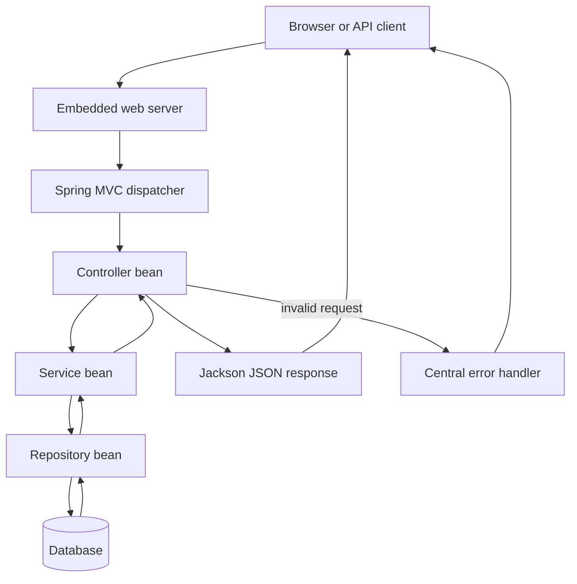
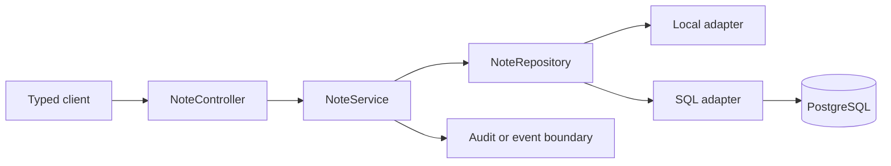

# Spring Boot From Zero to Production Basics

This is a standalone Spring Boot course for a learner who already knows a few
Java basics or is willing to use the Java guide beside it. It teaches how a
request enters Spring, how Spring creates objects, how rules reach a database,
and how a service stays testable and safe.

## 1. The one-minute picture

Spring Boot is a helpful manager for a Java application. It starts the program,
creates the objects that the program needs, connects routes, reads settings,
and starts a web server.



Spring does not remove the need for good design. It gives a framework for
making boundaries visible and wiring objects together.

## 2. Audience and prerequisites

You should understand Java variables, methods, classes, records, interfaces,
exceptions, and collections. You should also know basic HTTP and JSON. You do
not need to know every Spring annotation before starting.

Use Java 17 or newer, Gradle, a terminal, and fake data. Do not put passwords,
production database details, or personal records in the course project.

## 3. Outcomes

You will be able to:

- create a Spring Boot application and explain startup;
- explain the application context, bean, and dependency injection;
- write a controller, service, repository, and domain record;
- bind path, query, header, and JSON body values;
- validate input and return safe errors;
- select profiles and configuration without committing secrets;
- use JDBC or JPA at an intentional persistence boundary;
- define transaction scope and idempotency decisions;
- write unit, MockMvc, and integration tests;
- expose health and OpenAPI documentation safely;
- package and operate the service.

## 4. A-to-Z topic map

| Letter | Topic | Question to answer |
| --- | --- | --- |
| A | Application context and auto-configuration | What does Boot create at startup? |
| B | Beans and build files | Which objects are managed? |
| C | Controllers and configuration | Who owns HTTP and settings? |
| D | Dependency injection | How does a class receive its needs? |
| E | Exceptions and environment | How are failures and values handled? |
| F | Filters and profiles | Which request and configuration rules apply? |
| G | Gradle and gateways | How is the app built and entered? |
| H | HTTP and health | Is the process alive and ready? |
| I | Inversion of control | Why does Spring create collaborators? |
| J | JDBC and JSON | How do Java objects meet data and wire formats? |
| K | Kotlin awareness | What changes if a team uses Kotlin? |
| L | Logging and lifecycle | How do we see startup and shutdown? |
| M | MVC and migrations | How are web layers and schema changes organized? |
| N | `@RequestBody` and nulls | How is input bound and checked? |
| O | OpenAPI and observability | How can humans and tools understand the API? |
| P | Profiles, properties, and `ProblemDetail` | How do environments differ safely? |
| Q | Queries and queues | Which work is direct and which is later? |
| R | Repositories and REST | Where does persistence stop? |
| S | Services, security, and Spring context | Where do rules and permissions live? |
| T | Transactions and testing | Which work commits together? |
| U | URLs and untrusted input | What must be validated? |
| V | Validation and versioning | How do contracts evolve? |
| W | WebFlux versus MVC | Which web model fits the workload? |
| X | XML and external configuration | How do older systems integrate? |
| Y | YAML and your deployment | Where do runtime values come from? |
| Z | Zero-downtime thinking | What happens during a release? |

## 5. Recommended order

1. Generate a small Boot application.
2. Read its main class and startup logs.
3. Learn beans and constructor injection.
4. Add a typed REST route and response record.
5. Add request binding and validation.
6. Move rules into a service and storage behind a repository.
7. Add database access, transactions, and profiles.
8. Add centralized errors, tests, Actuator, and OpenAPI.
9. Add security boundaries and production configuration.
10. Package, deploy, observe, and review the failure paths.

## 6. Create the application

Use Spring Initializr or a version-pinned Gradle project. Typical dependencies
for a learning REST service are:

- Spring Web;
- Validation;
- Spring JDBC or Spring Data JPA;
- an H2 or PostgreSQL driver for the chosen environment;
- Actuator;
- a test starter;
- Spring Security only when authentication is part of the exercise.

A main class looks like this:

```java
@SpringBootApplication
public class StudyApiApplication {
    public static void main(String[] args) {
        SpringApplication.run(StudyApiApplication.class, args);
    }
}
```

`@SpringBootApplication` combines component scanning, auto-configuration, and
application configuration. The package of the main class should be above the
components you expect Spring to find.

## 7. Beans and dependency injection

A bean is an object managed by Spring. Constructor injection makes the required
collaborator visible:

```java
@Service
public class NoteService {
    private final NoteRepository repository;

    public NoteService(NoteRepository repository) {
        this.repository = repository;
    }
}
```

Useful stereotypes include:

| Annotation | Job |
| --- | --- |
| `@RestController` | handles HTTP and returns data |
| `@Service` | owns application or business operations |
| `@Repository` | marks data access code |
| `@Configuration` | declares setup and beans |
| `@RestControllerAdvice` | translates controller errors |
| `@Profile` | limits a bean to an environment |

Avoid field injection because it hides required dependencies and makes focused
tests harder to construct.

## 8. Build a REST route

```java
@RestController
@RequestMapping("/notes")
public class NoteController {
    private final NoteService service;

    public NoteController(NoteService service) {
        this.service = service;
    }

    @GetMapping("/{id}")
    public NoteResponse get(@PathVariable long id) {
        return service.get(id);
    }
}
```

The controller translates HTTP. It should not contain a raw SQL string or the
full business rule. `@GetMapping` means this method handles a `GET` request.

## 9. Bind and validate input

```java
public record NoteRequest(
        @NotBlank @Size(max = 120) String title,
        @NotBlank @Size(max = 20_000) String body) {
}
```

```java
@PostMapping
@ResponseStatus(HttpStatus.CREATED)
public NoteResponse create(@Valid @RequestBody NoteRequest request) {
    return service.create(request);
}
```

Common binders:

- `@PathVariable` reads a path part;
- `@RequestParam` reads a query parameter;
- `@RequestBody` maps JSON to a Java object;
- `@RequestHeader` reads a header;
- `@Valid` triggers bean validation.

Bean validation checks shape and simple limits. The service checks meaning,
permissions, and rules that depend on other data.

## 10. The service boundary

A service can normalize text, check ownership, choose a transaction, and call a
repository:

```java
@Service
public class NoteService {
    private final NoteRepository repository;

    public NoteResponse create(NoteRequest request) {
        String title = request.title().trim();
        if (title.isEmpty()) {
            throw new IllegalArgumentException("Title is required");
        }
        return repository.save(new Note(title, request.body())).toResponse();
    }
}
```

Keep this example small. In a real feature, test the service without starting
an HTTP server, then add an HTTP test for binding and status codes.

## 11. Repository and persistence choices

A repository interface protects the service from a particular storage engine:

```java
public interface NoteRepository {
    Optional<Note> findById(long id);
    Note save(Note note);
}
```

JDBC makes SQL visible and explicit. JPA maps objects to tables and can reduce
repetition, but it brings persistence-context behavior that must be understood.
Choose one intentionally. Do not put database entities directly into every
public response without considering coupling and data exposure.

Use parameterized SQL. Put schema changes in migrations. Store large documents
in private object storage and store metadata or a safe relative key in the
database.

## 12. Transactions and idempotency

A transaction groups changes that should commit together:

```text
begin transaction
  validate and resolve references
  write the note and audit row
commit
```

`@Transactional` belongs near the application operation whose changes must be
atomic. Do not assume that adding the annotation fixes a remote API call or a
second database.

If a client may retry a create, decide how duplicates are prevented. An
idempotency key, a unique business key, or an explicit duplicate response may
be required.

## 13. Configuration and profiles

Use environment-backed properties:

```properties
server.port=${SERVER_PORT:8080}
spring.profiles.active=${SPRING_PROFILES_ACTIVE:local}
```

Use profiles for meaningful environment differences, not for hiding random
constants. A local in-memory repository can help learning; a deployed profile
can use PostgreSQL. Both implementations must honor the same service contract.

Keep passwords, tokens, signing keys, and provider URLs out of source control.

## 14. Error handling

Centralize safe translation:

```java
@RestControllerAdvice
public class ApiExceptionHandler {
    @ExceptionHandler(NoteNotFoundException.class)
    ResponseEntity<ProblemDetail> notFound(NoteNotFoundException exception) {
        ProblemDetail problem = ProblemDetail.forStatus(HttpStatus.NOT_FOUND);
        problem.setTitle("Note not found");
        problem.setDetail("The requested note does not exist.");
        return ResponseEntity.status(HttpStatus.NOT_FOUND).body(problem);
    }
}
```

Do not include SQL, stack traces, provider messages, local paths, or secrets in
the response. Add a request ID and a stable error code when clients need
machine-readable behavior.

## 15. Actuator and OpenAPI

Actuator can expose health, metrics, and other operational endpoints. Expose
only what is needed and protect sensitive endpoints. Health should distinguish:

- liveness: the process is running;
- readiness: required dependencies can serve traffic.

OpenAPI and Swagger UI help humans explore a contract. They do not authenticate
the caller. Review schemas, error responses, pagination, and security schemes
before publishing documentation.

## 16. Spring Security concepts

Security is a boundary, not a hidden controller button. Learn these ideas:

- authentication identifies a principal;
- authorization checks a permission for a resource;
- a filter chain processes requests before the controller;
- passwords must be hashed with a suitable password algorithm;
- tokens and cookies have expiry, scope, and transport rules;
- CSRF matters for cookie-based browser writes;
- CORS controls which browser origins may call the API.

For a real service, authorize at the server for every read and write. Do not
trust a user ID sent in a request body as proof of identity.

## 17. Testing the application

Use layers of tests:

| Test | Proves |
| --- | --- |
| unit | service rule in isolation |
| `@WebMvcTest` or MockMvc | route binding, validation, status, error body |
| integration | context, database, and configuration work together |
| end-to-end | a real client can complete the workflow |

Write failure tests for malformed JSON, missing values, unknown IDs, duplicate
writes, permission failures, database outages, and timeouts. Coverage is a
signal, not a substitute for meaningful assertions.

## 18. MVC versus reactive web

Spring MVC is a good default for ordinary blocking JDBC applications. WebFlux
is useful for an end-to-end non-blocking workload when the team understands the
libraries and the operational trade-offs. Do not mix blocking database calls
into a reactive design without a deliberate boundary and capacity test.

## 19. Logging, metrics, and shutdown

Use structured logs with request IDs and safe fields. Never log passwords,
access tokens, full book contents, or sensitive personal data. Measure request
count, latency, error count, database pool use, and queue backlog.

On shutdown, stop accepting new work, finish bounded requests, close pools, and
exit. A deployment that kills a process in the middle of every write is not a
reliable deployment.

## 20. Packaging and deployment

A normal flow is:

```text
source -> Gradle checks -> tests -> packaged JAR or WAR -> deployment
       -> health check -> smoke test -> monitored release
```

Use environment configuration, repeatable builds, least-privilege database
accounts, migrations with rollback thinking, and a tested backup/restore plan.
A free host may sleep or have ephemeral disk; document those limits honestly.

## 21. Complete learning project

Build a `Study Notes API` with:

- `GET /notes` with bounded pagination;
- `GET /notes/{id}`;
- `POST /notes` with validation;
- `PUT /notes/{id}`;
- `DELETE /notes/{id}`;
- a repository interface and local implementation;
- a database implementation behind a profile;
- safe `400`, `404`, `409`, `503`, and generic `500` behavior;
- unit, MockMvc, and integration tests;
- health and OpenAPI documentation;
- a README with curl examples and failure behavior.



## 22. Practice labs

1. Explain every annotation in a small controller.
2. Add a request record with length constraints.
3. Write a service test for blank text and an unknown ID.
4. Add an in-memory repository and compare it with a SQL adapter contract.
5. Design a `ProblemDetail` response for a database outage.
6. Add a bounded list endpoint and explain its ordering.
7. Add a transaction for a note plus audit row.
8. Write a MockMvc test for invalid JSON.
9. Protect one route with a fake authenticated principal, then explain what
   must change for real authentication.
10. Package the application and perform a health smoke test.

## 23. Definition of done

- [ ] I can explain a bean, application context, and dependency injection.
- [ ] I can read a controller route and its input bindings.
- [ ] I can separate validation of shape from validation of meaning.
- [ ] I can keep SQL out of a controller.
- [ ] I can explain profiles and secret configuration.
- [ ] I can choose a transaction boundary.
- [ ] I can return safe, deliberate error responses.
- [ ] I can choose a unit, MockMvc, or integration test.
- [ ] I can protect health and documentation endpoints.
- [ ] I can describe a deploy, rollback, and backup check.

## 24. Commands and version note

Typical checks for a Gradle project are:

```bash
./gradlew test
./gradlew build
./gradlew bootRun
curl -i http://localhost:8080/actuator/health
```

Use a version-pinned Spring Boot release and Java 17 or newer. Spring Boot,
Spring Security, Gradle, and database drivers evolve; consult the official
reference for the exact version selected by the project.

## 25. Fresh-machine generation contract

This file is the complete generator specification for a new Spring Boot course.
A new agent may receive only this Markdown file. It must create the main
`Spring Boot` folder, every ordered lesson, an `images` folder, local SVG
diagrams, runnable examples, tests, and a source/version record. It must not
assume that the Java course, the old repository, or any image file exists.

### 25.1 Why Spring Boot exists

The agent must explain the history before teaching annotations. Plain Java can
run a server, but teams repeatedly had to configure servlet containers,
dependency wiring, JSON conversion, validation, database pools, health checks,
and packaging. Spring introduced an object container and reusable application
patterns. Spring Boot added conventions, auto-configuration, starters, an
embedded server, external configuration, and a production-friendly start.

The course must compare:

```text
plain Java -> manual object creation and server setup
Spring Framework -> dependency injection and application modules
Spring Boot -> conventions, auto-configuration, starters, embedded server
```

Explain the benefit and the cost. Boot reduces setup but can hide behavior;
the learner must inspect configuration, startup logs, and generated conditions.

### 25.2 Creation order and exact target tree

Create `Spring Boot`, then `Spring Boot/images`, then these files:

```text
Spring Boot/
|-- README.md
|-- 00-spring-boot-course-blueprint.md
|-- 01-learning-map.md
|-- 02-why-spring-and-spring-boot-history.md
|-- 03-create-a-versioned-boot-project.md
|-- 04-startup-application-context-and-auto-configuration.md
|-- 05-beans-component-scanning-and-lifecycle.md
|-- 06-dependency-injection-and-configuration.md
|-- 07-properties-profiles-and-secrets.md
|-- 08-spring-mvc-routing-and-controllers.md
|-- 09-request-binding-jackson-and-json.md
|-- 10-validation-and-boundary-rules.md
|-- 11-services-domain-rules-and-repositories.md
|-- 12-jdbc-jpa-and-persistence-choices.md
|-- 13-transactions-locking-and-idempotency.md
|-- 14-problem-detail-errors-and-exception-advice.md
|-- 15-spring-security-authentication-and-authorization.md
|-- 16-database-migrations-and-data-lifecycle.md
|-- 17-spring-mvc-versus-webflux.md
|-- 18-actuator-openapi-and-health.md
|-- 19-unit-web-and-mockmvc-testing.md
|-- 20-integration-tests-and-testcontainers.md
|-- 21-logging-metrics-tracing-and-shutdown.md
|-- 22-packaging-deployment-and-rollback.md
|-- 23-spring-architecture-patterns-and-trade-offs.md
|-- 24-capstone-study-notes-api.md
|-- 25-glossary-practice-and-checklist.md
`-- images/
    |-- spring-boot-startup-context.svg
    |-- spring-boot-bean-injection.svg
    |-- spring-mvc-request-flow.svg
    |-- spring-boot-config-profiles.svg
    |-- spring-validation-error-flow.svg
    |-- spring-repository-data-boundary.svg
    |-- spring-transaction-outbox.svg
    |-- spring-security-filter-boundary.svg
    |-- spring-actuator-observability.svg
    |-- spring-testing-layers.svg
    |-- spring-deployment-health.svg
    `-- spring-mvc-vs-webflux.svg
```

### 25.3 Lesson manifest and coverage

| File | Required scope |
| --- | --- |
| `01-learning-map.md` | Prerequisites, reading order, Java bridge, practice rhythm, and mastery checkpoints. |
| `02-why-spring-and-spring-boot-history.md` | Plain Java problems, Spring origins, inversion of control, Boot improvements, conventions, and costs. |
| `03-create-a-versioned-boot-project.md` | Initializr, Gradle/Maven comparison, Java compatibility, starters, dependency pinning, and first run. |
| `04-startup-application-context-and-auto-configuration.md` | Main class, application context, component scan, conditions, auto-configuration reports, and startup lifecycle. |
| `05-beans-component-scanning-and-lifecycle.md` | Bean definition, scopes, stereotypes, lifecycle callbacks, profiles, proxies, and avoiding hidden magic. |
| `06-dependency-injection-and-configuration.md` | Constructor injection, interfaces, configuration classes, `@Bean`, properties, and test replacement. |
| `07-properties-profiles-and-secrets.md` | YAML/properties, environment variables, profiles, config binding, secret managers, and configuration precedence. |
| `08-spring-mvc-routing-and-controllers.md` | DispatcherServlet, routes, path/query/header inputs, response status, content negotiation, and thin controllers. |
| `09-request-binding-jackson-and-json.md` | Jackson mapping, records, nulls, dates, unknown fields, media types, serialization, and response DTOs. |
| `10-validation-and-boundary-rules.md` | Bean validation, custom validators, shape versus business rules, limits, normalization, and authorization boundaries. |
| `11-services-domain-rules-and-repositories.md` | Application services, domain decisions, repository ports, adapters, transaction ownership, and dependency direction. |
| `12-jdbc-jpa-and-persistence-choices.md` | JDBC, JPA, entities, persistence context, lazy loading, SQL visibility, mapping, indexes, and when each fits. |
| `13-transactions-locking-and-idempotency.md` | `@Transactional`, isolation, locks, optimistic versioning, retries, duplicate writes, and outbox boundaries. |
| `14-problem-detail-errors-and-exception-advice.md` | `@RestControllerAdvice`, `ProblemDetail`, stable codes, safe details, validation errors, and provider failure mapping. |
| `15-spring-security-authentication-and-authorization.md` | Filter chain, principals, password hashing, sessions, tokens, OAuth concepts, CSRF, CORS, method/resource authorization. |
| `16-database-migrations-and-data-lifecycle.md` | Schema ownership, Flyway/Liquibase concepts, backward compatibility, soft delete, backups, and data retention. |
| `17-spring-mvc-versus-webflux.md` | Blocking versus reactive models, backpressure, driver compatibility, thread use, and selection trade-offs. |
| `18-actuator-openapi-and-health.md` | Liveness, readiness, metrics, safe actuator exposure, OpenAPI, Swagger, correlation IDs, and health dependencies. |
| `19-unit-web-and-mockmvc-testing.md` | JUnit, Mockito, slices, MockMvc, validation errors, security tests, fixtures, and focused failure assertions. |
| `20-integration-tests-and-testcontainers.md` | Full context, real database behavior, containers, migrations, isolation, cleanup, and contract tests. |
| `21-logging-metrics-tracing-and-shutdown.md` | Structured logs, MDC/request IDs, metrics, traces, pool health, graceful shutdown, and sensitive-data redaction. |
| `22-packaging-deployment-and-rollback.md` | JAR/WAR, containers, environment config, health smoke tests, rollout, rollback, backups, and provider limits. |
| `23-spring-architecture-patterns-and-trade-offs.md` | Layered monolith, modular monolith, hexagonal ports, events, cache, jobs, service split, and anti-patterns. |
| `24-capstone-study-notes-api.md` | Build CRUD with validation, repository, database, security, errors, tests, health, OpenAPI, and deployment. |
| `25-glossary-practice-and-checklist.md` | Define every annotation and framework word, give practice answers, and provide a final checklist. |
```

### 25.4 Diagram generation manifest

Create local SVG text with a 1200 by 700 `viewBox`, readable labels, arrow
markers, a legend, and no external image dependencies. Put Mermaid or plain
text source in the lesson as a fallback.

| SVG | Required picture | Lesson |
| --- | --- | --- |
| `spring-boot-startup-context.svg` | main class, context, component scan, auto-configuration, embedded server | `04` |
| `spring-boot-bean-injection.svg` | controller, service, repository beans and constructor injection | `05`, `06` |
| `spring-mvc-request-flow.svg` | HTTP request, DispatcherServlet, binding, controller, service, response | `08`, `09` |
| `spring-boot-config-profiles.svg` | properties, environment, profile selection, beans, and secret boundary | `07` |
| `spring-validation-error-flow.svg` | request body, validation, service rule, advice, and safe error | `10`, `14` |
| `spring-repository-data-boundary.svg` | DTO, service, repository, JDBC/JPA adapter, database | `11`, `12` |
| `spring-transaction-outbox.svg` | transaction, business row, outbox row, worker, and event | `13` |
| `spring-security-filter-boundary.svg` | request, security filters, identity, authorization, controller, denial | `15` |
| `spring-actuator-observability.svg` | health, metrics, logs, traces, dependency readiness, operator | `18`, `21` |
| `spring-testing-layers.svg` | unit, web slice, integration, Testcontainers, and end-to-end tests | `19`, `20` |
| `spring-deployment-health.svg` | build, artifact, environment, deploy, health, smoke, rollback | `22` |
| `spring-mvc-vs-webflux.svg` | blocking MVC path versus non-blocking reactive path and data driver choice | `17` |
```

### 25.5 Required lesson recipe

Every lesson must teach one idea in simple words before using its annotation.
It must explain the older problem, why Spring or Boot was introduced, what the
framework does at runtime, what it hides, and what it does not solve. Include a
complete small Java example, line-by-line explanation, HTTP or database
example, Mermaid flow, matching SVG, three use cases, a failure/security case,
trade-offs, a runnable lab, an incorrect example to debug, checkpoint
questions, and official source/version notes.

Use one continuing `Study Notes API` and one schedule example. Never teach a
controller without showing its service and repository boundary. Never teach a
security annotation without explaining the actual identity, authorization,
session/token, CSRF, CORS, and failure behavior.

### 25.6 Fresh-machine validation

Confirm all 27 Markdown paths and all 12 SVG paths exist, all links resolve,
all code fences are balanced, all A-to-Z concepts map to lessons, and no lesson
is a one-paragraph placeholder. Run `./gradlew test`, `./gradlew build`, and a
health/curl check when a project exists. Test invalid JSON, validation failure,
unauthorized access, missing records, duplicate writes, database outage,
transaction rollback, migration compatibility, and readiness failure.

Use official Spring Boot, Spring Framework, Spring Security, Spring Data, Spring
Actuator, Gradle, Java, OpenAPI, OWASP, and database documentation. Record the
version and date checked. If a tool or internet connection is unavailable,
report that limitation instead of claiming it passed.
