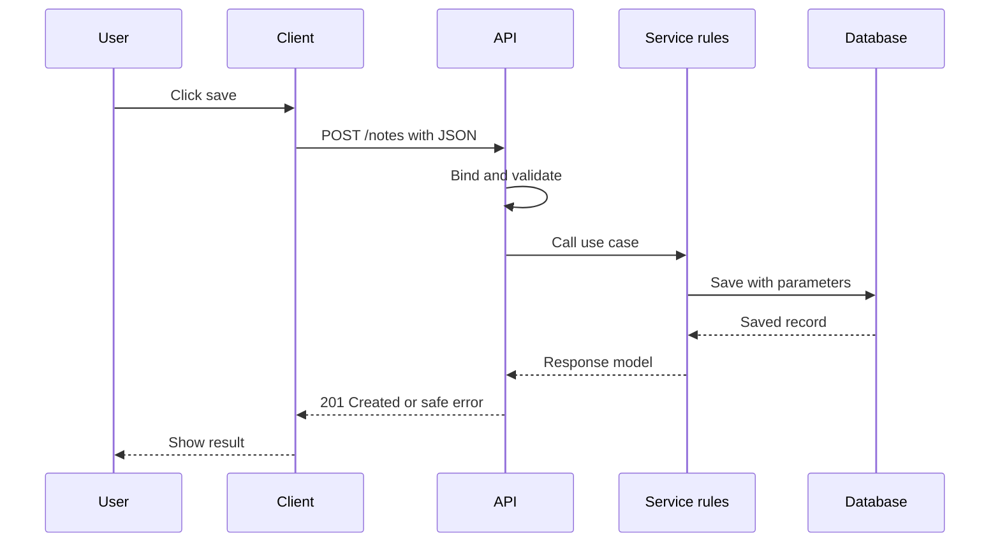

# API Design From First Request to Production Contract

This is a standalone course blueprint for learning how to design, build, test,
and operate HTTP APIs. It gathers the useful ideas already taught in the API
design lessons into one portable guide. It uses a small Study Notes or TM
Schedule API as the running example.

## 1. The one-minute picture

An API is a controlled doorway. A client asks for something using an agreed
language. The server checks the request, applies rules, reads or writes data,
and returns an answer.



The API contract is the menu. It tells a client which requests are allowed and
what answers mean. The implementation may change behind the contract.

## 2. Audience and outcomes

This course is for a beginner who can read JSON and wants to learn backend
architecture. By the end you can:

- explain clients, servers, routes, resources, and contracts;
- choose HTTP methods and status codes deliberately;
- design request and response JSON;
- validate input and return stable errors;
- separate controllers, services, repositories, and external adapters;
- use pagination, filtering, idempotency, authentication, and authorization;
- document an API with OpenAPI;
- test happy paths and failure paths;
- reason about storage, transactions, observability, and deployment.

## 3. A-to-Z topic map

| Letter | Topic | Beginner question |
| --- | --- | --- |
| A | API actors | Who asks, who answers, and who owns the data? |
| B | Bodies and boundaries | Which data may cross this doorway? |
| C | Contracts and CRUD | What promise does each operation make? |
| D | Data models | What is a resource and what is its identity? |
| E | Errors | How can a caller understand failure safely? |
| F | Filtering and flow | How does one request move through layers? |
| G | Gateways | Where do TLS, identity, and rate limits live? |
| H | HTTP | Which method, header, and status fit the action? |
| I | Idempotency | What happens if the client retries? |
| J | JSON | How do programs exchange structured values? |
| K | Keys | Which ID is stable, safe, and useful? |
| L | Layers | Which code owns HTTP, rules, and storage? |
| M | Methods | What does `GET`, `POST`, `PUT`, `PATCH`, or `DELETE` mean? |
| N | Naming | Can another person guess the route? |
| O | OpenAPI | Can a tool and a human read the contract? |
| P | Pagination and permissions | How do we bound lists and protect records? |
| Q | Query parameters | How do we search, sort, and filter? |
| R | REST | When is a resource-oriented design useful? |
| S | Security and status | Who may act and what happened? |
| T | Testing and transactions | How do we prove the promise? |
| U | URLs and untrusted input | Which strings need validation? |
| V | Versioning | How can the contract change without surprising clients? |
| W | Webhooks and writes | How do systems notify one another safely? |
| X | XML and external APIs | How do we adapt another format? |
| Y | YAML | How can an OpenAPI document stay readable? |
| Z | Zero-trust API | What must be checked at every boundary? |

## 4. Recommended learning order

1. Computer, network, URL, port, request, and response.
2. HTTP methods, headers, JSON, and status codes.
3. Resources, CRUD, naming, and REST trade-offs.
4. Request/response schemas, validation, and errors.
5. Layered architecture and a vertical slice.
6. SQL, transactions, pagination, and repository adapters.
7. Authentication, authorization, rate limits, and safe logs.
8. Testing, OpenAPI, versioning, webhooks, and idempotency.
9. Capacity, observability, deployment, and disaster recovery.
10. A complete capstone with a documented contract.

## 5. HTTP vocabulary

- A **URL** identifies where a request goes.
- A **method** tells the server what kind of action is requested.
- A **header** carries metadata such as content type or authorization.
- A **body** carries structured data when an operation needs it.
- A **status code** gives the broad result.
- A **resource** is a noun the API owns, such as a note, schedule, or user.

A typical contract might be:

```text
GET    /notes?topic=java&limit=20&offset=0
GET    /notes/{id}
POST   /notes
PUT    /notes/{id}
PATCH  /notes/{id}/completion
DELETE /notes/{id}
```

Use nouns in paths and put an action in the method when possible. A special
subresource such as `/completion` can be clearer than an invented verb route.

## 6. Request and response design

Define the shape before writing the handler:

```json
{
  "title": "HTTP basics",
  "body": "A request asks for work.",
  "topic": "API design"
}
```

```json
{
  "id": "note-123",
  "title": "HTTP basics",
  "body": "A request asks for work.",
  "topic": "API design",
  "createdAt": "2026-10-02T12:00:00Z"
}
```

Do not expose a database row just because it is already available. A public
response should contain fields the client needs, with names and meanings that
can survive a storage migration.

Choose required and optional fields deliberately. Define date format, timezone,
maximum lengths, null behavior, enum values, and unknown-field behavior.

## 7. Status codes and stable errors

Use a small consistent set:

| Status | Meaning |
| --- | --- |
| `200` | successful read or update |
| `201` | resource created |
| `202` | work accepted for later processing |
| `204` | successful action with no body |
| `400` | malformed or invalid request |
| `401` | caller is not authenticated |
| `403` | caller is authenticated but not allowed |
| `404` | resource is missing |
| `409` | conflict or duplicate |
| `413` | request is too large |
| `415` | unsupported media type |
| `429` | rate limit reached |
| `503` | dependency is temporarily unavailable |
| `500` | unexpected server failure |

A stable error can look like this:

```json
{
  "message": "The note was not found.",
  "code": "NOTE_NOT_FOUND",
  "requestId": "req-abc"
}
```

Do not return stack traces, SQL, local paths, provider responses, credentials,
or raw exception objects. Log safe diagnostic context on the server.

## 8. Validation and authorization

Validation asks whether the request has an acceptable shape and meaning.
Authorization asks whether this caller may perform the action on this record.
Both belong on the server.

Use bounded values:

- title length between 1 and 120;
- page size between 1 and 100;
- file size below a configured maximum;
- enum values from an allowlist;
- relative paths without absolute or traversal segments.

Do not trust an ID, category, username, or folder name because it came from a
browser. Normalize once, validate again at sensitive boundaries, and authorize
against the authoritative user and resource data.

## 9. Layered API architecture

```text
HTTP controller or route
        |
application service and business rules
        |
repository or integration port
        |
storage, database, queue, or external API
```

The controller translates HTTP. The service owns use-case rules. The repository
translates persistence. An adapter translates a provider's shape to the domain
shape. This makes a local fake possible without changing the contract.

Do not put SQL in a controller. Do not put browser-specific response formatting
in a database adapter. Do not add a layer unless it owns a real boundary.

## 10. CRUD and the complete write path

A create flow should be explainable step by step:

1. The client sends JSON and an idempotency key when duplicate creation matters.
2. The API checks authentication, content type, size, and shape.
3. The service normalizes values and checks business rules.
4. The transaction resolves references and writes the record.
5. An audit row or outbox entry is written if required.
6. The API returns the stable public resource.
7. The client refreshes or updates its cache.

A retry can happen after the database commits but before the client receives the
response. Choose a unique key or idempotency record when repeating the request
must not create a second resource.

## 11. Reads, filtering, and pagination

A list contract should define:

```text
limit: maximum number returned
cursor or offset: where to continue
sort: stable allowed field and direction
filters: bounded, documented values
metadata: next cursor or total only when affordable
```

Use a stable order such as `createdAt DESC, id DESC`. Query an indexed database
rather than loading every row into application memory. Do not return large
binary content inside a catalog list; return metadata and a safe read route.

## 12. Transactions and asynchronous work

Use a transaction when a set of changes must succeed or fail together. Do not
pretend a transaction across two independent providers is automatic.

Use a job and queue when work is slow, large, or retryable:

```text
POST /exports -> 202 {"jobId":"job-1"}
queue -> worker -> private file
GET /exports/job-1 -> status and result link
```

Workers need bounded retries, idempotent behavior, dead-letter handling,
backpressure, and visible failure. A queue is not a magic speed button.

## 13. Authentication, authorization, and limits

Authentication can use a secure session or a short-lived token. Authorization
must check the action and the resource. Rate limits protect login, expensive
queries, and public write routes.

Keep secrets server-side. Use HTTPS. Set intentional cookie flags. Validate
issuer, audience, expiry, and scopes for tokens. Keep CORS narrow. Add CSRF
protection for cookie-authenticated browser writes. Do not log tokens.

## 14. OpenAPI and versioning

An OpenAPI document should explain paths, parameters, schemas, security,
responses, and examples. Review it as a contract, not just generated decoration.

Prefer additive changes:

- add an optional response field;
- add a new route;
- accept a new enum only when old clients tolerate it;
- deprecate before removing.

Use a version boundary when a breaking change is unavoidable. Keep one selected
API implementation writing to a production database; experimental Node,
Python, Java, Go, or .NET versions should use isolated data or mocks.

## 15. Testing strategy

| Test | Purpose |
| --- | --- |
| unit | service rules and pure transformations |
| route/controller | binding, validation, status, and error body |
| integration | database, migrations, and provider adapters |
| contract | every implementation matches the public schema |
| end-to-end | a real client completes the workflow |
| security | unauthorized and traversal cases stay blocked |

Write failure tests for missing fields, bad types, oversized bodies, duplicate
writes, unknown resources, stale versions, provider outage, and rate limits.
A passing happy path does not prove a safe API.

## 16. Documentation and diagrams

For every endpoint document:

```text
method and path
purpose
authentication and authorization
query, path, header, and body fields
success response and status
failure statuses and stable codes
pagination or idempotency behavior
retry guidance
example curl and JSON
```

The API study set uses these diagram types: request lifecycle, layered
architecture, repository/profile selection, database relationships, read and
write sequences, error flow, testing pyramid, deployment flow, and architecture
decisions. Draw one picture for one question.

## 17. Capstone: Study Notes API

Build these endpoints:

```text
GET    /notes
GET    /notes/{id}
POST   /notes
PUT    /notes/{id}
PATCH  /notes/{id}/completion
DELETE /notes/{id}
```

Requirements:

- bounded pagination and stable ordering;
- title/body/topic validation;
- authenticated owner can read and change their notes;
- duplicate create behavior is explicit;
- missing note is a safe `404`;
- storage is behind a repository;
- database failure is a retryable `503`;
- OpenAPI and curl examples are included;
- unit, route, integration, and authorization tests exist.

## 18. Practice labs

1. Design a health endpoint and explain liveness versus readiness.
2. Turn a sentence into a resource and method table.
3. Write a request and response schema for a schedule row.
4. Design five stable error codes and choose statuses.
5. Add pagination to a list and explain the index it needs.
6. Draw a create sequence with a retry after an unknown response.
7. Decide whether an export is synchronous or a job.
8. Write an unauthorized test before writing the route.
9. Review a contract for leaked database fields and unbounded lists.
10. Run the capstone through a curl smoke test and record the result.

## 19. Definition of done

- [ ] I can explain a client, server, route, resource, contract, and adapter.
- [ ] I can choose methods and status codes for CRUD operations.
- [ ] I can design bounded, typed request and response schemas.
- [ ] I can separate shape validation from business and permission rules.
- [ ] I can return stable, safe error bodies.
- [ ] I can explain idempotency and transaction boundaries.
- [ ] I can document pagination and retries.
- [ ] I can name authentication and authorization owners.
- [ ] I can write tests for a failure path.
- [ ] I can explain how an operator observes and deploys the API.

## 20. Safe commands and version note

Use fake values and a local server:

```bash
curl -i http://localhost:8000/health
curl -i http://localhost:8000/notes
curl -i -X POST http://localhost:8000/notes \
  -H 'Content-Type: application/json' \
  -d '{"title":"HTTP basics","body":"A request asks for work.","topic":"api"}'
```

The exact framework, language, and OpenAPI tooling can change. The contract,
security, failure, and ownership questions remain the durable part of the
course.

## 21. Fresh-machine generation contract

This section changes the job of this file. This file is not only a summary for
a student. It is also a complete instruction sheet for a new agent that has no
old folders, no old lessons, no images, and no previous conversation.

The agent must read this one file and then create the whole `API designs`
course. It must not say that another computer has the missing source. It must
not create only a README or a few short notes. It must create every file in the
manifest below, in the listed order, with real teaching content.

### 21.1 Creation order

Perform these actions in order:

1. Create the main folder `API designs`.
2. Create `API designs/images`.
3. Create `README.md` and `00-START-HERE.md` first.
4. Create every numbered lesson in the manifest, including the intentional gap
  between `07` and `09`.
5. Create `INDEX-READING-CHECKLIST.md` and `TM-SCHEDULE-API-BY-API.md`.
6. Create every SVG in the image manifest as a local text-based SVG file.
7. Add relative links from the README and lessons to files that now exist.
8. Check the folder, Markdown fences, Mermaid blocks, SVG files, and lesson
  coverage before declaring the course complete.

Do not use an absolute home-directory path. The course must work when copied to
any `STUDY_CONTENT_DIR`. Preserve the space in `API designs` and preserve every
numeric prefix because the Study Library sorts names naturally.

### 21.2 Exact target tree

```text
API designs/
|-- README.md
|-- 00-START-HERE.md
|-- 01-computers-http-api-basics.md
|-- 02-rest-json-and-http.md
|-- 03-java-from-zero.md
|-- 04-java-oop-and-modern-java.md
|-- 05-spring-boot-from-zero.md
|-- 06-tm-schedule-architecture.md
|-- 07-folder-structure-and-domain-model.md
|-- 09-database-sql-jdbc-oracle.md
|-- 10-validation-errors-security.md
|-- 11-testing-apis.md
|-- 12-system-design-and-design-patterns.md
|-- 13-application-development-blueprint.md
|-- 14-practice-labs.md
|-- 15-glossary-and-cheat-sheets.md
|-- 16-api-design-course-blueprint.md
|-- INDEX-READING-CHECKLIST.md
|-- TM-SCHEDULE-API-BY-API.md
`-- images/
   |-- 01-api-request-lifecycle.svg
   |-- 02-tm-schedule-end-to-end-flow.svg
   |-- 03-layered-api-architecture.svg
   |-- 04-profile-and-repository-selection.svg
   |-- 05-oracle-database-relationships.svg
   |-- 06-read-schedule-sequence.svg
   |-- 07-create-schedule-row-sequence.svg
   |-- 08-error-handling-flow.svg
   |-- 09-testing-pyramid-for-this-application.svg
   |-- 10-build-and-deployment-flow.svg
   |-- 11-java-and-spring-boot-concept-map.svg
   `-- 12-system-design-decision-map.svg
```

The blueprint itself remains in the tree so a future agent can understand how
the course was made. It is not a substitute for any numbered lesson.

### 21.3 Lesson manifest and required coverage

Create each file with the stated job. A file may teach related ideas, but it
must not silently drop the listed idea.

| File | Required lesson job |
| --- | --- |
| `00-START-HERE.md` | Explain client, server, API, database, contract, the schedule example, study method, and first request. |
| `01-computers-http-api-basics.md` | Teach processes, ports, DNS, TCP/TLS, URLs, HTTP request/response, headers, latency, and status codes. |
| `02-rest-json-and-http.md` | Teach JSON values, serialization, methods, resource naming, CRUD, idempotency, content types, and REST trade-offs. |
| `03-java-from-zero.md` | Teach JDK/JVM, variables, types, methods, control flow, classes, records, collections, exceptions, and a first Java program. |
| `04-java-oop-and-modern-java.md` | Teach encapsulation, inheritance, interfaces, polymorphism, generics, lambdas, streams, dates, `Optional`, and modern Java choices. |
| `05-spring-boot-from-zero.md` | Teach Boot startup, beans, inversion of control, dependency injection, MVC, binding, validation, profiles, and error advice. |
| `06-tm-schedule-architecture.md` | Trace the real schedule application from browser click through controller, service, repository, memory/Oracle, and response. |
| `07-folder-structure-and-domain-model.md` | Explain package ownership, records, domain fields, legacy tables, repository ports, adapters, and dependency direction. |
| `09-database-sql-jdbc-oracle.md` | Teach relational tables, keys, joins, indexes, transactions, parameterized JDBC, mapping, Oracle boundaries, and migration choices. |
| `10-validation-errors-security.md` | Teach shape versus business validation, safe error bodies, authentication, authorization, secrets, SQL safety, CORS, and audit. |
| `11-testing-apis.md` | Teach unit, controller, integration, contract, browser, database, failure, coverage, fixtures, and test isolation. |
| `12-system-design-and-design-patterns.md` | Teach layered monolith, repository, adapter, cache, queue, event, outbox, CQRS, saga, strangler, and trade-offs. |
| `13-application-development-blueprint.md` | Teach problem statement, requirements, contract-first design, vertical slices, deployment, operations, ADRs, and definition of done. |
| `14-practice-labs.md` | Provide ordered labs from curl and Java basics through a tested endpoint and a safe capstone. |
| `15-glossary-and-cheat-sheets.md` | Define every important word, command, method, status, annotation, test type, and design question. |
| `INDEX-READING-CHECKLIST.md` | Provide checkboxes for every lesson, a prerequisite map, review schedule, and mastery questions. |
| `TM-SCHEDULE-API-BY-API.md` | Document every schedule endpoint with method, path, inputs, output, errors, storage path, tests, and curl example. |
```

The missing number `08` is intentional because the original reading order used
it as a future space. Do not create a fake empty file to make the numbers look
continuous.

### 21.4 Diagram and image generation manifest

The new agent must create these images locally. They are not downloaded from
the internet and they must not contain private screenshots. Each SVG is a text
file with a `viewBox`, a title, readable labels, arrows, and a short caption.
Use a consistent 1200 by 700 canvas, high contrast, large text, and simple
rectangles, arrows, and warning colors. Put the same Mermaid source in the
lesson so the idea remains readable if an SVG cannot load.

| SVG | Create this picture | Insert it in |
| --- | --- | --- |
| `01-api-request-lifecycle.svg` | client, DNS/TLS, API route, validation, service, database, response, and error branch | `01` |
| `02-tm-schedule-end-to-end-flow.svg` | a schedule click traveling through React, REST, Spring, service, repository, and Oracle | `00`, `06` |
| `03-layered-api-architecture.svg` | controller, application rules, repository port, memory adapter, and SQL adapter | `05`, `07` |
| `04-profile-and-repository-selection.svg` | local profile selecting memory and deployed profile selecting JDBC | `06`, `07` |
| `05-oracle-database-relationships.svg` | store, group, employee, schedule row, and status relationships | `09` |
| `06-read-schedule-sequence.svg` | read request sequence with query parameters and response mapping | `06`, `TM-SCHEDULE-API-BY-API` |
| `07-create-schedule-row-sequence.svg` | validation, transaction, insert, generated ID, and `201` response | `09`, `13` |
| `08-error-handling-flow.svg` | malformed input, business error, database outage, and generic safe error paths | `10` |
| `09-testing-pyramid-for-this-application.svg` | unit tests at the base, HTTP tests, integration tests, and browser tests at the top | `11` |
| `10-build-and-deployment-flow.svg` | source, Gradle checks, artifact, environment, health check, smoke test, and rollback | `13` |
| `11-java-and-spring-boot-concept-map.svg` | Java language below Spring Boot, MVC, validation, data, and tests | `03`, `05` |
| `12-system-design-decision-map.svg` | requirements leading to monolith, cache, queue, event, or service split | `12`, `13` |
```

If the new agent cannot render SVG immediately, it must still create the SVG
source and retain the Mermaid block. An image is an explanation, not decoration.

### 21.5 Required recipe for every lesson file

Every lesson, including the README and glossary, must use this structure:

```text
# Number - Plain title

## The plain-language picture
Explain the idea with a familiar object or activity.

## Words to know
Define each new technical word before using it again.

## Why this idea was invented
Name the earlier problem or older approach and the improvement this idea brings.

## How it works step by step
Show inputs, decisions, storage, outputs, and failure branches.

## Real application example
Use the Study Notes API or TM Schedule with fake values.

## Code, HTTP, JSON, SQL, or configuration example
Use a complete small example and explain each important line.

## Mermaid flowchart or sequence diagram
Show one question with labeled arrows.

## Matching SVG reference
Link only to the manifest image that the agent actually created.

## Real-time use cases
Give at least three: one small, one team-sized, and one production-sized.

## Failure, security, and trade-offs
Explain what can fail, what the user sees, what must be logged, and why another choice may be better.

## Practice
Give a runnable task, a failure task, and an explain-it-aloud question.

## Checkpoint
List questions that prove the student can use the idea without copying.
```

Do not write placeholder sentences such as "add details here". A lesson is
complete only when a beginner can read it without another repository and can
run or reason about at least one example. Explain why Java/Spring/SQL was
chosen, what it replaced or improved, and when not to use it.

### 21.6 Source and freshness rules

Use official documentation as the primary source: HTTP specifications and MDN,
Java SE and JDK documentation, Spring Framework and Spring Boot reference
documentation, JDBC/Oracle documentation, OpenAPI, OWASP API Security, and
the official Gradle documentation. Use RFCs or standards for protocol claims.
Record the date and versions checked in each README. If internet access is not
available, say so and mark provider limits as assumptions; never invent a
quote or claim that a page was checked.

The course must distinguish stable concepts from version-specific annotations
or commands. A version change may update a code sample, but it must not erase
the reason, trade-off, security boundary, or failure behavior.

### 21.7 Fresh-machine validation

Before replying that the course is complete, the new agent must confirm:

- every path in the target tree exists;
- every lesson has at least one code or data example;
- every lesson has a Mermaid diagram or a clear text flow;
- every diagram in the manifest exists and has readable labels;
- every image link points to an existing SVG;
- all internal Markdown links resolve;
- the A-to-Z table maps to lessons;
- the API-by-API endpoint table is complete;
- examples use fake values and no secrets;
- Java/Gradle checks run when those files exist;
- the learner can follow the numbered order from `00` to the final checklist.

Report missing runtimes or unrendered Mermaid honestly. Do not reduce the
lesson count or delete a diagram merely to make a check pass.
