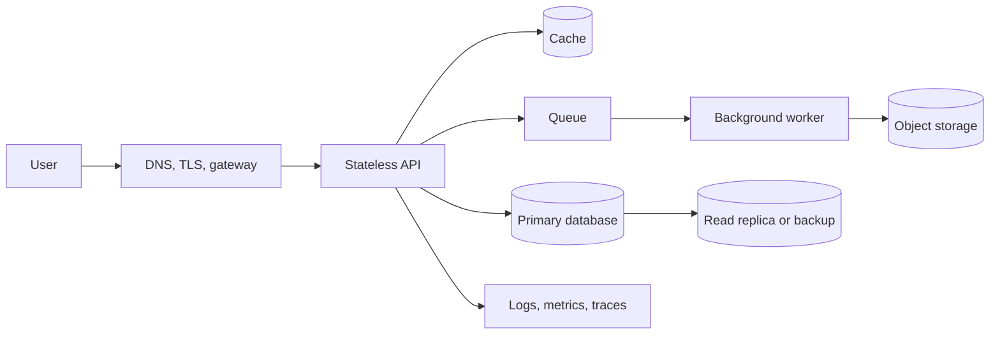
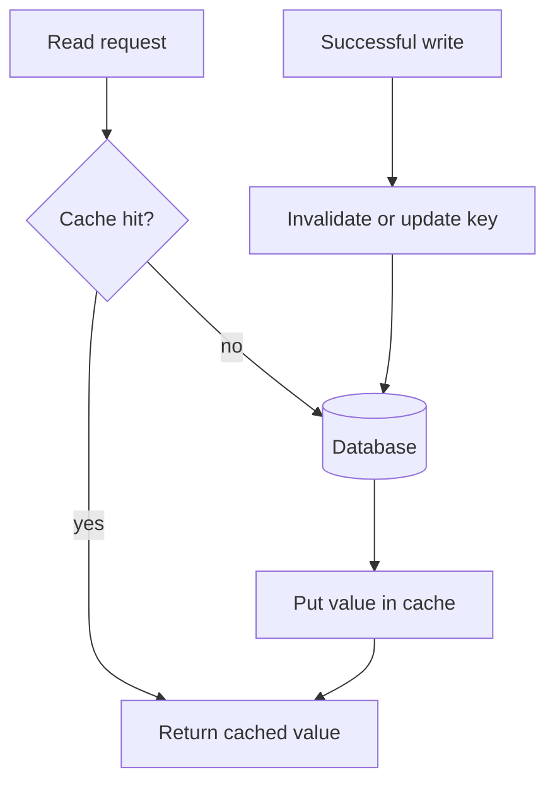

# System Design From a Small Idea to a Reliable Service

This is a standalone system-design course blueprint. It teaches how to turn a
user problem into a system that is useful, understandable, fast enough,
reliable enough, secure, observable, and affordable. It uses a small Study
Library or schedule API as a running example.

## 1. The one-minute picture

System design is planning a digital shop. You decide who enters, what the
workers do, where the orders live, how requests travel, what happens when a
worker is sick, and how the shop grows.



A good design is not the one with the most boxes. It is the smallest design
that meets the real requirements and can be operated by real people.

## 2. Audience and outcomes

This course is for a beginner who can read a simple API description. By the
end you can:

- separate functional and quality requirements;
- estimate traffic, storage, bandwidth, latency, and availability;
- draw a request and data flow;
- choose APIs, databases, caches, queues, workers, and replicas deliberately;
- reason about consistency, transactions, retries, and idempotency;
- design security, observability, deployment, backups, and recovery;
- review trade-offs and explain a design in an interview or design document.

## 3. A-to-Z topic map

| Letter | Topic | Question to answer |
| --- | --- | --- |
| A | Availability and architecture | How often must the service work? |
| B | Bottlenecks and backups | What fills first, and how do we recover? |
| C | Capacity and caching | How much work and reuse exist? |
| D | Data modeling and disaster recovery | What is authoritative and how is it restored? |
| E | Events and estimation | What can happen later, and what are the numbers? |
| F | Failure modes and fan-out | What breaks and how many dependencies are called? |
| G | Gateways and graceful degradation | Where is the edge and what can be reduced? |
| H | Health and horizontal scaling | How do we detect and add instances? |
| I | Indexes and idempotency | How do reads stay fast and writes safe? |
| J | Jobs | Which work belongs to a worker? |
| K | Keys and queues | What identifies data and waits for capacity? |
| L | Latency and load balancing | How is time divided and traffic shared? |
| M | Metrics and multi-region | What do we measure and where can the service run? |
| N | Networking and normalization | How do requests travel and data stay clear? |
| O | Observability and ownership | Who sees a failure and who fixes it? |
| P | Partitioning and privacy | How can data be split and protected? |
| Q | Queues and quotas | How do we control bursts and expensive work? |
| R | Reliability and replication | How do we survive a failed component? |
| S | Security, sharding, and consistency | What is protected and what can be stale? |
| T | Transactions and timeouts | What commits together and how long may it wait? |
| U | Users and use cases | What does a person need to do? |
| V | Versioning and validation | How do components change safely? |
| W | Workers and web requests | Which path is synchronous? |
| X | eXternal dependencies | What happens when another service is slow? |
| Y | Yield and recovery objectives | When should the system shed work? |
| Z | Zero-trust boundaries | What must be checked at every hop? |

## 4. The design method

Use this order for every problem:

1. Name the users and their jobs.
2. Write functional requirements as actions.
3. Write non-functional requirements as measurable promises.
4. State assumptions about traffic, data, regions, and budget.
5. Estimate requests per second, storage, and bandwidth.
6. Draw the simplest request and write flow.
7. Choose data stores and ownership.
8. Add caches, queues, replicas, or partitions only when a requirement needs
   them.
9. Draw failure paths, security boundaries, and observability.
10. Choose deployment, backup, restore, and rollback steps.
11. List trade-offs and the evidence that would change the design.

## 5. Requirements and capacity

Functional requirements say what people can do. Quality requirements say how
well the system must do it.

Example:

```text
functional: a manager reads a schedule for one store and date
quality: normal reads finish under 300 ms at the 95th percentile
quality: committed writes are not lost
quality: a database outage is visible instead of an empty success
```

Use simple arithmetic:

```text
average RPS = requests per day / 86,400
peak RPS = average RPS * peak multiplier
storage per year = objects per day * average object size * 365
bandwidth = requests per second * bytes per response
```

State whether a number is an estimate. The point is to find the first likely
bottleneck, not to pretend that a guess is a measurement.

## 6. Networking and request flow

A browser request may cross DNS, TLS, a gateway, a load balancer, an API,
cache, database, and external service. Every network hop can be delayed,
retried, or disconnected.

Set a timeout for every remote call. Do not let a request wait forever. Track a
correlation ID across services. Keep internal databases private and expose only
the intended API or media delivery boundary.

## 7. Data modeling and databases

Start with nouns and questions:

```text
User, Note, Topic, Bookmark, Progress
Who owns a note?
Which fields are required?
Which reads need an index?
Which changes must commit together?
```

Relational databases are a good default for metadata, relationships, constraints,
transactions, and stable queries. Document stores, key-value stores, search
indexes, and object storage may solve different measured problems.

Keep large PDFs, EPUBs, images, and videos in private object storage. Store
metadata, checksums, size, ownership, and a safe relative key in the database.
Do not put a 500 MB binary in a row just because the database accepts a blob.

## 8. Indexes, transactions, and consistency

An index helps the database find rows without reading everything. It costs
storage and write work, so choose it from real queries.

A transaction groups changes that must be all-or-nothing. Strong consistency is
useful when a user must see a committed write immediately. Eventual consistency
is acceptable when a notification or search index may catch up later.

Ask:

- Which store is authoritative?
- Can a replica be behind?
- What happens if a client retries a write?
- Which state transition is legal?
- How will two writers avoid overwriting each other?

## 9. Caches

A cache stores a result closer to the caller. Cache-aside is a common pattern:



A cache key must contain every value that changes the result. Decide freshness,
invalidation, eviction, and what happens when the cache is unavailable. Measure
before adding a cache to hide a slow query.

## 10. Queues, events, and workers

Use a queue when a user should not wait for slow work:

```text
POST /export -> 202 + job ID
producer -> queue -> worker -> object storage
GET /export/{jobId} -> progress or result
```

At-least-once delivery means a worker may see the same message twice. Make the
operation idempotent. Add retries with limits, dead letters, backpressure,
visibility into queue age, and a recovery process.

An event says something happened. A command asks someone to do something. Keep
that distinction clear.

## 11. Scaling and partitioning

Vertical scaling uses a bigger machine. Horizontal scaling uses more instances.
Start with the bottleneck:

- CPU-bound work may need more CPU or workers;
- slow reads may need indexes, a cache, or read replicas;
- large files need object storage and range reads;
- bursts may need a queue and backpressure;
- a hot key may need a different partition strategy.

Partitioning or sharding splits data. It can improve scale but makes joins,
rebalancing, transactions, and operations harder. Replication improves read
capacity or availability but introduces lag and failover decisions.

## 12. Reliability and failure handling

Every dependency can be slow, unavailable, inconsistent, or wrong. Use:

- bounded timeouts;
- retries only for safe or idempotent work;
- exponential backoff with jitter;
- circuit breaking for repeatedly failing remote calls;
- bulkheads so one workload cannot consume all resources;
- graceful degradation when a secondary feature is unavailable;
- durable queues and dead-letter handling;
- clear health and readiness checks.

Do not retry a payment or create blindly. Decide how a caller learns whether the
first write committed.

## 13. Security and privacy

Security boundaries include the browser, gateway, API, database, object store,
worker, and external provider. At each boundary ask who is calling, what they
may do, and what data may cross.

Use HTTPS, least-privilege accounts, secret managers, parameterized queries,
input limits, safe file paths, authorization on every resource, secure cookies
or tokens, audit events for sensitive writes, and dependency updates.

Do not log passwords, tokens, full private documents, or raw local paths. A
private network reduces exposure but does not replace API authorization.

## 14. Observability and operations

The three familiar signals are:

- logs: what happened;
- metrics: how often and how much;
- traces: where time went across boundaries.

Define an owner, alert threshold, health route, rollback, backup, restore drill,
retention policy, and incident note before calling a service complete.

Measure p50, p95, and p99 latency when tail behavior matters. A fast average can
hide a slow experience for one user in twenty.

## 15. Deployment and disaster recovery

A release path should be repeatable:

```text
source -> checks -> build artifact -> deploy -> health check
       -> smoke test -> monitor -> rollback if needed
```

A backup is not proven until it has been restored. Use a 3-2-1 approach when
data matters: live copy, separate local copy, and encrypted off-site copy. Define
RPO, the amount of data you can lose, and RTO, how long recovery may take.

Keep databases and private object storage off the public internet. A tunnel or
reverse proxy should expose only the intended web/API surface.

## 16. Architecture patterns

| Problem | Starting design | Add when evidence requires it |
| --- | --- | --- |
| small CRUD product | layered modular monolith | indexes, audit, measured cache |
| repeated reads | indexed API | cache-aside and invalidation |
| long export | job record and worker | queue, retries, dead letters |
| many reactions to a write | transaction plus outbox | event consumers |
| legacy migration | strangler adapter | route-by-route replacement |
| payment workflow | state machine and idempotency | saga or provider boundary |
| large text search | database search | dedicated search index |
| multiple teams | modular monolith | service split by ownership |

Microservices are a deployment and ownership choice, not a synonym for quality.
Start with a modular monolith when the product is small and the boundaries are
still changing.

## 17. End-to-end case study

For a Study Library:

```text
browser -> HTTPS edge -> API
API -> PostgreSQL metadata
API -> private object storage for PDFs and images
API -> queue for ebook extraction or indexing
worker -> object storage and catalog metadata
signals -> logs, metrics, traces, alerts
```

The API must not return an empty library when the database or storage provider is
unavailable. It should return a retryable error and preserve the last known
catalog only when its freshness is visible. Document routes and media routes
should remain separate, and hosted media requires lawful rights and signed
access.

## 18. Design review method

Present a design in this order:

1. users and requirements;
2. assumptions and capacity numbers;
3. high-level boxes and ownership;
4. read path;
5. write path;
6. data model and consistency;
7. bottleneck and scale plan;
8. failure handling;
9. security and privacy;
10. observability, deployment, backup, and trade-offs.

Explain one rejected alternative. A reviewer learns more from the reason for a
choice than from a list of fashionable components.

## 19. Practice labs

1. Design a lunch-menu app for one classroom and reject unnecessary services.
2. Estimate peak RPS and storage for a note library.
3. Draw a browser-to-database request with a timeout path.
4. Choose a relational table, cache key, and queue boundary for a schedule.
5. Design a retry-safe export job.
6. List three failures and the user-visible result for each.
7. Choose a backup plan and state RPO/RTO.
8. Review a system for leaked secrets and unbounded input.
9. Compare a modular monolith with two microservices and name the cost.
10. Present the Study Library design in ten minutes using the review order.

## 20. Definition of done

- [ ] I start with users and requirements instead of a favorite technology.
- [ ] I can estimate traffic, storage, bandwidth, and latency.
- [ ] I can explain the owner and purpose of every major component.
- [ ] I can choose database, cache, queue, and object storage boundaries.
- [ ] I can explain consistency, transactions, retries, and idempotency.
- [ ] I can draw a failure path and a recovery path.
- [ ] I can define security boundaries and safe logs.
- [ ] I can name useful metrics and a health check.
- [ ] I can explain deployment, backup, restore, and rollback.
- [ ] I can state a trade-off and the evidence that would change it.

## 21. Safe commands and version note

Use small synthetic numbers and local services when practicing. Useful checks
may include:

```bash
curl -i http://localhost:4445/api/health
curl -i http://localhost:4445/api/library
```

Do not claim a capacity estimate is a production measurement. Cloud limits,
database versions, provider pricing, and architecture needs change. Record the
assumptions and revisit them when real traffic or failure data arrives.

## 21. Fresh-machine generation contract

This file is a complete generator specification for a new agent. The agent may
receive only this Markdown file. It must create the full `System Design`
course, an `images` folder, local SVG diagrams, ordered lessons, examples,
practice work, and coverage checks without using the old computer.

### 21.1 Creation order

1. Create `System Design` and `System Design/images`.
2. Create `README.md` and `00-learning-map.md`.
3. Create lessons `01` through `19` in numeric order.
4. Create `20-system-design-course-blueprint.md`.
5. Create every SVG from the image manifest as a text-based local asset.
6. Link only to files that exist and keep a Mermaid or text fallback beside
   every important diagram.
7. Run the coverage, link, fence, diagram, and example checks below.

### 21.2 Exact target tree

```text
System Design/
|-- README.md
|-- 00-learning-map.md
|-- 01-system-design-foundations.md
|-- 02-requirements-and-capacity-estimation.md
|-- 03-architecture-building-blocks.md
|-- 04-networking-and-web-requests.md
|-- 05-apis-and-contracts.md
|-- 06-data-modeling-and-databases.md
|-- 07-caching.md
|-- 08-queues-events-and-background-work.md
|-- 09-consistency-transactions-and-distributed-data.md
|-- 10-scaling-and-partitioning.md
|-- 11-reliability-and-failure-handling.md
|-- 12-security-and-privacy.md
|-- 13-observability-and-operations.md
|-- 14-deployment-cloud-and-disaster-recovery.md
|-- 15-common-architecture-patterns.md
|-- 16-design-interview-and-review-method.md
|-- 17-tm-schedule-end-to-end-case-study.md
|-- 18-application-architecture-cookbook-and-decision-guide.md
|-- 19-glossary-checklists-and-practice-answers.md
|-- 20-system-design-course-blueprint.md
`-- images/
    |-- system-design-api-layered-architecture.svg
    |-- system-design-architecture-decision-tree.svg
    |-- system-design-async-job-queue-flow.svg
    |-- system-design-big-picture-request-flow.svg
    |-- system-design-browser-to-api-request.svg
    |-- system-design-cache-aside-flow.svg
    |-- system-design-database-choice-map.svg
    |-- system-design-deployment-and-disaster-recovery.svg
    |-- system-design-observability-three-pillars.svg
    |-- system-design-reliable-request-flow.svg
    |-- system-design-requirements-to-architecture.svg
    |-- system-design-security-boundaries.svg
    |-- system-design-sharding-and-replication.svg
    `-- system-design-tm-schedule-e2e.svg
```

### 21.3 Lesson manifest

Create each lesson with this minimum scope:

| File | Required scope |
| --- | --- |
| `00-learning-map.md` | Explain the five design questions, learning ladder, weekly routine, notebook, and mastery checkpoints. |
| `01-system-design-foundations.md` | Define system, component, boundary, request, state, ownership, and simple versus complex design. |
| `02-requirements-and-capacity-estimation.md` | Teach actors, functional and quality requirements, assumptions, RPS, storage, bandwidth, latency, availability, and estimates. |
| `03-architecture-building-blocks.md` | Teach clients, APIs, services, databases, caches, queues, workers, gateways, load balancers, and object storage. |
| `04-networking-and-web-requests.md` | Teach DNS, TCP, TLS, HTTP, proxies, connection pools, timeouts, retries, and request fan-out. |
| `05-apis-and-contracts.md` | Teach resources, schemas, status codes, pagination, versioning, idempotency, auth, OpenAPI, and contract tests. |
| `06-data-modeling-and-databases.md` | Teach relational modeling, keys, constraints, indexes, SQL, NoSQL, object storage, migrations, and ownership. |
| `07-caching.md` | Teach cache-aside, TTL, invalidation, stampede, freshness, keys, eviction, and failure behavior. |
| `08-queues-events-and-background-work.md` | Teach producer, queue, worker, event, command, retries, dead letters, backpressure, and job status. |
| `09-consistency-transactions-and-distributed-data.md` | Teach ACID, isolation, replicas, lag, strong/eventual consistency, conflicts, and distributed transaction limits. |
| `10-scaling-and-partitioning.md` | Teach vertical/horizontal scaling, bottlenecks, replication, partitioning, sharding, hot keys, and autoscaling. |
| `11-reliability-and-failure-handling.md` | Teach timeouts, retry safety, backoff, jitter, circuit breakers, bulkheads, graceful degradation, and recovery. |
| `12-security-and-privacy.md` | Teach threats, identity, authorization, secrets, encryption, least privilege, data classification, and safe logs. |
| `13-observability-and-operations.md` | Teach logs, metrics, traces, correlation IDs, SLOs, alerts, runbooks, ownership, and incident review. |
| `14-deployment-cloud-and-disaster-recovery.md` | Teach artifacts, environments, containers, regions, backups, RPO, RTO, restore drills, rollback, and provider limits. |
| `15-common-architecture-patterns.md` | Compare modular monolith, microservices, event-driven, CQRS, outbox, saga, strangler, and serverless. |
| `16-design-interview-and-review-method.md` | Teach how to present requirements, numbers, flows, bottlenecks, trade-offs, and rejected alternatives. |
| `17-tm-schedule-end-to-end-case-study.md` | Trace the schedule system from UI through API, database, tests, deployment, failure, and operations. |
| `18-application-architecture-cookbook-and-decision-guide.md` | Apply the method to CRUD, catalog, upload, chat, payments, notifications, analytics, search, SaaS, and offline apps. |
| `19-glossary-checklists-and-practice-answers.md` | Define every system-design term and provide review checklists and worked practice answers. |
```

### 21.4 Diagram generation manifest

Create each SVG with a 1200 by 700 `viewBox`, a title, large readable labels,
arrow markers, a legend, and no external image or font dependency. Every SVG
must have an equivalent Mermaid or text diagram in its lesson.

| SVG | Required picture | Main lesson |
| --- | --- | --- |
| `system-design-big-picture-request-flow.svg` | user, edge, API, data, queue, worker, and signals | `01` |
| `system-design-requirements-to-architecture.svg` | user jobs to requirements, numbers, components, and trade-offs | `02` |
| `system-design-browser-to-api-request.svg` | DNS, TLS, gateway, load balancer, API, cache, and database | `04` |
| `system-design-api-layered-architecture.svg` | presentation, application, domain, persistence, and infrastructure | `03`, `05` |
| `system-design-database-choice-map.svg` | workload questions leading to relational, key-value, document, search, or object storage | `06` |
| `system-design-cache-aside-flow.svg` | cache hit, miss, database read, fill, write, and invalidation | `07` |
| `system-design-async-job-queue-flow.svg` | command, queue, worker, progress, result, retry, and dead letter | `08` |
| `system-design-reliable-request-flow.svg` | timeout, safe retry, backoff, circuit breaker, and fallback | `11` |
| `system-design-sharding-and-replication.svg` | primary, replicas, partition keys, routing, lag, and failover | `09`, `10` |
| `system-design-security-boundaries.svg` | browser, gateway, API, database, object store, worker, and trust checks | `12` |
| `system-design-observability-three-pillars.svg` | request ID producing logs, metrics, traces, alerts, and an incident | `13` |
| `system-design-deployment-and-disaster-recovery.svg` | build, deploy, health, backup, restore, region failure, and rollback | `14` |
| `system-design-tm-schedule-e2e.svg` | complete schedule read/write path and failure branches | `17` |
| `system-design-architecture-decision-tree.svg` | requirement questions leading to the smallest suitable architecture | `15`, `18` |
```

### 21.5 Required lesson recipe

Every lesson must include a plain-language analogy, definitions, the older problem
that caused the idea, why the chosen design helps, a step-by-step flow, a
real-time example with numbers, a code/API/data example, a Mermaid diagram,
the matching SVG, at least three use cases, failure and security behavior,
trade-offs, a practice lab, and checkpoint questions.

For every technology choice, explain why it exists, what it replaced or
improved, its costs, when not to use it, and what measurement would justify it.
For every number, label it as an assumption or measurement. For every
dependency, name its owner, timeout, failure result, and recovery plan.

### 21.6 Fresh-machine validation and sources

Verify all 22 Markdown paths and all 14 SVG paths, all internal links, all
Mermaid blocks, all A-to-Z mappings, and all case-study references. Include
tests for overload, stale cache, duplicate messages, replica lag, database
failure, secret leakage, timeout, retry, backup restore, and rollback.

Use official HTTP, DNS, database, cloud-provider, OpenAPI, OWASP, and
observability documentation as primary sources. Record versions and dates. If
internet access is unavailable, label assumptions instead of pretending every
provider detail was checked. The final response must list created files and
actual validation results.
