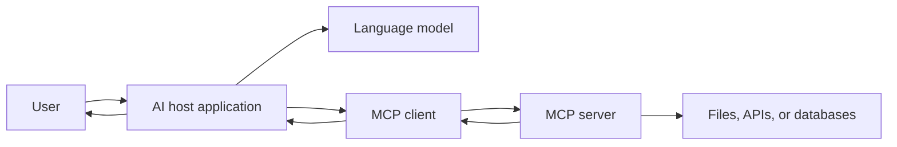
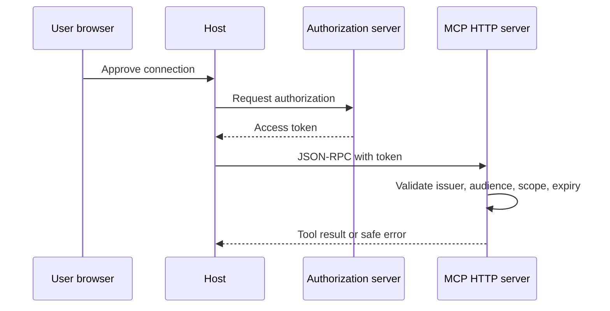

# MCP Servers From First Principles to Safe Operations

This standalone guide teaches the Model Context Protocol, usually shortened to
MCP. If someone says NCP in this study collection, check the spelling first;
the existing course is about MCP. The goal is to understand the roles, messages,
state, permissions, and failure paths well enough to build a small server safely.

## 1. The one-minute picture

Imagine a child asks a librarian, "Find my science book and tell me whether it
is available."

- the child is the user;
- the librarian desk is the host application;
- the helper at the desk is an MCP client;
- the catalog program is an MCP server;
- the book record is a resource;
- "search" is a tool;
- a prepared question is a prompt.

MCP is a shared language that lets an AI host discover data and actions from
another program. The MCP server is not the model and is not automatically the
database. It is a controlled adapter.



## 2. Version note

The companion notes were checked against documentation available on 2026-09-22
for protocol revision `2026-07-28`. Always check the official specification and
SDK documentation again before implementation.

There are two ideas to keep separate:

- modern MCP carries protocol metadata with requests and is designed to avoid
  assuming that an old connection message supplies meaning for every request;
- older MCP deployments use an `initialize` handshake, negotiated capabilities,
  and sometimes connection or session state.

"Stateless" does not mean that an application cannot have a user, database,
workflow, or task state. It means the wire protocol must make its needed
context clear.

## 3. Outcomes

You will be able to:

- explain host, model, client, server, user, and downstream provider roles;
- read JSON-RPC requests, responses, notifications, and IDs;
- explain lifecycle, capabilities, and version compatibility;
- choose stdio or Streamable HTTP;
- design tools, resources, prompts, elicitation, roots, and sampling boundaries;
- handle progress, cancellation, subscriptions, and long-running tasks;
- separate MCP authentication from downstream authorization;
- protect secrets, files, and destructive actions;
- test errors, observe behavior, and deploy a server responsibly.

## 4. A-to-Z topic map

| Letter | Topic | Question to answer |
| --- | --- | --- |
| A | Authorization and approval | Who may use which capability? |
| B | Boundaries | Where can data or actions cross? |
| C | Capabilities and cancellation | What can each side do, and how does work stop? |
| D | Discovery and data | How do clients learn what exists? |
| E | Elicitation and errors | How does the server ask for safe input and report failure? |
| F | Features | What can tools, resources, and prompts represent? |
| G | Governance | Who owns the data and the server? |
| H | Host | Why is the host different from the client? |
| I | Initialize and identity | How are old sessions and callers identified? |
| J | JSON-RPC | What message grammar is used? |
| K | Keys and scopes | Which credentials and permissions are needed? |
| L | Lifecycle and logs | What happens from start to shutdown? |
| M | MCP metadata | What does modern per-request context mean? |
| N | Notifications | When is there no response to send? |
| O | OAuth | How does a remote server protect HTTP access? |
| P | Prompts and progress | Who selects a prompt, and how is work reported? |
| Q | Questions and quotas | How do we bound expensive requests? |
| R | Resources and roots | What context may the client choose or expose? |
| S | Sampling and security | How can a server ask the host for model help safely? |
| T | Tools and tasks | Which actions are allowed, and how does long work continue? |
| U | User consent | Where can a human approve a risky action? |
| V | Versioning | How do incompatible clients and servers behave? |
| W | Workflows and webhooks | How does multi-step work stay understandable? |
| X | eXtension discipline | How do custom features avoid breaking the core? |
| Y | Yield and backpressure | What happens when work is too fast or too large? |
| Z | Zero-trust adapter | What must be checked even inside a private network? |

## 5. Roles and ownership

A host can connect to many servers. A client is the connector for one server in
the normal model. The server owns its tools and resources. The downstream API
or database owns its data. The human owns approval for high-impact actions.

Write the ownership table before writing code:

| Thing | Owner |
| --- | --- |
| user identity | host or identity provider |
| client connection | host process |
| tool schema | MCP server |
| schedule record | schedule API/database |
| approval | user and host policy |
| audit event | authorized service |
| workflow result | task store or application |

A model may suggest a tool call. It does not replace the server's authorization
or the user's approval.

## 6. JSON-RPC messages

A request has a method, parameters, and an ID:

```json
{
  "jsonrpc": "2.0",
  "id": 7,
  "method": "tools/call",
  "params": {
    "name": "read_schedule",
    "arguments": {"storeNumber": "100", "date": "2026-10-02"}
  }
}
```

A response uses the same ID:

```json
{
  "jsonrpc": "2.0",
  "id": 7,
  "result": {
    "content": [{"type": "text", "text": "No rows found."}]
  }
}
```

A notification has no request ID and does not receive a matching response.
Validate methods, arguments, sizes, and IDs. Do not assume a model-generated
string is safe just because it appears in JSON.

## 7. Lifecycle and capability discovery

Older clients may begin with `initialize`, negotiate a protocol version, and
exchange capabilities. Modern requests carry required context explicitly. In
both cases, a client and server need a compatibility plan.

Capabilities should be narrow. A server that exposes one read tool does not
need to claim it can write files, sample models, or subscribe to every event.
Reject unsupported versions with a clear error and record the selected version.

## 8. Transports

### Stdio

The host launches a local server process and exchanges messages over standard
input and output. Logs go to standard error, never standard output, because
standard output is the message channel.

### Streamable HTTP

A remote server accepts HTTP requests, may stream progress, and normally needs
TLS, authentication, rate limits, and origin policy. It must handle connection
loss and repeated requests.

Choose stdio for a local single-user tool. Choose HTTP when a remote service,
multiple clients, or independent deployment is a real requirement.

## 9. Tools, resources, and prompts

Use a **tool** for an action such as `read_schedule` or `validate_note`.
Use a **resource** for context selected by the application, such as a document
or catalog record. Use a **prompt** for a user-selected reusable template.

Keep tool contracts small:

```text
name: create_schedule_row
inputs: store number, date, one member choice, recovery area
permission: authenticated manager plus explicit confirmation
result: stable row or safe error
```

Do not expose a raw SQL tool, arbitrary shell tool, or unrestricted filesystem
tool to a model. Narrow tools reduce the blast radius of a mistaken call.

## 10. Client features

Elicitation lets a server ask the client to obtain additional user input. Roots
tell a server which filesystem locations a client allows it to consider. Sampling
lets a server ask the host to use model assistance under host policy.

Each feature needs:

- a bounded schema;
- a clear owner of consent;
- a timeout and cancellation path;
- a safe result when the user declines;
- no hidden escalation of permissions.

## 11. Progress, cancellation, subscriptions, and tasks

A short read can finish in one response. A long export may need progress updates,
cancellation, and a durable task handle:

```text
start task -> task_id
worker reports pending/running/progress
client cancels or polls
server records complete/failed/cancelled
client fetches bounded result
```

Use an explicit task store when work must survive a process restart. Do not keep
important workflow state only in memory. Make repeated cancellation and polling
safe.

## 12. State layers

Whenever the word "state" appears, label its kind:

| State | Example |
| --- | --- |
| protocol metadata | version and capabilities |
| connection | open stdio pipe or HTTP stream |
| request | one unfinished elicitation |
| application | schedule row or note |
| user | identity, scopes, preferences |
| workflow | task ID, checkpoints, result |

The server must know which store owns each value, how long it lives, and what
happens after restart.

## 13. Authentication and authorization

For a local stdio server, the host process and operating-system permissions may
be part of the trust boundary. For remote HTTP, use TLS and an intentional
identity flow such as OAuth. The MCP server's authorization is separate from a
downstream provider's authorization.



Never place client secrets in a model prompt or public bundle. Check the caller
at every tool boundary and authorize the specific action and resource.

## 14. Security and trust boundaries

Treat tool arguments, resource URIs, file paths, URLs, and model output as
untrusted. Protect against:

- path traversal and symlink escapes;
- arbitrary command execution;
- prompt injection that tries to bypass consent;
- exfiltration of private resources;
- confused-deputy access through a powerful server;
- replayed writes and duplicate tasks;
- oversized content and expensive recursion;
- leaked tokens, cookies, and provider errors.

The server should allowlist operations, normalize inputs, bound output size,
redact logs, and require human confirmation for destructive or sensitive work.

## 15. Errors, testing, and observability

Test:

- invalid JSON-RPC shape;
- unknown method and unsupported capability;
- wrong request ID behavior;
- malformed tool arguments;
- unauthorized and forbidden calls;
- provider timeout and provider outage;
- cancellation and duplicate task requests;
- resource size and traversal limits;
- server restart during work.

Record request IDs, method names, latency, outcome, and safe error codes. Do not
log full private resource contents or access tokens. Traces are useful when the
host, client, MCP server, and downstream API are separate processes.

## 16. Build a small MCP server

Start with one read-only tool:

```text
read_schedule(store_number, date)
  validate store_number and date
  check caller scope
  call the schedule API through a typed client
  return bounded, redacted results
```

Then add a resource for the schedule document and a prompt for explaining a
schedule to a manager. Add a write tool only after approval, idempotency,
audit, and failure behavior are designed.

Keep the server architecture visible:

```text
MCP transport -> message validator -> capability/router
              -> tool service -> typed downstream client -> API/database
```

## 17. Deployment decisions

Use a local process for one user and a remote HTTP service for a shared, secured
capability. A gateway may enforce identity and limits, but the server still
checks authorization. Package the server, pin dependencies, scan them, and run
health and contract tests before deployment.

Do not expose private movie files, database ports, service credentials, or an
arbitrary shell just because a remote client can reach the host.

## 18. Architecture decision guide

| Situation | Start with |
| --- | --- |
| local read-only helper | stdio and one narrow tool |
| local file context | roots plus bounded resources |
| remote multi-user service | Streamable HTTP, TLS, OAuth, audit |
| long export | task handle, queue, worker, result store |
| several downstream systems | modular server with typed adapters |
| high-risk write | explicit user confirmation and idempotency |
| experimental capability | isolated server and test data |

More boxes do not automatically make an MCP design safer. Clear ownership and
small permissions matter more.

## 19. Practice labs

1. Draw the host, client, server, and downstream API for a library search.
2. Match three JSON-RPC requests to their response IDs.
3. Decide whether five capabilities are tools, resources, or prompts.
4. Write a read-only `read_schedule` schema with limits.
5. List the trust boundaries for a filesystem resource.
6. Explain modern metadata versus a legacy initialize session.
7. Choose stdio or HTTP for three deployment scenarios.
8. Design a cancellation path for a five-minute export.
9. Write an authorization failure test before adding a write tool.
10. Create a task state table that survives a restart.

## 20. Definition of done

- [ ] I can explain host, client, server, model, user, and provider roles.
- [ ] I can read a JSON-RPC request, response, and notification.
- [ ] I can explain capability discovery and version compatibility.
- [ ] I can choose stdio or Streamable HTTP for a reason.
- [ ] I can distinguish tools, resources, and prompts.
- [ ] I can name the owner of every state value.
- [ ] I can separate authentication from authorization.
- [ ] I can identify a confused-deputy or data-exfiltration risk.
- [ ] I can test timeout, cancellation, and duplicate work.
- [ ] I can explain how logs and traces help an operator.

## 21. Safe commands and version note

Use synthetic data and the official SDK for the selected language. Keep stdout
reserved for stdio protocol messages and send diagnostics to stderr. Run unit,
contract, and security tests before connecting a server to a real host.

MCP revisions and SDK behavior change. Check the official specification,
security guidance, and SDK release notes before using this guide in production.

## 22. Fresh-machine generation contract

This file is both a course overview and a complete build specification. A new
agent may receive only this Markdown file. It must create the entire `MCP
servers` course, its lesson files, its `images` folder, and its local SVG
diagrams without asking for the old repository or old image files.

### 22.1 Creation order

1. Create the main folder `MCP servers`.
2. Create `MCP servers/images`.
3. Create `README.md` and `00-learning-map.md`.
4. Create lessons `01` through `21` in numeric order.
5. Create `22-mcp-course-blueprint.md` as the generation specification.
6. Create every SVG named in the image manifest using text-based SVG source.
7. Put Mermaid source beside each important picture so the idea survives when
   an image viewer is unavailable.
8. Validate every file, link, diagram, security example, and topic mapping.

Use only portable relative paths. Preserve the space in the folder name and
the numeric order. Do not create an empty placeholder lesson.

### 22.2 Exact target tree

```text
MCP servers/
|-- README.md
|-- 00-learning-map.md
|-- 01-mcp-in-one-picture.md
|-- 02-people-programs-and-roles.md
|-- 03-json-rpc-messages.md
|-- 04-lifecycle-discovery-and-capabilities.md
|-- 05-state-and-stateless-design.md
|-- 06-transports-stdio-and-streamable-http.md
|-- 07-tools.md
|-- 08-resources-and-prompts.md
|-- 09-client-features-elicitation-roots-and-sampling.md
|-- 10-multi-round-work-progress-cancellation-and-subscriptions.md
|-- 11-authentication-authorization-and-oauth.md
|-- 12-security-and-trust-boundaries.md
|-- 13-errors-testing-and-observability.md
|-- 14-build-an-mcp-server.md
|-- 15-build-an-mcp-client-and-host.md
|-- 16-end-to-end-tm-schedule-example.md
|-- 17-deployment-and-operations.md
|-- 18-architecture-cookbook-and-decision-guide.md
|-- 19-glossary-checklists-and-practice.md
|-- 20-sources-and-version-notes.md
|-- 21-advanced-utilities-and-extension-map.md
|-- 22-mcp-course-blueprint.md
`-- images/
  |-- mcp-architecture-decision-tree.svg
  |-- mcp-authentication-oauth-flow.svg
  |-- mcp-big-picture-host-client-server.svg
  |-- mcp-elicitation-multi-round-trip.svg
  |-- mcp-json-rpc-request-response.svg
  |-- mcp-lifecycle-versioning-and-capabilities.svg
  |-- mcp-long-running-task-flow.svg
  |-- mcp-modern-stateless-vs-legacy-stateful.svg
  |-- mcp-observability-testing-loop.svg
  |-- mcp-resources-and-prompts.svg
  |-- mcp-roles-and-connections.svg
  |-- mcp-security-trust-boundaries.svg
  |-- mcp-state-layers.svg
  |-- mcp-stdio-transport.svg
  |-- mcp-streamable-http-transport.svg
  |-- mcp-tm-schedule-end-to-end.svg
  `-- mcp-tools-discovery-and-call.svg
```

### 22.3 Lesson manifest

Create each lesson with the following scope. The scope is a minimum; the agent
may add current official details, but it must not remove a topic.

| File | Required scope |
| --- | --- |
| `00-learning-map.md` | Reading ladder, prerequisites, state question, study routine, design notebook, and mastery checkpoints. |
| `01-mcp-in-one-picture.md` | MCP, host, model, client, server, user, data source, and the complete first request. |
| `02-people-programs-and-roles.md` | Ownership, one-client-per-server reasoning, downstream systems, approval, identity, and confused-deputy risk. |
| `03-json-rpc-messages.md` | JSON-RPC 2.0 requests, responses, errors, notifications, IDs, parameters, batching if supported, and size limits. |
| `04-lifecycle-discovery-and-capabilities.md` | Modern metadata, legacy initialize, version negotiation, capability discovery, shutdown, and compatibility. |
| `05-state-and-stateless-design.md` | Protocol, connection, request, application, user, and workflow state, including restart behavior. |
| `06-transports-stdio-and-streamable-http.md` | Local stdio, remote Streamable HTTP, framing, stdout/stderr, TLS, streaming, reconnects, and limits. |
| `07-tools.md` | Safe tool names, schemas, descriptions, read/write permissions, confirmation, bounded output, and idempotency. |
| `08-resources-and-prompts.md` | Resources, resource templates, prompts, user selection, application context, URI safety, and caching. |
| `09-client-features-elicitation-roots-and-sampling.md` | Safe user input, allowed filesystem roots, host-controlled model sampling, consent, and denial paths. |
| `10-multi-round-work-progress-cancellation-and-subscriptions.md` | Progress tokens, cancellation, subscriptions, notifications, task handles, polling, and durable workflow state. |
| `11-authentication-authorization-and-oauth.md` | Local trust, HTTP identity, OAuth roles, scopes, token validation, downstream permissions, and expiry. |
| `12-security-and-trust-boundaries.md` | Prompt injection, data exfiltration, path traversal, shell risk, SSRF, replay, secret handling, and least privilege. |
| `13-errors-testing-and-observability.md` | Protocol errors, application errors, retries, contract tests, failure tests, logs, metrics, traces, and audit. |
| `14-build-an-mcp-server.md` | A narrow read-only schedule tool, validation, typed downstream access, tests, and safe errors. |
| `15-build-an-mcp-client-and-host.md` | A small host/client loop, capability discovery, approval, tool call, and result rendering. |
| `16-end-to-end-tm-schedule-example.md` | Read, validate, and approved write flows from a user question to the schedule API and back. |
| `17-deployment-and-operations.md` | Packaging, local versus remote deployment, TLS, OAuth, health, limits, rollbacks, and incidents. |
| `18-architecture-cookbook-and-decision-guide.md` | Local helper, gateway, remote service, worker, task store, adapter, and service-split designs. |
| `19-glossary-checklists-and-practice.md` | Every protocol term, review questions, threat checks, and practice answers. |
| `20-sources-and-version-notes.md` | Official specification links, SDK versions, security sources, date checked, and version differences. |
| `21-advanced-utilities-and-extension-map.md` | Pagination, caching, batching, metadata, custom extensions, compatibility, and when not to extend MCP. |
```

### 22.4 Diagram generation manifest

Create every SVG locally as plain text. Do not download or copy screenshots.
Use a 1200 by 700 `viewBox`, a title, readable labels, arrow markers, a legend
for trust boundaries, and a warning color for denied or failed paths. Include
the matching Mermaid diagram in the lesson.

| SVG | Required picture | Main lesson |
| --- | --- | --- |
| `mcp-big-picture-host-client-server.svg` | user, host, model, client, server, and data source | `01` |
| `mcp-roles-and-connections.svg` | one host connected to several local and remote servers | `02` |
| `mcp-json-rpc-request-response.svg` | request ID, parameters, response, error, and notification | `03` |
| `mcp-modern-stateless-vs-legacy-stateful.svg` | per-request metadata beside legacy initialization/session state | `04`, `05` |
| `mcp-lifecycle-versioning-and-capabilities.svg` | discovery, capability check, operation, and shutdown | `04` |
| `mcp-state-layers.svg` | protocol, connection, request, application, user, and workflow state | `05` |
| `mcp-stdio-transport.svg` | host process, stdin, stdout message channel, and stderr logs | `06` |
| `mcp-streamable-http-transport.svg` | HTTPS POST, optional stream, token, timeout, and reconnect | `06` |
| `mcp-tools-discovery-and-call.svg` | list tools, model suggestion, human approval, call, and result | `07` |
| `mcp-resources-and-prompts.svg` | application-selected resource and user-selected prompt paths | `08` |
| `mcp-elicitation-multi-round-trip.svg` | server asks, host asks user, user answers or declines, server continues | `09` |
| `mcp-long-running-task-flow.svg` | task creation, progress, cancel/poll, completion, failure, and result | `10` |
| `mcp-authentication-oauth-flow.svg` | browser, host, authorization server, token, and protected MCP server | `11` |
| `mcp-security-trust-boundaries.svg` | user consent, host, server, downstream API, private data, and audit | `12` |
| `mcp-observability-testing-loop.svg` | test, request, logs, metrics, traces, alert, and repair loop | `13` |
| `mcp-tm-schedule-end-to-end.svg` | question, tool, schedule API, authorization, result, and approval | `16` |
| `mcp-architecture-decision-tree.svg` | local, remote, task, gateway, or extension decision branches | `18`, `21` |
```

An SVG is a generated explanation, not a dependency. If the viewer cannot show
it, the Mermaid and plain-text version must still teach the same flow.

### 22.5 Required recipe for every lesson

Every file must include these headings or clearly equivalent headings:

```text
# Number - Plain title
## Plain-language picture
## Words to know
## Why MCP needed this idea
## Previous approach and improvement
## Step-by-step message or state flow
## Real-time example with fake data
## Complete JSON, code, or configuration example
## Mermaid diagram
## Matching SVG reference
## Three use cases
## Failure, security, permission, and trade-off analysis
## Practice lab and expected observation
## Checkpoint questions
## Sources and version note
```

Every tool example must state who may call it, what data it may read, whether a
human must approve it, how large the result may be, and what happens when the
call is repeated. Every remote example must state timeout, token, and failure
behavior. Every state example must name its owner and restart behavior.

### 22.6 Fresh-machine validation

The agent must confirm that all 24 Markdown paths and all 17 SVG paths exist,
that every README link resolves, every lesson has a Mermaid or text flow, every
image has matching text, and every A-to-Z concept maps to a lesson. It must
test malformed JSON-RPC, unknown methods, wrong IDs, denied permissions,
timeouts, cancellation, duplicate tasks, oversized resources, and restart.

Use the official MCP specification, JSON-RPC specification, OAuth and HTTP
standards, OWASP guidance, and the selected SDK documentation. Record the
version and date checked. If internet access is unavailable, say so instead of
inventing current protocol behavior. Report missing runtimes and unrendered
Mermaid honestly.
