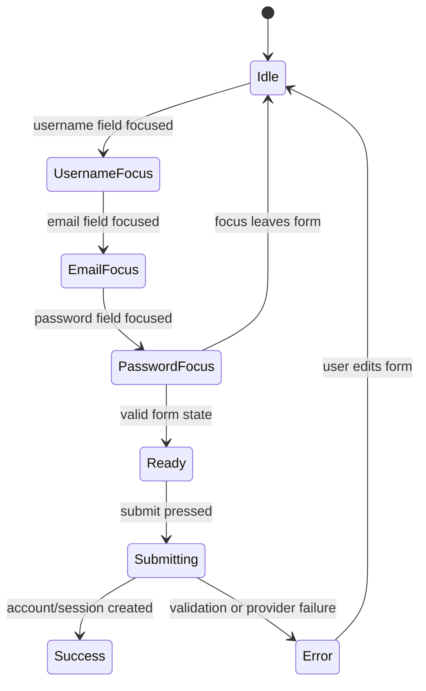

# Authentication, Profiles, and Premium Sign-In Enhancement

This is a standalone implementation blueprint for adding real user accounts,
email/password sign-up, Google/Microsoft/Facebook sign-in, sessions, profiles,
settings, sign-out, and a polished animated sign-in experience to Second Brain
Study Library.

A new coding agent may receive only this Markdown file plus the already-built
Study Library application. It must not need the old conversation, hidden files,
private screenshots, or an existing authentication implementation to understand
the feature.

## 1. The goal in simple words

A person should be able to:

```text
Open the app
    -> choose Sign up or Sign in
    -> use email/password or a configured provider
    -> verify identity when required
    -> enter the study library
    -> see a friendly greeting and profile menu
    -> open My profile
    -> edit name, username, phone, and avatar
    -> change settings or sign out safely
```

The application must feel warm and premium, but authentication must remain
serious. Animation may make the experience friendly; it must never hide a
security message, delay keyboard access, or replace a real provider flow.

## 2. Current application facts and ownership

Build on the existing boundaries:

- React and TypeScript are bundled with Webpack 5.
- `src/App.tsx` currently renders a shared-password `LoginView`.
- `src/api.ts` owns browser HTTP requests.
- `src/types.ts` owns client types.
- `server/index.ts` currently reads `LIBRARY_ACCESS_PASSWORD`, creates an HMAC
  session cookie, and protects `/api` routes with that single session.
- `server/personal-db.ts` owns the local SQLite catalog connection.
- `data/study-library.sqlite` is local metadata and must remain ignored.
- The client does not connect directly to SQLite, PostgreSQL, Supabase Auth, or
  provider secrets.
- `STORAGE_MODE=filesystem` remains the default local mode.
- `STORAGE_MODE=supabase` remains the hosted storage mode. Hosted identity may
  use Supabase Auth or the API's own OAuth adapter, but the browser still talks
  only to same-origin or explicitly configured REST routes.

The new identity system must replace the shared password for multi-user mode,
but it must preserve a deliberate local owner-only fallback during migration.
Do not silently treat one shared password as a user account.

## 3. Authentication choices and cost reality

### 3.1 Email and password

Store an account record containing a normalized email, username, display names,
password hash, verification state, and timestamps. Never store a plaintext
password or reversible encryption of a password.

Use a memory-hard password hashing algorithm such as Argon2id when a maintained
server dependency and deployment image support it. Node's built-in `scrypt`
with a unique random salt is an acceptable first local adapter when Argon2id is
not available. Record the algorithm and parameters with the hash so parameters
can be upgraded later.

### 3.2 Google, Microsoft, and Facebook

Use standards-based OAuth 2.0/OpenID Connect through server-side routes. Do not
accept a browser-supplied name or email as proof of identity. Validate the
provider's authorization response, state, nonce, issuer, audience, signature,
redirect URI, and token expiry on the server.

The usual provider authorization APIs do not charge per login. They can still
have quotas, verification requirements, policy changes, email limits, or
organization-specific costs. Microsoft may require an app registration and
tenant choice. Google may require consent-screen configuration and verified
origins. Facebook requires a Meta developer app and valid redirect domains.
Never promise that provider access is free forever.

Email verification, password reset, and OTP delivery often require an email or
SMS provider. Those services may have free quotas and then charge. TOTP apps
are usually free for the user; SMS OTP is not a free assumption.

### 3.3 Recommended provider strategy

Use an identity adapter so the product can choose one implementation per
environment:

```text
Browser
   -> Study Library auth routes
      -> local SQLite identity adapter in filesystem mode
      -> Supabase Auth adapter in hosted mode, or a server OAuth adapter
```

Do not operate competing identity writers against the same production user
catalog. Use one selected identity source per environment. Keep provider client
secrets, session secrets, password-reset keys, and service-role keys on the
server only.

## 4. Product requirements

### 4.1 Sign-in screen

The sign-in view must support:

- email or username field;
- password field with show/hide control;
- Sign in button;
- Continue with Google button when configured;
- Continue with Microsoft button when configured;
- Continue with Facebook button when configured;
- link to Create account;
- link to Forgot password;
- clear loading, invalid credentials, locked account, provider error, and
  unavailable-provider states;
- keyboard navigation and visible focus;
- no account enumeration in error messages.

If a provider is not configured, do not show a fake button that fails later.
Either omit it or show a disabled state labelled `Not configured` only in a
private development build.

### 4.2 Sign-up screen

Required fields:

- first name;
- last name;
- unique username;
- email address;
- password;
- confirm password;
- acceptance of the privacy/terms text when the deployment requires it.

Validate on the client for usability and again on the server for security.
Normalize email case and Unicode carefully. Usernames should have a documented
character policy, length range, reserved-name list, and case-insensitive unique
comparison.

After sign-up, require email verification before sensitive account actions when
an email provider is configured. In a local offline mode, clearly label a
non-delivered verification state instead of pretending an email was sent.

### 4.3 Friendly animated mascot

The requested bear/emoji companion must be an original, lightweight asset or a
CSS/emoji composition. Do not download a copyrighted image or make an external
image URL a dependency. The mascot states are:

```text
idle        -> friendly wave or blink
username    -> one hand points toward the username field
email       -> eyes follow the field without tracking the user's actual data
password    -> both hands cover the eyes; never reveal password text
ready       -> one hand points toward the Sign in or Create account button
error       -> gentle concerned state with text explanation
success     -> brief celebration, then settle
```

Implementation rules:

- animation is decorative and never carries the only instruction;
- `prefers-reduced-motion: reduce` uses static states;
- keyboard focus and screen readers do not depend on pointer movement;
- password state must not log, inspect, or expose the password value;
- no looping animation may cause layout shift or block submission;
- use a familiar label such as `Study guide mascot` and `aria-hidden` only when
  the adjacent text already explains the state.

### 4.4 Authenticated shell

After sign-in:

- show `Good morning, FirstName` or a similarly short greeting;
- show the user avatar or generated initials;
- provide a profile menu with `My profile`, `Settings`, and `Sign out`;
- show the menu with keyboard support, Escape close, outside-click close, and
  focus return;
- keep Study/Watch mode switching available;
- never expose email, provider tokens, or internal user IDs in the URL.

The current shell has a brand lockup on the left and actions on the right. Keep
that structure unless responsive space requires a compact profile button. The
profile control may be placed beside the existing theme and focus controls on
desktop and in a full-width account row on mobile.

### 4.5 My profile

The profile page or modal must support:

- avatar upload and removal;
- first name and last name;
- username display and change flow;
- email display with verification status;
- optional phone number with country-aware validation;
- provider identities linked to the account;
- password change for password accounts;
- account creation date and last sign-in only when useful;
- save, cancel, loading, validation, conflict, and error states;
- account deletion/export entry points in settings.

Images must be validated by type, dimensions, and size. Store avatars in private
storage or an allowlisted local profile directory; never trust a user filename
or expose an absolute path. Use a generated initial avatar when no image exists.

## 5. Authentication state model

Use typed state rather than unrelated booleans:

```text
type AuthView = 'sign-in' | 'sign-up' | 'verify-email' | 'forgot-password'
type AuthStatus = 'checking' | 'signed-out' | 'signed-in' | 'error'
type ProfileMenuState = 'closed' | 'open'
type OAuthProvider = 'google' | 'microsoft' | 'facebook'
```

The session response should contain only safe public session information:

```json
{
  "authenticated": true,
  "user": {
    "id": "user-123",
    "username": "asha",
    "firstName": "Asha",
    "lastName": "Rao",
    "displayName": "Asha Rao",
    "email": "asha@example.test",
    "emailVerified": true,
    "avatarUrl": null,
    "providers": ["password", "google"]
  }
}
```

Never return password hashes, provider access tokens, refresh tokens, reset
tokens, session secrets, or internal database paths.

## 6. Database contract

The local SQLite adapter should add migrations rather than rewriting the
existing catalog table. A suitable first schema is:

```sql
CREATE TABLE IF NOT EXISTS users (
  id TEXT PRIMARY KEY,
  email TEXT NOT NULL UNIQUE,
  username TEXT NOT NULL UNIQUE,
  first_name TEXT NOT NULL,
  last_name TEXT NOT NULL,
  phone_number TEXT,
  avatar_path TEXT,
  password_hash TEXT,
  email_verified_at TEXT,
  disabled_at TEXT,
  created_at TEXT NOT NULL,
  updated_at TEXT NOT NULL,
  last_login_at TEXT
);

CREATE TABLE IF NOT EXISTS auth_identities (
  id TEXT PRIMARY KEY,
  user_id TEXT NOT NULL REFERENCES users(id) ON DELETE CASCADE,
  provider TEXT NOT NULL,
  provider_subject TEXT NOT NULL,
  provider_email TEXT,
  created_at TEXT NOT NULL,
  UNIQUE(provider, provider_subject)
);

CREATE TABLE IF NOT EXISTS auth_sessions (
  id TEXT PRIMARY KEY,
  user_id TEXT NOT NULL REFERENCES users(id) ON DELETE CASCADE,
  token_hash TEXT NOT NULL UNIQUE,
  expires_at TEXT NOT NULL,
  created_at TEXT NOT NULL,
  last_seen_at TEXT NOT NULL,
  revoked_at TEXT
);

CREATE TABLE IF NOT EXISTS auth_tokens (
  id TEXT PRIMARY KEY,
  user_id TEXT NOT NULL REFERENCES users(id) ON DELETE CASCADE,
  purpose TEXT NOT NULL CHECK (purpose IN ('email_verify', 'password_reset')),
  token_hash TEXT NOT NULL UNIQUE,
  expires_at TEXT NOT NULL,
  consumed_at TEXT,
  created_at TEXT NOT NULL
);
```

Rules:

- store a hash of a random session token, not the raw token;
- store a hash of verification/reset tokens and show the raw value only once in
  an email link;
- use parameterized SQL and explicit indexes;
- never log email verification links, password reset tokens, or hashes;
- revoke sessions after password change, account disable, or sign-out-all;
- periodically delete expired token and session records;
- keep auth migrations separate from the catalog sync operation;
- use PostgreSQL equivalents and migrations for hosted multi-user mode.

## 7. HTTP contract

### Public routes

```text
GET  /api/auth/config
GET  /api/auth/session
POST /api/auth/signup
POST /api/auth/login
GET  /api/auth/oauth/:provider/start
GET  /api/auth/oauth/:provider/callback
POST /api/auth/verify-email
POST /api/auth/forgot-password
POST /api/auth/reset-password
```

`/api/auth/config` returns enabled providers and safe feature flags, never client
secrets. OAuth start creates state and nonce server-side and redirects to the
configured provider. The callback validates the response, links or creates an
account according to a documented email-linking policy, rotates the session,
and redirects to the app.

### Authenticated routes

```text
POST   /api/auth/logout
POST   /api/auth/logout-all
GET    /api/profile
PATCH  /api/profile
POST   /api/profile/avatar
DELETE /api/profile/avatar
POST   /api/profile/password
GET    /api/profile/providers
DELETE /api/profile/providers/:provider
GET    /api/settings
PATCH  /api/settings
POST   /api/account/export
DELETE /api/account
```

All authenticated routes identify the user from the server session. Never accept
`userId` as authority from a request body.

### Error contract

Use a bounded body:

```json
{
  "code": "AUTH_INVALID_CREDENTIALS",
  "message": "The email, username, or password is not correct.",
  "requestId": "req-123"
}
```

Do not reveal whether an email exists during login, forgot-password, or OAuth
account linking. Use deliberate statuses: `400` invalid input, `401` invalid
credentials, `403` disabled/unverified action, `409` username conflict, `413`
oversized avatar, `415` unsupported image, `429` rate limit, and `503`
provider/email dependency outage.

## 8. Session and security requirements

Use a secure, HttpOnly, SameSite cookie. In HTTPS production set `Secure=true`.
Use a random high-entropy token, hash it in the database, rotate it after
login and privilege changes, and expire idle/absolute sessions.

Required controls:

- TLS in production;
- CSRF protection for cookie-authenticated state-changing routes;
- rate limits for signup, login, verification, reset, and OAuth callbacks;
- constant-time comparisons where secrets are compared;
- password hashing with Argon2id or configured scrypt;
- generic login/reset messages to reduce account enumeration;
- email and username normalization without unsafe Unicode surprises;
- provider state and nonce validation;
- redirect allowlist, not a user-controlled callback URL;
- security headers and no tokens in URLs or logs;
- audit events without passwords, tokens, or private profile contents;
- reauthentication for password change, email change, export, and deletion;
- account lock or progressive delay without permanent denial of service;
- dependency updates and secret rotation procedures.

Do not call the feature secure merely because a sign-in form works. Test the
failure paths and provider callback boundaries.

## 9. OAuth provider setup

Create provider adapters behind one interface:

```text
OAuthProviderAdapter
  getAuthorizationUrl(state, nonce, redirectUri)
  exchangeCode(code, redirectUri)
  verifyIdentity(response)
```

Configuration names should be server-only and provider-specific:

```text
GOOGLE_CLIENT_ID
GOOGLE_CLIENT_SECRET
GOOGLE_REDIRECT_URI
MICROSOFT_CLIENT_ID
MICROSOFT_CLIENT_SECRET
MICROSOFT_REDIRECT_URI
FACEBOOK_CLIENT_ID
FACEBOOK_CLIENT_SECRET
FACEBOOK_REDIRECT_URI
```

Never put provider secrets in `VITE_*`, Webpack client constants, Markdown,
source control, or browser storage. Display a provider button only when its
server-side configuration and redirect URI are valid.

Account linking policy must be explicit:

- same verified provider subject returns the existing account;
- matching verified email may require a signed-in confirmation before linking;
- unverified email never silently merges accounts;
- unlinking the last login method is forbidden until another password/provider
  method exists;
- provider name and subject are stored, provider tokens are not stored unless a
  later feature has a documented need and encrypted token vault.

## 10. Premium login visual contract

Preserve the existing study language: warm paper, teal structure, coral
accent, compact mono metadata, and editorial-serif headings. Avoid a generic
SaaS login page, a purple gradient, or a card inside another card.

Sign-in composition:

```text
full viewport study atmosphere
  left: brand, short welcome, original mascot illustration
  right: sign-in or sign-up form
  bottom: privacy/help/status line
```

On small screens, the form comes first and the mascot becomes a compact header
or decorative side area. Keep the next content hint visible and do not let the
mascot push the form below an unreasonable scroll distance.

Mascot state machine:



Use an original SVG or CSS illustration only when the new agent creates it
locally from the description. Keep the animation optional and respect reduced
motion. The mascot must never inspect or store password text.

## 11. Profile menu and settings UX

The authenticated topbar should include:

```text
[brand] [Study/Watch] [search] [theme] [FirstName + avatar] [focus]
```

The profile menu contains:

```text
My profile
Settings
Sign out
```

The menu must close on Escape, outside click, route change, and sign-out. My
profile should use a focused page or modal with explicit Save and Cancel. Use
optimistic UI only for non-sensitive cosmetic changes; profile and password
writes should show server-confirmed results.

Settings should include:

- theme and reading preferences already supported by the app;
- active sessions and sign-out-all;
- linked providers;
- email verification state;
- privacy/export/delete actions;
- notification choices only when a notification provider exists.

## 12. Suggested implementation tree

Keep auth modular and do not grow `App.tsx` into the identity system:

```text
src/features/auth/
+-- AuthGate.tsx
+-- SignInView.tsx
+-- SignUpView.tsx
+-- ForgotPasswordView.tsx
+-- AuthMascot.tsx
+-- ProfileMenu.tsx
+-- ProfileView.tsx
+-- SettingsView.tsx
+-- authTypes.ts
+-- authValidation.ts
+`-- Auth.css
+src/api.ts                 auth/session/profile/provider requests
+src/types.ts               user/session/profile/provider types
+src/App.tsx                compose AuthGate and authenticated shell
+server/auth/
+|-- config.ts
+|-- password.ts
+|-- sessions.ts
+|-- providers.ts
+|-- oauth.ts
+|-- tokens.ts
+|-- validation.ts
+|-- routes.ts
+`-- errors.ts
+server/personal-db.ts      auth migrations and repository adapter
+server/index.ts            route registration and auth middleware
+tests/
+|-- auth-password.test.ts
+|-- auth-session.test.ts
+|-- auth-oauth.test.ts
+|-- auth-profile.test.ts
+`-- auth-security.test.ts
+```
+
+Use typed schemas at every HTTP boundary. Keep provider adapters replaceable so
+local SQLite and hosted Supabase Auth do not create two incompatible clients.
+
## 13. Testing and acceptance
+
+### Account tests
+
+- valid signup creates a user with a password hash, never a plaintext password;
+- invalid email, username, password, confirmation, and duplicate values fail;
+- password login succeeds only for the correct hash;
+- login errors do not reveal whether an email exists;
+- email verification token expires and cannot be reused;
+- reset token expires, is single-use, and rotates sessions;
+- disabled users cannot create sessions;
+- logout revokes the current session;
+- logout-all revokes every session for the user.
+
+### OAuth tests
+
+- unconfigured provider is not offered as a working button;
+- state and nonce are required and single-use;
+- invalid issuer, audience, signature, code, or redirect is rejected;
+- provider subject maps to the correct identity;
+- verified-email linking requires the documented confirmation;
+- callback errors do not leak provider tokens or internal details.
+
+### Profile tests
+
+- profile reads return only safe public fields;
+- username conflicts return `409`;
+- avatar type, size, dimensions, and path are validated;
+- profile writes require the authenticated session;
+- password change requires current password or recent reauthentication;
+- account export/delete requires deliberate confirmation.
+
+### UI acceptance path
+
+1. Open signed-out app and see Sign in/Create account choices.
+2. Create an account with a fake email and safe test password.
+3. Confirm validation and loading states.
+4. Sign in and see the user's greeting and avatar initials.
+5. Open the profile menu with mouse and keyboard.
+6. Edit profile and upload a small synthetic image.
+7. Sign out and confirm protected content is unavailable.
+8. Sign in again and confirm the saved profile appears.
+9. Test every configured OAuth provider in a registered HTTPS callback
+   environment, never with production credentials in a local fixture.
+10. Test reduced-motion mode and 320px/mobile layouts.
+
+## 14. Implementation order
+
+1. Add auth types, schemas, database migrations, password hashing, and session
+   repository.
+2. Replace the shared-password login with local account signup/sign-in behind a
+   feature flag or explicit migration mode.
+3. Add session middleware and safe `/api/auth/session` user response.
+4. Add sign-in/sign-up UI and the original mascot state machine.
+5. Add profile menu, profile view, avatar validation, and settings.
+6. Add email verification and password reset through a configured email adapter.
+7. Add one OAuth provider adapter and tests, then add the others only after the
+   first flow is proven.
+8. Add CSRF, rate limits, audit events, session revocation, and security tests.
+9. Add hosted Supabase Auth or another selected provider adapter without
+   allowing two production identity writers.
+10. Run focused auth tests, typecheck, lint, build, and the manual acceptance
+    path. Update `FEATURE_LOG.md` with actual provider/runtime limitations.
+
+Do not launch all three social providers at once without registered redirect
+URIs, verified application settings, privacy policy, and a tested callback.
+
## 15. Definition of done
+
+- [ ] Users can create an email/password account safely.
+- [ ] Users can sign in and sign out with a secure server session.
+- [ ] Passwords, tokens, and provider secrets are never stored or logged in plaintext.
+- [ ] Users can see and edit their profile and username.
+- [ ] Avatar upload is private, bounded, and validated.
+- [ ] The topbar greets the signed-in user and exposes an accessible profile menu.
+- [ ] Google, Microsoft, and Facebook buttons appear only when configured and tested.
+- [ ] OAuth state, nonce, issuer, audience, redirect, and token expiry are validated.
+- [ ] Email verification and reset flows do not reveal account existence.
+- [ ] Session revocation, rate limiting, CSRF, and security headers are tested.
+- [ ] The mascot is original, optional, accessible, and reduced-motion safe.
+- [ ] The app works when email or OAuth providers are unavailable.
+- [ ] Local SQLite and hosted identity ownership are documented.
+- [ ] Typecheck, lint, build, focused auth tests, and manual acceptance results are recorded.
+
## 16. Official sources and version rule
+
+Use the current official documentation for OAuth 2.0, OpenID Connect, Google
+Identity, Microsoft identity platform, Meta Login, WebAuthn if later added,
+Node.js crypto, SQLite/PostgreSQL, Supabase Auth, OWASP Authentication and API
+Security guidance, secure cookies, CSRF, and password storage.
+
+Record provider documentation dates and selected library versions. Provider
+pricing, quotas, redirect rules, and verification requirements can change. Do
+not promise that social login or email delivery will always be free.
+
## 17. Fresh-agent handoff prompt
+
```text
You are extending an already-built Second Brain Study Library. Read this
Markdown specification completely. Implement user accounts, secure local
email/password authentication, profile/settings UI, and configured OAuth
providers within the existing React/TypeScript/Webpack and Express boundaries.
Do not fake Google, Microsoft, or Facebook login when provider credentials are
missing. Use an identity adapter, secure password hashing, hashed sessions,
CSRF/rate limits, server-side authorization, and migrations. Create the warm
premium sign-in screen with an original reduced-motion-safe mascot. Preserve the
existing Study/Watch reader and local-first behavior. Run focused auth tests,
typecheck, lint, build, and manual acceptance checks. Report provider setup,
email/OTP costs or quotas, sandbox/runtime limitations, and every file created.
```
