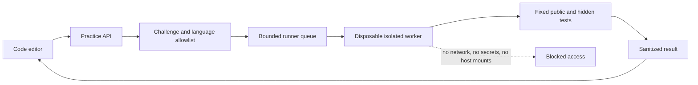

# Study Library Interactive Learning Enhancement

This is a standalone implementation blueprint for adding assignments, quizzes,
practical coding sessions, scoring, review links, and safe code execution to
Second Brain Study Library.

A new coding agent may receive only this Markdown file. It must not need the
old repository, hidden files, screenshots, or a previous conversation to
understand the feature. The existing application is already a React/Webpack
study reader with an Express API. This document explains how to extend that
application without replacing its local-first architecture or its warm paper,
teal, coral, editorial-serif design.

## 1. The goal in simple words

A learner should follow this loop for every lesson:

```text
Read the lesson
    -> mark the lesson read
    -> open Assignment
    -> answer five questions
    -> see score and explanations
    -> review the exact section for wrong answers
    -> retry until the quiz passes
    -> open Practical session
    -> write code or a structured answer
    -> click Run
    -> see a friendly terminal-like result
    -> inspect passed and failed tests
    -> improve the solution
    -> pass every required test
    -> unlock the next lesson
```

The learner is not punished for a wrong answer. A wrong answer creates a useful
path back to the lesson section that explains the idea. The goal is recall,
understanding, and practice, not a high number without learning.

## 2. Current application facts

The implementation must build on these existing boundaries:

- React and TypeScript are bundled with Webpack 5.
- `src/App.tsx` fetches Markdown through `fetchContent` and renders it with
  `react-markdown`, `remark-gfm`, `rehype-sanitize`, and `rehype-highlight`.
- The current completion and bookmark sets are browser-local `localStorage`
  preferences. They are not cross-device grades.
- `src/types.ts` owns client domain types and `src/api.ts` owns HTTP requests.
- `server/index.ts` owns Express route registration, content access, session
  middleware, and the local filesystem API.
- The current routes include `/api/library`, `/api/content`, `/api/asset`,
  `/api/file`, uploads, ebooks, and separate Watch media routes.
- There is currently no code execution endpoint. Adding one is a security
  boundary, not a small UI-only change.
- The app must remain usable when no practice runner is configured. Reading and
  quiz review must not disappear because a code runner is offline.

Do not put quiz state into the study Markdown itself after the learner answers.
Markdown is course content. Attempts and progress are user state.

## 3. Product rules

### 3.1 One lesson, one learning path

Every course lesson that is intended to be completed must provide:

1. a stable lesson ID;
2. stable section IDs for important headings;
3. exactly five multiple-choice questions for the first release;
4. one practical challenge or an explicit `not-applicable` explanation;
5. a link from each wrong answer to the relevant section;
6. a clear next step after the quiz;
7. a final lesson completion state.

Five questions means five scored questions, not five paragraphs containing many
unscored questions. Each question has one correct option in the first release.
A later version may add multiple-select, short answer, or code-output questions
with a new schema version.

### 3.2 Reading, assignment, and practical stages

Use a visible stepper or tab group in the reading surface:

```text
[Lesson] -> [Assignment] -> [Practical] -> [Next lesson]
```

- `Lesson` is always available for review.
- `Assignment` becomes available when the learner presses **Mark lesson read**
  or reaches the bottom and confirms completion.
- `Practical` becomes available after the quiz reaches the passing score.
- `Next lesson` becomes available after the practical challenge passes, unless
  the lesson explicitly has no practical challenge.
- A learner may revisit any earlier lesson and retry an assignment.
- A learner must never lose a previous best score because of a later retry.
- The UI must show `Not started`, `Read`, `Quiz passed`, `Practical passed`, or
  `Complete` without pretending that local progress is synchronized to a server.

The recommended first-release pass score is **4 out of 5**, or **80 percent**.
The blueprint must make this a named constant, not a magic number. A course may
raise the threshold in its metadata, but it may not silently lower it.

### 3.3 Scoring

For five questions:

```text
points = number of selected correct answers
maximum = 5
percentage = round(points / maximum * 100)
```

Show all of these after submission:

- score such as `4 / 5`;
- percentage such as `80%`;
- pass or review status;
- each selected option;
- the correct option;
- a short explanation;
- a **Review this section** link for every missed answer;
- **Retry assignment** and **Continue to practical** actions when appropriate.

Do not reveal the answer key before submission. Do not mark a question correct
because the option text merely resembles the answer. Compare stable option IDs.

### 3.4 Practical coding session

A practical challenge contains:

- a task statement;
- the language and runtime;
- starter code;
- input/output or function contract;
- public examples;
- public test names;
- hidden test names or counts without hidden inputs;
- time, memory, output, and file limits;
- a Run button with a play icon and a text tooltip;
- a terminal-like output panel in the page;
- a test summary such as `3 passed, 1 failed`;
- a review link when a failed test maps to a lesson section;
- Reset starter code and Submit solution actions.

The learner must be able to run an incomplete solution. A failed test is a
learning result, not a server error. The terminal panel must distinguish:

```text
program output
compile error
runtime error
failed assertion
sandbox timeout
runner unavailable
```

Passing all required tests is the practical completion rule. Do not require a
perfect code style score before unlocking the next lesson; style feedback can
be a separate advisory result.

For non-code subjects such as system design, an exercise may use a structured
answer editor with a validator. It must still show a task, expected concepts,
feedback, and a completion rule. Do not force a fake compiler onto a diagram or
architecture question.

## 4. Content authoring format

Every lesson Markdown file must contain normal teaching content plus two
machine-readable fenced blocks. The blocks are still Markdown, so the course
can be transferred as text only.

Use stable custom fence labels:

````text
```study-quiz
{ valid JSON }
```

```study-practical
{ valid JSON }
```
````

The parser must extract only these exact fence labels. It must use `JSON.parse`
and a runtime schema validator. It must never use `eval`, `new Function`, or
execute data from a lesson file.

### 4.1 Quiz block schema

```json
{
  "schemaVersion": 1,
  "lessonId": "api-design/02-rest-json-and-http",
  "title": "Assignment: REST, JSON, and HTTP",
  "passPercentage": 80,
  "questions": [
    {
      "id": "q1",
      "sectionId": "http-methods",
      "prompt": "Which HTTP method is normally used to read a resource?",
      "options": [
        {"id": "a", "text": "GET"},
        {"id": "b", "text": "POST"},
        {"id": "c", "text": "DELETE"},
        {"id": "d", "text": "PATCH"}
      ],
      "correctOptionId": "a",
      "explanation": "GET asks the server to return a representation.",
      "reviewLabel": "Review HTTP methods"
    }
  ]
}
```

The complete block must contain exactly five questions. Required validation:

- `lessonId` is non-empty and stable;
- `schemaVersion` is supported;
- `passPercentage` is between 1 and 100;
- question IDs are unique within the lesson;
- every question has one `sectionId`;
- every question has exactly four options in the first release;
- option IDs are unique within a question;
- exactly one `correctOptionId` matches an option;
- prompt, explanation, and review label are bounded strings;
- no question contains a secret, personal data, or an external answer URL.

### 4.2 Practical block schema

```json
{
  "schemaVersion": 1,
  "challengeId": "api-design/02-rest-json-and-http/parse-request",
  "lessonId": "api-design/02-rest-json-and-http",
  "title": "Practical: classify an HTTP request",
  "language": "typescript",
  "mode": "function",
  "instructions": "Return the method family and status expectation for a request.",
  "starterCode": "export function classify(method: string): string {\n  return '';\n}",
  "entryPoint": "classify",
  "publicExamples": [
    {"input": "GET", "expected": "read"},
    {"input": "POST", "expected": "write"}
  ],
  "publicTestIds": ["read-method", "write-method"],
  "reviewSections": {
    "invalid-method": "http-methods"
  },
  "limits": {
    "timeMs": 2000,
    "memoryMb": 128,
    "outputBytes": 20000
  }
}
```

The browser receives the starter code and public examples. Hidden test inputs,
expected outputs, and secret runner configuration stay on the server or in the
isolated runner. For local personal mode, a fixed registry may contain the
challenge tests in the checked-out generated course, but it must never accept a
browser-supplied command.

Allowed first-release languages should be explicit:

```text
javascript -> fixed Node.js runtime
typescript -> fixed TypeScript compile then Node.js runtime
python     -> fixed Python runtime
java       -> fixed Java compiler/runtime
json       -> schema validation, no process execution
text       -> rubric or required-key validation, no process execution
```

A Spring Boot challenge should normally test a Java function, JSON contract, or
small service rule. Do not start an entire untrusted Spring server inside a web
request.

### 4.3 Section anchors

Every important heading must have a stable ID. Use a heading marker in the
lesson content, for example:

```markdown
## HTTP methods {#http-methods}
```

The Markdown pipeline must preserve that ID and the review link must navigate to
`#http-methods`. If the selected Markdown parser cannot support explicit IDs,
add a controlled heading-ID plugin and update the sanitization schema to permit
only safe `id` values. Never build an anchor from untrusted HTML.

A review link must:

1. select the same lesson if it is not already selected;
2. switch to the Lesson tab;
3. wait for content to render;
4. scroll the heading into view;
5. focus the heading or a nearby review callout;
6. preserve the quiz attempt so the learner can return to Assignment.

## 5. User interface contract

### 5.1 Lesson surface

Add a compact learning stepper below the existing note toolbar or near the
lesson footer. It must fit the current responsive reading surface and support
widths down to 320px.

```text
Lesson  1/3  ->  Assignment  2/3  ->  Practical  3/3

[Mark lesson read]
```

After reading:

```text
Lesson read
Assignment available: 5 questions
[Open assignment]
```

Use familiar icons: book for Lesson, checklist for Assignment, play/code icon
for Practical, arrow for Next lesson. Give every unfamiliar icon a tooltip and
an accessible label. Do not hide progress behind hover.

### 5.2 Assignment panel

The assignment panel must show:

- lesson title and question number, such as `Question 2 of 5`;
- progress indicator with stable dimensions;
- one question at a time or a clearly separated five-question list;
- radio controls with keyboard support;
- selected, unanswered, correct, and incorrect visual states;
- Submit assignment button disabled until all five are answered;
- score panel after submission;
- review links for wrong answers;
- retry and practical actions.

Do not show the correct answer while the learner is selecting. Do not submit on
option click. Do not make a color-only distinction; include text and icons.

### 5.3 Practical panel

The practical panel must show:

- task statement and expected behavior;
- language selector only for supported challenge languages;
- code editor with line numbers, tab handling, accessible labels, and starter
  reset;
- Run button with a play icon;
- Submit solution button only after a run has completed;
- terminal output panel with `aria-live="polite"` for new results;
- test result rows with passed/failed/blocked states;
- elapsed time and bounded output size;
- runner unavailable state with a useful local setup explanation;
- link back to the lesson section related to a failed test.

A GUI terminal is a panel in the application. It is not a browser shell and
must never expose the host operating system.

### 5.4 Progress and navigation

The next lesson action must explain why it is locked:

```text
Read the lesson -> pass the assignment -> pass the practical -> Next lesson
```

Allow review of all previously opened lessons. Do not make a failed assignment
hide the lesson. Preserve bookmarks, theme, focus mode, and current reading
size.

## 6. State model

Use typed state, not several unrelated booleans:

```text
type LessonStage = 'lesson' | 'assignment' | 'practical' | 'complete'
type QuizStatus = 'locked' | 'available' | 'in-progress' | 'submitted' | 'passed'
type PracticalStatus = 'locked' | 'available' | 'running' | 'failed' | 'passed' | 'unavailable'
```

Store a progress record per lesson:

```json
{
  "lessonId": "python-first-api/12-first-fastapi-application",
  "readAt": "2026-10-02T12:00:00Z",
  "quiz": {
    "bestScore": 4,
    "bestPercentage": 80,
    "attempts": 2,
    "passed": true,
    "lastAttemptAt": "2026-10-02T12:10:00Z"
  },
  "practical": {
    "lastRunId": "run-123",
    "passedTests": 4,
    "totalTests": 4,
    "passed": true,
    "lastAttemptAt": "2026-10-02T12:20:00Z"
  }
}
```

For the current local-first phase, store this under a versioned local-storage
key such as `study-library:learning-progress:v1`. Validate data when reading;
old or corrupt state must reset safely without deleting bookmarks or completion
state.

For a hosted multi-user phase, add authenticated REST persistence. The browser
must never write directly to PostgreSQL or object storage.

## 7. API and runner contract

### 7.1 Local quiz mode

The first local implementation may parse quiz blocks from fetched Markdown and
score in the browser. This is suitable for personal practice, not an official
exam, because a learner can inspect the answer key in browser memory.

Display a clear local-practice label if official grades matter.

### 7.2 Hosted progress mode

Add these same-origin routes when progress must follow a user across devices:

```text
GET  /api/learning/progress?lessonId=...
POST /api/learning/quiz-attempts
POST /api/learning/practical-attempts
```

The server validates the lesson ID, question IDs, selected option IDs, score,
challenge ID, and authenticated user. The server recalculates quiz scores from
its authoritative answer key; it never trusts a browser-supplied score.

### 7.3 Code run route

Use an asynchronous contract for real execution:

```text
POST /api/practice/runs
GET  /api/practice/runs/:runId
POST /api/practice/runs/:runId/cancel
```

Request:

```json
{
  "challengeId": "api-design/02-rest-json-and-http/parse-request",
  "language": "typescript",
  "source": "export function classify(method: string) { return 'read'; }"
}
```

Initial response:

```json
{
  "runId": "run-123",
  "status": "queued"
}
```

Result response:

```json
{
  "runId": "run-123",
  "status": "completed",
  "summary": {"passed": 3, "failed": 1, "total": 4},
  "tests": [
    {"id": "read-method", "status": "passed", "durationMs": 12},
    {"id": "invalid-method", "status": "failed", "message": "Expected write."}
  ],
  "stdout": "",
  "stderr": "",
  "reviewSectionId": "http-methods"
}
```

All response fields are bounded. Do not return arbitrary process output,
filesystem paths, environment variables, stack traces with host details, or
secrets.

## 8. Safe code execution

Never run learner code with `exec`, `eval`, `new Function`, a shell command built
from request input, the host Node process, the production filesystem, or the
Docker socket.

The runner must use a fixed challenge registry and a disposable sandbox:



Required controls:

- run as a non-root user;
- read-only base image and empty temporary workspace;
- no network by default;
- no production or personal-study mounts;
- no credentials or service tokens;
- fixed executable and argument list selected by server-side language mapping;
- CPU, memory, process, wall-clock, file-size, output, and queue limits;
- cancellation and cleanup after every run;
- dependency-free starter challenges unless dependencies are prebuilt and
  pinned in the runner image;
- no arbitrary package installation during a run;
- audit-safe run ID, lesson ID, language, duration, and result status;
- rate limits and per-user concurrency limits.

For local development, if a trusted sandbox is unavailable, disable Run and
show `Runner unavailable`. Never silently fall back to unsafe host execution.
Browser-only runtimes such as WebAssembly may be added later, but they must use
an explicit language capability list and the same output limits.

## 9. Suggested implementation tree

Keep the new feature modular. Do not make `src/App.tsx` a large quiz and code
runner file.

```text
src/
+-- features/learning/
|   +-- AssignmentPanel.tsx
|   +-- PracticalPanel.tsx
|   +-- LessonStepper.tsx
|   +-- LessonProgress.ts
|   +-- lessonExerciseParser.ts
|   +-- learningProgress.ts
|   +-- learningTypes.ts
|   +-- CodeEditor.tsx
|   +-- TestResults.tsx
|   `-- Learning.css
+-- api.ts                 add typed progress and run calls
+-- types.ts               add quiz, progress, challenge, and run types
+-- App.tsx                compose the panels around the existing reader
server/
+-- learning/
|   +-- schemas.ts         boundary validation
|   +-- progress.ts        local/hosted progress service
|   +-- challenges.ts      allowlisted challenge metadata and tests
|   +-- runner.ts          queue and runner adapter
|   +-- sandbox.ts         isolated execution boundary
|   `-- routes.ts          learning and practice endpoints
+-- tests/
    +-- learning-parser.test.ts
    +-- quiz-scoring.test.ts
    +-- practice-routes.test.ts
    `-- sandbox-policy.test.ts
```

Use the repository's existing TypeScript style. Keep parsing, state transitions,
HTTP requests, components, runner policy, and execution adapters separate.

### 9.1 Dependencies

Choose a maintained code editor that works with Webpack 5 and TypeScript. The
preferred lightweight option is CodeMirror 6 with language packages for
JavaScript/TypeScript, Python, and Java. Install exact versions with `pnpm` and
update the lockfile. Do not add Monaco, CodeMirror, or a runtime package merely
for a decorative text area.

The runner may use a separate worker/container image. It must not add a
production dependency that executes arbitrary code in the web process.

## 10. Lesson authoring requirements

Update every generated course lesson with:

1. explicit section IDs for concepts;
2. exactly five quiz questions covering different ideas;
3. explanations that point to the section, not only the answer;
4. one practical task tied to the lesson's real example;
5. public examples and a fixed challenge ID;
6. tests for the happy path, boundary case, and failure case;
7. a safe language choice;
8. a statement of what the learner should see when the test passes.

Question quality rules:

- test understanding, not trivia;
- use one best answer;
- avoid clues such as the longest option always being correct;
- include realistic code, HTTP, JSON, SQL, or architecture situations;
- explain why each wrong option is wrong;
- avoid ambiguous wording and double negatives;
- cover the lesson's beginning, middle, and end;
- do not repeat the same question with synonyms.

Practical quality rules:

- task can be described in one paragraph;
- starter code runs or fails in an understandable way;
- public examples are small;
- hidden tests cover edge cases;
- failure messages teach the missing concept without revealing all hidden data;
- completion requires all required tests, not a subjective feeling;
- a non-code lesson gets a structured answer validator instead of fake code.

## 11. Accessibility and responsive behavior

The feature must support keyboard use and screen readers:

- use a real tablist or stepper semantics, not clickable `div` elements;
- use radio inputs or equivalent accessible selection controls;
- provide visible focus states;
- announce score and run results with bounded `aria-live` regions;
- do not rely on color alone for correct, incorrect, passed, or failed;
- label the editor, language, Run, Reset, Submit, Retry, and Review controls;
- preserve focus when changing panels or returning from a review anchor;
- keep touch targets at least 40px;
- test 320px, 390px, 768px, 1024px, and 1440px widths;
- respect `prefers-reduced-motion`.

Use the established warm paper, teal, coral, editorial-serif language. The
assignment and practical panels are framed tools, not decorative nested cards.
Keep text inside controls and result rows without overflow.

## 12. Testing contract

### Unit tests

- parse a valid quiz block;
- reject zero, four, or six questions in the first release;
- reject duplicate IDs and missing sections;
- calculate `0/5`, `4/5`, and `5/5` correctly;
- preserve the best score across retries;
- map missed questions to review anchors;
- parse practical metadata and reject unsupported languages;
- transition lesson, quiz, practical, and complete states correctly.

### Component tests

- Assignment is locked before the lesson is read;
- all five answers are required before submit;
- score and explanations appear after submission;
- wrong-answer Review links return to the correct heading;
- Practical is locked until the quiz passes;
- Run shows queued/running/result/unavailable states;
- passed and failed test rows render with text, not color only;
- retry does not erase best score;
- next lesson remains locked until the defined completion rule passes;
- keyboard navigation and narrow layouts work.

### API and security tests

- unauthenticated progress and run requests are rejected when auth is enabled;
- unknown lesson and challenge IDs return `404`;
- malformed source, unsupported language, oversized source, and too many runs
  return bounded `400`, `413`, or `429` errors;
- browser-provided score and test results are ignored and recalculated;
- runner timeout, cancellation, crash, and queue exhaustion are visible;
- source cannot read a host file, network, environment variable, or secret;
- response output is truncated and sanitized;
- run records do not expose host paths or stack traces.

### Manual acceptance path

1. Open a lesson with five questions.
2. Mark it read.
3. Confirm Assignment becomes available.
4. Answer all five and submit.
5. Confirm the score is shown as points and percentage.
6. Intentionally miss one answer.
7. Follow Review this section and return to Assignment.
8. Retry until at least `4 / 5`.
9. Open Practical.
10. Run starter code and inspect the terminal panel.
11. Fix the code until every test passes.
12. Confirm Practical and Next lesson unlock.
13. Reload the page and confirm local progress remains.
14. Repeat with the runner unavailable and confirm reading/quiz still work.

## 13. Implementation order

1. Add typed lesson exercise schemas and a safe Markdown fence parser.
2. Add stable heading IDs and review-anchor navigation.
3. Add local progress state and pure quiz scoring.
4. Add Lesson/Assignment/Practical stepper and Assignment UI.
5. Add practical metadata and a disabled Runner unavailable state.
6. Add the server-side challenge registry and safe asynchronous runner adapter.
7. Add API routes, authentication, limits, result sanitization, and tests.
8. Add the CodeMirror editor and terminal-like result panel.
9. Add hosted progress persistence only after local behavior is correct.
10. Add quiz/practical metadata to every generated course lesson.
11. Run focused tests, typecheck, lint, build, and manual acceptance checks.
12. Update the feature log with actual results and any unavailable runner.

Do not start with arbitrary code execution. A safe runner and clear content
schema are the controlling boundaries.

## 14. Definition of done

- [ ] A fresh agent can understand and implement the feature from this file.
- [ ] Every lesson has exactly five validated quiz questions.
- [ ] Every wrong answer links to a stable lesson section.
- [ ] Scores show points, percentage, explanations, and retry behavior.
- [ ] Practical work has a starter, language, public examples, and tests.
- [ ] Run results show output, errors, and passed/failed counts in the GUI.
- [ ] All required tests must pass before practical completion.
- [ ] Quiz and practical progress survive reload in local mode.
- [ ] Hosted mode recalculates scores server-side when enabled.
- [ ] Arbitrary code never runs in the web process or on the host filesystem.
- [ ] Runner limits, cancellation, cleanup, and rate limits are tested.
- [ ] The reader remains useful when the runner is offline.
- [ ] Keyboard, screen-reader, reduced-motion, and mobile behavior are tested.
- [ ] Typecheck, lint, build, focused tests, and manual acceptance are recorded.

## 15. Official documentation and version rules

Use the current repository versions first. Check the official documentation for
React, React Markdown, remark/rehype, Webpack, CodeMirror, Node.js, the selected
sandbox technology, and the selected language runtimes. For security, check
OWASP guidance for untrusted code execution, authentication, authorization,
path traversal, SSRF, resource exhaustion, and secrets.

Record the date and versions checked in the feature log. Do not claim that a
runner is secure because it passed one example. Treat sandbox isolation as a
measured operational boundary and keep it disabled when its prerequisites are
missing.

## 16. Final handoff instruction

A new agent should receive this file with the following prompt:

```text
You are extending an already-built Second Brain Study Library. Read this
Markdown file completely. Do not ask for the old repository or invent a second
application. Inspect the existing React/TypeScript/Webpack reader and Express
API, then implement the lesson -> assignment -> practical learning loop using
the contracts here. Preserve local-first reading behavior. Create typed schemas,
parse only the declared Markdown exercise fences, add stable section review
links, score five questions, and add the practical runner behind a safe
sandbox boundary. Never run learner code in the web process or host shell.
Implement tests before claiming completion. Report created files, validation
commands, runner prerequisites, and any feature that remains unavailable.
```
