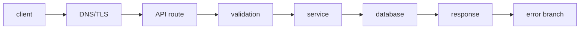
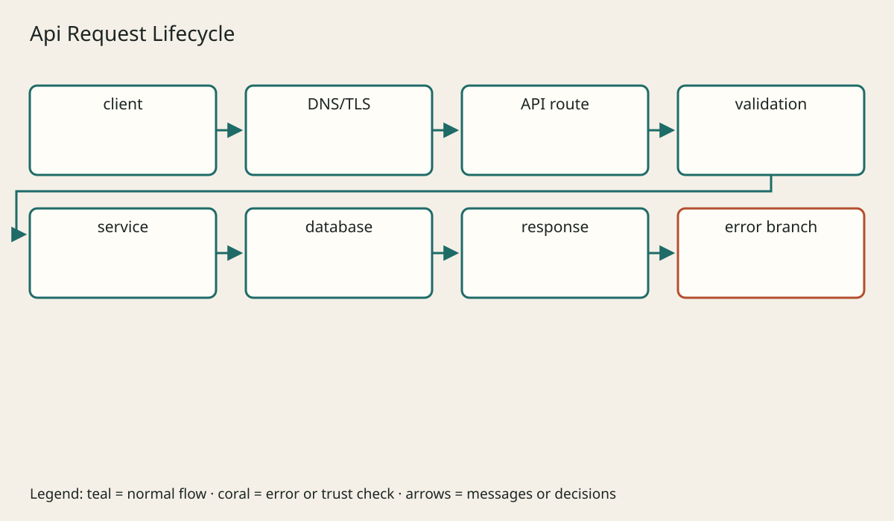

# Java Oop And Modern Java

## The big idea in plain words {#picture}

Learning is like climbing stairs. You can only reach the third step if the first two are solid.

## What you will be able to do {#outcomes}

Read this after the previous numbered lesson. Use synthetic notes and local exercise data. By the end you should explain the following scope without copying:

Teach encapsulation, inheritance, interfaces, polymorphism, generics, lambdas, streams, dates, `Optional`, and modern Java choices.

## Words to know {#vocabulary}

- **prerequisite**: something you need to know first, before the next thing makes sense.

- **checkpoint**: a question you answer from memory, without peeking.

- **contract**: a clear promise about what goes in and what comes out.

## Why this idea exists {#history}

If you try to memorize a whole framework before you ever run one small example, most of it slips away. Learning in small loops (read, guess, try, check, review) shows you exactly which step you missed.

## Concept 1 {#concept-1}

prerequisite means something you need to know first, before the next thing makes sense. Read the prerequisites before you run a framework example.

Apply this rule to the Study Notes boundary before choosing syntax. Name the input, owner, and observable result. The scenario below gives a concrete decision to check.

## Concept 2 {#concept-2}

Guess the output first, then look at the answer.

Apply this rule to the Study Notes boundary before choosing syntax. Name the input, owner, and observable result. The scenario below gives a concrete decision to check.

## Concept 3 {#concept-3}

When a test fails, it points to the idea you are missing.

Apply this rule to the Study Notes boundary before choosing syntax. Name the input, owner, and observable result. The scenario below gives a concrete decision to check.

## Concept 4 {#concept-4}

A practice score in this app is just a helper, not an official exam grade.

Apply this rule to the Study Notes boundary before choosing syntax. Name the input, owner, and observable result. The scenario below gives a concrete decision to check.

## Going deeper: the technical walkthrough {#walkthrough}

### Classes and encapsulation


```java
public final class Counter {
    private int value;

    public void increment() {
        value += 1;
    }

    public int value() {
        return value;
    }
}
```

The field is private. Callers cannot change it directly. Encapsulation protects
invariants, such as never letting a counter become negative.


### Records and value objects


```java
public record StudyNote(long id, String title, String topic) {
}
```

A record is a compact immutable data carrier. Java creates the constructor,
accessors, equality, hash code, and string representation. The accessor is
`title()`, not `getTitle()`.

Use records for request and response data when behavior does not need mutable
identity. Use a class when the object owns complex state transitions or
invariants.


### Interfaces and dependency direction


```java
public interface NoteRepository {
    List<StudyNote> findByTopic(String topic);
    StudyNote save(StudyNote note);
}
```

A service can depend on this promise while one implementation uses memory and
another uses PostgreSQL. This is the basic idea behind a repository port and
adapter.

```text
Controller -> Service -> Repository interface -> Memory or database adapter
```

An interface is useful when the boundary is real. Do not create ten empty
interfaces only to make a diagram look sophisticated.


### Collections and generics


```java
List<String> topics = List.of("Java", "APIs");
Set<String> uniqueTopics = new HashSet<>(topics);
Map<Long, StudyNote> notesById = new HashMap<>();
```

- `List` keeps order and can contain duplicates.
- `Set` keeps unique values.
- `Map` finds a value by key.
- A generic such as `List<StudyNote>` tells the compiler what belongs inside.

Choose the collection from the operation you need, not from habit.


### Null, Optional, and validation


`null` means there is no object. An empty string is still a string. Normalize
untrusted text at a boundary:

```java
static String blankToNull(String value) {
    if (value == null || value.isBlank()) {
        return null;
    }
    return value.trim();
}
```

Use `Optional<StudyNote>` as a return value when "may not exist" is the normal
contract. Do not use `Optional` for every field or as a replacement for learning
which values are required.


### Dates and time


Use the `java.time` API:

```java
LocalDate lessonDate = LocalDate.of(2026, 10, 2);
Instant createdAt = Instant.now();
```

`LocalDate` is a calendar date without a time zone. `Instant` is a point on the
UTC timeline. Choose the type from the business meaning. Do not store every
date as an unstructured string.


### Lambdas and streams


```java
List<String> titles = notes.stream()
        .map(StudyNote::title)
        .filter(title -> title.startsWith("API"))
        .sorted()
        .toList();
```

A stream is a pipeline, not a database query. It is useful for small in-memory
transformations. Use a database query for filtering a large table.

A normal loop is often clearer than a long stream. Readability is the goal.


## Worked scenario {#worked-scenario}

You understand how to ask for data with GET, but you cannot explain how the server checks incoming data. What should you study next?

The justified choice is **Practice sending bad data and see how the server checks it**. Select **review-validation** in the structured practical and explain why. Alternatives ignore a requirement, cross a trust boundary, or invent success.

### Structured decision contract

```json

{
  "decision": "review-validation",
  "justification": "The prerequisite and checkpoint boundary must preserve the declared contract and ownership.",
  "failureBehavior": "Expose a safe failure and recover through the boundary owner."
}

```

Decision selects one declared behavior. Justification explains the boundary. FailureBehavior explains the observable error and recovery owner. These fields never execute commands. Required terms and minimum lengths form a basic practice rubric, not semantic grading.

## Step-by-step flow and matching picture {#flow}





## Three real-life uses {#use-cases}

1. A personal learner applies this rule to one synthetic note and checks the result.
2. A team changes the boundary while preserving its shared request and response contract.
3. A deployed library handles concurrent requests and reports failures through safe errors and correlated signals.

## What can go wrong, and how to stay safe {#failure-security}

Come back to a topic after a break; remembering it is better practice than just re-reading it. An external dependency needs an owner, size limit, deadline, cleanup, and recovery path. Return a stable error code rather than raw exceptions. Redact credentials and private bodies in diagnostics.

The abstraction improves prerequisite reasoning but adds configuration and lifecycle work. Keep a simpler implementation when it meets the requirement. Measure the limiting resource before adding services, queues, or caches.

## Practice lab and expected observation {#practice}

1. Predict the scenario decision before opening Practical. Explain each rejected alternative.
2. Run a relevant example above in an isolated exercise project. Record the expected result, then change one input to an invalid or boundary value. A failed assertion or deliberate error should replace silent success.
3. Submit the structured decision. Initially the checks fail. After selecting review-validation and writing an explanation and failure plan, all three pass. Follow the indicated review section for missed checks.

### Broken example to debug

```json

{"decision":"trust-client","justification":"","failureBehavior":""}

```

This ignores the responsible boundary and gives no reasoning or recovery. Correct the fields rather than changing the validator.

## Checkpoint and definition of done {#checkpoint}

- [ ] Define prerequisite and checkpoint without looking.
- [ ] Trace input to owner and output.
- [ ] Explain one failure and one alternative.
- [ ] Pass at least four assignment questions.
- [ ] Pass every practical check and submit.
- [ ] Explain the concept again tomorrow.

## Sources, versions, and safe commands {#sources}

HTTP semantics; educational contracts, not an audit of the unavailable TM Schedule repository. Review date: 2026-10-02. The supplied blueprint is the teaching source; official landing pages were checked where reachable. No provider or original TM Schedule deployment was tested.

- [Official reference](https://www.rfc-editor.org/rfc/rfc9110)

- [Official reference](https://spec.openapis.org/oas/v3.1.0.html)

[Course reading order](README.md) · [Previous lesson](03-java-from-zero.md) · [Next lesson](05-spring-boot-from-zero.md)

```study-quiz

{
  "schemaVersion": 1,
  "lessonId": "api-design/04-java-oop-and-modern-java",
  "title": "Assignment: Java Oop And Modern Java",
  "passPercentage": 80,
  "questions": [
    {
      "id": "q1",
      "sectionId": "concept-1",
      "prompt": "In Java Oop And Modern Java, what does prerequisite mean?",
      "options": [
        {
          "id": "a",
          "text": "something you need to know first, before the next thing makes sense",
          "explanation": "This preserves the definition and boundary described in the lesson."
        },
        {
          "id": "b",
          "text": "A permission granted by a hidden browser control",
          "explanation": "This changes the declared meaning or bypasses the responsible boundary."
        },
        {
          "id": "c",
          "text": "An unlimited provider operation with no ownership",
          "explanation": "This changes the declared meaning or bypasses the responsible boundary."
        },
        {
          "id": "d",
          "text": "A diagnostic credential intended for public logs",
          "explanation": "This changes the declared meaning or bypasses the responsible boundary."
        }
      ],
      "correctOptionId": "a",
      "explanation": "prerequisite means something you need to know first, before the next thing makes sense.",
      "reviewLabel": "Review concept 1"
    },
    {
      "id": "q2",
      "sectionId": "concept-2",
      "prompt": "In Java Oop And Modern Java, which rule is correct for checkpoint 2?",
      "options": [
        {
          "id": "a",
          "text": "Trust client-side checks instead of the server rule.",
          "explanation": "This changes the declared meaning or bypasses the responsible boundary."
        },
        {
          "id": "b",
          "text": "Guess the output first, then look at the answer.",
          "explanation": "This preserves the definition and boundary described in the lesson."
        },
        {
          "id": "c",
          "text": "Hide the failure by returning a fabricated successful result.",
          "explanation": "This changes the declared meaning or bypasses the responsible boundary."
        },
        {
          "id": "d",
          "text": "Skip the stated boundary, limit, or ownership check.",
          "explanation": "This changes the declared meaning or bypasses the responsible boundary."
        }
      ],
      "correctOptionId": "b",
      "explanation": "Guess the output first, then look at the answer.",
      "reviewLabel": "Review concept 2"
    },
    {
      "id": "q3",
      "sectionId": "concept-3",
      "prompt": "In Java Oop And Modern Java, which rule is correct for checkpoint 3?",
      "options": [
        {
          "id": "a",
          "text": "Trust client-side checks instead of the server rule.",
          "explanation": "This changes the declared meaning or bypasses the responsible boundary."
        },
        {
          "id": "b",
          "text": "Hide the failure by returning a fabricated successful result.",
          "explanation": "This changes the declared meaning or bypasses the responsible boundary."
        },
        {
          "id": "c",
          "text": "When a test fails, it points to the idea you are missing.",
          "explanation": "This preserves the definition and boundary described in the lesson."
        },
        {
          "id": "d",
          "text": "Skip the stated boundary, limit, or ownership check.",
          "explanation": "This changes the declared meaning or bypasses the responsible boundary."
        }
      ],
      "correctOptionId": "c",
      "explanation": "When a test fails, it points to the idea you are missing.",
      "reviewLabel": "Review concept 3"
    },
    {
      "id": "q4",
      "sectionId": "concept-4",
      "prompt": "In Java Oop And Modern Java, which rule is correct for checkpoint 4?",
      "options": [
        {
          "id": "a",
          "text": "Trust client-side checks instead of the server rule.",
          "explanation": "This changes the declared meaning or bypasses the responsible boundary."
        },
        {
          "id": "b",
          "text": "Hide the failure by returning a fabricated successful result.",
          "explanation": "This changes the declared meaning or bypasses the responsible boundary."
        },
        {
          "id": "c",
          "text": "Skip the stated boundary, limit, or ownership check.",
          "explanation": "This changes the declared meaning or bypasses the responsible boundary."
        },
        {
          "id": "d",
          "text": "A practice score in this app is just a helper, not an official exam grade.",
          "explanation": "This preserves the definition and boundary described in the lesson."
        }
      ],
      "correctOptionId": "d",
      "explanation": "A practice score in this app is just a helper, not an official exam grade.",
      "reviewLabel": "Review concept 4"
    },
    {
      "id": "q5",
      "sectionId": "worked-scenario",
      "prompt": "You understand how to ask for data with GET, but you cannot explain how the server checks incoming data. What should you study next?",
      "options": [
        {
          "id": "a",
          "text": "Practice sending bad data and see how the server checks it",
          "explanation": "This preserves the definition and boundary described in the lesson."
        },
        {
          "id": "b",
          "text": "Jump straight to advanced deployment",
          "explanation": "This changes the declared meaning or bypasses the responsible boundary."
        },
        {
          "id": "c",
          "text": "Copy an answer without trying it",
          "explanation": "This changes the declared meaning or bypasses the responsible boundary."
        },
        {
          "id": "d",
          "text": "Switch frameworks so the problem goes away",
          "explanation": "This changes the declared meaning or bypasses the responsible boundary."
        }
      ],
      "correctOptionId": "a",
      "explanation": "Practice sending bad data and see how the server checks it. Come back to a topic after a break; remembering it is better practice than just re-reading it.",
      "reviewLabel": "Review the worked scenario"
    }
  ]
}

```

```study-practical

{
  "schemaVersion": 1,
  "challengeId": "api-design/04-java-oop-and-modern-java/decision",
  "lessonId": "api-design/04-java-oop-and-modern-java",
  "title": "Practical: Java Oop And Modern Java",
  "language": "json",
  "mode": "structured",
  "instructions": "You understand how to ask for data with GET, but you cannot explain how the server checks incoming data. What should you study next? Return an object with decision (choose from review-validation, skip-check, unbounded-work, trust-client), justification (at least 40 characters; include prerequisite and checkpoint), and failureBehavior (at least 25 characters; include failure and recover while explaining the error and recovery). These are structured reasoning checks, not code execution or an official grade.",
  "starterCode": "{\n  \"decision\": \"\",\n  \"justification\": \"\",\n  \"failureBehavior\": \"\"\n}",
  "entryPoint": "answer",
  "publicExamples": [
    {
      "input": {
        "decision": "skip-check",
        "justification": "",
        "failureBehavior": ""
      },
      "expected": {
        "passed": false
      }
    },
    {
      "input": {
        "decision": "review-validation",
        "justification": "The prerequisite and checkpoint boundary must preserve the declared contract and ownership.",
        "failureBehavior": "Show a safe failure and recover through the responsible owner."
      },
      "expected": {
        "passed": true
      }
    }
  ],
  "publicTestIds": [
    "decision",
    "explanation",
    "failure-plan"
  ],
  "reviewSections": {
    "decision": "worked-scenario",
    "explanation": "concept-2",
    "failure-plan": "failure-security"
  },
  "limits": {
    "timeMs": 2000,
    "memoryMb": 128,
    "outputBytes": 20000
  }
}

```

