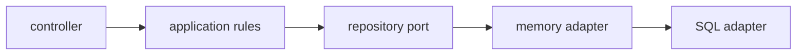
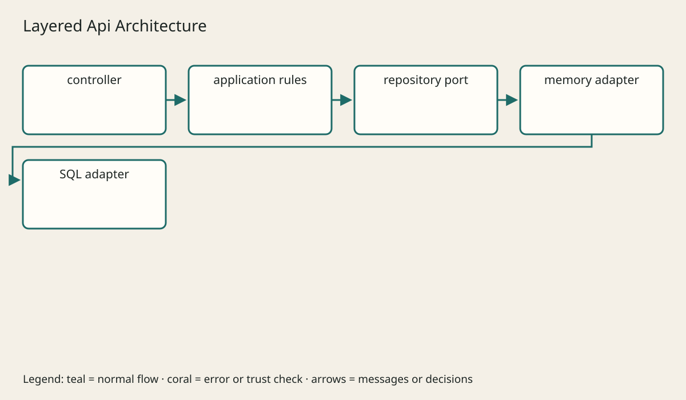
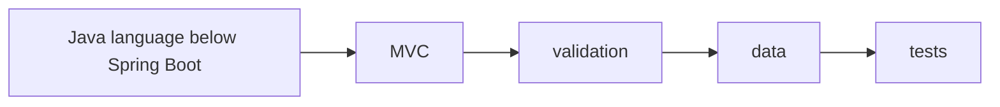
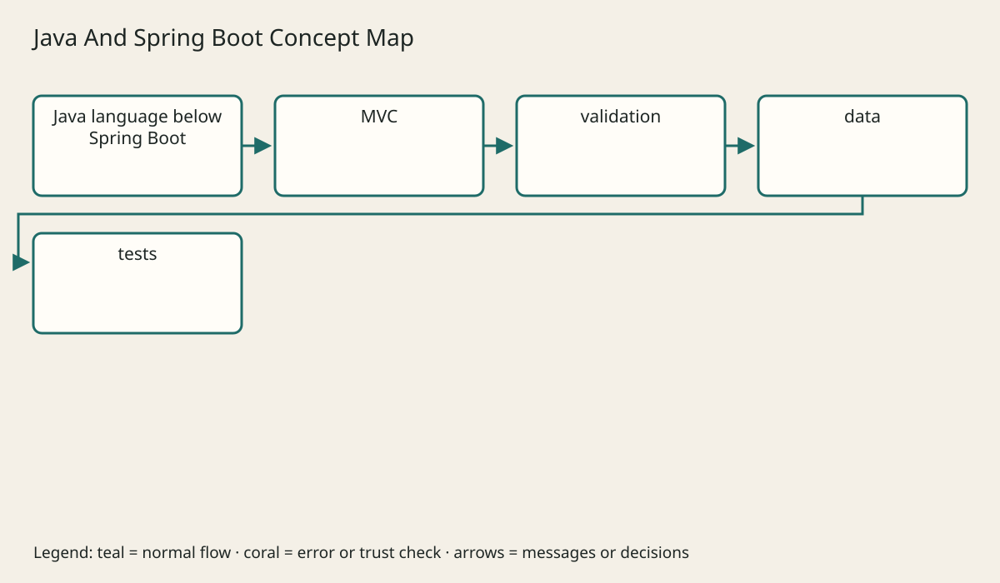

# Spring Boot From Zero

## The big idea in plain words {#picture}

Learning is like climbing stairs. You can only reach the third step if the first two are solid.

## What you will be able to do {#outcomes}

Read this after the previous numbered lesson. Use synthetic notes and local exercise data. By the end you should explain the following scope without copying:

Teach Boot startup, beans, inversion of control, dependency injection, MVC, binding, validation, profiles, and error advice.

## Words to know {#vocabulary}

- **prerequisite**: something you need to know first, before the next thing makes sense.

- **checkpoint**: a question you answer from memory, without peeking.

- **contract**: a clear promise about what goes in and what comes out.

## Why this idea exists {#history}

If you try to memorize a whole framework before you ever run one small example, most of it slips away. Learning in small loops (read, guess, try, check, review) shows you exactly which step you missed.

## Concept 1 {#concept-1}

prerequisite means something you need to know first, before the next thing makes sense. Read the prerequisites before you run a framework example.

Apply this rule to the Study Notes boundary before choosing syntax. Name the input, owner, and observable result. The scenario below gives a concrete decision to check.

## Concept 2 {#concept-2}

Guess the output first, then look at the answer.

Apply this rule to the Study Notes boundary before choosing syntax. Name the input, owner, and observable result. The scenario below gives a concrete decision to check.

## Concept 3 {#concept-3}

When a test fails, it points to the idea you are missing.

Apply this rule to the Study Notes boundary before choosing syntax. Name the input, owner, and observable result. The scenario below gives a concrete decision to check.

## Concept 4 {#concept-4}

A practice score in this app is just a helper, not an official exam grade.

Apply this rule to the Study Notes boundary before choosing syntax. Name the input, owner, and observable result. The scenario below gives a concrete decision to check.

## Going deeper: the technical walkthrough {#walkthrough}

### Create the application


Use Spring Initializr or a version-pinned Gradle project. Typical dependencies
for a learning REST service are:

- Spring Web;
- Validation;
- Spring JDBC or Spring Data JPA;
- an H2 or PostgreSQL driver for the chosen environment;
- Actuator;
- a test starter;
- Spring Security only when authentication is part of the exercise.

A main class looks like this:

```java
@SpringBootApplication
public class StudyApiApplication {
    public static void main(String[] args) {
        SpringApplication.run(StudyApiApplication.class, args);
    }
}
```

`@SpringBootApplication` combines component scanning, auto-configuration, and
application configuration. The package of the main class should be above the
components you expect Spring to find.


### Beans and dependency injection


A bean is an object managed by Spring. Constructor injection makes the required
collaborator visible:

```java
@Service
public class NoteService {
    private final NoteRepository repository;

    public NoteService(NoteRepository repository) {
        this.repository = repository;
    }
}
```

Useful stereotypes include:

| Annotation | Job |
| --- | --- |
| `@RestController` | handles HTTP and returns data |
| `@Service` | owns application or business operations |
| `@Repository` | marks data access code |
| `@Configuration` | declares setup and beans |
| `@RestControllerAdvice` | translates controller errors |
| `@Profile` | limits a bean to an environment |

Avoid field injection because it hides required dependencies and makes focused
tests harder to construct.


### Build a REST route


```java
@RestController
@RequestMapping("/notes")
public class NoteController {
    private final NoteService service;

    public NoteController(NoteService service) {
        this.service = service;
    }

    @GetMapping("/{id}")
    public NoteResponse get(@PathVariable long id) {
        return service.get(id);
    }
}
```

The controller translates HTTP. It should not contain a raw SQL string or the
full business rule. `@GetMapping` means this method handles a `GET` request.


### Bind and validate input


```java
public record NoteRequest(
        @NotBlank @Size(max = 120) String title,
        @NotBlank @Size(max = 20_000) String body) {
}
```

```java
@PostMapping
@ResponseStatus(HttpStatus.CREATED)
public NoteResponse create(@Valid @RequestBody NoteRequest request) {
    return service.create(request);
}
```

Common binders:

- `@PathVariable` reads a path part;
- `@RequestParam` reads a query parameter;
- `@RequestBody` maps JSON to a Java object;
- `@RequestHeader` reads a header;
- `@Valid` triggers bean validation.

Bean validation checks shape and simple limits. The service checks meaning,
permissions, and rules that depend on other data.


### Error handling


Centralize safe translation:

```java
@RestControllerAdvice
public class ApiExceptionHandler {
    @ExceptionHandler(NoteNotFoundException.class)
    ResponseEntity<ProblemDetail> notFound(NoteNotFoundException exception) {
        ProblemDetail problem = ProblemDetail.forStatus(HttpStatus.NOT_FOUND);
        problem.setTitle("Note not found");
        problem.setDetail("The requested note does not exist.");
        return ResponseEntity.status(HttpStatus.NOT_FOUND).body(problem);
    }
}
```

Do not include SQL, stack traces, provider messages, local paths, or secrets in
the response. Add a request ID and a stable error code when clients need
machine-readable behavior.


## Worked scenario {#worked-scenario}

You understand how to ask for data with GET, but you cannot explain how the server checks incoming data. What should you study next?

The justified choice is **Practice sending bad data and see how the server checks it**. Select **review-validation** in the structured practical and explain why. Alternatives ignore a requirement, cross a trust boundary, or invent success.

### Structured decision contract

```json

{
  "decision": "review-validation",
  "justification": "The prerequisite and checkpoint boundary must preserve the declared contract and ownership.",
  "failureBehavior": "Expose a safe failure and recover through the boundary owner."
}

```

Decision selects one declared behavior. Justification explains the boundary. FailureBehavior explains the observable error and recovery owner. These fields never execute commands. Required terms and minimum lengths form a basic practice rubric, not semantic grading.

## Step-by-step flow and matching picture {#flow}









## Three real-life uses {#use-cases}

1. A personal learner applies this rule to one synthetic note and checks the result.
2. A team changes the boundary while preserving its shared request and response contract.
3. A deployed library handles concurrent requests and reports failures through safe errors and correlated signals.

## What can go wrong, and how to stay safe {#failure-security}

Come back to a topic after a break; remembering it is better practice than just re-reading it. An external dependency needs an owner, size limit, deadline, cleanup, and recovery path. Return a stable error code rather than raw exceptions. Redact credentials and private bodies in diagnostics.

The abstraction improves prerequisite reasoning but adds configuration and lifecycle work. Keep a simpler implementation when it meets the requirement. Measure the limiting resource before adding services, queues, or caches.

## Practice lab and expected observation {#practice}

1. Predict the scenario decision before opening Practical. Explain each rejected alternative.
2. Run a relevant example above in an isolated exercise project. Record the expected result, then change one input to an invalid or boundary value. A failed assertion or deliberate error should replace silent success.
3. Submit the structured decision. Initially the checks fail. After selecting review-validation and writing an explanation and failure plan, all three pass. Follow the indicated review section for missed checks.

### Broken example to debug

```json

{"decision":"trust-client","justification":"","failureBehavior":""}

```

This ignores the responsible boundary and gives no reasoning or recovery. Correct the fields rather than changing the validator.

## Checkpoint and definition of done {#checkpoint}

- [ ] Define prerequisite and checkpoint without looking.
- [ ] Trace input to owner and output.
- [ ] Explain one failure and one alternative.
- [ ] Pass at least four assignment questions.
- [ ] Pass every practical check and submit.
- [ ] Explain the concept again tomorrow.

## Sources, versions, and safe commands {#sources}

HTTP semantics; educational contracts, not an audit of the unavailable TM Schedule repository. Review date: 2026-10-02. The supplied blueprint is the teaching source; official landing pages were checked where reachable. No provider or original TM Schedule deployment was tested.

- [Official reference](https://www.rfc-editor.org/rfc/rfc9110)

- [Official reference](https://spec.openapis.org/oas/v3.1.0.html)

[Course reading order](README.md) · [Previous lesson](04-java-oop-and-modern-java.md) · [Next lesson](06-tm-schedule-architecture.md)

```study-quiz

{
  "schemaVersion": 1,
  "lessonId": "api-design/05-spring-boot-from-zero",
  "title": "Assignment: Spring Boot From Zero",
  "passPercentage": 80,
  "questions": [
    {
      "id": "q1",
      "sectionId": "concept-1",
      "prompt": "In Spring Boot From Zero, what does prerequisite mean?",
      "options": [
        {
          "id": "a",
          "text": "A permission granted by a hidden browser control",
          "explanation": "This changes the declared meaning or bypasses the responsible boundary."
        },
        {
          "id": "b",
          "text": "something you need to know first, before the next thing makes sense",
          "explanation": "This preserves the definition and boundary described in the lesson."
        },
        {
          "id": "c",
          "text": "An unlimited provider operation with no ownership",
          "explanation": "This changes the declared meaning or bypasses the responsible boundary."
        },
        {
          "id": "d",
          "text": "A diagnostic credential intended for public logs",
          "explanation": "This changes the declared meaning or bypasses the responsible boundary."
        }
      ],
      "correctOptionId": "b",
      "explanation": "prerequisite means something you need to know first, before the next thing makes sense.",
      "reviewLabel": "Review concept 1"
    },
    {
      "id": "q2",
      "sectionId": "concept-2",
      "prompt": "In Spring Boot From Zero, which rule is correct for checkpoint 2?",
      "options": [
        {
          "id": "a",
          "text": "Trust client-side checks instead of the server rule.",
          "explanation": "This changes the declared meaning or bypasses the responsible boundary."
        },
        {
          "id": "b",
          "text": "Hide the failure by returning a fabricated successful result.",
          "explanation": "This changes the declared meaning or bypasses the responsible boundary."
        },
        {
          "id": "c",
          "text": "Guess the output first, then look at the answer.",
          "explanation": "This preserves the definition and boundary described in the lesson."
        },
        {
          "id": "d",
          "text": "Skip the stated boundary, limit, or ownership check.",
          "explanation": "This changes the declared meaning or bypasses the responsible boundary."
        }
      ],
      "correctOptionId": "c",
      "explanation": "Guess the output first, then look at the answer.",
      "reviewLabel": "Review concept 2"
    },
    {
      "id": "q3",
      "sectionId": "concept-3",
      "prompt": "In Spring Boot From Zero, which rule is correct for checkpoint 3?",
      "options": [
        {
          "id": "a",
          "text": "Trust client-side checks instead of the server rule.",
          "explanation": "This changes the declared meaning or bypasses the responsible boundary."
        },
        {
          "id": "b",
          "text": "Hide the failure by returning a fabricated successful result.",
          "explanation": "This changes the declared meaning or bypasses the responsible boundary."
        },
        {
          "id": "c",
          "text": "Skip the stated boundary, limit, or ownership check.",
          "explanation": "This changes the declared meaning or bypasses the responsible boundary."
        },
        {
          "id": "d",
          "text": "When a test fails, it points to the idea you are missing.",
          "explanation": "This preserves the definition and boundary described in the lesson."
        }
      ],
      "correctOptionId": "d",
      "explanation": "When a test fails, it points to the idea you are missing.",
      "reviewLabel": "Review concept 3"
    },
    {
      "id": "q4",
      "sectionId": "concept-4",
      "prompt": "In Spring Boot From Zero, which rule is correct for checkpoint 4?",
      "options": [
        {
          "id": "a",
          "text": "A practice score in this app is just a helper, not an official exam grade.",
          "explanation": "This preserves the definition and boundary described in the lesson."
        },
        {
          "id": "b",
          "text": "Trust client-side checks instead of the server rule.",
          "explanation": "This changes the declared meaning or bypasses the responsible boundary."
        },
        {
          "id": "c",
          "text": "Hide the failure by returning a fabricated successful result.",
          "explanation": "This changes the declared meaning or bypasses the responsible boundary."
        },
        {
          "id": "d",
          "text": "Skip the stated boundary, limit, or ownership check.",
          "explanation": "This changes the declared meaning or bypasses the responsible boundary."
        }
      ],
      "correctOptionId": "a",
      "explanation": "A practice score in this app is just a helper, not an official exam grade.",
      "reviewLabel": "Review concept 4"
    },
    {
      "id": "q5",
      "sectionId": "worked-scenario",
      "prompt": "You understand how to ask for data with GET, but you cannot explain how the server checks incoming data. What should you study next?",
      "options": [
        {
          "id": "a",
          "text": "Jump straight to advanced deployment",
          "explanation": "This changes the declared meaning or bypasses the responsible boundary."
        },
        {
          "id": "b",
          "text": "Practice sending bad data and see how the server checks it",
          "explanation": "This preserves the definition and boundary described in the lesson."
        },
        {
          "id": "c",
          "text": "Copy an answer without trying it",
          "explanation": "This changes the declared meaning or bypasses the responsible boundary."
        },
        {
          "id": "d",
          "text": "Switch frameworks so the problem goes away",
          "explanation": "This changes the declared meaning or bypasses the responsible boundary."
        }
      ],
      "correctOptionId": "b",
      "explanation": "Practice sending bad data and see how the server checks it. Come back to a topic after a break; remembering it is better practice than just re-reading it.",
      "reviewLabel": "Review the worked scenario"
    }
  ]
}

```

```study-practical

{
  "schemaVersion": 1,
  "challengeId": "api-design/05-spring-boot-from-zero/decision",
  "lessonId": "api-design/05-spring-boot-from-zero",
  "title": "Practical: Spring Boot From Zero",
  "language": "json",
  "mode": "structured",
  "instructions": "You understand how to ask for data with GET, but you cannot explain how the server checks incoming data. What should you study next? Return an object with decision (choose from review-validation, skip-check, unbounded-work, trust-client), justification (at least 40 characters; include prerequisite and checkpoint), and failureBehavior (at least 25 characters; include failure and recover while explaining the error and recovery). These are structured reasoning checks, not code execution or an official grade.",
  "starterCode": "{\n  \"decision\": \"\",\n  \"justification\": \"\",\n  \"failureBehavior\": \"\"\n}",
  "entryPoint": "answer",
  "publicExamples": [
    {
      "input": {
        "decision": "skip-check",
        "justification": "",
        "failureBehavior": ""
      },
      "expected": {
        "passed": false
      }
    },
    {
      "input": {
        "decision": "review-validation",
        "justification": "The prerequisite and checkpoint boundary must preserve the declared contract and ownership.",
        "failureBehavior": "Show a safe failure and recover through the responsible owner."
      },
      "expected": {
        "passed": true
      }
    }
  ],
  "publicTestIds": [
    "decision",
    "explanation",
    "failure-plan"
  ],
  "reviewSections": {
    "decision": "worked-scenario",
    "explanation": "concept-2",
    "failure-plan": "failure-security"
  },
  "limits": {
    "timeMs": 2000,
    "memoryMb": 128,
    "outputBytes": 20000
  }
}

```

