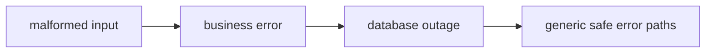
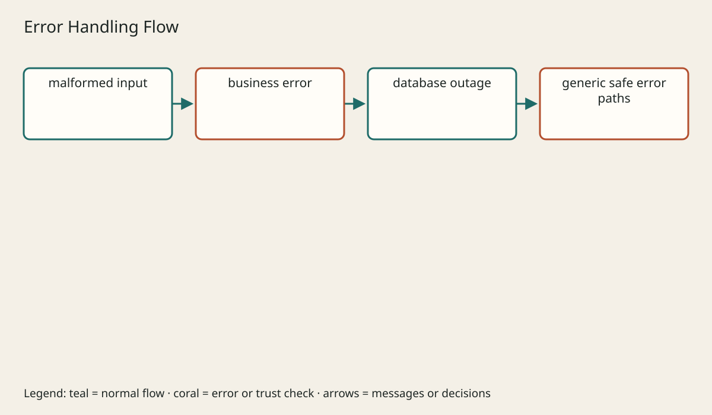

# Validation Errors Security

## The big idea in plain words {#picture}

A badge shows who you are. A room key decides which rooms you can enter. They are not the same thing.

## What you will be able to do {#outcomes}

Read this after the previous numbered lesson. Use synthetic notes and local exercise data. By the end you should explain the following scope without copying:

Teach shape versus business validation, safe error bodies, authentication, authorization, secrets, SQL safety, CORS, and audit.

## Words to know {#vocabulary}

- **authentication**: proving who someone is.

- **authorization**: checking what that person may do with specific data.

- **leastPrivilege**: giving only the access a job really needs.

## Why this idea exists {#history}

Trusting a button in the browser, or a suggestion from an AI model, hands your power to the wrong place. Check who the caller is, and check what they may do, on the server you control.

## Concept 1 {#concept-1}

authentication means proving who someone is. Who you are and what you may do are two different questions.

Apply this rule to the Study Notes boundary before choosing syntax. Name the input, owner, and observable result. The scenario below gives a concrete decision to check.

## Concept 2 {#concept-2}

Hiding a button does not protect anything.

Apply this rule to the Study Notes boundary before choosing syntax. Name the input, owner, and observable result. The scenario below gives a concrete decision to check.

## Concept 3 {#concept-3}

Keep passwords and keys in protected server settings.

Apply this rule to the Study Notes boundary before choosing syntax. Name the input, owner, and observable result. The scenario below gives a concrete decision to check.

## Concept 4 {#concept-4}

If users can give a link, control where the server is allowed to go.

Apply this rule to the Study Notes boundary before choosing syntax. Name the input, owner, and observable result. The scenario below gives a concrete decision to check.

## Going deeper: the technical walkthrough {#walkthrough}

### Status codes and stable errors


Use a small consistent set:

| Status | Meaning |
| --- | --- |
| `200` | successful read or update |
| `201` | resource created |
| `202` | work accepted for later processing |
| `204` | successful action with no body |
| `400` | malformed or invalid request |
| `401` | caller is not authenticated |
| `403` | caller is authenticated but not allowed |
| `404` | resource is missing |
| `409` | conflict or duplicate |
| `413` | request is too large |
| `415` | unsupported media type |
| `429` | rate limit reached |
| `503` | dependency is temporarily unavailable |
| `500` | unexpected server failure |

A stable error can look like this:

```json
{
  "message": "The note was not found.",
  "code": "NOTE_NOT_FOUND",
  "requestId": "req-abc"
}
```

Do not return stack traces, SQL, local paths, provider responses, credentials,
or raw exception objects. Log safe diagnostic context on the server.


### Validation and authorization


Validation asks whether the request has an acceptable shape and meaning.
Authorization asks whether this caller may perform the action on this record.
Both belong on the server.

Use bounded values:

- title length between 1 and 120;
- page size between 1 and 100;
- file size below a configured maximum;
- enum values from an allowlist;
- relative paths without absolute or traversal segments.

Do not trust an ID, category, username, or folder name because it came from a
browser. Normalize once, validate again at sensitive boundaries, and authorize
against the authoritative user and resource data.


### Authentication, authorization, and limits


Authentication can use a secure session or a short-lived token. Authorization
must check the action and the resource. Rate limits protect login, expensive
queries, and public write routes.

Keep secrets server-side. Use HTTPS. Set intentional cookie flags. Validate
issuer, audience, expiry, and scopes for tokens. Keep CORS narrow. Add CSRF
protection for cookie-authenticated browser writes. Do not log tokens.


## Worked scenario {#worked-scenario}

A signed-in student asks for another student's private note. What should happen?

The justified choice is **Say no, because the ownership check fails**. Select **deny-cross-user** in the structured practical and explain why. Alternatives ignore a requirement, cross a trust boundary, or invent success.

### Structured decision contract

```json

{
  "decision": "deny-cross-user",
  "justification": "The authentication and authorization boundary must preserve the declared contract and ownership.",
  "failureBehavior": "Expose a safe failure and recover through the boundary owner."
}

```

Decision selects one declared behavior. Justification explains the boundary. FailureBehavior explains the observable error and recovery owner. These fields never execute commands. Required terms and minimum lengths form a basic practice rubric, not semantic grading.

## Step-by-step flow and matching picture {#flow}





## Three real-life uses {#use-cases}

1. A personal learner applies this rule to one synthetic note and checks the result.
2. A team changes the boundary while preserving its shared request and response contract.
3. A deployed library handles concurrent requests and reports failures through safe errors and correlated signals.

## What can go wrong, and how to stay safe {#failure-security}

Logs must hide passwords and private content. An external dependency needs an owner, size limit, deadline, cleanup, and recovery path. Return a stable error code rather than raw exceptions. Redact credentials and private bodies in diagnostics.

The abstraction improves authentication reasoning but adds configuration and lifecycle work. Keep a simpler implementation when it meets the requirement. Measure the limiting resource before adding services, queues, or caches.

## Practice lab and expected observation {#practice}

1. Predict the scenario decision before opening Practical. Explain each rejected alternative.
2. Run a relevant example above in an isolated exercise project. Record the expected result, then change one input to an invalid or boundary value. A failed assertion or deliberate error should replace silent success.
3. Submit the structured decision. Initially the checks fail. After selecting deny-cross-user and writing an explanation and failure plan, all three pass. Follow the indicated review section for missed checks.

### Broken example to debug

```json

{"decision":"trust-client","justification":"","failureBehavior":""}

```

This ignores the responsible boundary and gives no reasoning or recovery. Correct the fields rather than changing the validator.

## Checkpoint and definition of done {#checkpoint}

- [ ] Define authentication and authorization without looking.
- [ ] Trace input to owner and output.
- [ ] Explain one failure and one alternative.
- [ ] Pass at least four assignment questions.
- [ ] Pass every practical check and submit.
- [ ] Explain the concept again tomorrow.

## Sources, versions, and safe commands {#sources}

HTTP semantics; educational contracts, not an audit of the unavailable TM Schedule repository. Review date: 2026-10-02. The supplied blueprint is the teaching source; official landing pages were checked where reachable. No provider or original TM Schedule deployment was tested.

- [Official reference](https://www.rfc-editor.org/rfc/rfc9110)

- [Official reference](https://spec.openapis.org/oas/v3.1.0.html)

[Course reading order](README.md) · [Previous lesson](09-database-sql-jdbc-oracle.md) · [Next lesson](11-testing-apis.md)

```study-quiz

{
  "schemaVersion": 1,
  "lessonId": "api-design/10-validation-errors-security",
  "title": "Assignment: Validation Errors Security",
  "passPercentage": 80,
  "questions": [
    {
      "id": "q1",
      "sectionId": "concept-1",
      "prompt": "In Validation Errors Security, what does authentication mean?",
      "options": [
        {
          "id": "a",
          "text": "A permission granted by a hidden browser control",
          "explanation": "This changes the declared meaning or bypasses the responsible boundary."
        },
        {
          "id": "b",
          "text": "proving who someone is",
          "explanation": "This preserves the definition and boundary described in the lesson."
        },
        {
          "id": "c",
          "text": "An unlimited provider operation with no ownership",
          "explanation": "This changes the declared meaning or bypasses the responsible boundary."
        },
        {
          "id": "d",
          "text": "A diagnostic credential intended for public logs",
          "explanation": "This changes the declared meaning or bypasses the responsible boundary."
        }
      ],
      "correctOptionId": "b",
      "explanation": "authentication means proving who someone is.",
      "reviewLabel": "Review concept 1"
    },
    {
      "id": "q2",
      "sectionId": "concept-2",
      "prompt": "In Validation Errors Security, which rule is correct for checkpoint 2?",
      "options": [
        {
          "id": "a",
          "text": "Trust client-side checks instead of the server rule.",
          "explanation": "This changes the declared meaning or bypasses the responsible boundary."
        },
        {
          "id": "b",
          "text": "Hide the failure by returning a fabricated successful result.",
          "explanation": "This changes the declared meaning or bypasses the responsible boundary."
        },
        {
          "id": "c",
          "text": "Hiding a button does not protect anything.",
          "explanation": "This preserves the definition and boundary described in the lesson."
        },
        {
          "id": "d",
          "text": "Skip the stated boundary, limit, or ownership check.",
          "explanation": "This changes the declared meaning or bypasses the responsible boundary."
        }
      ],
      "correctOptionId": "c",
      "explanation": "Hiding a button does not protect anything.",
      "reviewLabel": "Review concept 2"
    },
    {
      "id": "q3",
      "sectionId": "concept-3",
      "prompt": "In Validation Errors Security, which rule is correct for checkpoint 3?",
      "options": [
        {
          "id": "a",
          "text": "Trust client-side checks instead of the server rule.",
          "explanation": "This changes the declared meaning or bypasses the responsible boundary."
        },
        {
          "id": "b",
          "text": "Hide the failure by returning a fabricated successful result.",
          "explanation": "This changes the declared meaning or bypasses the responsible boundary."
        },
        {
          "id": "c",
          "text": "Skip the stated boundary, limit, or ownership check.",
          "explanation": "This changes the declared meaning or bypasses the responsible boundary."
        },
        {
          "id": "d",
          "text": "Keep passwords and keys in protected server settings.",
          "explanation": "This preserves the definition and boundary described in the lesson."
        }
      ],
      "correctOptionId": "d",
      "explanation": "Keep passwords and keys in protected server settings.",
      "reviewLabel": "Review concept 3"
    },
    {
      "id": "q4",
      "sectionId": "concept-4",
      "prompt": "In Validation Errors Security, which rule is correct for checkpoint 4?",
      "options": [
        {
          "id": "a",
          "text": "If users can give a link, control where the server is allowed to go.",
          "explanation": "This preserves the definition and boundary described in the lesson."
        },
        {
          "id": "b",
          "text": "Trust client-side checks instead of the server rule.",
          "explanation": "This changes the declared meaning or bypasses the responsible boundary."
        },
        {
          "id": "c",
          "text": "Hide the failure by returning a fabricated successful result.",
          "explanation": "This changes the declared meaning or bypasses the responsible boundary."
        },
        {
          "id": "d",
          "text": "Skip the stated boundary, limit, or ownership check.",
          "explanation": "This changes the declared meaning or bypasses the responsible boundary."
        }
      ],
      "correctOptionId": "a",
      "explanation": "If users can give a link, control where the server is allowed to go.",
      "reviewLabel": "Review concept 4"
    },
    {
      "id": "q5",
      "sectionId": "worked-scenario",
      "prompt": "A signed-in student asks for another student's private note. What should happen?",
      "options": [
        {
          "id": "a",
          "text": "Allow it because any login is enough",
          "explanation": "This changes the declared meaning or bypasses the responsible boundary."
        },
        {
          "id": "b",
          "text": "Say no, because the ownership check fails",
          "explanation": "This preserves the definition and boundary described in the lesson."
        },
        {
          "id": "c",
          "text": "Believe the role the student claims",
          "explanation": "This changes the declared meaning or bypasses the responsible boundary."
        },
        {
          "id": "d",
          "text": "Send a secret so they can sign in",
          "explanation": "This changes the declared meaning or bypasses the responsible boundary."
        }
      ],
      "correctOptionId": "b",
      "explanation": "Say no, because the ownership check fails. Logs must hide passwords and private content.",
      "reviewLabel": "Review the worked scenario"
    }
  ]
}

```

```study-practical

{
  "schemaVersion": 1,
  "challengeId": "api-design/10-validation-errors-security/decision",
  "lessonId": "api-design/10-validation-errors-security",
  "title": "Practical: Validation Errors Security",
  "language": "json",
  "mode": "structured",
  "instructions": "A signed-in student asks for another student's private note. What should happen? Return an object with decision (choose from deny-cross-user, skip-check, unbounded-work, trust-client), justification (at least 40 characters; include authentication and authorization), and failureBehavior (at least 25 characters; include failure and recover while explaining the error and recovery). These are structured reasoning checks, not code execution or an official grade.",
  "starterCode": "{\n  \"decision\": \"\",\n  \"justification\": \"\",\n  \"failureBehavior\": \"\"\n}",
  "entryPoint": "answer",
  "publicExamples": [
    {
      "input": {
        "decision": "skip-check",
        "justification": "",
        "failureBehavior": ""
      },
      "expected": {
        "passed": false
      }
    },
    {
      "input": {
        "decision": "deny-cross-user",
        "justification": "The authentication and authorization boundary must preserve the declared contract and ownership.",
        "failureBehavior": "Show a safe failure and recover through the responsible owner."
      },
      "expected": {
        "passed": true
      }
    }
  ],
  "publicTestIds": [
    "decision",
    "explanation",
    "failure-plan"
  ],
  "reviewSections": {
    "decision": "worked-scenario",
    "explanation": "concept-2",
    "failure-plan": "failure-security"
  },
  "limits": {
    "timeMs": 2000,
    "memoryMb": 128,
    "outputBytes": 20000
  }
}

```

