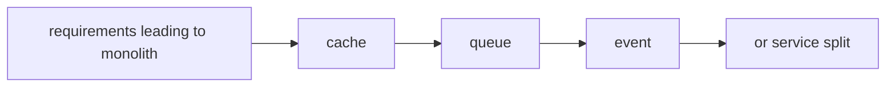

# System Design And Design Patterns

## The big idea in plain words {#picture}

Architecture is a map of the building: which room belongs to whom and which doors connect them.

## What you will be able to do {#outcomes}

Read this after the previous numbered lesson. Use synthetic notes and local exercise data. By the end you should explain the following scope without copying:

Teach layered monolith, repository, adapter, cache, queue, event, outbox, CQRS, saga, strangler, and trade-offs.

## Words to know {#vocabulary}

- **monolith**: an app that is built and shipped as one piece.

- **port**: a doorway where your app talks to the outside.

- **saga**: a chain of steps where each step has an 'undo' step.

## Why this idea exists {#history}

One tangled program is risky to change, but splitting into many services adds network and deployment work. Start with tidy parts inside one program, and split only when you must.

## Concept 1 {#concept-1}

monolith means an app that is built and shipped as one piece. A modular monolith can have clear owners without network calls.

Apply this rule to the Study Notes boundary before choosing syntax. Name the input, owner, and observable result. The scenario below gives a concrete decision to check.

## Concept 2 {#concept-2}

Split into a service only when you truly need to scale or release it separately.

Apply this rule to the Study Notes boundary before choosing syntax. Name the input, owner, and observable result. The scenario below gives a concrete decision to check.

## Concept 3 {#concept-3}

An outbox keeps messages safe until they are sent.

Apply this rule to the Study Notes boundary before choosing syntax. Name the input, owner, and observable result. The scenario below gives a concrete decision to check.

## Concept 4 {#concept-4}

CQRS splits reading and writing, and brings extra coordination.

Apply this rule to the Study Notes boundary before choosing syntax. Name the input, owner, and observable result. The scenario below gives a concrete decision to check.

## Going deeper: the technical walkthrough {#walkthrough}

### Transactions and asynchronous work


Use a transaction when a set of changes must succeed or fail together. Do not
pretend a transaction across two independent providers is automatic.

Use a job and queue when work is slow, large, or retryable:

```text
POST /exports -> 202 {"jobId":"job-1"}
queue -> worker -> private file
GET /exports/job-1 -> status and result link
```

Workers need bounded retries, idempotent behavior, dead-letter handling,
backpressure, and visible failure. A queue is not a magic speed button.


## Worked scenario {#worked-scenario}

A small team builds a simple CRUD app and has no separate scaling problem. What should it start with?

The justified choice is **A modular monolith with clear ports**. Select **modular-monolith** in the structured practical and explain why. Alternatives ignore a requirement, cross a trust boundary, or invent success.

### Structured decision contract

```json

{
  "decision": "modular-monolith",
  "justification": "The monolith and port boundary must preserve the declared contract and ownership.",
  "failureBehavior": "Expose a safe failure and recover through the boundary owner."
}

```

Decision selects one declared behavior. Justification explains the boundary. FailureBehavior explains the observable error and recovery owner. These fields never execute commands. Required terms and minimum lengths form a basic practice rubric, not semantic grading.

## Step-by-step flow and matching picture {#flow}




## Three real-life uses {#use-cases}

1. A personal learner applies this rule to one synthetic note and checks the result.
2. A team changes the boundary while preserving its shared request and response contract.
3. A deployed library handles concurrent requests and reports failures through safe errors and correlated signals.

## What can go wrong, and how to stay safe {#failure-security}

A saga fixes mistakes with undo steps, not one magic rollback. An external dependency needs an owner, size limit, deadline, cleanup, and recovery path. Return a stable error code rather than raw exceptions. Redact credentials and private bodies in diagnostics.

The abstraction improves monolith reasoning but adds configuration and lifecycle work. Keep a simpler implementation when it meets the requirement. Measure the limiting resource before adding services, queues, or caches.

## Practice lab and expected observation {#practice}

1. Predict the scenario decision before opening Practical. Explain each rejected alternative.
2. Run a relevant example above in an isolated exercise project. Record the expected result, then change one input to an invalid or boundary value. A failed assertion or deliberate error should replace silent success.
3. Submit the structured decision. Initially the checks fail. After selecting modular-monolith and writing an explanation and failure plan, all three pass. Follow the indicated review section for missed checks.

### Broken example to debug

```json

{"decision":"trust-client","justification":"","failureBehavior":""}

```

This ignores the responsible boundary and gives no reasoning or recovery. Correct the fields rather than changing the validator.

## Checkpoint and definition of done {#checkpoint}

- [ ] Define monolith and port without looking.
- [ ] Trace input to owner and output.
- [ ] Explain one failure and one alternative.
- [ ] Pass at least four assignment questions.
- [ ] Pass every practical check and submit.
- [ ] Explain the concept again tomorrow.

## Sources, versions, and safe commands {#sources}

HTTP semantics; educational contracts, not an audit of the unavailable TM Schedule repository. Review date: 2026-10-02. The supplied blueprint is the teaching source; official landing pages were checked where reachable. No provider or original TM Schedule deployment was tested.

- [Official reference](https://www.rfc-editor.org/rfc/rfc9110)

- [Official reference](https://spec.openapis.org/oas/v3.1.0.html)

[Course reading order](README.md) · [Previous lesson](11-testing-apis.md) · [Next lesson](13-application-development-blueprint.md)

```study-quiz

{
  "schemaVersion": 1,
  "lessonId": "api-design/12-system-design-and-design-patterns",
  "title": "Assignment: System Design And Design Patterns",
  "passPercentage": 80,
  "questions": [
    {
      "id": "q1",
      "sectionId": "concept-1",
      "prompt": "In System Design And Design Patterns, what does monolith mean?",
      "options": [
        {
          "id": "a",
          "text": "A permission granted by a hidden browser control",
          "explanation": "This changes the declared meaning or bypasses the responsible boundary."
        },
        {
          "id": "b",
          "text": "An unlimited provider operation with no ownership",
          "explanation": "This changes the declared meaning or bypasses the responsible boundary."
        },
        {
          "id": "c",
          "text": "A diagnostic credential intended for public logs",
          "explanation": "This changes the declared meaning or bypasses the responsible boundary."
        },
        {
          "id": "d",
          "text": "an app that is built and shipped as one piece",
          "explanation": "This preserves the definition and boundary described in the lesson."
        }
      ],
      "correctOptionId": "d",
      "explanation": "monolith means an app that is built and shipped as one piece.",
      "reviewLabel": "Review concept 1"
    },
    {
      "id": "q2",
      "sectionId": "concept-2",
      "prompt": "In System Design And Design Patterns, which rule is correct for checkpoint 2?",
      "options": [
        {
          "id": "a",
          "text": "Split into a service only when you truly need to scale or release it separately.",
          "explanation": "This preserves the definition and boundary described in the lesson."
        },
        {
          "id": "b",
          "text": "Trust client-side checks instead of the server rule.",
          "explanation": "This changes the declared meaning or bypasses the responsible boundary."
        },
        {
          "id": "c",
          "text": "Hide the failure by returning a fabricated successful result.",
          "explanation": "This changes the declared meaning or bypasses the responsible boundary."
        },
        {
          "id": "d",
          "text": "Skip the stated boundary, limit, or ownership check.",
          "explanation": "This changes the declared meaning or bypasses the responsible boundary."
        }
      ],
      "correctOptionId": "a",
      "explanation": "Split into a service only when you truly need to scale or release it separately.",
      "reviewLabel": "Review concept 2"
    },
    {
      "id": "q3",
      "sectionId": "concept-3",
      "prompt": "In System Design And Design Patterns, which rule is correct for checkpoint 3?",
      "options": [
        {
          "id": "a",
          "text": "Trust client-side checks instead of the server rule.",
          "explanation": "This changes the declared meaning or bypasses the responsible boundary."
        },
        {
          "id": "b",
          "text": "An outbox keeps messages safe until they are sent.",
          "explanation": "This preserves the definition and boundary described in the lesson."
        },
        {
          "id": "c",
          "text": "Hide the failure by returning a fabricated successful result.",
          "explanation": "This changes the declared meaning or bypasses the responsible boundary."
        },
        {
          "id": "d",
          "text": "Skip the stated boundary, limit, or ownership check.",
          "explanation": "This changes the declared meaning or bypasses the responsible boundary."
        }
      ],
      "correctOptionId": "b",
      "explanation": "An outbox keeps messages safe until they are sent.",
      "reviewLabel": "Review concept 3"
    },
    {
      "id": "q4",
      "sectionId": "concept-4",
      "prompt": "In System Design And Design Patterns, which rule is correct for checkpoint 4?",
      "options": [
        {
          "id": "a",
          "text": "Trust client-side checks instead of the server rule.",
          "explanation": "This changes the declared meaning or bypasses the responsible boundary."
        },
        {
          "id": "b",
          "text": "Hide the failure by returning a fabricated successful result.",
          "explanation": "This changes the declared meaning or bypasses the responsible boundary."
        },
        {
          "id": "c",
          "text": "CQRS splits reading and writing, and brings extra coordination.",
          "explanation": "This preserves the definition and boundary described in the lesson."
        },
        {
          "id": "d",
          "text": "Skip the stated boundary, limit, or ownership check.",
          "explanation": "This changes the declared meaning or bypasses the responsible boundary."
        }
      ],
      "correctOptionId": "c",
      "explanation": "CQRS splits reading and writing, and brings extra coordination.",
      "reviewLabel": "Review concept 4"
    },
    {
      "id": "q5",
      "sectionId": "worked-scenario",
      "prompt": "A small team builds a simple CRUD app and has no separate scaling problem. What should it start with?",
      "options": [
        {
          "id": "a",
          "text": "One service for every class",
          "explanation": "This changes the declared meaning or bypasses the responsible boundary."
        },
        {
          "id": "b",
          "text": "Distributed transactions for every read",
          "explanation": "This changes the declared meaning or bypasses the responsible boundary."
        },
        {
          "id": "c",
          "text": "A database that every browser can reach directly",
          "explanation": "This changes the declared meaning or bypasses the responsible boundary."
        },
        {
          "id": "d",
          "text": "A modular monolith with clear ports",
          "explanation": "This preserves the definition and boundary described in the lesson."
        }
      ],
      "correctOptionId": "d",
      "explanation": "A modular monolith with clear ports. A saga fixes mistakes with undo steps, not one magic rollback.",
      "reviewLabel": "Review the worked scenario"
    }
  ]
}

```

```study-practical

{
  "schemaVersion": 1,
  "challengeId": "api-design/12-system-design-and-design-patterns/decision",
  "lessonId": "api-design/12-system-design-and-design-patterns",
  "title": "Practical: System Design And Design Patterns",
  "language": "json",
  "mode": "structured",
  "instructions": "A small team builds a simple CRUD app and has no separate scaling problem. What should it start with? Return an object with decision (choose from modular-monolith, skip-check, unbounded-work, trust-client), justification (at least 40 characters; include monolith and port), and failureBehavior (at least 25 characters; include failure and recover while explaining the error and recovery). These are structured reasoning checks, not code execution or an official grade.",
  "starterCode": "{\n  \"decision\": \"\",\n  \"justification\": \"\",\n  \"failureBehavior\": \"\"\n}",
  "entryPoint": "answer",
  "publicExamples": [
    {
      "input": {
        "decision": "skip-check",
        "justification": "",
        "failureBehavior": ""
      },
      "expected": {
        "passed": false
      }
    },
    {
      "input": {
        "decision": "modular-monolith",
        "justification": "The monolith and port boundary must preserve the declared contract and ownership.",
        "failureBehavior": "Show a safe failure and recover through the responsible owner."
      },
      "expected": {
        "passed": true
      }
    }
  ],
  "publicTestIds": [
    "decision",
    "explanation",
    "failure-plan"
  ],
  "reviewSections": {
    "decision": "worked-scenario",
    "explanation": "concept-2",
    "failure-plan": "failure-security"
  },
  "limits": {
    "timeMs": 2000,
    "memoryMb": 128,
    "outputBytes": 20000
  }
}

```

