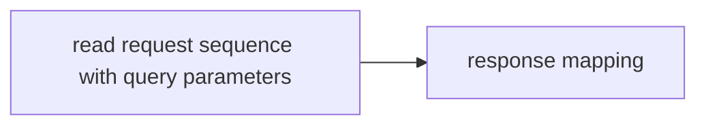
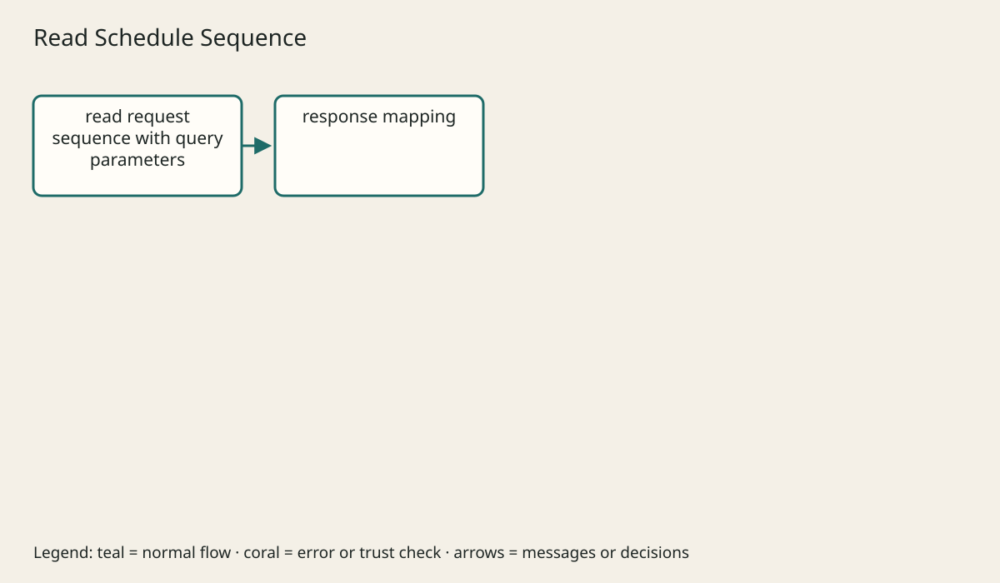

# TM SCHEDULE API BY API

## The big idea in plain words {#picture}

**Case-study provenance:** the original TM Schedule source and endpoint contract were not supplied. These are illustrative schedule flows with synthetic data, not a verified inventory of that private application.

An HTTP request is a letter. It has an address, a word saying what you want done, and sometimes a form inside.

## What you will be able to do {#outcomes}

Read this after the previous numbered lesson. Use synthetic notes and local exercise data. By the end you should explain the following scope without copying:

Document every schedule endpoint with method, path, inputs, output, errors, storage path, tests, and curl example.

## Words to know {#vocabulary}

- **method**: the action word of a request, like GET or POST.

- **header**: extra information that travels with a message.

- **status**: a number in the reply that says how it went.

## Why this idea exists {#history}

If every app invented its own message style, nothing could talk to anything else. Shared methods, headers, and status codes let different programs understand each other.

## Concept 1 {#concept-1}

method means the action word of a request, like GET or POST. GET reads data and should not create anything new.

Apply this rule to the Study Notes boundary before choosing syntax. Name the input, owner, and observable result. The scenario below gives a concrete decision to check.

## Concept 2 {#concept-2}

Creating something with POST usually answers 201 and points to the new item.

Apply this rule to the Study Notes boundary before choosing syntax. Name the input, owner, and observable result. The scenario below gives a concrete decision to check.

## Concept 3 {#concept-3}

Content-Type tells what kind of data is in the body.

Apply this rule to the Study Notes boundary before choosing syntax. Name the input, owner, and observable result. The scenario below gives a concrete decision to check.

## Concept 4 {#concept-4}

Before retrying a write, decide how to avoid doing it twice.

Apply this rule to the Study Notes boundary before choosing syntax. Name the input, owner, and observable result. The scenario below gives a concrete decision to check.

## Going deeper: the technical walkthrough {#walkthrough}

### HTTP vocabulary


- A **URL** identifies where a request goes.
- A **method** tells the server what kind of action is requested.
- A **header** carries metadata such as content type or authorization.
- A **body** carries structured data when an operation needs it.
- A **status code** gives the broad result.
- A **resource** is a noun the API owns, such as a note, schedule, or user.

A typical contract might be:

```text
GET    /notes?topic=java&limit=20&offset=0
GET    /notes/{id}
POST   /notes
PUT    /notes/{id}
PATCH  /notes/{id}/completion
DELETE /notes/{id}
```

Use nouns in paths and put an action in the method when possible. A special
subresource such as `/completion` can be clearer than an invented verb route.


### CRUD and the complete write path


A create flow should be explainable step by step:

1. The client sends JSON and an idempotency key when duplicate creation matters.
2. The API checks authentication, content type, size, and shape.
3. The service normalizes values and checks business rules.
4. The transaction resolves references and writes the record.
5. An audit row or outbox entry is written if required.
6. The API returns the stable public resource.
7. The client refreshes or updates its cache.

A retry can happen after the database commits but before the client receives the
response. Choose a unique key or idempotency record when repeating the request
must not create a second resource.


### Reads, filtering, and pagination


A list contract should define:

```text
limit: maximum number returned
cursor or offset: where to continue
sort: stable allowed field and direction
filters: bounded, documented values
metadata: next cursor or total only when affordable
```

Use a stable order such as `createdAt DESC, id DESC`. Query an indexed database
rather than loading every row into application memory. Do not return large
binary content inside a catalog list; return metadata and a safe read route.


## Worked scenario {#worked-scenario}

A client wants a page of notes and must not change anything. Which request fits?

The justified choice is **GET /notes?limit=20 returning a limited list**. Select **bounded-get** in the structured practical and explain why. Alternatives ignore a requirement, cross a trust boundary, or invent success.

### Structured decision contract

```json

{
  "decision": "bounded-get",
  "justification": "The method and header boundary must preserve the declared contract and ownership.",
  "failureBehavior": "Expose a safe failure and recover through the boundary owner."
}

```

Decision selects one declared behavior. Justification explains the boundary. FailureBehavior explains the observable error and recovery owner. These fields never execute commands. Required terms and minimum lengths form a basic practice rubric, not semantic grading.

## Step-by-step flow and matching picture {#flow}





## Three real-life uses {#use-cases}

1. A personal learner applies this rule to one synthetic note and checks the result.
2. A team changes the boundary while preserving its shared request and response contract.
3. A deployed library handles concurrent requests and reports failures through safe errors and correlated signals.

## What can go wrong, and how to stay safe {#failure-security}

A list answer should be a limited page in a steady order. An external dependency needs an owner, size limit, deadline, cleanup, and recovery path. Return a stable error code rather than raw exceptions. Redact credentials and private bodies in diagnostics.

The abstraction improves method reasoning but adds configuration and lifecycle work. Keep a simpler implementation when it meets the requirement. Measure the limiting resource before adding services, queues, or caches.

## Practice lab and expected observation {#practice}

1. Predict the scenario decision before opening Practical. Explain each rejected alternative.
2. Run a relevant example above in an isolated exercise project. Record the expected result, then change one input to an invalid or boundary value. A failed assertion or deliberate error should replace silent success.
3. Submit the structured decision. Initially the checks fail. After selecting bounded-get and writing an explanation and failure plan, all three pass. Follow the indicated review section for missed checks.

### Broken example to debug

```json

{"decision":"trust-client","justification":"","failureBehavior":""}

```

This ignores the responsible boundary and gives no reasoning or recovery. Correct the fields rather than changing the validator.

## Checkpoint and definition of done {#checkpoint}

- [ ] Define method and header without looking.
- [ ] Trace input to owner and output.
- [ ] Explain one failure and one alternative.
- [ ] Pass at least four assignment questions.
- [ ] Pass every practical check and submit.
- [ ] Explain the concept again tomorrow.

## Sources, versions, and safe commands {#sources}

HTTP semantics; educational contracts, not an audit of the unavailable TM Schedule repository. Review date: 2026-10-02. The supplied blueprint is the teaching source; official landing pages were checked where reachable. No provider or original TM Schedule deployment was tested.

- [Official reference](https://www.rfc-editor.org/rfc/rfc9110)

- [Official reference](https://spec.openapis.org/oas/v3.1.0.html)

[Course reading order](README.md) · [Previous lesson](INDEX-READING-CHECKLIST.md)

```study-quiz

{
  "schemaVersion": 1,
  "lessonId": "api-design/tm-schedule-api-by-api",
  "title": "Assignment: TM SCHEDULE API BY API",
  "passPercentage": 80,
  "questions": [
    {
      "id": "q1",
      "sectionId": "concept-1",
      "prompt": "In TM SCHEDULE API BY API, what does method mean?",
      "options": [
        {
          "id": "a",
          "text": "the action word of a request, like GET or POST",
          "explanation": "This preserves the definition and boundary described in the lesson."
        },
        {
          "id": "b",
          "text": "A permission granted by a hidden browser control",
          "explanation": "This changes the declared meaning or bypasses the responsible boundary."
        },
        {
          "id": "c",
          "text": "An unlimited provider operation with no ownership",
          "explanation": "This changes the declared meaning or bypasses the responsible boundary."
        },
        {
          "id": "d",
          "text": "A diagnostic credential intended for public logs",
          "explanation": "This changes the declared meaning or bypasses the responsible boundary."
        }
      ],
      "correctOptionId": "a",
      "explanation": "method means the action word of a request, like GET or POST.",
      "reviewLabel": "Review concept 1"
    },
    {
      "id": "q2",
      "sectionId": "concept-2",
      "prompt": "In TM SCHEDULE API BY API, which rule is correct for checkpoint 2?",
      "options": [
        {
          "id": "a",
          "text": "Trust client-side checks instead of the server rule.",
          "explanation": "This changes the declared meaning or bypasses the responsible boundary."
        },
        {
          "id": "b",
          "text": "Creating something with POST usually answers 201 and points to the new item.",
          "explanation": "This preserves the definition and boundary described in the lesson."
        },
        {
          "id": "c",
          "text": "Hide the failure by returning a fabricated successful result.",
          "explanation": "This changes the declared meaning or bypasses the responsible boundary."
        },
        {
          "id": "d",
          "text": "Skip the stated boundary, limit, or ownership check.",
          "explanation": "This changes the declared meaning or bypasses the responsible boundary."
        }
      ],
      "correctOptionId": "b",
      "explanation": "Creating something with POST usually answers 201 and points to the new item.",
      "reviewLabel": "Review concept 2"
    },
    {
      "id": "q3",
      "sectionId": "concept-3",
      "prompt": "In TM SCHEDULE API BY API, which rule is correct for checkpoint 3?",
      "options": [
        {
          "id": "a",
          "text": "Trust client-side checks instead of the server rule.",
          "explanation": "This changes the declared meaning or bypasses the responsible boundary."
        },
        {
          "id": "b",
          "text": "Hide the failure by returning a fabricated successful result.",
          "explanation": "This changes the declared meaning or bypasses the responsible boundary."
        },
        {
          "id": "c",
          "text": "Content-Type tells what kind of data is in the body.",
          "explanation": "This preserves the definition and boundary described in the lesson."
        },
        {
          "id": "d",
          "text": "Skip the stated boundary, limit, or ownership check.",
          "explanation": "This changes the declared meaning or bypasses the responsible boundary."
        }
      ],
      "correctOptionId": "c",
      "explanation": "Content-Type tells what kind of data is in the body.",
      "reviewLabel": "Review concept 3"
    },
    {
      "id": "q4",
      "sectionId": "concept-4",
      "prompt": "In TM SCHEDULE API BY API, which rule is correct for checkpoint 4?",
      "options": [
        {
          "id": "a",
          "text": "Trust client-side checks instead of the server rule.",
          "explanation": "This changes the declared meaning or bypasses the responsible boundary."
        },
        {
          "id": "b",
          "text": "Hide the failure by returning a fabricated successful result.",
          "explanation": "This changes the declared meaning or bypasses the responsible boundary."
        },
        {
          "id": "c",
          "text": "Skip the stated boundary, limit, or ownership check.",
          "explanation": "This changes the declared meaning or bypasses the responsible boundary."
        },
        {
          "id": "d",
          "text": "Before retrying a write, decide how to avoid doing it twice.",
          "explanation": "This preserves the definition and boundary described in the lesson."
        }
      ],
      "correctOptionId": "d",
      "explanation": "Before retrying a write, decide how to avoid doing it twice.",
      "reviewLabel": "Review concept 4"
    },
    {
      "id": "q5",
      "sectionId": "worked-scenario",
      "prompt": "A client wants a page of notes and must not change anything. Which request fits?",
      "options": [
        {
          "id": "a",
          "text": "GET /notes?limit=20 returning a limited list",
          "explanation": "This preserves the definition and boundary described in the lesson."
        },
        {
          "id": "b",
          "text": "POST /delete-everything",
          "explanation": "This changes the declared meaning or bypasses the responsible boundary."
        },
        {
          "id": "c",
          "text": "A GET that secretly changes data",
          "explanation": "This changes the declared meaning or bypasses the responsible boundary."
        },
        {
          "id": "d",
          "text": "A database password inside the URL",
          "explanation": "This changes the declared meaning or bypasses the responsible boundary."
        }
      ],
      "correctOptionId": "a",
      "explanation": "GET /notes?limit=20 returning a limited list. A list answer should be a limited page in a steady order.",
      "reviewLabel": "Review the worked scenario"
    }
  ]
}

```

```study-practical

{
  "schemaVersion": 1,
  "challengeId": "api-design/tm-schedule-api-by-api/decision",
  "lessonId": "api-design/tm-schedule-api-by-api",
  "title": "Practical: TM SCHEDULE API BY API",
  "language": "json",
  "mode": "structured",
  "instructions": "A client wants a page of notes and must not change anything. Which request fits? Return an object with decision (choose from bounded-get, skip-check, unbounded-work, trust-client), justification (at least 40 characters; include method and header), and failureBehavior (at least 25 characters; include failure and recover while explaining the error and recovery). These are structured reasoning checks, not code execution or an official grade.",
  "starterCode": "{\n  \"decision\": \"\",\n  \"justification\": \"\",\n  \"failureBehavior\": \"\"\n}",
  "entryPoint": "answer",
  "publicExamples": [
    {
      "input": {
        "decision": "skip-check",
        "justification": "",
        "failureBehavior": ""
      },
      "expected": {
        "passed": false
      }
    },
    {
      "input": {
        "decision": "bounded-get",
        "justification": "The method and header boundary must preserve the declared contract and ownership.",
        "failureBehavior": "Show a safe failure and recover through the responsible owner."
      },
      "expected": {
        "passed": true
      }
    }
  ],
  "publicTestIds": [
    "decision",
    "explanation",
    "failure-plan"
  ],
  "reviewSections": {
    "decision": "worked-scenario",
    "explanation": "concept-2",
    "failure-plan": "failure-security"
  },
  "limits": {
    "timeMs": 2000,
    "memoryMb": 128,
    "outputBytes": 20000
  }
}

```

