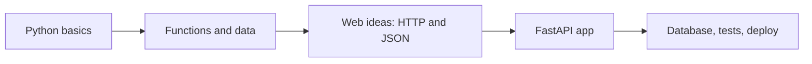
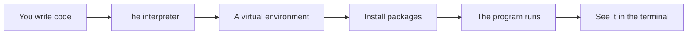
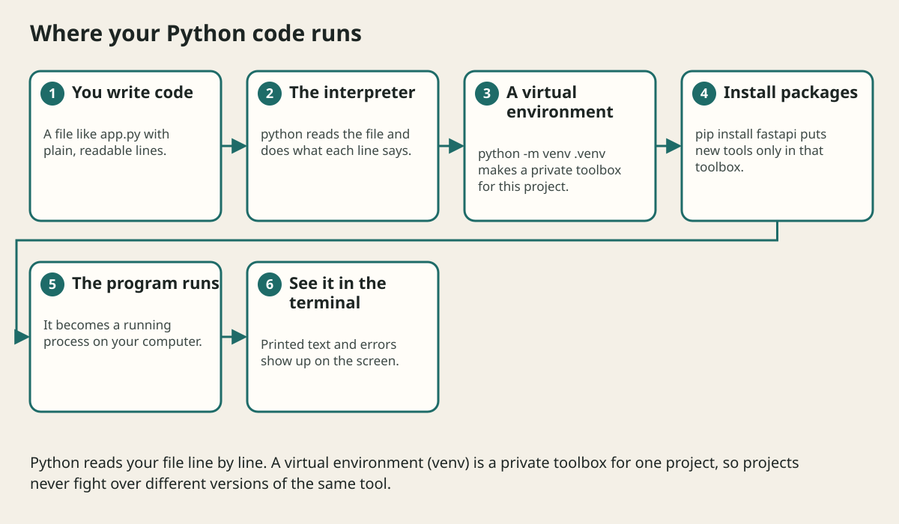

# Learning Map

## The big idea in plain words {#picture}

Learning Python and building web APIs is like learning to cook and then running a small restaurant. First you learn to chop, boil, and season (the Python basics). Then you learn how a restaurant works: orders come in, the kitchen makes food, and the waiter brings it back (a web API).

You do not need to know everything before you start. In each lesson you learn one small skill, try it right away, and build on it. By the end you will have a real working service.



## What you will be able to do {#outcomes}

By the end of this lesson you will be able to:

- Know the order of the course and why it goes that way.
- Follow the study loop: read, guess, try, check, review.
- Know what you will have built by the end.

## Words to know {#vocabulary}

- **Python**: a friendly programming language with simple, readable code.
- **API**: a menu of things a program can be asked to do.
- **FastAPI**: a Python tool that makes it easy to build web APIs.
- **bug**: a mistake in the code. Everyone makes them!
- **prerequisite**: something to learn first.

## Why this idea exists {#history}

Trying to learn a big framework without the basics feels like reading a recipe in a language you do not know. A good order makes every new step feel small.

## Concept 1: Small steps beat big jumps {#concept-1}

Each lesson adds only a little. Read it, run the example, and change something to see what happens. A small change that breaks the program teaches you more than a page of reading.

## Concept 2: Guess first {#concept-2}

Before running a line of code, say what you think will happen. If you are right, great. If not, you have found the exact idea to learn next.

## Concept 3: Errors are clues {#concept-3}

Python's error messages are friendly and point to the line with the problem. Read them from the bottom, where the final message lives. Most of the time it tells you what to fix.

## Concept 4: Come back and rebuild {#concept-4}

After a few days, try to write an old example again without looking. It feels hard, and that is good, because the effort of remembering is what makes the skill stick.

## Your very first guess {#example}

What does `print(2 + 3)` show? It shows `5`. What does `print("2" + "3")` show? It shows `23`, because the quote marks make them text, and text is joined side by side. Were you right? Either way you have learned how Python treats numbers and text differently.

## Going deeper: the technical walkthrough {#walkthrough}

### Audience and prerequisites


This course is for a person who can use a terminal but may be new to Python
and backend work. You need:

- a computer and a text editor;
- Python 3.11 or newer;
- a terminal;
- basic comfort with folders and commands;
- patience to read an error message before changing code.

The first project uses an in-memory list so the learner can understand HTTP
before learning database administration. The later project uses SQLite locally
and leaves a clear boundary for PostgreSQL in a hosted environment.


### What you will be able to do


By the end you can:

- create and activate a virtual environment;
- write functions, classes, modules, and typed Python;
- explain a request, response, route, status code, and JSON body;
- build `GET`, `POST`, `PUT`, and `DELETE` endpoints;
- validate input with Pydantic;
- keep route handlers thin and rules in a service;
- store data behind a repository boundary;
- return safe errors and protect secrets;
- test routes with an HTTP test client;
- read the automatic OpenAPI document;
- run the API locally and package it for deployment.


### Recommended learning order


1. Install Python and create a virtual environment.
2. Learn values, collections, functions, and control flow.
3. Learn modules, exceptions, typing, and tests.
4. Learn HTTP, JSON, routes, and status codes.
5. Build a read-only FastAPI endpoint.
6. Add request and response models.
7. Add create, update, delete, and error paths.
8. Move business rules into a service and storage into a repository.
9. Add a database, authentication concepts, logs, and OpenAPI.
10. Package, test, and deploy the small API.


## Worked scenario {#worked-scenario}

You understand how to ask for data with GET, but you cannot explain how the server checks incoming data. What should you study next?

The justified choice is **Practice sending bad data and see how the server checks it**. Select **review-validation** in the structured practical and explain why. Alternatives ignore a requirement, cross a trust boundary, or invent success.

### Structured decision contract

```json

{
  "decision": "review-validation",
  "justification": "The prerequisite and checkpoint boundary must preserve the declared contract and ownership.",
  "failureBehavior": "Expose a safe failure and recover through the boundary owner."
}

```

Decision selects one declared behavior. Justification explains the boundary. FailureBehavior explains the observable error and recovery owner. These fields never execute commands. Required terms and minimum lengths form a basic practice rubric, not semantic grading.

## Step-by-step flow and matching picture {#flow}





## Three real-life uses {#use-cases}

1. A student writes a small script to add up their pocket money.
2. A teacher builds an API that lists homework for each class.
3. A team builds a service that other apps ask for weather data.

## What can go wrong, and how to stay safe {#failure-security}

The biggest trap is copying code without understanding it. It works today and breaks tomorrow, and you will not know why. Also do not skip the practice. Reading feels like progress, but typing and running is where the learning happens.

## Practice lab and expected observation {#practice}

1. Predict the scenario decision before opening Practical. Explain each rejected alternative.
2. Run a relevant example above in an isolated exercise project. Record the expected result, then change one input to an invalid or boundary value. A failed assertion or deliberate error should replace silent success.
3. Submit the structured decision. Initially the checks fail. After selecting review-validation and writing an explanation and failure plan, all three pass. Follow the indicated review section for missed checks.

### Broken example to debug

```json

{"decision":"trust-client","justification":"","failureBehavior":""}

```

This ignores the responsible boundary and gives no reasoning or recovery. Correct the fields rather than changing the validator.

## Checkpoint and definition of done {#checkpoint}

- [ ] Define prerequisite and checkpoint without looking.
- [ ] Trace input to owner and output.
- [ ] Explain one failure and one alternative.
- [ ] Pass at least four assignment questions.
- [ ] Pass every practical check and submit.
- [ ] Explain the concept again tomorrow.

## Sources, versions, and safe commands {#sources}

Python 3.11+; examples use Python 3.11 syntax and Pydantic 2 conventions. Review date: 2026-10-02. The supplied blueprint is the teaching source; official landing pages were checked where reachable. No provider or original TM Schedule deployment was tested.

- [Official reference](https://docs.python.org/3/tutorial/)

- [Official reference](https://fastapi.tiangolo.com/tutorial/)

[Course reading order](README.md) · [Next lesson](02-why-python-and-web-framework-history.md)

```study-quiz

{
  "schemaVersion": 1,
  "lessonId": "python-first-api/01-learning-map",
  "title": "Assignment: Learning Map",
  "passPercentage": 80,
  "questions": [
    {
      "id": "q1",
      "sectionId": "concept-1",
      "prompt": "In Learning Map, what does prerequisite mean?",
      "options": [
        {
          "id": "a",
          "text": "something you need to know first, before the next thing makes sense",
          "explanation": "This preserves the definition and boundary described in the lesson."
        },
        {
          "id": "b",
          "text": "A permission granted by a hidden browser control",
          "explanation": "This changes the declared meaning or bypasses the responsible boundary."
        },
        {
          "id": "c",
          "text": "An unlimited provider operation with no ownership",
          "explanation": "This changes the declared meaning or bypasses the responsible boundary."
        },
        {
          "id": "d",
          "text": "A diagnostic credential intended for public logs",
          "explanation": "This changes the declared meaning or bypasses the responsible boundary."
        }
      ],
      "correctOptionId": "a",
      "explanation": "prerequisite means something you need to know first, before the next thing makes sense.",
      "reviewLabel": "Review concept 1"
    },
    {
      "id": "q2",
      "sectionId": "concept-2",
      "prompt": "In Learning Map, which rule is correct for checkpoint 2?",
      "options": [
        {
          "id": "a",
          "text": "Trust client-side checks instead of the server rule.",
          "explanation": "This changes the declared meaning or bypasses the responsible boundary."
        },
        {
          "id": "b",
          "text": "Guess the output first, then look at the answer.",
          "explanation": "This preserves the definition and boundary described in the lesson."
        },
        {
          "id": "c",
          "text": "Hide the failure by returning a fabricated successful result.",
          "explanation": "This changes the declared meaning or bypasses the responsible boundary."
        },
        {
          "id": "d",
          "text": "Skip the stated boundary, limit, or ownership check.",
          "explanation": "This changes the declared meaning or bypasses the responsible boundary."
        }
      ],
      "correctOptionId": "b",
      "explanation": "Guess the output first, then look at the answer.",
      "reviewLabel": "Review concept 2"
    },
    {
      "id": "q3",
      "sectionId": "concept-3",
      "prompt": "In Learning Map, which rule is correct for checkpoint 3?",
      "options": [
        {
          "id": "a",
          "text": "Trust client-side checks instead of the server rule.",
          "explanation": "This changes the declared meaning or bypasses the responsible boundary."
        },
        {
          "id": "b",
          "text": "Hide the failure by returning a fabricated successful result.",
          "explanation": "This changes the declared meaning or bypasses the responsible boundary."
        },
        {
          "id": "c",
          "text": "When a test fails, it points to the idea you are missing.",
          "explanation": "This preserves the definition and boundary described in the lesson."
        },
        {
          "id": "d",
          "text": "Skip the stated boundary, limit, or ownership check.",
          "explanation": "This changes the declared meaning or bypasses the responsible boundary."
        }
      ],
      "correctOptionId": "c",
      "explanation": "When a test fails, it points to the idea you are missing.",
      "reviewLabel": "Review concept 3"
    },
    {
      "id": "q4",
      "sectionId": "concept-4",
      "prompt": "In Learning Map, which rule is correct for checkpoint 4?",
      "options": [
        {
          "id": "a",
          "text": "Trust client-side checks instead of the server rule.",
          "explanation": "This changes the declared meaning or bypasses the responsible boundary."
        },
        {
          "id": "b",
          "text": "Hide the failure by returning a fabricated successful result.",
          "explanation": "This changes the declared meaning or bypasses the responsible boundary."
        },
        {
          "id": "c",
          "text": "Skip the stated boundary, limit, or ownership check.",
          "explanation": "This changes the declared meaning or bypasses the responsible boundary."
        },
        {
          "id": "d",
          "text": "A practice score in this app is just a helper, not an official exam grade.",
          "explanation": "This preserves the definition and boundary described in the lesson."
        }
      ],
      "correctOptionId": "d",
      "explanation": "A practice score in this app is just a helper, not an official exam grade.",
      "reviewLabel": "Review concept 4"
    },
    {
      "id": "q5",
      "sectionId": "worked-scenario",
      "prompt": "You understand how to ask for data with GET, but you cannot explain how the server checks incoming data. What should you study next?",
      "options": [
        {
          "id": "a",
          "text": "Practice sending bad data and see how the server checks it",
          "explanation": "This preserves the definition and boundary described in the lesson."
        },
        {
          "id": "b",
          "text": "Jump straight to advanced deployment",
          "explanation": "This changes the declared meaning or bypasses the responsible boundary."
        },
        {
          "id": "c",
          "text": "Copy an answer without trying it",
          "explanation": "This changes the declared meaning or bypasses the responsible boundary."
        },
        {
          "id": "d",
          "text": "Switch frameworks so the problem goes away",
          "explanation": "This changes the declared meaning or bypasses the responsible boundary."
        }
      ],
      "correctOptionId": "a",
      "explanation": "Practice sending bad data and see how the server checks it. Come back to a topic after a break; remembering it is better practice than just re-reading it.",
      "reviewLabel": "Review the worked scenario"
    }
  ]
}

```

```study-practical

{
  "schemaVersion": 1,
  "challengeId": "python-first-api/01-learning-map/decision",
  "lessonId": "python-first-api/01-learning-map",
  "title": "Practical: Learning Map",
  "language": "json",
  "mode": "structured",
  "instructions": "You understand how to ask for data with GET, but you cannot explain how the server checks incoming data. What should you study next? Return an object with decision (choose from review-validation, skip-check, unbounded-work, trust-client), justification (at least 40 characters; include prerequisite and checkpoint), and failureBehavior (at least 25 characters; include failure and recover while explaining the error and recovery). These are structured reasoning checks, not code execution or an official grade.",
  "starterCode": "{\n  \"decision\": \"\",\n  \"justification\": \"\",\n  \"failureBehavior\": \"\"\n}",
  "entryPoint": "answer",
  "publicExamples": [
    {
      "input": {
        "decision": "skip-check",
        "justification": "",
        "failureBehavior": ""
      },
      "expected": {
        "passed": false
      }
    },
    {
      "input": {
        "decision": "review-validation",
        "justification": "The prerequisite and checkpoint boundary must preserve the declared contract and ownership.",
        "failureBehavior": "Show a safe failure and recover through the responsible owner."
      },
      "expected": {
        "passed": true
      }
    }
  ],
  "publicTestIds": [
    "decision",
    "explanation",
    "failure-plan"
  ],
  "reviewSections": {
    "decision": "worked-scenario",
    "explanation": "concept-2",
    "failure-plan": "failure-security"
  },
  "limits": {
    "timeMs": 2000,
    "memoryMb": 128,
    "outputBytes": 20000
  }
}

```

