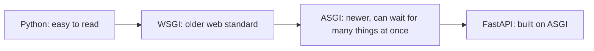
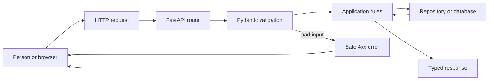
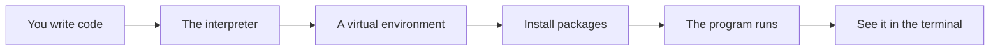

# Why Python And Web Framework History

## The big idea in plain words {#picture}

Python was made to be easy to read, almost like plain English. Instead of lots of symbols and curly braces, Python uses spaces to show which lines belong together. Programmers say "Python reads like pseudocode" because it looks like the plan you would write before coding.

For websites, Python had to learn how to talk to the web. Over the years, different "web languages" came along. FastAPI is the newest friendly one: it is fast, and it checks your data for you.



## What you will be able to do {#outcomes}

By the end of this lesson you will be able to:

- Explain what makes Python popular and what its costs are.
- Say what an interpreter is.
- Explain WSGI, ASGI, and where FastAPI fits.

## Words to know {#vocabulary}

- **interpreter**: a program that reads your Python file and does what it says, line by line.
- **dynamic typing**: Python figures out types while running.
- **type hint**: a note that tells readers what type a value should be.
- **WSGI**: an older standard for Python web servers that handles one request at a time per worker.
- **ASGI**: a newer standard that can handle waiting better.
- **framework**: a ready-made skeleton for building apps.

## Why this idea exists {#history}

People were tired of long, hard-to-read code. Python made programming friendlier. As the web grew, newer tools were needed to handle many visitors at once.

## Concept 1: Python is easy to read {#concept-1}

```python
if age >= 10:
    print("big kid")
else:
    print("little kid")
```
No curly braces. The indented lines (moved in by 4 spaces) belong to the line above. Python uses spaces to show structure, so tidy spacing is part of the code.

## Concept 2: The interpreter runs your file {#concept-2}

You do not compile first. You type `python app.py` and the interpreter reads and runs it. This is quick for trying things out. The trade-off: some mistakes only appear when the line actually runs.

## Concept 3: Type hints help people and tools {#concept-3}

`def greet(name: str) -> str:` says "name is text and the answer is text". Python does not force this by itself, but tools and FastAPI use hints to check and to make documentation. That is a big deal for FastAPI.

## Concept 4: From WSGI to ASGI {#concept-4}

Old Python web servers (WSGI) did one job at a time per worker, so one slow request could hold things up. ASGI lets one worker wait for many things at once, like a waiter who takes more orders while the kitchen is cooking. FastAPI is built on ASGI.

## The same idea, two styles {#example}

In an old framework you might write many lines to read a number from the URL and check it. In FastAPI you write `def get_note(note_id: int):`, and FastAPI sees `int`, reads the number from the URL, checks it, and returns an error if it is not a number. The hint did the work.

## Going deeper: the technical walkthrough {#walkthrough}

### The one-minute picture


Imagine a school library:

- the browser is a student asking a question;
- the API is the librarian at the desk;
- a route is the desk window for one kind of question;
- a Pydantic model is the form that checks the answer;
- the service is the librarian's rule book;
- the database is the catalog;
- the response is the answer sent back to the student.

A Python API is a Python program that listens for requests, checks them,
performs a useful action, and returns a predictable response.




### Python foundations


### Values and collections

```python
name: str = "Asha"
count: int = 3
is_ready: bool = True
names: list[str] = ["Asha", "Sam"]
by_id: dict[int, str] = {1: "Asha"}
```

A type annotation tells a human and a type checker what a value should be. It
does not make untrusted web input safe by itself. Request models still need
runtime validation.

### Functions and decisions

```python
def clean_text(value: str | None) -> str | None:
    if value is None:
        return None
    cleaned = value.strip()
    return cleaned or None
```

A function should have one clear job. A route should not contain every database
query and business rule in one long block.

### Exceptions

```python
class ItemNotFound(Exception):
    """The requested item does not exist."""


def find_item(item_id: int) -> dict[str, object]:
    raise ItemNotFound from None
```

The API layer can translate a known exception to `404`. It should not return a
Python traceback, SQL statement, local path, or secret to a caller.

### Modules and virtual environments

Create an isolated environment so one project cannot break another project:

```bash
python3 -m venv .venv
source .venv/bin/activate
python -m pip install --upgrade pip
python -m pip install fastapi uvicorn pydantic pytest httpx
```

Keep dependencies in `pyproject.toml` or a locked requirements file. Do not
install into the system Python when the project is meant to be repeatable.


## Worked scenario {#worked-scenario}

A small team spends most of its time writing the same route and checking code over and over. What is a good reason to add a framework?

The justified choice is **It removes repeated setup while the team still writes its own permission rules**. Select **reduce-setup** in the structured practical and explain why. Alternatives ignore a requirement, cross a trust boundary, or invent success.

### Structured decision contract

```json

{
  "decision": "reduce-setup",
  "justification": "The runtime and framework boundary must preserve the declared contract and ownership.",
  "failureBehavior": "Expose a safe failure and recover through the boundary owner."
}

```

Decision selects one declared behavior. Justification explains the boundary. FailureBehavior explains the observable error and recovery owner. These fields never execute commands. Required terms and minimum lengths form a basic practice rubric, not semantic grading.

## Step-by-step flow and matching picture {#flow}




## Three real-life uses {#use-cases}

1. A student uses Python for quick scripts to rename lots of files.
2. A data team uses Python to study numbers and make charts.
3. A startup uses FastAPI to build an API that a phone app talks to.

## What can go wrong, and how to stay safe {#failure-security}

Mistakes: thinking Python is slow for everything (it is fine for most web work, and heavy work can be done in helpers), believing type hints are enforced by Python itself (they are not; tools and FastAPI check them), and mixing tabs and spaces so the indentation breaks.

## Practice lab and expected observation {#practice}

1. Predict the scenario decision before opening Practical. Explain each rejected alternative.
2. Run a relevant example above in an isolated exercise project. Record the expected result, then change one input to an invalid or boundary value. A failed assertion or deliberate error should replace silent success.
3. Submit the structured decision. Initially the checks fail. After selecting reduce-setup and writing an explanation and failure plan, all three pass. Follow the indicated review section for missed checks.

### Broken example to debug

```json

{"decision":"trust-client","justification":"","failureBehavior":""}

```

This ignores the responsible boundary and gives no reasoning or recovery. Correct the fields rather than changing the validator.

## Checkpoint and definition of done {#checkpoint}

- [ ] Define runtime and framework without looking.
- [ ] Trace input to owner and output.
- [ ] Explain one failure and one alternative.
- [ ] Pass at least four assignment questions.
- [ ] Pass every practical check and submit.
- [ ] Explain the concept again tomorrow.

## Sources, versions, and safe commands {#sources}

Python 3.11+; examples use Python 3.11 syntax and Pydantic 2 conventions. Review date: 2026-10-02. The supplied blueprint is the teaching source; official landing pages were checked where reachable. No provider or original TM Schedule deployment was tested.

- [Official reference](https://docs.python.org/3/tutorial/)

- [Official reference](https://fastapi.tiangolo.com/tutorial/)

[Course reading order](README.md) · [Previous lesson](01-learning-map.md) · [Next lesson](03-installation-venv-and-project-layout.md)

```study-quiz

{
  "schemaVersion": 1,
  "lessonId": "python-first-api/02-why-python-and-web-framework-history",
  "title": "Assignment: Why Python And Web Framework History",
  "passPercentage": 80,
  "questions": [
    {
      "id": "q1",
      "sectionId": "concept-1",
      "prompt": "In Why Python And Web Framework History, what does runtime mean?",
      "options": [
        {
          "id": "a",
          "text": "A permission granted by a hidden browser control",
          "explanation": "This changes the declared meaning or bypasses the responsible boundary."
        },
        {
          "id": "b",
          "text": "the helper program that actually runs your code",
          "explanation": "This preserves the definition and boundary described in the lesson."
        },
        {
          "id": "c",
          "text": "An unlimited provider operation with no ownership",
          "explanation": "This changes the declared meaning or bypasses the responsible boundary."
        },
        {
          "id": "d",
          "text": "A diagnostic credential intended for public logs",
          "explanation": "This changes the declared meaning or bypasses the responsible boundary."
        }
      ],
      "correctOptionId": "b",
      "explanation": "runtime means the helper program that actually runs your code.",
      "reviewLabel": "Review concept 1"
    },
    {
      "id": "q2",
      "sectionId": "concept-2",
      "prompt": "In Why Python And Web Framework History, which rule is correct for checkpoint 2?",
      "options": [
        {
          "id": "a",
          "text": "Trust client-side checks instead of the server rule.",
          "explanation": "This changes the declared meaning or bypasses the responsible boundary."
        },
        {
          "id": "b",
          "text": "Hide the failure by returning a fabricated successful result.",
          "explanation": "This changes the declared meaning or bypasses the responsible boundary."
        },
        {
          "id": "c",
          "text": "A framework saves setup work, but it does not decide who is allowed to do what.",
          "explanation": "This preserves the definition and boundary described in the lesson."
        },
        {
          "id": "d",
          "text": "Skip the stated boundary, limit, or ownership check.",
          "explanation": "This changes the declared meaning or bypasses the responsible boundary."
        }
      ],
      "correctOptionId": "c",
      "explanation": "A framework saves setup work, but it does not decide who is allowed to do what.",
      "reviewLabel": "Review concept 2"
    },
    {
      "id": "q3",
      "sectionId": "concept-3",
      "prompt": "In Why Python And Web Framework History, which rule is correct for checkpoint 3?",
      "options": [
        {
          "id": "a",
          "text": "Trust client-side checks instead of the server rule.",
          "explanation": "This changes the declared meaning or bypasses the responsible boundary."
        },
        {
          "id": "b",
          "text": "Hide the failure by returning a fabricated successful result.",
          "explanation": "This changes the declared meaning or bypasses the responsible boundary."
        },
        {
          "id": "c",
          "text": "Skip the stated boundary, limit, or ownership check.",
          "explanation": "This changes the declared meaning or bypasses the responsible boundary."
        },
        {
          "id": "d",
          "text": "Code that is compiled once to portable bytecode still needs a matching runtime on each computer.",
          "explanation": "This preserves the definition and boundary described in the lesson."
        }
      ],
      "correctOptionId": "d",
      "explanation": "Code that is compiled once to portable bytecode still needs a matching runtime on each computer.",
      "reviewLabel": "Review concept 3"
    },
    {
      "id": "q4",
      "sectionId": "concept-4",
      "prompt": "In Why Python And Web Framework History, which rule is correct for checkpoint 4?",
      "options": [
        {
          "id": "a",
          "text": "Non-blocking input and output helps when your program mostly waits; it does not make heavy math faster.",
          "explanation": "This preserves the definition and boundary described in the lesson."
        },
        {
          "id": "b",
          "text": "Trust client-side checks instead of the server rule.",
          "explanation": "This changes the declared meaning or bypasses the responsible boundary."
        },
        {
          "id": "c",
          "text": "Hide the failure by returning a fabricated successful result.",
          "explanation": "This changes the declared meaning or bypasses the responsible boundary."
        },
        {
          "id": "d",
          "text": "Skip the stated boundary, limit, or ownership check.",
          "explanation": "This changes the declared meaning or bypasses the responsible boundary."
        }
      ],
      "correctOptionId": "a",
      "explanation": "Non-blocking input and output helps when your program mostly waits; it does not make heavy math faster.",
      "reviewLabel": "Review concept 4"
    },
    {
      "id": "q5",
      "sectionId": "worked-scenario",
      "prompt": "A small team spends most of its time writing the same route and checking code over and over. What is a good reason to add a framework?",
      "options": [
        {
          "id": "a",
          "text": "It guarantees every database query is fast",
          "explanation": "This changes the declared meaning or bypasses the responsible boundary."
        },
        {
          "id": "b",
          "text": "It removes repeated setup while the team still writes its own permission rules",
          "explanation": "This preserves the definition and boundary described in the lesson."
        },
        {
          "id": "c",
          "text": "It means you no longer need tests",
          "explanation": "This changes the declared meaning or bypasses the responsible boundary."
        },
        {
          "id": "d",
          "text": "It automatically decides who is allowed to do what",
          "explanation": "This changes the declared meaning or bypasses the responsible boundary."
        }
      ],
      "correctOptionId": "b",
      "explanation": "It removes repeated setup while the team still writes its own permission rules. When you pick a technology, say which need it meets and which cost you accept.",
      "reviewLabel": "Review the worked scenario"
    }
  ]
}

```

```study-practical

{
  "schemaVersion": 1,
  "challengeId": "python-first-api/02-why-python-and-web-framework-history/decision",
  "lessonId": "python-first-api/02-why-python-and-web-framework-history",
  "title": "Practical: Why Python And Web Framework History",
  "language": "json",
  "mode": "structured",
  "instructions": "A small team spends most of its time writing the same route and checking code over and over. What is a good reason to add a framework? Return an object with decision (choose from reduce-setup, skip-check, unbounded-work, trust-client), justification (at least 40 characters; include runtime and framework), and failureBehavior (at least 25 characters; include failure and recover while explaining the error and recovery). These are structured reasoning checks, not code execution or an official grade.",
  "starterCode": "{\n  \"decision\": \"\",\n  \"justification\": \"\",\n  \"failureBehavior\": \"\"\n}",
  "entryPoint": "answer",
  "publicExamples": [
    {
      "input": {
        "decision": "skip-check",
        "justification": "",
        "failureBehavior": ""
      },
      "expected": {
        "passed": false
      }
    },
    {
      "input": {
        "decision": "reduce-setup",
        "justification": "The runtime and framework boundary must preserve the declared contract and ownership.",
        "failureBehavior": "Show a safe failure and recover through the responsible owner."
      },
      "expected": {
        "passed": true
      }
    }
  ],
  "publicTestIds": [
    "decision",
    "explanation",
    "failure-plan"
  ],
  "reviewSections": {
    "decision": "worked-scenario",
    "explanation": "concept-2",
    "failure-plan": "failure-security"
  },
  "limits": {
    "timeMs": 2000,
    "memoryMb": 128,
    "outputBytes": 20000
  }
}

```

