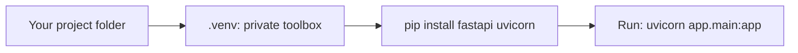
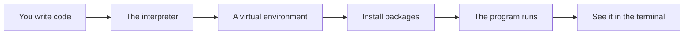

# Installation Venv And Project Layout

## The big idea in plain words {#picture}

A craftsperson keeps tools for each project in a separate toolbox. A bike repair needs a wrench, and a painting needs brushes. If everything is thrown into one big box, the wrong tool is used and things break.

In Python, a **virtual environment** (venv) is a toolbox for one project. Libraries you install go only into that box. Your project A can use version 1 of a tool while project B uses version 2, with no fights.



## What you will be able to do {#outcomes}

By the end of this lesson you will be able to:

- Create and use a virtual environment.
- Install packages with pip and record them.
- Lay out a project with tidy folders.

## Words to know {#vocabulary}

- **venv**: a private folder of Python tools for one project.
- **pip**: the tool that downloads and installs Python packages.
- **package**: code written by others that you can install.
- **pyproject.toml**: a file that describes your project and its tools.
- **import**: bringing code from another file or package into yours.
- **requirements**: a list of packages and versions your project needs.

## Why this idea exists {#history}

"It works on my computer" is the most famous sentence in programming. A venv and a list of versions make sure it works on every computer the same way.

## Concept 1: Make your toolbox {#concept-1}

In the project folder type:
```text
python -m venv .venv
.venv\Scripts\activate        (Windows)
source .venv/bin/activate     (Mac and Linux)
```
After activating, your terminal shows `(.venv)` and anything you install goes only into this project.

## Concept 2: Install with pip {#concept-2}

`pip install fastapi uvicorn` downloads those packages into the venv. Then `pip freeze > requirements.txt` writes down exact versions. A teammate runs `pip install -r requirements.txt` and gets the same tools.

## Concept 3: Pin versions {#concept-3}

Say exactly which version you tested: `fastapi==0.115.0`. If you write only "fastapi", the next install might get a newer version that behaves differently. Pinned versions mean repeatable results.

## Concept 4: A tidy project layout {#concept-4}

```text
notes-api/
├── app/
│   ├── main.py
│   ├── routes/
│   ├── services/
│   └── repositories/
├── tests/
├── pyproject.toml
└── .gitignore
```
Code lives in `app/`, tests in `tests/`. Add `.venv` to `.gitignore` so you never share the toolbox, just the list of tools.

## First setup {#example}

You create a folder `notes-api`, run `python -m venv .venv`, activate it, run `pip install fastapi uvicorn`, and write a file `app/main.py`. A friend copies your folder (without .venv), runs the same two commands from `requirements.txt`, and has the same working project.

## Going deeper: the technical walkthrough {#walkthrough}

### Project layout


A small but maintainable API can look like this:

```text
fastapi-course/
+-- pyproject.toml
+-- app/
|   +-- main.py
|   +-- config.py
|   +-- routes/
|   +-- models/
|   +-- services/
|   +-- repositories/
|   +-- errors.py
|   +-- logging_config.py
+-- tests/
+-- README.md
```

Keep configuration parsing, HTTP binding, business rules, and storage in
separate places. Split a file when it becomes hard to scan, not merely because
another language uses more files.


### Safe commands and version note


Use a project environment and fake data:

```bash
python -m venv .venv
source .venv/bin/activate
python -m pip install -e .
pytest
uvicorn app.main:app --reload --port 8000
```

Check the current Python, FastAPI, Pydantic, and Starlette documentation when
implementing. Library APIs change. This guide teaches the stable ideas and does
not replace the version-pinned documentation for a real project.


## Worked scenario {#worked-scenario}

In production, the storage password is missing. What should the app do when it starts?

The justified choice is **Say it is not ready and show a safe configuration error**. Select **fail-config** in the structured practical and explain why. Alternatives ignore a requirement, cross a trust boundary, or invent success.

### Structured decision contract

```json

{
  "decision": "fail-config",
  "justification": "The environment and profile boundary must preserve the declared contract and ownership.",
  "failureBehavior": "Expose a safe failure and recover through the boundary owner."
}

```

Decision selects one declared behavior. Justification explains the boundary. FailureBehavior explains the observable error and recovery owner. These fields never execute commands. Required terms and minimum lengths form a basic practice rubric, not semantic grading.

## Step-by-step flow and matching picture {#flow}




## Three real-life uses {#use-cases}

1. A student keeps each homework project in its own venv.
2. A team shares `requirements.txt` so everyone runs the same versions.
3. A server installs from a lock file so the live app matches the tested app.

## What can go wrong, and how to stay safe {#failure-security}

Mistakes: installing everything globally so projects clash, forgetting to activate the venv, committing the `.venv` folder to git, and installing packages without noting their versions. If `pip` installs into the wrong place, check whether your terminal shows `(.venv)`.

## Practice lab and expected observation {#practice}

1. Predict the scenario decision before opening Practical. Explain each rejected alternative.
2. Run a relevant example above in an isolated exercise project. Record the expected result, then change one input to an invalid or boundary value. A failed assertion or deliberate error should replace silent success.
3. Submit the structured decision. Initially the checks fail. After selecting fail-config and writing an explanation and failure plan, all three pass. Follow the indicated review section for missed checks.

### Broken example to debug

```json

{"decision":"trust-client","justification":"","failureBehavior":""}

```

This ignores the responsible boundary and gives no reasoning or recovery. Correct the fields rather than changing the validator.

## Checkpoint and definition of done {#checkpoint}

- [ ] Define environment and profile without looking.
- [ ] Trace input to owner and output.
- [ ] Explain one failure and one alternative.
- [ ] Pass at least four assignment questions.
- [ ] Pass every practical check and submit.
- [ ] Explain the concept again tomorrow.

## Sources, versions, and safe commands {#sources}

Python 3.11+; examples use Python 3.11 syntax and Pydantic 2 conventions. Review date: 2026-10-02. The supplied blueprint is the teaching source; official landing pages were checked where reachable. No provider or original TM Schedule deployment was tested.

- [Official reference](https://docs.python.org/3/tutorial/)

- [Official reference](https://fastapi.tiangolo.com/tutorial/)

[Course reading order](README.md) · [Previous lesson](02-why-python-and-web-framework-history.md) · [Next lesson](04-values-types-and-control-flow.md)

```study-quiz

{
  "schemaVersion": 1,
  "lessonId": "python-first-api/03-installation-venv-and-project-layout",
  "title": "Assignment: Installation Venv And Project Layout",
  "passPercentage": 80,
  "questions": [
    {
      "id": "q1",
      "sectionId": "concept-1",
      "prompt": "In Installation Venv And Project Layout, what does environment mean?",
      "options": [
        {
          "id": "a",
          "text": "A permission granted by a hidden browser control",
          "explanation": "This changes the declared meaning or bypasses the responsible boundary."
        },
        {
          "id": "b",
          "text": "An unlimited provider operation with no ownership",
          "explanation": "This changes the declared meaning or bypasses the responsible boundary."
        },
        {
          "id": "c",
          "text": "the settings given to a program by the place it runs",
          "explanation": "This preserves the definition and boundary described in the lesson."
        },
        {
          "id": "d",
          "text": "A diagnostic credential intended for public logs",
          "explanation": "This changes the declared meaning or bypasses the responsible boundary."
        }
      ],
      "correctOptionId": "c",
      "explanation": "environment means the settings given to a program by the place it runs.",
      "reviewLabel": "Review concept 1"
    },
    {
      "id": "q2",
      "sectionId": "concept-2",
      "prompt": "In Installation Venv And Project Layout, which rule is correct for checkpoint 2?",
      "options": [
        {
          "id": "a",
          "text": "Trust client-side checks instead of the server rule.",
          "explanation": "This changes the declared meaning or bypasses the responsible boundary."
        },
        {
          "id": "b",
          "text": "Hide the failure by returning a fabricated successful result.",
          "explanation": "This changes the declared meaning or bypasses the responsible boundary."
        },
        {
          "id": "c",
          "text": "Skip the stated boundary, limit, or ownership check.",
          "explanation": "This changes the declared meaning or bypasses the responsible boundary."
        },
        {
          "id": "d",
          "text": "Keep secrets on the server, never in browser code.",
          "explanation": "This preserves the definition and boundary described in the lesson."
        }
      ],
      "correctOptionId": "d",
      "explanation": "Keep secrets on the server, never in browser code.",
      "reviewLabel": "Review concept 2"
    },
    {
      "id": "q3",
      "sectionId": "concept-3",
      "prompt": "In Installation Venv And Project Layout, which rule is correct for checkpoint 3?",
      "options": [
        {
          "id": "a",
          "text": "A profile can switch which helper is used without changing the service's promise.",
          "explanation": "This preserves the definition and boundary described in the lesson."
        },
        {
          "id": "b",
          "text": "Trust client-side checks instead of the server rule.",
          "explanation": "This changes the declared meaning or bypasses the responsible boundary."
        },
        {
          "id": "c",
          "text": "Hide the failure by returning a fabricated successful result.",
          "explanation": "This changes the declared meaning or bypasses the responsible boundary."
        },
        {
          "id": "d",
          "text": "Skip the stated boundary, limit, or ownership check.",
          "explanation": "This changes the declared meaning or bypasses the responsible boundary."
        }
      ],
      "correctOptionId": "a",
      "explanation": "A profile can switch which helper is used without changing the service's promise.",
      "reviewLabel": "Review concept 3"
    },
    {
      "id": "q4",
      "sectionId": "concept-4",
      "prompt": "In Installation Venv And Project Layout, which rule is correct for checkpoint 4?",
      "options": [
        {
          "id": "a",
          "text": "Trust client-side checks instead of the server rule.",
          "explanation": "This changes the declared meaning or bypasses the responsible boundary."
        },
        {
          "id": "b",
          "text": "Write down which setting wins when two places disagree.",
          "explanation": "This preserves the definition and boundary described in the lesson."
        },
        {
          "id": "c",
          "text": "Hide the failure by returning a fabricated successful result.",
          "explanation": "This changes the declared meaning or bypasses the responsible boundary."
        },
        {
          "id": "d",
          "text": "Skip the stated boundary, limit, or ownership check.",
          "explanation": "This changes the declared meaning or bypasses the responsible boundary."
        }
      ],
      "correctOptionId": "b",
      "explanation": "Write down which setting wins when two places disagree.",
      "reviewLabel": "Review concept 4"
    },
    {
      "id": "q5",
      "sectionId": "worked-scenario",
      "prompt": "In production, the storage password is missing. What should the app do when it starts?",
      "options": [
        {
          "id": "a",
          "text": "Start with a fake full library",
          "explanation": "This changes the declared meaning or bypasses the responsible boundary."
        },
        {
          "id": "b",
          "text": "Put a private key into browser JavaScript",
          "explanation": "This changes the declared meaning or bypasses the responsible boundary."
        },
        {
          "id": "c",
          "text": "Say it is not ready and show a safe configuration error",
          "explanation": "This preserves the definition and boundary described in the lesson."
        },
        {
          "id": "d",
          "text": "Quietly pretend the storage is empty",
          "explanation": "This changes the declared meaning or bypasses the responsible boundary."
        }
      ],
      "correctOptionId": "c",
      "explanation": "Say it is not ready and show a safe configuration error. A missing database password is a problem to report, not an empty catalog.",
      "reviewLabel": "Review the worked scenario"
    }
  ]
}

```

```study-practical

{
  "schemaVersion": 1,
  "challengeId": "python-first-api/03-installation-venv-and-project-layout/decision",
  "lessonId": "python-first-api/03-installation-venv-and-project-layout",
  "title": "Practical: Installation Venv And Project Layout",
  "language": "json",
  "mode": "structured",
  "instructions": "In production, the storage password is missing. What should the app do when it starts? Return an object with decision (choose from fail-config, skip-check, unbounded-work, trust-client), justification (at least 40 characters; include environment and profile), and failureBehavior (at least 25 characters; include failure and recover while explaining the error and recovery). These are structured reasoning checks, not code execution or an official grade.",
  "starterCode": "{\n  \"decision\": \"\",\n  \"justification\": \"\",\n  \"failureBehavior\": \"\"\n}",
  "entryPoint": "answer",
  "publicExamples": [
    {
      "input": {
        "decision": "skip-check",
        "justification": "",
        "failureBehavior": ""
      },
      "expected": {
        "passed": false
      }
    },
    {
      "input": {
        "decision": "fail-config",
        "justification": "The environment and profile boundary must preserve the declared contract and ownership.",
        "failureBehavior": "Show a safe failure and recover through the responsible owner."
      },
      "expected": {
        "passed": true
      }
    }
  ],
  "publicTestIds": [
    "decision",
    "explanation",
    "failure-plan"
  ],
  "reviewSections": {
    "decision": "worked-scenario",
    "explanation": "concept-2",
    "failure-plan": "failure-security"
  },
  "limits": {
    "timeMs": 2000,
    "memoryMb": 128,
    "outputBytes": 20000
  }
}

```

