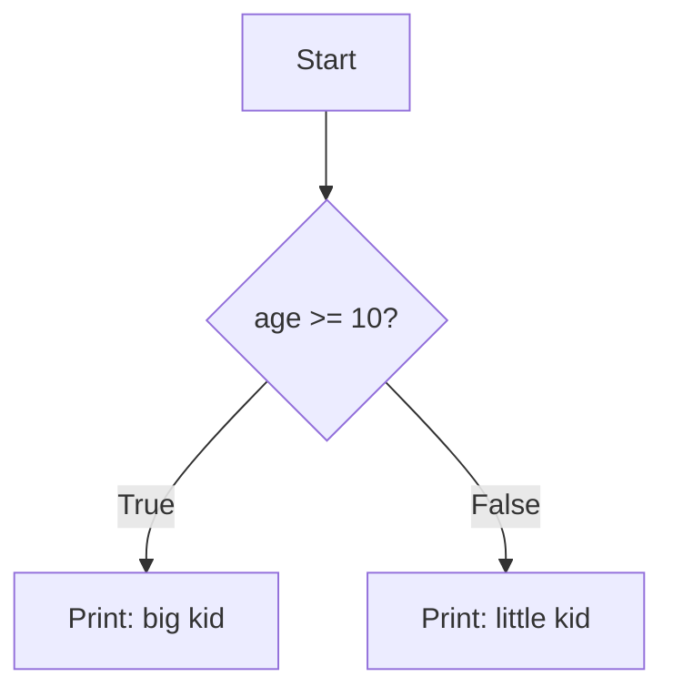
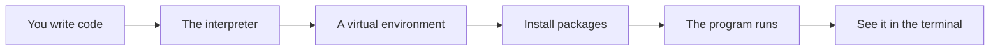

# Values Types And Control Flow

## The big idea in plain words {#picture}

Python variables are labeled boxes, just like a school locker with a name tag. You write `age = 10` and the locker labeled "age" holds 10. Later you can put 11 in it. Python figures out the kind of thing in the box by itself.

The kinds you meet most are numbers, text (called strings), true or false (booleans), and "nothing" (`None`). With `if` and loops you can make choices and repeat.



## What you will be able to do {#outcomes}

By the end of this lesson you will be able to:

- Use numbers, text, booleans, and `None`.
- Write `if`, `for`, and `while`.
- Understand "truthiness" and common beginner surprises.

## Words to know {#vocabulary}

- **variable**: a name that points to a value.
- **string**: text inside quotes, like "hello".
- **boolean**: either `True` or `False`.
- **None**: Python's way of saying "nothing here".
- **condition**: a question with a yes or no answer.
- **loop**: repeating steps.

## Why this idea exists {#history}

Everything in a program is built from these simple parts: values, decisions, and repeats. Once they feel natural, harder topics are much easier.

## Concept 1: Values and names {#concept-1}

```python
name = "Ava"        # str: text
age = 10            # int: whole number
height = 1.35       # float: decimal number
is_student = True   # bool
nothing = None      # no value
```
Names use lowercase and underscores. You can print any of them with `print(name)`.

## Concept 2: Make decisions with if {#concept-2}

```python
if age >= 10:
    print("big kid")
elif age >= 5:
    print("kid")
else:
    print("little kid")
```
Python checks each condition from the top and runs the first one that is true. Indentation (4 spaces) decides which lines belong to which branch.

## Concept 3: Repeat with loops {#concept-3}

```python
for number in range(1, 4):
    print(number)       # 1, 2, 3
```
`range(1, 4)` goes from 1 up to, but not including, 4. A `while` loop repeats as long as its condition is true: make sure something changes so it can stop.

## Concept 4: Truthy and falsy {#concept-4}

In an `if`, Python treats some things as false: `0`, `""` (empty text), `[]` (empty list), and `None`. Everything else counts as true. So `if name:` is true when the name is not empty. It is handy, but be careful: `0` is a real number, and `if count:` is false for zero!

## A tiny calculator {#example}

```python
total = 0
for price in [3, 4, 5]:
    total = total + price
print("Total:", total)    # Total: 12
```
We start at 0, add each price, and print the sum. You can follow the value of `total` through each turn: 3, 7, 12.

## Going deeper: the technical walkthrough {#walkthrough}

### Python foundations


### Values and collections

```python
name: str = "Asha"
count: int = 3
is_ready: bool = True
names: list[str] = ["Asha", "Sam"]
by_id: dict[int, str] = {1: "Asha"}
```

A type annotation tells a human and a type checker what a value should be. It
does not make untrusted web input safe by itself. Request models still need
runtime validation.

### Functions and decisions

```python
def clean_text(value: str | None) -> str | None:
    if value is None:
        return None
    cleaned = value.strip()
    return cleaned or None
```

A function should have one clear job. A route should not contain every database
query and business rule in one long block.

### Exceptions

```python
class ItemNotFound(Exception):
    """The requested item does not exist."""


def find_item(item_id: int) -> dict[str, object]:
    raise ItemNotFound from None
```

The API layer can translate a known exception to `404`. It should not return a
Python traceback, SQL statement, local path, or secret to a caller.

### Modules and virtual environments

Create an isolated environment so one project cannot break another project:

```bash
python3 -m venv .venv
source .venv/bin/activate
python -m pip install --upgrade pip
python -m pip install fastapi uvicorn pydantic pytest httpx
```

Keep dependencies in `pyproject.toml` or a locked requirements file. Do not
install into the system Python when the project is meant to be repeatable.


## Worked scenario {#worked-scenario}

Someone sends a note title that is only spaces. What should the API do?

The justified choice is **Trim it, see it is empty, and reject it**. Select **reject-blank** in the structured practical and explain why. Alternatives ignore a requirement, cross a trust boundary, or invent success.

### Structured decision contract

```json

{
  "decision": "reject-blank",
  "justification": "The type and reference boundary must preserve the declared contract and ownership.",
  "failureBehavior": "Expose a safe failure and recover through the boundary owner."
}

```

Decision selects one declared behavior. Justification explains the boundary. FailureBehavior explains the observable error and recovery owner. These fields never execute commands. Required terms and minimum lengths form a basic practice rubric, not semantic grading.

## Step-by-step flow and matching picture {#flow}




## Three real-life uses {#use-cases}

1. A script that checks if a number is even or odd.
2. A program that adds up all prices in a list.
3. An API that checks if a title is empty before saving a note.

## What can go wrong, and how to stay safe {#failure-security}

Mistakes: mixing up `=` (put a value in a box) with `==` (ask if two things are equal), forgetting the colon at the end of `if` or `for` lines, wrong indentation, and treating an empty string like `None`. They are different things.

## Practice lab and expected observation {#practice}

Implement normalize so null or whitespace-only input returns null, and a nonblank string returns its trimmed value. Preserve internal spaces. The caller translates null to a deliberate validation error instead of saving a blank note.

The language starter and public examples appear in Practical. Run is unavailable until a trusted isolated worker is configured. Reading and assignment review still work; this lesson does not claim code-test completion.

1. Predict the scenario decision before opening Practical. Explain each rejected alternative.
2. Run a relevant example above in an isolated exercise project. Record the expected result, then change one input to an invalid or boundary value. A failed assertion or deliberate error should replace silent success.
3. Submit the structured decision. Initially the checks fail. After selecting reject-blank and writing an explanation and failure plan, all three pass. Follow the indicated review section for missed checks.

### Broken example to debug

```json

{"decision":"trust-client","justification":"","failureBehavior":""}

```

This ignores the responsible boundary and gives no reasoning or recovery. Correct the fields rather than changing the validator.

## Checkpoint and definition of done {#checkpoint}

- [ ] Define type and reference without looking.
- [ ] Trace input to owner and output.
- [ ] Explain one failure and one alternative.
- [ ] Pass at least four assignment questions.
- [ ] Pass every practical check and submit.
- [ ] Explain the concept again tomorrow.

## Sources, versions, and safe commands {#sources}

Python 3.11+; examples use Python 3.11 syntax and Pydantic 2 conventions. Review date: 2026-10-02. The supplied blueprint is the teaching source; official landing pages were checked where reachable. No provider or original TM Schedule deployment was tested.

- [Official reference](https://docs.python.org/3/tutorial/)

- [Official reference](https://fastapi.tiangolo.com/tutorial/)

[Course reading order](README.md) · [Previous lesson](03-installation-venv-and-project-layout.md) · [Next lesson](04a-reading-python-errors-and-tracebacks.md)

```study-quiz

{
  "schemaVersion": 1,
  "lessonId": "python-first-api/04-values-types-and-control-flow",
  "title": "Assignment: Values Types And Control Flow",
  "passPercentage": 80,
  "questions": [
    {
      "id": "q1",
      "sectionId": "concept-1",
      "prompt": "In Values Types And Control Flow, what does type mean?",
      "options": [
        {
          "id": "a",
          "text": "A permission granted by a hidden browser control",
          "explanation": "This changes the declared meaning or bypasses the responsible boundary."
        },
        {
          "id": "b",
          "text": "An unlimited provider operation with no ownership",
          "explanation": "This changes the declared meaning or bypasses the responsible boundary."
        },
        {
          "id": "c",
          "text": "A diagnostic credential intended for public logs",
          "explanation": "This changes the declared meaning or bypasses the responsible boundary."
        },
        {
          "id": "d",
          "text": "a description of what kind of values are allowed",
          "explanation": "This preserves the definition and boundary described in the lesson."
        }
      ],
      "correctOptionId": "d",
      "explanation": "type means a description of what kind of values are allowed.",
      "reviewLabel": "Review concept 1"
    },
    {
      "id": "q2",
      "sectionId": "concept-2",
      "prompt": "In Values Types And Control Flow, which rule is correct for checkpoint 2?",
      "options": [
        {
          "id": "a",
          "text": "Check unknown input before you use it.",
          "explanation": "This preserves the definition and boundary described in the lesson."
        },
        {
          "id": "b",
          "text": "Trust client-side checks instead of the server rule.",
          "explanation": "This changes the declared meaning or bypasses the responsible boundary."
        },
        {
          "id": "c",
          "text": "Hide the failure by returning a fabricated successful result.",
          "explanation": "This changes the declared meaning or bypasses the responsible boundary."
        },
        {
          "id": "d",
          "text": "Skip the stated boundary, limit, or ownership check.",
          "explanation": "This changes the declared meaning or bypasses the responsible boundary."
        }
      ],
      "correctOptionId": "a",
      "explanation": "Check unknown input before you use it.",
      "reviewLabel": "Review concept 2"
    },
    {
      "id": "q3",
      "sectionId": "concept-3",
      "prompt": "In Values Types And Control Flow, which rule is correct for checkpoint 3?",
      "options": [
        {
          "id": "a",
          "text": "Trust client-side checks instead of the server rule.",
          "explanation": "This changes the declared meaning or bypasses the responsible boundary."
        },
        {
          "id": "b",
          "text": "Equal values have the same content; the same object is the very same thing in memory.",
          "explanation": "This preserves the definition and boundary described in the lesson."
        },
        {
          "id": "c",
          "text": "Hide the failure by returning a fabricated successful result.",
          "explanation": "This changes the declared meaning or bypasses the responsible boundary."
        },
        {
          "id": "d",
          "text": "Skip the stated boundary, limit, or ownership check.",
          "explanation": "This changes the declared meaning or bypasses the responsible boundary."
        }
      ],
      "correctOptionId": "b",
      "explanation": "Equal values have the same content; the same object is the very same thing in memory.",
      "reviewLabel": "Review concept 3"
    },
    {
      "id": "q4",
      "sectionId": "concept-4",
      "prompt": "In Values Types And Control Flow, which rule is correct for checkpoint 4?",
      "options": [
        {
          "id": "a",
          "text": "Trust client-side checks instead of the server rule.",
          "explanation": "This changes the declared meaning or bypasses the responsible boundary."
        },
        {
          "id": "b",
          "text": "Hide the failure by returning a fabricated successful result.",
          "explanation": "This changes the declared meaning or bypasses the responsible boundary."
        },
        {
          "id": "c",
          "text": "Missing, null, blank, and zero can all mean different things.",
          "explanation": "This preserves the definition and boundary described in the lesson."
        },
        {
          "id": "d",
          "text": "Skip the stated boundary, limit, or ownership check.",
          "explanation": "This changes the declared meaning or bypasses the responsible boundary."
        }
      ],
      "correctOptionId": "c",
      "explanation": "Missing, null, blank, and zero can all mean different things.",
      "reviewLabel": "Review concept 4"
    },
    {
      "id": "q5",
      "sectionId": "worked-scenario",
      "prompt": "Someone sends a note title that is only spaces. What should the API do?",
      "options": [
        {
          "id": "a",
          "text": "Trust the type label and accept it",
          "explanation": "This changes the declared meaning or bypasses the responsible boundary."
        },
        {
          "id": "b",
          "text": "Save the spaces as a real title",
          "explanation": "This changes the declared meaning or bypasses the responsible boundary."
        },
        {
          "id": "c",
          "text": "Crash and show a scary error",
          "explanation": "This changes the declared meaning or bypasses the responsible boundary."
        },
        {
          "id": "d",
          "text": "Trim it, see it is empty, and reject it",
          "explanation": "This preserves the definition and boundary described in the lesson."
        }
      ],
      "correctOptionId": "d",
      "explanation": "Trim it, see it is empty, and reject it. Refuse bad input before you save it.",
      "reviewLabel": "Review the worked scenario"
    }
  ]
}

```

```study-practical

{
  "schemaVersion": 1,
  "challengeId": "python-first-api/04-values-types-and-control-flow/coding",
  "lessonId": "python-first-api/04-values-types-and-control-flow",
  "title": "Practical: Normalize a note title",
  "language": "python",
  "mode": "function",
  "instructions": "Implement normalize so null or whitespace-only input returns null, and a nonblank string returns its trimmed value. Preserve internal spaces. The caller translates null to a deliberate validation error instead of saving a blank note. A disposable isolated code runner is required; this installation never executes learner code on the host.",
  "starterCode": "def normalize(value: str | None) -> str | None:\n    return value\n",
  "entryPoint": "normalize",
  "publicExamples": [
    {
      "input": "  APIs  ",
      "expected": "APIs"
    },
    {
      "input": "   ",
      "expected": null
    },
    {
      "input": null,
      "expected": null
    }
  ],
  "publicTestIds": [
    "trim-title",
    "blank-title",
    "missing-title",
    "preserve-inner-spaces"
  ],
  "reviewSections": {
    "trim-title": "walkthrough",
    "blank-title": "walkthrough",
    "missing-title": "walkthrough",
    "preserve-inner-spaces": "walkthrough"
  },
  "limits": {
    "timeMs": 2000,
    "memoryMb": 128,
    "outputBytes": 20000
  }
}

```

