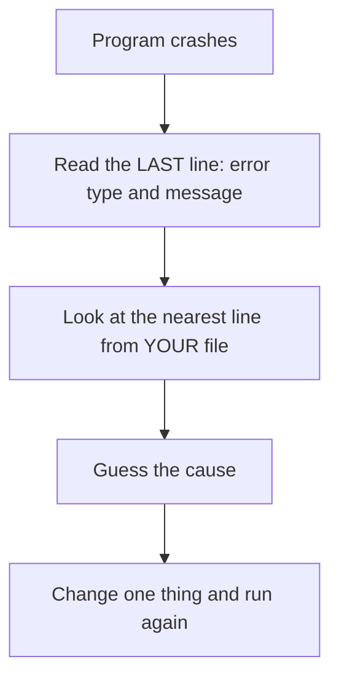
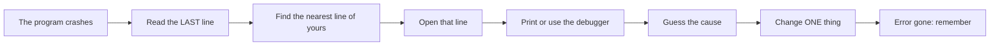
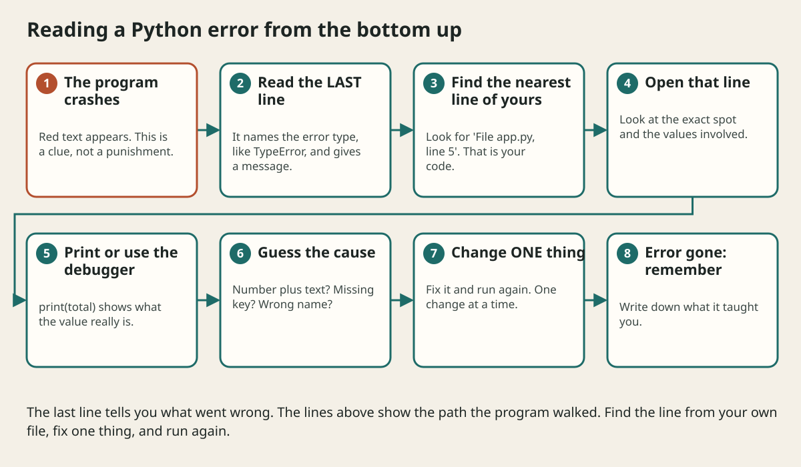

# Reading Python Errors And Tracebacks

## The big idea in plain words {#picture}

When your bike makes a strange noise, a good mechanic does not panic. They listen, find where the noise comes from, and fix that one part. A Python error message is the bike's strange noise, and the traceback is the way to find where it comes from.

The big secret is that **you read a traceback from the bottom up**. The very last line tells you what went wrong. The lines above show the path the program walked before it fell.



## What you will be able to do {#outcomes}

By the end of this lesson you will be able to:

- Read a traceback from the bottom.
- Recognize SyntaxError, NameError, TypeError, ValueError, and KeyError.
- Debug with print statements and a calm four-step method.

## Words to know {#vocabulary}

- **traceback**: the list of calls shown when a program crashes.
- **SyntaxError**: the code is written wrongly.
- **NameError**: a name was used that does not exist.
- **TypeError**: a value of the wrong type was used.
- **KeyError**: a dictionary key is missing.
- **debugger**: a tool to pause the program and look inside.

## Why this idea exists {#history}

Beginners often feel stuck when they see red text. Programmers who read it carefully fix most bugs in minutes, and learn something each time.

## Concept 1: Read the last line first {#concept-1}

```text
Traceback (most recent call last):
  File "app.py", line 5, in <module>
    print(total + "dollars")
TypeError: unsupported operand type(s) for +: 'int' and 'str'
```
The last line says: you tried to add a number (`int`) and text (`str`). The line above it says where: `app.py`, line 5.

## Concept 2: Common errors in plain words {#concept-2}

`SyntaxError`: the code is not written properly, like a missing `:`. `NameError`: you used a name that does not exist (maybe a typo). `TypeError`: wrong type, like `"a" + 1`. `ValueError`: right type, wrong value, like `int("abc")`. `KeyError`: that key is not in the dictionary. `IndexError`: that position is not in the list.

## Concept 3: Follow the path {#concept-3}

The lines above the last one show each function that was running, from the oldest at the top to the newest at the bottom. Look for the line from your own file. Lines inside libraries are rarely the real cause. The mistake is almost always in how your code used them.

## Concept 4: A calm debugging method {#concept-4}

1) Read the last line. 2) Open the file and line it names. 3) Add `print(variable)` just before to see what the values really are, or use the debugger with `breakpoint()`. 4) Change one thing and run again. If you change many things at once, you will never know which one fixed it.

## Fix the sum {#example}

`total + "dollars"` fails because `total` is a number. Two fixes: `str(total) + " dollars"` or better, `f"{total} dollars"`. Run again: it prints `12 dollars`. The error is gone, and you learned a rule: numbers and text need to be converted before joining.

## Going deeper: the technical walkthrough {#walkthrough}

## Worked scenario {#worked-scenario}

Your script crashes with a long traceback. Where should you look first?

The justified choice is **At the last line for the error type and message, then at the nearest line from your own file**. Select **read-traceback-bottom** in the structured practical and explain why. Alternatives ignore a requirement, cross a trust boundary, or invent success.

### Structured decision contract

```json

{
  "decision": "read-traceback-bottom",
  "justification": "The traceback and syntaxError boundary must preserve the declared contract and ownership.",
  "failureBehavior": "Expose a safe failure and recover through the boundary owner."
}

```

Decision selects one declared behavior. Justification explains the boundary. FailureBehavior explains the observable error and recovery owner. These fields never execute commands. Required terms and minimum lengths form a basic practice rubric, not semantic grading.

## Step-by-step flow and matching picture {#flow}





## Three real-life uses {#use-cases}

1. A student fixes a missing colon after reading `SyntaxError`.
2. A developer uses `print(note)` to see why a value is `None`.
3. A team adds request ids to errors so they can find the right traceback in the logs.

## What can go wrong, and how to stay safe {#failure-security}

Mistakes: reading from the top and getting lost, ignoring the message, changing five things at once, and hiding errors with an empty `except:`. Hiding an error does not remove it. It just removes the clue.

## Practice lab and expected observation {#practice}

1. Predict the scenario decision before opening Practical. Explain each rejected alternative.
2. Run a relevant example above in an isolated exercise project. Record the expected result, then change one input to an invalid or boundary value. A failed assertion or deliberate error should replace silent success.
3. Submit the structured decision. Initially the checks fail. After selecting read-traceback-bottom and writing an explanation and failure plan, all three pass. Follow the indicated review section for missed checks.

### Broken example to debug

```json

{"decision":"trust-client","justification":"","failureBehavior":""}

```

This ignores the responsible boundary and gives no reasoning or recovery. Correct the fields rather than changing the validator.

## Checkpoint and definition of done {#checkpoint}

- [ ] Define traceback and syntaxError without looking.
- [ ] Trace input to owner and output.
- [ ] Explain one failure and one alternative.
- [ ] Pass at least four assignment questions.
- [ ] Pass every practical check and submit.
- [ ] Explain the concept again tomorrow.

## Sources, versions, and safe commands {#sources}

Python 3.11+; examples use Python 3.11 syntax and Pydantic 2 conventions. Review date: 2026-10-02. The supplied blueprint is the teaching source; official landing pages were checked where reachable. No provider or original TM Schedule deployment was tested.

- [Official reference](https://docs.python.org/3/tutorial/)

- [Official reference](https://fastapi.tiangolo.com/tutorial/)

[Course reading order](README.md) · [Previous lesson](04-values-types-and-control-flow.md) · [Next lesson](04b-text-strings-and-f-strings.md)

```study-quiz

{
  "schemaVersion": 1,
  "lessonId": "python-first-api/04a-reading-python-errors-and-tracebacks",
  "title": "Assignment: Reading Python Errors And Tracebacks",
  "passPercentage": 80,
  "questions": [
    {
      "id": "q1",
      "sectionId": "concept-1",
      "prompt": "In Reading Python Errors And Tracebacks, what does traceback mean?",
      "options": [
        {
          "id": "a",
          "text": "the list of calls that led to an error, shown when a program crashes",
          "explanation": "This preserves the definition and boundary described in the lesson."
        },
        {
          "id": "b",
          "text": "A permission granted by a hidden browser control",
          "explanation": "This changes the declared meaning or bypasses the responsible boundary."
        },
        {
          "id": "c",
          "text": "An unlimited provider operation with no ownership",
          "explanation": "This changes the declared meaning or bypasses the responsible boundary."
        },
        {
          "id": "d",
          "text": "A diagnostic credential intended for public logs",
          "explanation": "This changes the declared meaning or bypasses the responsible boundary."
        }
      ],
      "correctOptionId": "a",
      "explanation": "traceback means the list of calls that led to an error, shown when a program crashes.",
      "reviewLabel": "Review concept 1"
    },
    {
      "id": "q2",
      "sectionId": "concept-2",
      "prompt": "In Reading Python Errors And Tracebacks, which rule is correct for checkpoint 2?",
      "options": [
        {
          "id": "a",
          "text": "Trust client-side checks instead of the server rule.",
          "explanation": "This changes the declared meaning or bypasses the responsible boundary."
        },
        {
          "id": "b",
          "text": "SyntaxError means the code is not written correctly, for example a missing colon.",
          "explanation": "This preserves the definition and boundary described in the lesson."
        },
        {
          "id": "c",
          "text": "Hide the failure by returning a fabricated successful result.",
          "explanation": "This changes the declared meaning or bypasses the responsible boundary."
        },
        {
          "id": "d",
          "text": "Skip the stated boundary, limit, or ownership check.",
          "explanation": "This changes the declared meaning or bypasses the responsible boundary."
        }
      ],
      "correctOptionId": "b",
      "explanation": "SyntaxError means the code is not written correctly, for example a missing colon.",
      "reviewLabel": "Review concept 2"
    },
    {
      "id": "q3",
      "sectionId": "concept-3",
      "prompt": "In Reading Python Errors And Tracebacks, which rule is correct for checkpoint 3?",
      "options": [
        {
          "id": "a",
          "text": "Trust client-side checks instead of the server rule.",
          "explanation": "This changes the declared meaning or bypasses the responsible boundary."
        },
        {
          "id": "b",
          "text": "Hide the failure by returning a fabricated successful result.",
          "explanation": "This changes the declared meaning or bypasses the responsible boundary."
        },
        {
          "id": "c",
          "text": "TypeError means a value of the wrong type was used, such as adding text to a number.",
          "explanation": "This preserves the definition and boundary described in the lesson."
        },
        {
          "id": "d",
          "text": "Skip the stated boundary, limit, or ownership check.",
          "explanation": "This changes the declared meaning or bypasses the responsible boundary."
        }
      ],
      "correctOptionId": "c",
      "explanation": "TypeError means a value of the wrong type was used, such as adding text to a number.",
      "reviewLabel": "Review concept 3"
    },
    {
      "id": "q4",
      "sectionId": "concept-4",
      "prompt": "In Reading Python Errors And Tracebacks, which rule is correct for checkpoint 4?",
      "options": [
        {
          "id": "a",
          "text": "Trust client-side checks instead of the server rule.",
          "explanation": "This changes the declared meaning or bypasses the responsible boundary."
        },
        {
          "id": "b",
          "text": "Hide the failure by returning a fabricated successful result.",
          "explanation": "This changes the declared meaning or bypasses the responsible boundary."
        },
        {
          "id": "c",
          "text": "Skip the stated boundary, limit, or ownership check.",
          "explanation": "This changes the declared meaning or bypasses the responsible boundary."
        },
        {
          "id": "d",
          "text": "A NameError means a name is used before it was given a value or is spelled wrongly.",
          "explanation": "This preserves the definition and boundary described in the lesson."
        }
      ],
      "correctOptionId": "d",
      "explanation": "A NameError means a name is used before it was given a value or is spelled wrongly.",
      "reviewLabel": "Review concept 4"
    },
    {
      "id": "q5",
      "sectionId": "worked-scenario",
      "prompt": "Your script crashes with a long traceback. Where should you look first?",
      "options": [
        {
          "id": "a",
          "text": "At the last line for the error type and message, then at the nearest line from your own file",
          "explanation": "This preserves the definition and boundary described in the lesson."
        },
        {
          "id": "b",
          "text": "At the first line only",
          "explanation": "This changes the declared meaning or bypasses the responsible boundary."
        },
        {
          "id": "c",
          "text": "Delete the whole file",
          "explanation": "This changes the declared meaning or bypasses the responsible boundary."
        },
        {
          "id": "d",
          "text": "Ignore it and run the script again",
          "explanation": "This changes the declared meaning or bypasses the responsible boundary."
        }
      ],
      "correctOptionId": "a",
      "explanation": "At the last line for the error type and message, then at the nearest line from your own file. Change one thing at a time when fixing a bug, and run the program again after each change.",
      "reviewLabel": "Review the worked scenario"
    }
  ]
}

```

```study-practical

{
  "schemaVersion": 1,
  "challengeId": "python-first-api/04a-reading-python-errors-and-tracebacks/decision",
  "lessonId": "python-first-api/04a-reading-python-errors-and-tracebacks",
  "title": "Practical: Reading Python Errors And Tracebacks",
  "language": "json",
  "mode": "structured",
  "instructions": "Your script crashes with a long traceback. Where should you look first? Return an object with decision (choose from read-traceback-bottom, skip-check, unbounded-work, trust-client), justification (at least 40 characters; include traceback and syntaxError), and failureBehavior (at least 25 characters; include failure and recover while explaining the error and recovery). These are structured reasoning checks, not code execution or an official grade.",
  "starterCode": "{\n  \"decision\": \"\",\n  \"justification\": \"\",\n  \"failureBehavior\": \"\"\n}",
  "entryPoint": "answer",
  "publicExamples": [
    {
      "input": {
        "decision": "skip-check",
        "justification": "",
        "failureBehavior": ""
      },
      "expected": {
        "passed": false
      }
    },
    {
      "input": {
        "decision": "read-traceback-bottom",
        "justification": "The traceback and syntaxError boundary must preserve the declared contract and ownership.",
        "failureBehavior": "Show a safe failure and recover through the responsible owner."
      },
      "expected": {
        "passed": true
      }
    }
  ],
  "publicTestIds": [
    "decision",
    "explanation",
    "failure-plan"
  ],
  "reviewSections": {
    "decision": "worked-scenario",
    "explanation": "concept-2",
    "failure-plan": "failure-security"
  },
  "limits": {
    "timeMs": 2000,
    "memoryMb": 128,
    "outputBytes": 20000
  }
}

```

