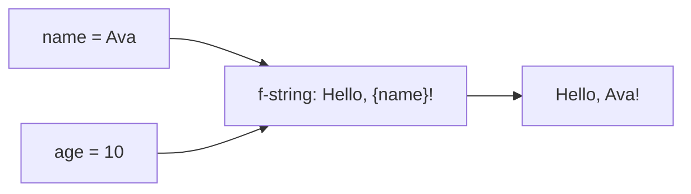
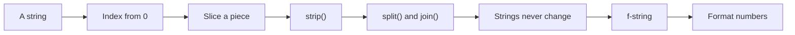
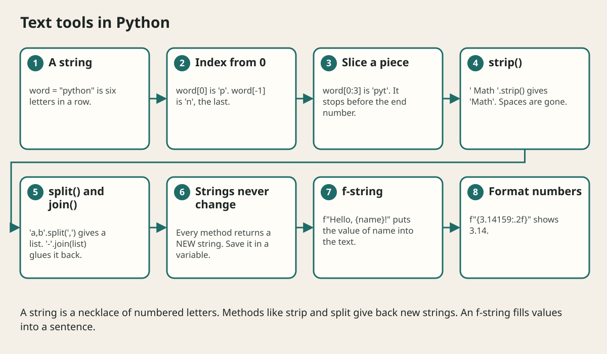

# Text Strings And F Strings

## The big idea in plain words {#picture}

A string is a necklace of letters. Each bead (character) sits in a numbered place, starting at zero. You can look at one bead, take a piece of the necklace, or make a new necklace by joining pieces. But you cannot paint a bead on the old necklace. Python strings never change. Every action gives you a new one.

The handiest trick is the **f-string**: you write text with blank spaces in curly braces, and Python fills them in.



## What you will be able to do {#outcomes}

By the end of this lesson you will be able to:

- Create strings with single, double, and triple quotes.
- Use indexing, slicing, and methods like `strip`, `lower`, `split`, and `join`.
- Format text with f-strings.

## Words to know {#vocabulary}

- **string**: text in quotes.
- **index**: the number of a character, starting at 0.
- **slice**: a piece taken with `[start:end]`.
- **method**: an action written after a dot, like `.upper()`.
- **f-string**: a string starting with `f` that fills in `{values}`.
- **immutable**: cannot be changed after it is made.

## Why this idea exists {#history}

Text is everywhere: titles, names, messages, URLs, JSON. Cleaning and shaping text is one of the most common jobs a program does.

## Concept 1: Make strings {#concept-1}

```python
a = "double quotes"
b = 'single quotes'
c = """a long text
that has many lines"""
```
Both single and double quotes work. Use triple quotes for many lines. Use a backslash for special characters, like `\n` for a new line.

## Concept 2: Indexing and slicing {#concept-2}

```python
word = "python"
word[0]      # 'p'
word[-1]     # 'n' (the last)
word[0:3]    # 'pyt' (from 0 up to, not including, 3)
len(word)    # 6
```
Negative numbers count from the end. A slice stops just before its end number.

## Concept 3: Useful methods {#concept-3}

```python
"  Math  ".strip()          # 'Math'
"Hello".lower()             # 'hello'
"a,b,c".split(",")          # ['a', 'b', 'c']
"-".join(["a", "b", "c"])   # 'a-b-c'
"hello".replace("l", "L")   # 'heLLo'
```
Each one returns a *new* string. The original does not change. That is why you must save the result: `title = title.strip()`.

## Concept 4: f-strings fill in blanks {#concept-4}

```python
name = "Ava"
points = 12.5
print(f"{name} scored {points:.1f} points")   # Ava scored 12.5 points
print(f"Total: {2 + 3}")                      # Total: 5
```
Anything in `{ }` is calculated and inserted. `:.1f` means "one digit after the decimal point". It is much easier than gluing strings with `+`.

## Clean and shout {#example}

```python
title = "  intro to python  "
clean = title.strip().title()
print(f"New note: {clean}")     # New note: Intro To Python
```
We chain the methods: remove spaces, capitalize each word, and then put the result in a message.

## Going deeper: the technical walkthrough {#walkthrough}

## Worked scenario {#worked-scenario}

A user types '  Math  ' as a title. How do you clean it before saving?

The justified choice is **Call strip() to remove the extra spaces**. Select **strip-the-title** in the structured practical and explain why. Alternatives ignore a requirement, cross a trust boundary, or invent success.

### Structured decision contract

```json

{
  "decision": "strip-the-title",
  "justification": "The string and fString boundary must preserve the declared contract and ownership.",
  "failureBehavior": "Expose a safe failure and recover through the boundary owner."
}

```

Decision selects one declared behavior. Justification explains the boundary. FailureBehavior explains the observable error and recovery owner. These fields never execute commands. Required terms and minimum lengths form a basic practice rubric, not semantic grading.

## Step-by-step flow and matching picture {#flow}





## Three real-life uses {#use-cases}

1. A form trims spaces from every title before saving.
2. A program splits "a,b,c" from a file into a list.
3. A greeting uses an f-string to say hello to each user by name.

## What can go wrong, and how to stay safe {#failure-security}

Mistakes: calling `title.strip()` and forgetting to save the result, joining a number and text with `+` (use an f-string), forgetting that slices stop before the end number, and building SQL with an f-string (never do that: use `?` slots).

## Practice lab and expected observation {#practice}

1. Predict the scenario decision before opening Practical. Explain each rejected alternative.
2. Run a relevant example above in an isolated exercise project. Record the expected result, then change one input to an invalid or boundary value. A failed assertion or deliberate error should replace silent success.
3. Submit the structured decision. Initially the checks fail. After selecting strip-the-title and writing an explanation and failure plan, all three pass. Follow the indicated review section for missed checks.

### Broken example to debug

```json

{"decision":"trust-client","justification":"","failureBehavior":""}

```

This ignores the responsible boundary and gives no reasoning or recovery. Correct the fields rather than changing the validator.

## Checkpoint and definition of done {#checkpoint}

- [ ] Define string and fString without looking.
- [ ] Trace input to owner and output.
- [ ] Explain one failure and one alternative.
- [ ] Pass at least four assignment questions.
- [ ] Pass every practical check and submit.
- [ ] Explain the concept again tomorrow.

## Sources, versions, and safe commands {#sources}

Python 3.11+; examples use Python 3.11 syntax and Pydantic 2 conventions. Review date: 2026-10-02. The supplied blueprint is the teaching source; official landing pages were checked where reachable. No provider or original TM Schedule deployment was tested.

- [Official reference](https://docs.python.org/3/tutorial/)

- [Official reference](https://fastapi.tiangolo.com/tutorial/)

[Course reading order](README.md) · [Previous lesson](04a-reading-python-errors-and-tracebacks.md) · [Next lesson](05-functions-scope-and-composition.md)

```study-quiz

{
  "schemaVersion": 1,
  "lessonId": "python-first-api/04b-text-strings-and-f-strings",
  "title": "Assignment: Text Strings And F Strings",
  "passPercentage": 80,
  "questions": [
    {
      "id": "q1",
      "sectionId": "concept-1",
      "prompt": "In Text Strings And F Strings, what does string mean?",
      "options": [
        {
          "id": "a",
          "text": "A permission granted by a hidden browser control",
          "explanation": "This changes the declared meaning or bypasses the responsible boundary."
        },
        {
          "id": "b",
          "text": "a piece of text inside quotes",
          "explanation": "This preserves the definition and boundary described in the lesson."
        },
        {
          "id": "c",
          "text": "An unlimited provider operation with no ownership",
          "explanation": "This changes the declared meaning or bypasses the responsible boundary."
        },
        {
          "id": "d",
          "text": "A diagnostic credential intended for public logs",
          "explanation": "This changes the declared meaning or bypasses the responsible boundary."
        }
      ],
      "correctOptionId": "b",
      "explanation": "string means a piece of text inside quotes.",
      "reviewLabel": "Review concept 1"
    },
    {
      "id": "q2",
      "sectionId": "concept-2",
      "prompt": "In Text Strings And F Strings, which rule is correct for checkpoint 2?",
      "options": [
        {
          "id": "a",
          "text": "Trust client-side checks instead of the server rule.",
          "explanation": "This changes the declared meaning or bypasses the responsible boundary."
        },
        {
          "id": "b",
          "text": "Hide the failure by returning a fabricated successful result.",
          "explanation": "This changes the declared meaning or bypasses the responsible boundary."
        },
        {
          "id": "c",
          "text": "An f-string puts values into text using curly braces, like f'Hello {name}'.",
          "explanation": "This preserves the definition and boundary described in the lesson."
        },
        {
          "id": "d",
          "text": "Skip the stated boundary, limit, or ownership check.",
          "explanation": "This changes the declared meaning or bypasses the responsible boundary."
        }
      ],
      "correctOptionId": "c",
      "explanation": "An f-string puts values into text using curly braces, like f'Hello {name}'.",
      "reviewLabel": "Review concept 2"
    },
    {
      "id": "q3",
      "sectionId": "concept-3",
      "prompt": "In Text Strings And F Strings, which rule is correct for checkpoint 3?",
      "options": [
        {
          "id": "a",
          "text": "Trust client-side checks instead of the server rule.",
          "explanation": "This changes the declared meaning or bypasses the responsible boundary."
        },
        {
          "id": "b",
          "text": "Hide the failure by returning a fabricated successful result.",
          "explanation": "This changes the declared meaning or bypasses the responsible boundary."
        },
        {
          "id": "c",
          "text": "Skip the stated boundary, limit, or ownership check.",
          "explanation": "This changes the declared meaning or bypasses the responsible boundary."
        },
        {
          "id": "d",
          "text": "strip removes spaces from both ends, and split breaks a string into a list.",
          "explanation": "This preserves the definition and boundary described in the lesson."
        }
      ],
      "correctOptionId": "d",
      "explanation": "strip removes spaces from both ends, and split breaks a string into a list.",
      "reviewLabel": "Review concept 3"
    },
    {
      "id": "q4",
      "sectionId": "concept-4",
      "prompt": "In Text Strings And F Strings, which rule is correct for checkpoint 4?",
      "options": [
        {
          "id": "a",
          "text": "Counting starts at 0, so text[0] is the first character.",
          "explanation": "This preserves the definition and boundary described in the lesson."
        },
        {
          "id": "b",
          "text": "Trust client-side checks instead of the server rule.",
          "explanation": "This changes the declared meaning or bypasses the responsible boundary."
        },
        {
          "id": "c",
          "text": "Hide the failure by returning a fabricated successful result.",
          "explanation": "This changes the declared meaning or bypasses the responsible boundary."
        },
        {
          "id": "d",
          "text": "Skip the stated boundary, limit, or ownership check.",
          "explanation": "This changes the declared meaning or bypasses the responsible boundary."
        }
      ],
      "correctOptionId": "a",
      "explanation": "Counting starts at 0, so text[0] is the first character.",
      "reviewLabel": "Review concept 4"
    },
    {
      "id": "q5",
      "sectionId": "worked-scenario",
      "prompt": "A user types '  Math  ' as a title. How do you clean it before saving?",
      "options": [
        {
          "id": "a",
          "text": "Save it exactly as typed",
          "explanation": "This changes the declared meaning or bypasses the responsible boundary."
        },
        {
          "id": "b",
          "text": "Call strip() to remove the extra spaces",
          "explanation": "This preserves the definition and boundary described in the lesson."
        },
        {
          "id": "c",
          "text": "Multiply it by two",
          "explanation": "This changes the declared meaning or bypasses the responsible boundary."
        },
        {
          "id": "d",
          "text": "Convert it to a number",
          "explanation": "This changes the declared meaning or bypasses the responsible boundary."
        }
      ],
      "correctOptionId": "b",
      "explanation": "Call strip() to remove the extra spaces. The join method glues a list of strings together using a separator.",
      "reviewLabel": "Review the worked scenario"
    }
  ]
}

```

```study-practical

{
  "schemaVersion": 1,
  "challengeId": "python-first-api/04b-text-strings-and-f-strings/decision",
  "lessonId": "python-first-api/04b-text-strings-and-f-strings",
  "title": "Practical: Text Strings And F Strings",
  "language": "json",
  "mode": "structured",
  "instructions": "A user types '  Math  ' as a title. How do you clean it before saving? Return an object with decision (choose from strip-the-title, skip-check, unbounded-work, trust-client), justification (at least 40 characters; include string and fString), and failureBehavior (at least 25 characters; include failure and recover while explaining the error and recovery). These are structured reasoning checks, not code execution or an official grade.",
  "starterCode": "{\n  \"decision\": \"\",\n  \"justification\": \"\",\n  \"failureBehavior\": \"\"\n}",
  "entryPoint": "answer",
  "publicExamples": [
    {
      "input": {
        "decision": "skip-check",
        "justification": "",
        "failureBehavior": ""
      },
      "expected": {
        "passed": false
      }
    },
    {
      "input": {
        "decision": "strip-the-title",
        "justification": "The string and fString boundary must preserve the declared contract and ownership.",
        "failureBehavior": "Show a safe failure and recover through the responsible owner."
      },
      "expected": {
        "passed": true
      }
    }
  ],
  "publicTestIds": [
    "decision",
    "explanation",
    "failure-plan"
  ],
  "reviewSections": {
    "decision": "worked-scenario",
    "explanation": "concept-2",
    "failure-plan": "failure-security"
  },
  "limits": {
    "timeMs": 2000,
    "memoryMb": 128,
    "outputBytes": 20000
  }
}

```

