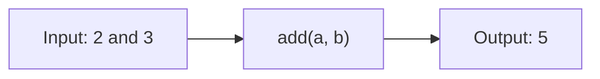
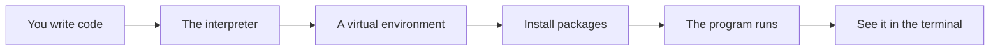

# Functions Scope And Composition

## The big idea in plain words {#picture}

A function is a small machine. You put something in the input tray, it works inside, and something comes out of the output tray. For example, a machine named `add` takes two numbers and gives back their sum. Once you build the machine, you can use it over and over without rebuilding it.

Functions keep programs tidy. Instead of one huge list of steps, you have many small machines with clear names.



## What you will be able to do {#outcomes}

By the end of this lesson you will be able to:

- Write functions with parameters, defaults, and return values.
- Understand local scope and what a closure is.
- Keep functions small and easy to test.

## Words to know {#vocabulary}

- **function**: a named group of steps.
- **parameter**: a name for an input a function receives.
- **argument**: the actual value you give when calling.
- **return**: hands an answer back to the caller.
- **scope**: where a name can be seen.
- **pure function**: gives the same answer for the same input and changes nothing outside.

## Why this idea exists {#history}

If you copy the same steps in ten places, a fix needs ten changes. If they live in one function, one change fixes everything.

## Concept 1: Defining and calling {#concept-1}

```python
def add(a, b):
    return a + b

print(add(2, 3))    # 5
```
`def` starts the function. `a` and `b` are parameters. `return` sends the answer back. Without `return`, a function gives back `None`.

## Concept 2: Defaults and keyword arguments {#concept-2}

```python
def greet(name, greeting="Hello"):
    return f"{greeting}, {name}!"

greet("Ava")                      # Hello, Ava!
greet("Ava", greeting="Hi")       # Hi, Ava!
```
A default makes a parameter optional. Naming arguments (`greeting="Hi"`) makes calls easy to read. FastAPI uses this idea a lot for query parameters.

## Concept 3: Scope: names have a home {#concept-3}

A variable made inside a function lives only there, like a note on a desk inside a room. Outside, nobody sees it. A function can read things from outside, but changing outside things is a bad habit. Prefer to take inputs and return outputs.

## Concept 4: Never use a changeable default {#concept-4}

Writing `def add_tag(tag, tags=[])` is a famous trap: the same list is shared by every call! Use `None` as the default and make a new list inside: `if tags is None: tags = []`. Small, pure functions are easy to test and trust.

## Clean a title {#example}

```python
def clean_title(text):
    title = text.strip()
    if not title:
        raise ValueError("Title cannot be empty")
    return title

print(clean_title("  Math  "))     # Math
```
Many routes can now use `clean_title`, and the rule lives in exactly one place.

## Going deeper: the technical walkthrough {#walkthrough}

### Python foundations


### Values and collections

```python
name: str = "Asha"
count: int = 3
is_ready: bool = True
names: list[str] = ["Asha", "Sam"]
by_id: dict[int, str] = {1: "Asha"}
```

A type annotation tells a human and a type checker what a value should be. It
does not make untrusted web input safe by itself. Request models still need
runtime validation.

### Functions and decisions

```python
def clean_text(value: str | None) -> str | None:
    if value is None:
        return None
    cleaned = value.strip()
    return cleaned or None
```

A function should have one clear job. A route should not contain every database
query and business rule in one long block.

### Exceptions

```python
class ItemNotFound(Exception):
    """The requested item does not exist."""


def find_item(item_id: int) -> dict[str, object]:
    raise ItemNotFound from None
```

The API layer can translate a known exception to `404`. It should not return a
Python traceback, SQL statement, local path, or secret to a caller.

### Modules and virtual environments

Create an isolated environment so one project cannot break another project:

```bash
python3 -m venv .venv
source .venv/bin/activate
python -m pip install --upgrade pip
python -m pip install fastapi uvicorn pydantic pytest httpx
```

Keep dependencies in `pyproject.toml` or a locked requirements file. Do not
install into the system Python when the project is meant to be repeatable.


## Worked scenario {#worked-scenario}

Three routes all clean up a note title in slightly different ways. What fixes this?

The justified choice is **Move the cleanup into one tested function that all three use**. Select **extract-rule** in the structured practical and explain why. Alternatives ignore a requirement, cross a trust boundary, or invent success.

### Structured decision contract

```json

{
  "decision": "extract-rule",
  "justification": "The parameter and return boundary must preserve the declared contract and ownership.",
  "failureBehavior": "Expose a safe failure and recover through the boundary owner."
}

```

Decision selects one declared behavior. Justification explains the boundary. FailureBehavior explains the observable error and recovery owner. These fields never execute commands. Required terms and minimum lengths form a basic practice rubric, not semantic grading.

## Step-by-step flow and matching picture {#flow}




## Three real-life uses {#use-cases}

1. A function that converts temperatures from Celsius to Fahrenheit.
2. A `clean_title` used by every route that saves a note.
3. A small function tested on its own without starting a web server.

## What can go wrong, and how to stay safe {#failure-security}

Mistakes: forgetting `return` and getting `None`, using a list as a default value, changing global variables from inside a function, and writing one huge function that does ten jobs. If you struggle to name a function, it probably does too much.

## Practice lab and expected observation {#practice}

Implement normalize so null or whitespace-only input returns null, and a nonblank string returns its trimmed value. Preserve internal spaces. The caller translates null to a deliberate validation error instead of saving a blank note.

The language starter and public examples appear in Practical. Run is unavailable until a trusted isolated worker is configured. Reading and assignment review still work; this lesson does not claim code-test completion.

1. Predict the scenario decision before opening Practical. Explain each rejected alternative.
2. Run a relevant example above in an isolated exercise project. Record the expected result, then change one input to an invalid or boundary value. A failed assertion or deliberate error should replace silent success.
3. Submit the structured decision. Initially the checks fail. After selecting extract-rule and writing an explanation and failure plan, all three pass. Follow the indicated review section for missed checks.

### Broken example to debug

```json

{"decision":"trust-client","justification":"","failureBehavior":""}

```

This ignores the responsible boundary and gives no reasoning or recovery. Correct the fields rather than changing the validator.

## Checkpoint and definition of done {#checkpoint}

- [ ] Define parameter and return without looking.
- [ ] Trace input to owner and output.
- [ ] Explain one failure and one alternative.
- [ ] Pass at least four assignment questions.
- [ ] Pass every practical check and submit.
- [ ] Explain the concept again tomorrow.

## Sources, versions, and safe commands {#sources}

Python 3.11+; examples use Python 3.11 syntax and Pydantic 2 conventions. Review date: 2026-10-02. The supplied blueprint is the teaching source; official landing pages were checked where reachable. No provider or original TM Schedule deployment was tested.

- [Official reference](https://docs.python.org/3/tutorial/)

- [Official reference](https://fastapi.tiangolo.com/tutorial/)

[Course reading order](README.md) · [Previous lesson](04b-text-strings-and-f-strings.md) · [Next lesson](06-collections-comprehensions-and-datastructures.md)

```study-quiz

{
  "schemaVersion": 1,
  "lessonId": "python-first-api/05-functions-scope-and-composition",
  "title": "Assignment: Functions Scope And Composition",
  "passPercentage": 80,
  "questions": [
    {
      "id": "q1",
      "sectionId": "concept-1",
      "prompt": "In Functions Scope And Composition, what does parameter mean?",
      "options": [
        {
          "id": "a",
          "text": "A permission granted by a hidden browser control",
          "explanation": "This changes the declared meaning or bypasses the responsible boundary."
        },
        {
          "id": "b",
          "text": "An unlimited provider operation with no ownership",
          "explanation": "This changes the declared meaning or bypasses the responsible boundary."
        },
        {
          "id": "c",
          "text": "a named slot where a function receives an input",
          "explanation": "This preserves the definition and boundary described in the lesson."
        },
        {
          "id": "d",
          "text": "A diagnostic credential intended for public logs",
          "explanation": "This changes the declared meaning or bypasses the responsible boundary."
        }
      ],
      "correctOptionId": "c",
      "explanation": "parameter means a named slot where a function receives an input.",
      "reviewLabel": "Review concept 1"
    },
    {
      "id": "q2",
      "sectionId": "concept-2",
      "prompt": "In Functions Scope And Composition, which rule is correct for checkpoint 2?",
      "options": [
        {
          "id": "a",
          "text": "Trust client-side checks instead of the server rule.",
          "explanation": "This changes the declared meaning or bypasses the responsible boundary."
        },
        {
          "id": "b",
          "text": "Hide the failure by returning a fabricated successful result.",
          "explanation": "This changes the declared meaning or bypasses the responsible boundary."
        },
        {
          "id": "c",
          "text": "Skip the stated boundary, limit, or ownership check.",
          "explanation": "This changes the declared meaning or bypasses the responsible boundary."
        },
        {
          "id": "d",
          "text": "A pure function only works with what you give it and changes nothing outside.",
          "explanation": "This preserves the definition and boundary described in the lesson."
        }
      ],
      "correctOptionId": "d",
      "explanation": "A pure function only works with what you give it and changes nothing outside.",
      "reviewLabel": "Review concept 2"
    },
    {
      "id": "q3",
      "sectionId": "concept-3",
      "prompt": "In Functions Scope And Composition, which rule is correct for checkpoint 3?",
      "options": [
        {
          "id": "a",
          "text": "Do not hide a shared changeable list inside a default value.",
          "explanation": "This preserves the definition and boundary described in the lesson."
        },
        {
          "id": "b",
          "text": "Trust client-side checks instead of the server rule.",
          "explanation": "This changes the declared meaning or bypasses the responsible boundary."
        },
        {
          "id": "c",
          "text": "Hide the failure by returning a fabricated successful result.",
          "explanation": "This changes the declared meaning or bypasses the responsible boundary."
        },
        {
          "id": "d",
          "text": "Skip the stated boundary, limit, or ownership check.",
          "explanation": "This changes the declared meaning or bypasses the responsible boundary."
        }
      ],
      "correctOptionId": "a",
      "explanation": "Do not hide a shared changeable list inside a default value.",
      "reviewLabel": "Review concept 3"
    },
    {
      "id": "q4",
      "sectionId": "concept-4",
      "prompt": "In Functions Scope And Composition, which rule is correct for checkpoint 4?",
      "options": [
        {
          "id": "a",
          "text": "Trust client-side checks instead of the server rule.",
          "explanation": "This changes the declared meaning or bypasses the responsible boundary."
        },
        {
          "id": "b",
          "text": "Returning a value lets the caller decide what to do with it.",
          "explanation": "This preserves the definition and boundary described in the lesson."
        },
        {
          "id": "c",
          "text": "Hide the failure by returning a fabricated successful result.",
          "explanation": "This changes the declared meaning or bypasses the responsible boundary."
        },
        {
          "id": "d",
          "text": "Skip the stated boundary, limit, or ownership check.",
          "explanation": "This changes the declared meaning or bypasses the responsible boundary."
        }
      ],
      "correctOptionId": "b",
      "explanation": "Returning a value lets the caller decide what to do with it.",
      "reviewLabel": "Review concept 4"
    },
    {
      "id": "q5",
      "sectionId": "worked-scenario",
      "prompt": "Three routes all clean up a note title in slightly different ways. What fixes this?",
      "options": [
        {
          "id": "a",
          "text": "Copy all the routes again",
          "explanation": "This changes the declared meaning or bypasses the responsible boundary."
        },
        {
          "id": "b",
          "text": "Only check the title in the user interface",
          "explanation": "This changes the declared meaning or bypasses the responsible boundary."
        },
        {
          "id": "c",
          "text": "Move the cleanup into one tested function that all three use",
          "explanation": "This preserves the definition and boundary described in the lesson."
        },
        {
          "id": "d",
          "text": "Return success even when there is no title",
          "explanation": "This changes the declared meaning or bypasses the responsible boundary."
        }
      ],
      "correctOptionId": "c",
      "explanation": "Move the cleanup into one tested function that all three use. A small function can be tested without starting a whole web server.",
      "reviewLabel": "Review the worked scenario"
    }
  ]
}

```

```study-practical

{
  "schemaVersion": 1,
  "challengeId": "python-first-api/05-functions-scope-and-composition/coding",
  "lessonId": "python-first-api/05-functions-scope-and-composition",
  "title": "Practical: Normalize a note title",
  "language": "python",
  "mode": "function",
  "instructions": "Implement normalize so null or whitespace-only input returns null, and a nonblank string returns its trimmed value. Preserve internal spaces. The caller translates null to a deliberate validation error instead of saving a blank note. A disposable isolated code runner is required; this installation never executes learner code on the host.",
  "starterCode": "def normalize(value: str | None) -> str | None:\n    return value\n",
  "entryPoint": "normalize",
  "publicExamples": [
    {
      "input": "  APIs  ",
      "expected": "APIs"
    },
    {
      "input": "   ",
      "expected": null
    },
    {
      "input": null,
      "expected": null
    }
  ],
  "publicTestIds": [
    "trim-title",
    "blank-title",
    "missing-title",
    "preserve-inner-spaces"
  ],
  "reviewSections": {
    "trim-title": "walkthrough",
    "blank-title": "walkthrough",
    "missing-title": "walkthrough",
    "preserve-inner-spaces": "walkthrough"
  },
  "limits": {
    "timeMs": 2000,
    "memoryMb": 128,
    "outputBytes": 20000
  }
}

```

