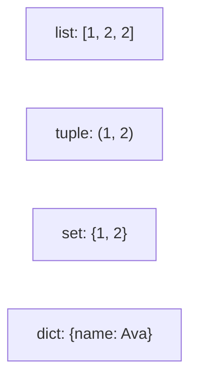
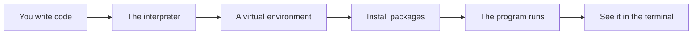

# Collections Comprehensions And Datastructures

## The big idea in plain words {#picture}

Python gives you four main shelves. A **list** is a row of things in order, like a line of kids. A **tuple** is a list that is locked: it cannot be changed. A **set** is a bag where nothing appears twice. A **dict** (dictionary) is a lookup: you give a word, you get its meaning.

Picking the right shelf makes code shorter and faster, and says clearly what you mean.



## What you will be able to do {#outcomes}

By the end of this lesson you will be able to:

- Use lists, tuples, sets, and dictionaries.
- Write a list comprehension.
- Sort and choose the right structure for the job.

## Words to know {#vocabulary}

- **list**: ordered items you can change.
- **tuple**: ordered items you cannot change.
- **set**: unique items with no order.
- **dict**: keys connected to values.
- **comprehension**: a short way to build a list in one line.
- **iterator**: something you can go through one item at a time.

## Why this idea exists {#history}

Real programs hold many things: a list of notes, a set of tags, a dictionary from id to note. Choosing well keeps code clear and quick.

## Concept 1: List: ordered and changeable {#concept-1}

```python
names = ["Ava", "Ben"]
names.append("Cy")
print(names[0])        # Ava (counting starts at 0)
```
Use a list when order matters and when items can change. The same value may appear twice.

## Concept 2: Dict: look up by key {#concept-2}

```python
note = {"id": 1, "title": "Math"}
print(note["title"])       # Math
note["pinned"] = True      # add a new key
```
Dictionaries are everywhere in Python and in JSON, the format most APIs use. `note.get("tags", [])` is a safe way to read a key that might be missing.

## Concept 3: Set and tuple {#concept-3}

`{1, 2, 2}` becomes `{1, 2}`. Sets are great for removing duplicates and for asking "is this in here?" very quickly. A tuple `(3, 4)` is a fixed pair, like a coordinate that should not change.

## Concept 4: Comprehensions {#concept-4}

```python
squares = [n * n for n in range(1, 6)]            # [1, 4, 9, 16, 25]
long_names = [n for n in names if len(n) > 2]
```
Read it as: "make a new list of n times n, for each n in the range". It is a short way to say "loop and collect". Use it for simple jobs. If it gets long, use a normal loop.

## Count tags {#example}

```python
tags = ["python", "api", "python"]
counts = {}
for tag in tags:
    counts[tag] = counts.get(tag, 0) + 1
print(counts)       # {'python': 2, 'api': 1}
```
A dictionary remembers one number for each tag. `get(tag, 0)` means "the current count, or 0 if we have not seen it".

## Going deeper: the technical walkthrough {#walkthrough}

### Python foundations


### Values and collections

```python
name: str = "Asha"
count: int = 3
is_ready: bool = True
names: list[str] = ["Asha", "Sam"]
by_id: dict[int, str] = {1: "Asha"}
```

A type annotation tells a human and a type checker what a value should be. It
does not make untrusted web input safe by itself. Request models still need
runtime validation.

### Functions and decisions

```python
def clean_text(value: str | None) -> str | None:
    if value is None:
        return None
    cleaned = value.strip()
    return cleaned or None
```

A function should have one clear job. A route should not contain every database
query and business rule in one long block.

### Exceptions

```python
class ItemNotFound(Exception):
    """The requested item does not exist."""


def find_item(item_id: int) -> dict[str, object]:
    raise ItemNotFound from None
```

The API layer can translate a known exception to `404`. It should not return a
Python traceback, SQL statement, local path, or secret to a caller.

### Modules and virtual environments

Create an isolated environment so one project cannot break another project:

```bash
python3 -m venv .venv
source .venv/bin/activate
python -m pip install --upgrade pip
python -m pip install fastapi uvicorn pydantic pytest httpx
```

Keep dependencies in `pyproject.toml` or a locked requirements file. Do not
install into the system Python when the project is meant to be repeatable.


### Focused implementation

Use a tuple for a fixed positional group, a list for order, a set for uniqueness, and a dict for key lookup. Comprehensions construct values; generators produce them lazily. Repeated dictionary lookup helps an in-memory catalog. A million database rows should be filtered by a query rather than loaded into Python.

```python

notes = [{"id": 1, "title": "APIs"}, {"id": 2, "title": "Python"}]
by_id = {note["id"]: note for note in notes}
titles = sorted(note["title"] for note in notes)
assert by_id[1]["title"] == "APIs"
print(titles)

```

Read the imports, then the values and checks, then the operation, and finally the result or cleanup. Java Example programs compile as Example.java. Python uses Python 3.11+. JavaScript ESM runs as example.mjs. Framework snippets run inside the generated project.

## Worked scenario {#worked-scenario}

You often need to find a note by its unique ID in a small program. Which container fits best?

The justified choice is **A map where the note ID is the key**. Select **map-by-id** in the structured practical and explain why. Alternatives ignore a requirement, cross a trust boundary, or invent success.

### Structured decision contract

```json

{
  "decision": "map-by-id",
  "justification": "The list and set boundary must preserve the declared contract and ownership.",
  "failureBehavior": "Expose a safe failure and recover through the boundary owner."
}

```

Decision selects one declared behavior. Justification explains the boundary. FailureBehavior explains the observable error and recovery owner. These fields never execute commands. Required terms and minimum lengths form a basic practice rubric, not semantic grading.

## Step-by-step flow and matching picture {#flow}




## Three real-life uses {#use-cases}

1. A list of homework tasks in order.
2. A set of student ids that have handed in the work.
3. A dictionary from product code to price.

## What can go wrong, and how to stay safe {#failure-security}

Mistakes: using a list and searching it again and again when a dict would be instant, changing a list while looping over it, expecting a set to keep order, and writing a comprehension so long that nobody can read it.

## Practice lab and expected observation {#practice}

Implement titles to return distinct note titles in ascending ASCII order without changing the caller’s list. An empty list returns an empty list. This is an in-memory exercise, not a replacement for a database pagination query.

The language starter and public examples appear in Practical. Run is unavailable until a trusted isolated worker is configured. Reading and assignment review still work; this lesson does not claim code-test completion.

1. Predict the scenario decision before opening Practical. Explain each rejected alternative.
2. Run a relevant example above in an isolated exercise project. Record the expected result, then change one input to an invalid or boundary value. A failed assertion or deliberate error should replace silent success.
3. Submit the structured decision. Initially the checks fail. After selecting map-by-id and writing an explanation and failure plan, all three pass. Follow the indicated review section for missed checks.

### Broken example to debug

```json

{"decision":"trust-client","justification":"","failureBehavior":""}

```

This ignores the responsible boundary and gives no reasoning or recovery. Correct the fields rather than changing the validator.

## Checkpoint and definition of done {#checkpoint}

- [ ] Define list and set without looking.
- [ ] Trace input to owner and output.
- [ ] Explain one failure and one alternative.
- [ ] Pass at least four assignment questions.
- [ ] Pass every practical check and submit.
- [ ] Explain the concept again tomorrow.

## Sources, versions, and safe commands {#sources}

Python 3.11+; examples use Python 3.11 syntax and Pydantic 2 conventions. Review date: 2026-10-02. The supplied blueprint is the teaching source; official landing pages were checked where reachable. No provider or original TM Schedule deployment was tested.

- [Official reference](https://docs.python.org/3/tutorial/)

- [Official reference](https://fastapi.tiangolo.com/tutorial/)

[Course reading order](README.md) · [Previous lesson](05-functions-scope-and-composition.md) · [Next lesson](06a-classes-and-objects-in-python.md)

```study-quiz

{
  "schemaVersion": 1,
  "lessonId": "python-first-api/06-collections-comprehensions-and-datastructures",
  "title": "Assignment: Collections Comprehensions And Datastructures",
  "passPercentage": 80,
  "questions": [
    {
      "id": "q1",
      "sectionId": "concept-1",
      "prompt": "In Collections Comprehensions And Datastructures, what does list mean?",
      "options": [
        {
          "id": "a",
          "text": "A permission granted by a hidden browser control",
          "explanation": "This changes the declared meaning or bypasses the responsible boundary."
        },
        {
          "id": "b",
          "text": "An unlimited provider operation with no ownership",
          "explanation": "This changes the declared meaning or bypasses the responsible boundary."
        },
        {
          "id": "c",
          "text": "A diagnostic credential intended for public logs",
          "explanation": "This changes the declared meaning or bypasses the responsible boundary."
        },
        {
          "id": "d",
          "text": "items in order; the same item can appear twice",
          "explanation": "This preserves the definition and boundary described in the lesson."
        }
      ],
      "correctOptionId": "d",
      "explanation": "list means items in order; the same item can appear twice.",
      "reviewLabel": "Review concept 1"
    },
    {
      "id": "q2",
      "sectionId": "concept-2",
      "prompt": "In Collections Comprehensions And Datastructures, which rule is correct for checkpoint 2?",
      "options": [
        {
          "id": "a",
          "text": "A set is how you say 'no duplicates'.",
          "explanation": "This preserves the definition and boundary described in the lesson."
        },
        {
          "id": "b",
          "text": "Trust client-side checks instead of the server rule.",
          "explanation": "This changes the declared meaning or bypasses the responsible boundary."
        },
        {
          "id": "c",
          "text": "Hide the failure by returning a fabricated successful result.",
          "explanation": "This changes the declared meaning or bypasses the responsible boundary."
        },
        {
          "id": "d",
          "text": "Skip the stated boundary, limit, or ownership check.",
          "explanation": "This changes the declared meaning or bypasses the responsible boundary."
        }
      ],
      "correctOptionId": "a",
      "explanation": "A set is how you say 'no duplicates'.",
      "reviewLabel": "Review concept 2"
    },
    {
      "id": "q3",
      "sectionId": "concept-3",
      "prompt": "In Collections Comprehensions And Datastructures, which rule is correct for checkpoint 3?",
      "options": [
        {
          "id": "a",
          "text": "Trust client-side checks instead of the server rule.",
          "explanation": "This changes the declared meaning or bypasses the responsible boundary."
        },
        {
          "id": "b",
          "text": "A map connects each key to exactly one current value.",
          "explanation": "This preserves the definition and boundary described in the lesson."
        },
        {
          "id": "c",
          "text": "Hide the failure by returning a fabricated successful result.",
          "explanation": "This changes the declared meaning or bypasses the responsible boundary."
        },
        {
          "id": "d",
          "text": "Skip the stated boundary, limit, or ownership check.",
          "explanation": "This changes the declared meaning or bypasses the responsible boundary."
        }
      ],
      "correctOptionId": "b",
      "explanation": "A map connects each key to exactly one current value.",
      "reviewLabel": "Review concept 3"
    },
    {
      "id": "q4",
      "sectionId": "concept-4",
      "prompt": "In Collections Comprehensions And Datastructures, which rule is correct for checkpoint 4?",
      "options": [
        {
          "id": "a",
          "text": "Trust client-side checks instead of the server rule.",
          "explanation": "This changes the declared meaning or bypasses the responsible boundary."
        },
        {
          "id": "b",
          "text": "Hide the failure by returning a fabricated successful result.",
          "explanation": "This changes the declared meaning or bypasses the responsible boundary."
        },
        {
          "id": "c",
          "text": "Sorting needs a clear rule for what 'smaller' means.",
          "explanation": "This preserves the definition and boundary described in the lesson."
        },
        {
          "id": "d",
          "text": "Skip the stated boundary, limit, or ownership check.",
          "explanation": "This changes the declared meaning or bypasses the responsible boundary."
        }
      ],
      "correctOptionId": "c",
      "explanation": "Sorting needs a clear rule for what 'smaller' means.",
      "reviewLabel": "Review concept 4"
    },
    {
      "id": "q5",
      "sectionId": "worked-scenario",
      "prompt": "You often need to find a note by its unique ID in a small program. Which container fits best?",
      "options": [
        {
          "id": "a",
          "text": "A list you search from the start every time",
          "explanation": "This changes the declared meaning or bypasses the responsible boundary."
        },
        {
          "id": "b",
          "text": "A set that stores no notes",
          "explanation": "This changes the declared meaning or bypasses the responsible boundary."
        },
        {
          "id": "c",
          "text": "One big changeable text string",
          "explanation": "This changes the declared meaning or bypasses the responsible boundary."
        },
        {
          "id": "d",
          "text": "A map where the note ID is the key",
          "explanation": "This preserves the definition and boundary described in the lesson."
        }
      ],
      "correctOptionId": "d",
      "explanation": "A map where the note ID is the key. A database index helps find things in big stored data; a map in memory disappears when the program stops.",
      "reviewLabel": "Review the worked scenario"
    }
  ]
}

```

```study-practical

{
  "schemaVersion": 1,
  "challengeId": "python-first-api/06-collections-comprehensions-and-datastructures/coding",
  "lessonId": "python-first-api/06-collections-comprehensions-and-datastructures",
  "title": "Practical: Create a distinct sorted title list",
  "language": "python",
  "mode": "function",
  "instructions": "Implement titles to return distinct note titles in ascending ASCII order without changing the caller’s list. An empty list returns an empty list. This is an in-memory exercise, not a replacement for a database pagination query. A disposable isolated code runner is required; this installation never executes learner code on the host.",
  "starterCode": "def titles(values: list[str]) -> list[str]:\n    return values\n",
  "entryPoint": "titles",
  "publicExamples": [
    {
      "input": [
        "Java",
        "API",
        "Java"
      ],
      "expected": [
        "API",
        "Java"
      ]
    },
    {
      "input": [],
      "expected": []
    }
  ],
  "publicTestIds": [
    "sorted-distinct",
    "empty-list",
    "input-unchanged"
  ],
  "reviewSections": {
    "sorted-distinct": "walkthrough",
    "empty-list": "walkthrough",
    "input-unchanged": "walkthrough"
  },
  "limits": {
    "timeMs": 2000,
    "memoryMb": 128,
    "outputBytes": 20000
  }
}

```

