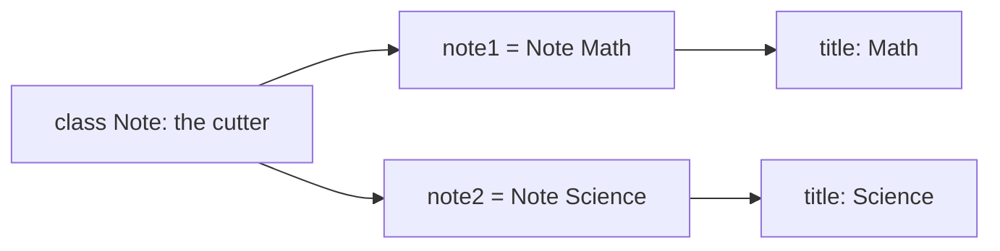
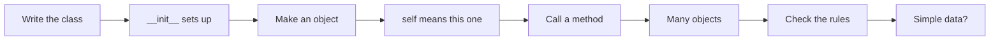
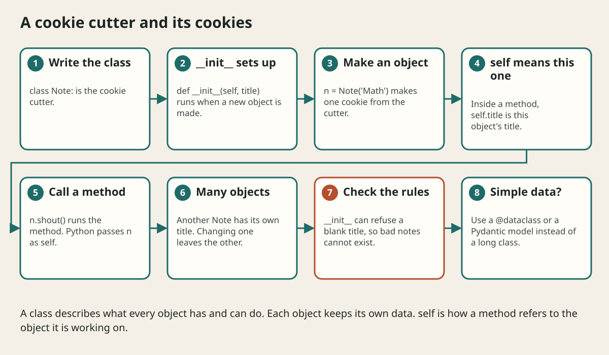

# Classes And Objects In Python

## The big idea in plain words {#picture}

A class is a cookie cutter. An object is one cookie. You can make many cookies with one cutter, and each cookie can have its own sprinkles. The cutter says "every cookie has a shape and can be eaten". Each cookie has its own particular decorations.

In Python, you write the cutter with the word `class`. You make cookies by calling the class like a function: `Note("Math")`.



## What you will be able to do {#outcomes}

By the end of this lesson you will be able to:

- Write a class with `__init__` and methods.
- Explain `self` in plain words.
- Choose between a class, a dataclass, and a plain function.

## Words to know {#vocabulary}

- **class**: a blueprint for objects.
- **object / instance**: one real thing made from a class.
- **attribute**: a variable that belongs to an object.
- **method**: a function that belongs to a class.
- **self**: the object that a method is working on.
- **inheritance**: a child class that gets what its parent has.

## Why this idea exists {#history}

Classes group data and the actions on that data in one place. The libraries you use in this course, like FastAPI and Pydantic, ask you to write classes, so you need to read them with ease.

## Concept 1: A first class {#concept-1}

```python
class Note:
    def __init__(self, title):
        self.title = title

    def shout(self):
        return self.title.upper()

n = Note("math")
print(n.title)     # math
print(n.shout())   # MATH
```
`__init__` runs when you write `Note("math")`. It sets up the object's attributes. Methods are functions inside the class.

## Concept 2: What is self? {#concept-2}

`self` is the object itself. When you call `n.shout()`, Python quietly passes `n` as `self`. So inside the method, `self.title` means "this note's title". Another note has its own `self` and its own title.

## Concept 3: Each object has its own data {#concept-3}

```python
a = Note("Math")
b = Note("Science")
a.title = "Algebra"
print(b.title)     # Science (not changed)
```
Changing one object does not change the other, just as decorating one cookie does not decorate the others.

## Concept 4: Inheritance and when to use classes {#concept-4}

```python
class Pinned(Note):
    def shout(self):
        return "PINNED: " + super().shout()
```
A child class gets everything from its parent and can replace parts. But do not use classes everywhere. For data only, use a `@dataclass` or a Pydantic model. For one job, a plain function is simpler. Use a class when data and actions belong together.

## Protect a rule {#example}

```python
class Note:
    def __init__(self, title):
        if not title.strip():
            raise ValueError("Title cannot be empty")
        self.title = title.strip()
```
Now it is impossible to build a `Note` with an empty title, because the check runs every time an object is created.

## Going deeper: the technical walkthrough {#walkthrough}

## Worked scenario {#worked-scenario}

You need a small class that just holds an id, a title, and a pinned flag. What is the simplest choice?

The justified choice is **A dataclass with three fields**. Select **use-dataclass** in the structured practical and explain why. Alternatives ignore a requirement, cross a trust boundary, or invent success.

### Structured decision contract

```json

{
  "decision": "use-dataclass",
  "justification": "The classDefinition and instance boundary must preserve the declared contract and ownership.",
  "failureBehavior": "Expose a safe failure and recover through the boundary owner."
}

```

Decision selects one declared behavior. Justification explains the boundary. FailureBehavior explains the observable error and recovery owner. These fields never execute commands. Required terms and minimum lengths form a basic practice rubric, not semantic grading.

## Step-by-step flow and matching picture {#flow}





## Three real-life uses {#use-cases}

1. A `BankAccount` class that refuses to go below zero.
2. A Pydantic `NoteIn` model, which is a class that checks data.
3. A `Student` class that keeps a name and a list of grades.

## What can go wrong, and how to stay safe {#failure-security}

Mistakes: forgetting `self` as the first parameter, forgetting `self.` before attribute names inside methods, sharing a list between all objects by writing it at the class level, and building a giant class that does too many jobs.

## Practice lab and expected observation {#practice}

1. Predict the scenario decision before opening Practical. Explain each rejected alternative.
2. Run a relevant example above in an isolated exercise project. Record the expected result, then change one input to an invalid or boundary value. A failed assertion or deliberate error should replace silent success.
3. Submit the structured decision. Initially the checks fail. After selecting use-dataclass and writing an explanation and failure plan, all three pass. Follow the indicated review section for missed checks.

### Broken example to debug

```json

{"decision":"trust-client","justification":"","failureBehavior":""}

```

This ignores the responsible boundary and gives no reasoning or recovery. Correct the fields rather than changing the validator.

## Checkpoint and definition of done {#checkpoint}

- [ ] Define classDefinition and instance without looking.
- [ ] Trace input to owner and output.
- [ ] Explain one failure and one alternative.
- [ ] Pass at least four assignment questions.
- [ ] Pass every practical check and submit.
- [ ] Explain the concept again tomorrow.

## Sources, versions, and safe commands {#sources}

Python 3.11+; examples use Python 3.11 syntax and Pydantic 2 conventions. Review date: 2026-10-02. The supplied blueprint is the teaching source; official landing pages were checked where reachable. No provider or original TM Schedule deployment was tested.

- [Official reference](https://docs.python.org/3/tutorial/)

- [Official reference](https://fastapi.tiangolo.com/tutorial/)

[Course reading order](README.md) · [Previous lesson](06-collections-comprehensions-and-datastructures.md) · [Next lesson](07-modules-packages-and-dependencies.md)

```study-quiz

{
  "schemaVersion": 1,
  "lessonId": "python-first-api/06a-classes-and-objects-in-python",
  "title": "Assignment: Classes And Objects In Python",
  "passPercentage": 80,
  "questions": [
    {
      "id": "q1",
      "sectionId": "concept-1",
      "prompt": "In Classes And Objects In Python, what does classDefinition mean?",
      "options": [
        {
          "id": "a",
          "text": "a blueprint that describes what an object knows and can do",
          "explanation": "This preserves the definition and boundary described in the lesson."
        },
        {
          "id": "b",
          "text": "A permission granted by a hidden browser control",
          "explanation": "This changes the declared meaning or bypasses the responsible boundary."
        },
        {
          "id": "c",
          "text": "An unlimited provider operation with no ownership",
          "explanation": "This changes the declared meaning or bypasses the responsible boundary."
        },
        {
          "id": "d",
          "text": "A diagnostic credential intended for public logs",
          "explanation": "This changes the declared meaning or bypasses the responsible boundary."
        }
      ],
      "correctOptionId": "a",
      "explanation": "classDefinition means a blueprint that describes what an object knows and can do.",
      "reviewLabel": "Review concept 1"
    },
    {
      "id": "q2",
      "sectionId": "concept-2",
      "prompt": "In Classes And Objects In Python, which rule is correct for checkpoint 2?",
      "options": [
        {
          "id": "a",
          "text": "Trust client-side checks instead of the server rule.",
          "explanation": "This changes the declared meaning or bypasses the responsible boundary."
        },
        {
          "id": "b",
          "text": "The __init__ method runs when a new object is created and sets up its attributes.",
          "explanation": "This preserves the definition and boundary described in the lesson."
        },
        {
          "id": "c",
          "text": "Hide the failure by returning a fabricated successful result.",
          "explanation": "This changes the declared meaning or bypasses the responsible boundary."
        },
        {
          "id": "d",
          "text": "Skip the stated boundary, limit, or ownership check.",
          "explanation": "This changes the declared meaning or bypasses the responsible boundary."
        }
      ],
      "correctOptionId": "b",
      "explanation": "The __init__ method runs when a new object is created and sets up its attributes.",
      "reviewLabel": "Review concept 2"
    },
    {
      "id": "q3",
      "sectionId": "concept-3",
      "prompt": "In Classes And Objects In Python, which rule is correct for checkpoint 3?",
      "options": [
        {
          "id": "a",
          "text": "Trust client-side checks instead of the server rule.",
          "explanation": "This changes the declared meaning or bypasses the responsible boundary."
        },
        {
          "id": "b",
          "text": "Hide the failure by returning a fabricated successful result.",
          "explanation": "This changes the declared meaning or bypasses the responsible boundary."
        },
        {
          "id": "c",
          "text": "The first parameter of a method is called self and refers to the object itself.",
          "explanation": "This preserves the definition and boundary described in the lesson."
        },
        {
          "id": "d",
          "text": "Skip the stated boundary, limit, or ownership check.",
          "explanation": "This changes the declared meaning or bypasses the responsible boundary."
        }
      ],
      "correctOptionId": "c",
      "explanation": "The first parameter of a method is called self and refers to the object itself.",
      "reviewLabel": "Review concept 3"
    },
    {
      "id": "q4",
      "sectionId": "concept-4",
      "prompt": "In Classes And Objects In Python, which rule is correct for checkpoint 4?",
      "options": [
        {
          "id": "a",
          "text": "Trust client-side checks instead of the server rule.",
          "explanation": "This changes the declared meaning or bypasses the responsible boundary."
        },
        {
          "id": "b",
          "text": "Hide the failure by returning a fabricated successful result.",
          "explanation": "This changes the declared meaning or bypasses the responsible boundary."
        },
        {
          "id": "c",
          "text": "Skip the stated boundary, limit, or ownership check.",
          "explanation": "This changes the declared meaning or bypasses the responsible boundary."
        },
        {
          "id": "d",
          "text": "Each object keeps its own copy of its attributes.",
          "explanation": "This preserves the definition and boundary described in the lesson."
        }
      ],
      "correctOptionId": "d",
      "explanation": "Each object keeps its own copy of its attributes.",
      "reviewLabel": "Review concept 4"
    },
    {
      "id": "q5",
      "sectionId": "worked-scenario",
      "prompt": "You need a small class that just holds an id, a title, and a pinned flag. What is the simplest choice?",
      "options": [
        {
          "id": "a",
          "text": "A dataclass with three fields",
          "explanation": "This preserves the definition and boundary described in the lesson."
        },
        {
          "id": "b",
          "text": "A giant class with many unrelated methods",
          "explanation": "This changes the declared meaning or bypasses the responsible boundary."
        },
        {
          "id": "c",
          "text": "Three separate global variables",
          "explanation": "This changes the declared meaning or bypasses the responsible boundary."
        },
        {
          "id": "d",
          "text": "A class with no attributes",
          "explanation": "This changes the declared meaning or bypasses the responsible boundary."
        }
      ],
      "correctOptionId": "a",
      "explanation": "A dataclass with three fields. A dataclass is a shorter way to write a class that mostly holds data.",
      "reviewLabel": "Review the worked scenario"
    }
  ]
}

```

```study-practical

{
  "schemaVersion": 1,
  "challengeId": "python-first-api/06a-classes-and-objects-in-python/decision",
  "lessonId": "python-first-api/06a-classes-and-objects-in-python",
  "title": "Practical: Classes And Objects In Python",
  "language": "json",
  "mode": "structured",
  "instructions": "You need a small class that just holds an id, a title, and a pinned flag. What is the simplest choice? Return an object with decision (choose from use-dataclass, skip-check, unbounded-work, trust-client), justification (at least 40 characters; include classDefinition and instance), and failureBehavior (at least 25 characters; include failure and recover while explaining the error and recovery). These are structured reasoning checks, not code execution or an official grade.",
  "starterCode": "{\n  \"decision\": \"\",\n  \"justification\": \"\",\n  \"failureBehavior\": \"\"\n}",
  "entryPoint": "answer",
  "publicExamples": [
    {
      "input": {
        "decision": "skip-check",
        "justification": "",
        "failureBehavior": ""
      },
      "expected": {
        "passed": false
      }
    },
    {
      "input": {
        "decision": "use-dataclass",
        "justification": "The classDefinition and instance boundary must preserve the declared contract and ownership.",
        "failureBehavior": "Show a safe failure and recover through the responsible owner."
      },
      "expected": {
        "passed": true
      }
    }
  ],
  "publicTestIds": [
    "decision",
    "explanation",
    "failure-plan"
  ],
  "reviewSections": {
    "decision": "worked-scenario",
    "explanation": "concept-2",
    "failure-plan": "failure-security"
  },
  "limits": {
    "timeMs": 2000,
    "memoryMb": 128,
    "outputBytes": 20000
  }
}

```

