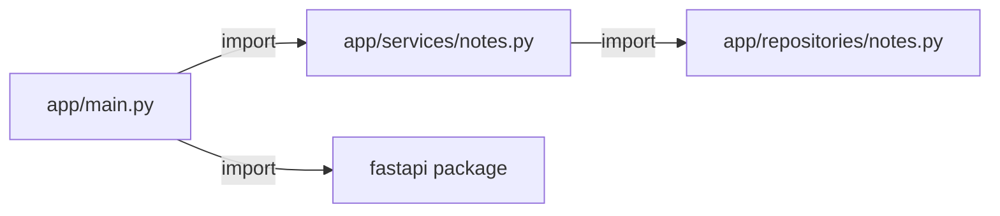
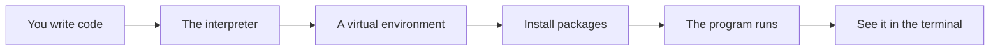

# Modules Packages And Dependencies

## The big idea in plain words {#picture}

A big program in one file is like one giant drawer with everything thrown in. A better way: many small files (called **modules**), grouped in folders (called **packages**), each with one job. When you need something, you `import` it, like fetching a tool from a labeled drawer.

You can also use packages written by other people, like FastAPI. That is a superpower. But each outside package is something you trust, so choose with care.



## What you will be able to do {#outcomes}

By the end of this lesson you will be able to:

- Import from your own files and from packages.
- Organize a project into modules and packages.
- Pin dependencies and think about trust.

## Words to know {#vocabulary}

- **module**: one Python file that holds code.
- **package**: a folder of modules, with `__init__.py`.
- **import**: use code from another module.
- **dependency**: a package your project needs.
- **lock file**: a record of exact versions installed.
- **circular import**: A imports B and B imports A.

## Why this idea exists {#history}

Without modules, one file grows to thousands of lines and nobody can find anything. With modules, each file is small and has one clear job.

## Concept 1: Import what you need {#concept-1}

```python
from app.services.notes import create_note
import json
```
The first line takes `create_note` from `app/services/notes.py`. The second brings the whole standard `json` module. Use clear names so readers know where things come from.

## Concept 2: Packages are folders {#concept-2}

A folder with an `__init__.py` file is a package. It lets you write `app.services.notes`. In modern Python the file is even optional, but keeping it makes the intention clear.

## Concept 3: Pin dependencies and be careful {#concept-3}

Record exact versions in `requirements.txt` or `pyproject.toml`. A new version can change behavior. Also, each package runs code on your machine, so install only well-known ones and check the name carefully, because attackers publish packages with names almost the same as popular ones.

## Concept 4: Avoid circles {#concept-4}

If `a.py` imports `b.py` and `b.py` imports `a.py`, Python may stop with an import error. The fix is to rethink the design so the arrows go one way, like route to service to repository.

## Splitting a file {#example}

`main.py` has 500 lines. You move note rules to `services/notes.py` and database code to `repositories/notes.py`. Now `main.py` has 40 lines and each file has one job. A bug in the rules? Open `services/notes.py` and nothing else.

## Going deeper: the technical walkthrough {#walkthrough}

### Python foundations


### Values and collections

```python
name: str = "Asha"
count: int = 3
is_ready: bool = True
names: list[str] = ["Asha", "Sam"]
by_id: dict[int, str] = {1: "Asha"}
```

A type annotation tells a human and a type checker what a value should be. It
does not make untrusted web input safe by itself. Request models still need
runtime validation.

### Functions and decisions

```python
def clean_text(value: str | None) -> str | None:
    if value is None:
        return None
    cleaned = value.strip()
    return cleaned or None
```

A function should have one clear job. A route should not contain every database
query and business rule in one long block.

### Exceptions

```python
class ItemNotFound(Exception):
    """The requested item does not exist."""


def find_item(item_id: int) -> dict[str, object]:
    raise ItemNotFound from None
```

The API layer can translate a known exception to `404`. It should not return a
Python traceback, SQL statement, local path, or secret to a caller.

### Modules and virtual environments

Create an isolated environment so one project cannot break another project:

```bash
python3 -m venv .venv
source .venv/bin/activate
python -m pip install --upgrade pip
python -m pip install fastapi uvicorn pydantic pytest httpx
```

Keep dependencies in `pyproject.toml` or a locked requirements file. Do not
install into the system Python when the project is meant to be repeatable.


### Project layout


A small but maintainable API can look like this:

```text
fastapi-course/
+-- pyproject.toml
+-- app/
|   +-- main.py
|   +-- config.py
|   +-- routes/
|   +-- models/
|   +-- services/
|   +-- repositories/
|   +-- errors.py
|   +-- logging_config.py
+-- tests/
+-- README.md
```

Keep configuration parsing, HTTP binding, business rules, and storage in
separate places. Split a file when it becomes hard to scan, not merely because
another language uses more files.


### Focused implementation

An import evaluates a module and reuses its module object. Keep side effects out of imports so tests can load functions without starting servers. A package has a public surface; helpers remain implementation details. A virtual environment isolates dependencies, not untrusted code. Lock dependencies and review installation hooks.

```python

from pathlib import Path
from importlib.util import find_spec

print(Path("notes.json").suffix)
assert find_spec("json") is not None

```

Read the imports, then the values and checks, then the operation, and finally the result or cleanup. Java Example programs compile as Example.java. Python uses Python 3.11+. JavaScript ESM runs as example.mjs. Framework snippets run inside the generated project.

## Worked scenario {#worked-scenario}

Two computers install different versions of the same libraries. What makes builds the same?

The justified choice is **A lockfile saved with the project and used by the package manager**. Select **use-lockfile** in the structured practical and explain why. Alternatives ignore a requirement, cross a trust boundary, or invent success.

### Structured decision contract

```json

{
  "decision": "use-lockfile",
  "justification": "The module and package boundary must preserve the declared contract and ownership.",
  "failureBehavior": "Expose a safe failure and recover through the boundary owner."
}

```

Decision selects one declared behavior. Justification explains the boundary. FailureBehavior explains the observable error and recovery owner. These fields never execute commands. Required terms and minimum lengths form a basic practice rubric, not semantic grading.

## Step-by-step flow and matching picture {#flow}




## Three real-life uses {#use-cases}

1. A project with `routes`, `services`, and `repositories` folders.
2. A team shares a `pyproject.toml` so everyone installs the same packages.
3. A script imports `json` and `pathlib` from the standard library without installing anything.

## What can go wrong, and how to stay safe {#failure-security}

Mistakes: `from module import *` (you cannot tell where names come from), circular imports, unpinned dependencies, and installing a package just because a blog post mentioned it. Add a package only when you can say why you need it.

## Practice lab and expected observation {#practice}

1. Predict the scenario decision before opening Practical. Explain each rejected alternative.
2. Run a relevant example above in an isolated exercise project. Record the expected result, then change one input to an invalid or boundary value. A failed assertion or deliberate error should replace silent success.
3. Submit the structured decision. Initially the checks fail. After selecting use-lockfile and writing an explanation and failure plan, all three pass. Follow the indicated review section for missed checks.

### Broken example to debug

```json

{"decision":"trust-client","justification":"","failureBehavior":""}

```

This ignores the responsible boundary and gives no reasoning or recovery. Correct the fields rather than changing the validator.

## Checkpoint and definition of done {#checkpoint}

- [ ] Define module and package without looking.
- [ ] Trace input to owner and output.
- [ ] Explain one failure and one alternative.
- [ ] Pass at least four assignment questions.
- [ ] Pass every practical check and submit.
- [ ] Explain the concept again tomorrow.

## Sources, versions, and safe commands {#sources}

Python 3.11+; examples use Python 3.11 syntax and Pydantic 2 conventions. Review date: 2026-10-02. The supplied blueprint is the teaching source; official landing pages were checked where reachable. No provider or original TM Schedule deployment was tested.

- [Official reference](https://docs.python.org/3/tutorial/)

- [Official reference](https://fastapi.tiangolo.com/tutorial/)

[Course reading order](README.md) · [Previous lesson](06a-classes-and-objects-in-python.md) · [Next lesson](08-exceptions-context-managers-and-errors.md)

```study-quiz

{
  "schemaVersion": 1,
  "lessonId": "python-first-api/07-modules-packages-and-dependencies",
  "title": "Assignment: Modules Packages And Dependencies",
  "passPercentage": 80,
  "questions": [
    {
      "id": "q1",
      "sectionId": "concept-1",
      "prompt": "In Modules Packages And Dependencies, what does module mean?",
      "options": [
        {
          "id": "a",
          "text": "A permission granted by a hidden browser control",
          "explanation": "This changes the declared meaning or bypasses the responsible boundary."
        },
        {
          "id": "b",
          "text": "one piece of code with clear things it takes in and gives out",
          "explanation": "This preserves the definition and boundary described in the lesson."
        },
        {
          "id": "c",
          "text": "An unlimited provider operation with no ownership",
          "explanation": "This changes the declared meaning or bypasses the responsible boundary."
        },
        {
          "id": "d",
          "text": "A diagnostic credential intended for public logs",
          "explanation": "This changes the declared meaning or bypasses the responsible boundary."
        }
      ],
      "correctOptionId": "b",
      "explanation": "module means one piece of code with clear things it takes in and gives out.",
      "reviewLabel": "Review concept 1"
    },
    {
      "id": "q2",
      "sectionId": "concept-2",
      "prompt": "In Modules Packages And Dependencies, which rule is correct for checkpoint 2?",
      "options": [
        {
          "id": "a",
          "text": "Trust client-side checks instead of the server rule.",
          "explanation": "This changes the declared meaning or bypasses the responsible boundary."
        },
        {
          "id": "b",
          "text": "Hide the failure by returning a fabricated successful result.",
          "explanation": "This changes the declared meaning or bypasses the responsible boundary."
        },
        {
          "id": "c",
          "text": "A lockfile makes installs repeatable.",
          "explanation": "This preserves the definition and boundary described in the lesson."
        },
        {
          "id": "d",
          "text": "Skip the stated boundary, limit, or ownership check.",
          "explanation": "This changes the declared meaning or bypasses the responsible boundary."
        }
      ],
      "correctOptionId": "c",
      "explanation": "A lockfile makes installs repeatable.",
      "reviewLabel": "Review concept 2"
    },
    {
      "id": "q3",
      "sectionId": "concept-3",
      "prompt": "In Modules Packages And Dependencies, which rule is correct for checkpoint 3?",
      "options": [
        {
          "id": "a",
          "text": "Trust client-side checks instead of the server rule.",
          "explanation": "This changes the declared meaning or bypasses the responsible boundary."
        },
        {
          "id": "b",
          "text": "Hide the failure by returning a fabricated successful result.",
          "explanation": "This changes the declared meaning or bypasses the responsible boundary."
        },
        {
          "id": "c",
          "text": "Skip the stated boundary, limit, or ownership check.",
          "explanation": "This changes the declared meaning or bypasses the responsible boundary."
        },
        {
          "id": "d",
          "text": "Pieces that depend on each other in a circle are hard to understand.",
          "explanation": "This preserves the definition and boundary described in the lesson."
        }
      ],
      "correctOptionId": "d",
      "explanation": "Pieces that depend on each other in a circle are hard to understand.",
      "reviewLabel": "Review concept 3"
    },
    {
      "id": "q4",
      "sectionId": "concept-4",
      "prompt": "In Modules Packages And Dependencies, which rule is correct for checkpoint 4?",
      "options": [
        {
          "id": "a",
          "text": "Different module systems find files in different ways.",
          "explanation": "This preserves the definition and boundary described in the lesson."
        },
        {
          "id": "b",
          "text": "Trust client-side checks instead of the server rule.",
          "explanation": "This changes the declared meaning or bypasses the responsible boundary."
        },
        {
          "id": "c",
          "text": "Hide the failure by returning a fabricated successful result.",
          "explanation": "This changes the declared meaning or bypasses the responsible boundary."
        },
        {
          "id": "d",
          "text": "Skip the stated boundary, limit, or ownership check.",
          "explanation": "This changes the declared meaning or bypasses the responsible boundary."
        }
      ],
      "correctOptionId": "a",
      "explanation": "Different module systems find files in different ways.",
      "reviewLabel": "Review concept 4"
    },
    {
      "id": "q5",
      "sectionId": "worked-scenario",
      "prompt": "Two computers install different versions of the same libraries. What makes builds the same?",
      "options": [
        {
          "id": "a",
          "text": "A screenshot of the editor",
          "explanation": "This changes the declared meaning or bypasses the responsible boundary."
        },
        {
          "id": "b",
          "text": "A lockfile saved with the project and used by the package manager",
          "explanation": "This preserves the definition and boundary described in the lesson."
        },
        {
          "id": "c",
          "text": "A hidden browser setting",
          "explanation": "This changes the declared meaning or bypasses the responsible boundary."
        },
        {
          "id": "d",
          "text": "A tag called 'latest' on its own",
          "explanation": "This changes the declared meaning or bypasses the responsible boundary."
        }
      ],
      "correctOptionId": "b",
      "explanation": "A lockfile saved with the project and used by the package manager. Keep secrets out of files you commit.",
      "reviewLabel": "Review the worked scenario"
    }
  ]
}

```

```study-practical

{
  "schemaVersion": 1,
  "challengeId": "python-first-api/07-modules-packages-and-dependencies/decision",
  "lessonId": "python-first-api/07-modules-packages-and-dependencies",
  "title": "Practical: Modules Packages And Dependencies",
  "language": "json",
  "mode": "structured",
  "instructions": "Two computers install different versions of the same libraries. What makes builds the same? Return an object with decision (choose from use-lockfile, skip-check, unbounded-work, trust-client), justification (at least 40 characters; include module and package), and failureBehavior (at least 25 characters; include failure and recover while explaining the error and recovery). These are structured reasoning checks, not code execution or an official grade.",
  "starterCode": "{\n  \"decision\": \"\",\n  \"justification\": \"\",\n  \"failureBehavior\": \"\"\n}",
  "entryPoint": "answer",
  "publicExamples": [
    {
      "input": {
        "decision": "skip-check",
        "justification": "",
        "failureBehavior": ""
      },
      "expected": {
        "passed": false
      }
    },
    {
      "input": {
        "decision": "use-lockfile",
        "justification": "The module and package boundary must preserve the declared contract and ownership.",
        "failureBehavior": "Show a safe failure and recover through the responsible owner."
      },
      "expected": {
        "passed": true
      }
    }
  ],
  "publicTestIds": [
    "decision",
    "explanation",
    "failure-plan"
  ],
  "reviewSections": {
    "decision": "worked-scenario",
    "explanation": "concept-2",
    "failure-plan": "failure-security"
  },
  "limits": {
    "timeMs": 2000,
    "memoryMb": 128,
    "outputBytes": 20000
  }
}

```

