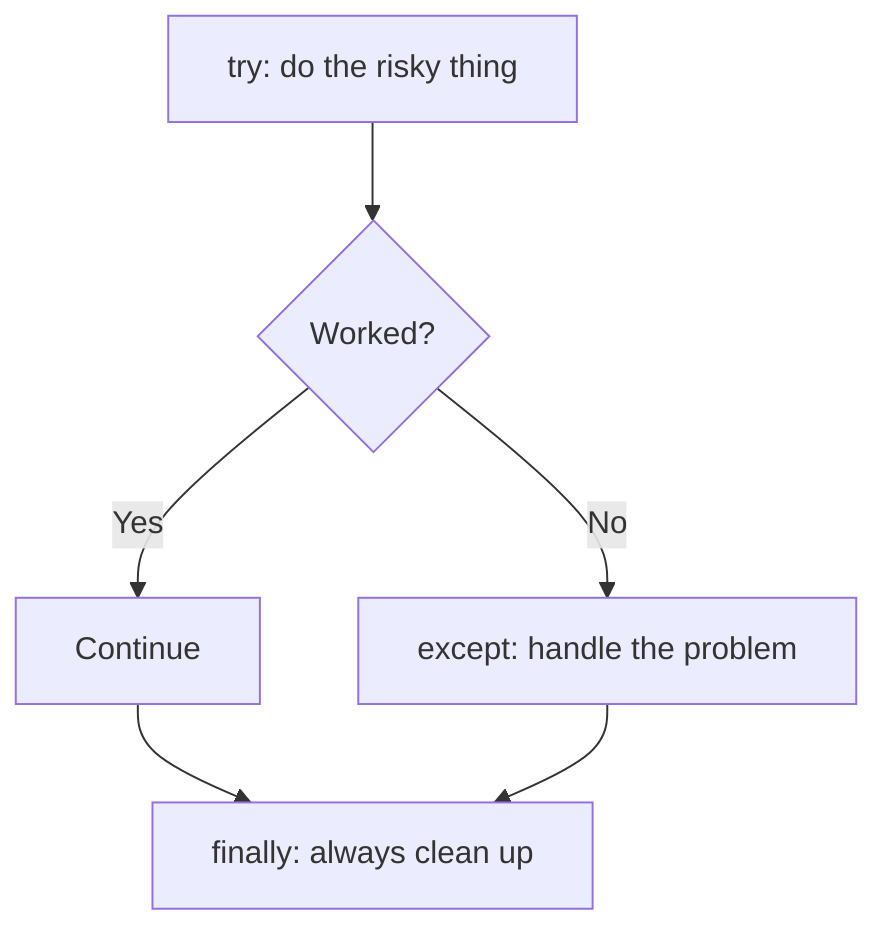
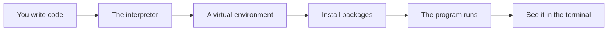

# Exceptions Context Managers And Errors

## The big idea in plain words {#picture}

Things go wrong in real life: a file is missing, a number is typed as a word, the internet drops. A careful program expects this. When something goes wrong, Python **raises an exception**, like a flag in a game. If nobody catches the flag, the program stops with a message.

Your job is to catch the flags you can handle, clean up after yourself, and send a friendly message when something really went wrong.



## What you will be able to do {#outcomes}

By the end of this lesson you will be able to:

- Use `try`, `except`, `finally`, and `raise`.
- Use `with` to open and close things safely.
- Turn Python errors into safe web errors.

## Words to know {#vocabulary}

- **exception**: an object that says something went wrong.
- **raise**: start an exception on purpose.
- **try/except**: attempt something and handle a failure.
- **finally**: code that always runs.
- **context manager**: something that sets up and cleans up, used with `with`.
- **traceback**: the list of calls that led to an error.

## Why this idea exists {#history}

Without error handling, one unexpected input crashes your whole server. With it, you can say "that note does not exist" and carry on.

## Concept 1: try and except {#concept-1}

```python
try:
    number = int("abc")
except ValueError:
    print("Please type a number")
```
`int("abc")` fails with `ValueError`. The `except` line catches that exact kind of failure. Name the specific error, not just a general `except:`, so you do not hide other problems.

## Concept 2: with cleans up for you {#concept-2}

```python
with open("notes.txt", encoding="utf-8") as file:
    text = file.read()
```
When the `with` block ends, the file closes, even if an error happened inside. It is like a door that closes itself behind you. Database connections and locks also use `with`.

## Concept 3: Raise your own errors {#concept-3}

```python
def find_note(note_id):
    if note_id not in notes:
        raise NoteNotFound(note_id)
    return notes[note_id]
```
`NoteNotFound` is your own exception class. It says clearly what went wrong. Keep the original error as the cause with `raise NewError() from original`, so no clue is lost.

## Concept 4: Safe messages for web users {#concept-4}

In FastAPI, turn your exceptions into proper replies: not found becomes 404, bad input becomes 400 or 422. Never send raw errors, file paths, or SQL to the user. Log the full details privately, and send a short message with a request ID.

## Turn an error into a 404 {#example}

```python
from fastapi import HTTPException

@app.get("/notes/{note_id}")
def get_note(note_id: int):
    try:
        return service.find(note_id)
    except NoteNotFound:
        raise HTTPException(status_code=404, detail="Note not found")
```
The visitor sees a neat "Note not found". Your logs can hold the full story.

## Going deeper: the technical walkthrough {#walkthrough}

### Python foundations


### Values and collections

```python
name: str = "Asha"
count: int = 3
is_ready: bool = True
names: list[str] = ["Asha", "Sam"]
by_id: dict[int, str] = {1: "Asha"}
```

A type annotation tells a human and a type checker what a value should be. It
does not make untrusted web input safe by itself. Request models still need
runtime validation.

### Functions and decisions

```python
def clean_text(value: str | None) -> str | None:
    if value is None:
        return None
    cleaned = value.strip()
    return cleaned or None
```

A function should have one clear job. A route should not contain every database
query and business rule in one long block.

### Exceptions

```python
class ItemNotFound(Exception):
    """The requested item does not exist."""


def find_item(item_id: int) -> dict[str, object]:
    raise ItemNotFound from None
```

The API layer can translate a known exception to `404`. It should not return a
Python traceback, SQL statement, local path, or secret to a caller.

### Modules and virtual environments

Create an isolated environment so one project cannot break another project:

```bash
python3 -m venv .venv
source .venv/bin/activate
python -m pip install --upgrade pip
python -m pip install fastapi uvicorn pydantic pytest httpx
```

Keep dependencies in `pyproject.toml` or a locked requirements file. Do not
install into the system Python when the project is meant to be repeatable.


### Errors and safe boundaries


Create a stable error shape such as:

```json
{
  "message": "The note was not found.",
  "code": "NOTE_NOT_FOUND",
  "requestId": "request-123"
}
```

Map errors deliberately:

- malformed input: `400`;
- missing authentication: `401`;
- insufficient permission: `403`;
- missing note: `404`;
- duplicate resource: `409`;
- too much input: `413`;
- dependency outage: `503`;
- unexpected failure: generic `500`.

Do not return `str(exception)` when it can contain a filesystem path, SQL,
provider response, or secret. Log diagnostic details on the server with a
request ID and redact private values.


### Focused implementation

Use try/except for expected exceptions, else for success-only work, and finally for unconditional cleanup. A context manager packages setup and cleanup into with. Exception chaining preserves the cause for server diagnostics; safe API errors must not serialize that chain. Catch specific failures instead of masking programming bugs as empty catalogs.

```python

from contextlib import contextmanager

@contextmanager
def session():
    print("open")
    try:
        yield {"title": "APIs"}
    finally:
        print("close")

with session() as note:
    assert note["title"] == "APIs"

```

Read the imports, then the values and checks, then the operation, and finally the result or cleanup. Java Example programs compile as Example.java. Python uses Python 3.11+. JavaScript ESM runs as example.mjs. Framework snippets run inside the generated project.

## Worked scenario {#worked-scenario}

A database error includes a private file path. What should the API send back?

The justified choice is **A general safe error with a steady code and a request ID**. Select **safe-error** in the structured practical and explain why. Alternatives ignore a requirement, cross a trust boundary, or invent success.

### Structured decision contract

```json

{
  "decision": "safe-error",
  "justification": "The exception and safeError boundary must preserve the declared contract and ownership.",
  "failureBehavior": "Expose a safe failure and recover through the boundary owner."
}

```

Decision selects one declared behavior. Justification explains the boundary. FailureBehavior explains the observable error and recovery owner. These fields never execute commands. Required terms and minimum lengths form a basic practice rubric, not semantic grading.

## Step-by-step flow and matching picture {#flow}




## Three real-life uses {#use-cases}

1. A script that reads a file and says "file not found" in friendly words.
2. An API that returns 404 for an unknown id and 422 for bad input.
3. A function that always closes the database connection using `with`.

## What can go wrong, and how to stay safe {#failure-security}

Mistakes: an empty `except:` that hides every problem, forgetting to close files (use `with`), showing raw error text to users, and catching an error then pretending everything worked. Never let a failure turn into a fake success.

## Practice lab and expected observation {#practice}

1. Predict the scenario decision before opening Practical. Explain each rejected alternative.
2. Run a relevant example above in an isolated exercise project. Record the expected result, then change one input to an invalid or boundary value. A failed assertion or deliberate error should replace silent success.
3. Submit the structured decision. Initially the checks fail. After selecting safe-error and writing an explanation and failure plan, all three pass. Follow the indicated review section for missed checks.

### Broken example to debug

```json

{"decision":"trust-client","justification":"","failureBehavior":""}

```

This ignores the responsible boundary and gives no reasoning or recovery. Correct the fields rather than changing the validator.

## Checkpoint and definition of done {#checkpoint}

- [ ] Define exception and safeError without looking.
- [ ] Trace input to owner and output.
- [ ] Explain one failure and one alternative.
- [ ] Pass at least four assignment questions.
- [ ] Pass every practical check and submit.
- [ ] Explain the concept again tomorrow.

## Sources, versions, and safe commands {#sources}

Python 3.11+; examples use Python 3.11 syntax and Pydantic 2 conventions. Review date: 2026-10-02. The supplied blueprint is the teaching source; official landing pages were checked where reachable. No provider or original TM Schedule deployment was tested.

- [Official reference](https://docs.python.org/3/tutorial/)

- [Official reference](https://fastapi.tiangolo.com/tutorial/)

[Course reading order](README.md) · [Previous lesson](07-modules-packages-and-dependencies.md) · [Next lesson](08a-decorators-and-generators-explained.md)

```study-quiz

{
  "schemaVersion": 1,
  "lessonId": "python-first-api/08-exceptions-context-managers-and-errors",
  "title": "Assignment: Exceptions Context Managers And Errors",
  "passPercentage": 80,
  "questions": [
    {
      "id": "q1",
      "sectionId": "concept-1",
      "prompt": "In Exceptions Context Managers And Errors, what does exception mean?",
      "options": [
        {
          "id": "a",
          "text": "A permission granted by a hidden browser control",
          "explanation": "This changes the declared meaning or bypasses the responsible boundary."
        },
        {
          "id": "b",
          "text": "An unlimited provider operation with no ownership",
          "explanation": "This changes the declared meaning or bypasses the responsible boundary."
        },
        {
          "id": "c",
          "text": "a problem that interrupts the normal flow of a program",
          "explanation": "This preserves the definition and boundary described in the lesson."
        },
        {
          "id": "d",
          "text": "A diagnostic credential intended for public logs",
          "explanation": "This changes the declared meaning or bypasses the responsible boundary."
        }
      ],
      "correctOptionId": "c",
      "explanation": "exception means a problem that interrupts the normal flow of a program.",
      "reviewLabel": "Review concept 1"
    },
    {
      "id": "q2",
      "sectionId": "concept-2",
      "prompt": "In Exceptions Context Managers And Errors, which rule is correct for checkpoint 2?",
      "options": [
        {
          "id": "a",
          "text": "Trust client-side checks instead of the server rule.",
          "explanation": "This changes the declared meaning or bypasses the responsible boundary."
        },
        {
          "id": "b",
          "text": "Hide the failure by returning a fabricated successful result.",
          "explanation": "This changes the declared meaning or bypasses the responsible boundary."
        },
        {
          "id": "c",
          "text": "Skip the stated boundary, limit, or ownership check.",
          "explanation": "This changes the declared meaning or bypasses the responsible boundary."
        },
        {
          "id": "d",
          "text": "A validation problem must never turn into a fake success.",
          "explanation": "This preserves the definition and boundary described in the lesson."
        }
      ],
      "correctOptionId": "d",
      "explanation": "A validation problem must never turn into a fake success.",
      "reviewLabel": "Review concept 2"
    },
    {
      "id": "q3",
      "sectionId": "concept-3",
      "prompt": "In Exceptions Context Managers And Errors, which rule is correct for checkpoint 3?",
      "options": [
        {
          "id": "a",
          "text": "Whoever opens a resource must close it, even when something fails.",
          "explanation": "This preserves the definition and boundary described in the lesson."
        },
        {
          "id": "b",
          "text": "Trust client-side checks instead of the server rule.",
          "explanation": "This changes the declared meaning or bypasses the responsible boundary."
        },
        {
          "id": "c",
          "text": "Hide the failure by returning a fabricated successful result.",
          "explanation": "This changes the declared meaning or bypasses the responsible boundary."
        },
        {
          "id": "d",
          "text": "Skip the stated boundary, limit, or ownership check.",
          "explanation": "This changes the declared meaning or bypasses the responsible boundary."
        }
      ],
      "correctOptionId": "a",
      "explanation": "Whoever opens a resource must close it, even when something fails.",
      "reviewLabel": "Review concept 3"
    },
    {
      "id": "q4",
      "sectionId": "concept-4",
      "prompt": "In Exceptions Context Managers And Errors, which rule is correct for checkpoint 4?",
      "options": [
        {
          "id": "a",
          "text": "Trust client-side checks instead of the server rule.",
          "explanation": "This changes the declared meaning or bypasses the responsible boundary."
        },
        {
          "id": "b",
          "text": "Error messages for callers must not reveal SQL, file paths, secrets, or stack traces.",
          "explanation": "This preserves the definition and boundary described in the lesson."
        },
        {
          "id": "c",
          "text": "Hide the failure by returning a fabricated successful result.",
          "explanation": "This changes the declared meaning or bypasses the responsible boundary."
        },
        {
          "id": "d",
          "text": "Skip the stated boundary, limit, or ownership check.",
          "explanation": "This changes the declared meaning or bypasses the responsible boundary."
        }
      ],
      "correctOptionId": "b",
      "explanation": "Error messages for callers must not reveal SQL, file paths, secrets, or stack traces.",
      "reviewLabel": "Review concept 4"
    },
    {
      "id": "q5",
      "sectionId": "worked-scenario",
      "prompt": "A database error includes a private file path. What should the API send back?",
      "options": [
        {
          "id": "a",
          "text": "The raw error text exactly as it came",
          "explanation": "This changes the declared meaning or bypasses the responsible boundary."
        },
        {
          "id": "b",
          "text": "An empty success answer",
          "explanation": "This changes the declared meaning or bypasses the responsible boundary."
        },
        {
          "id": "c",
          "text": "A general safe error with a steady code and a request ID",
          "explanation": "This preserves the definition and boundary described in the lesson."
        },
        {
          "id": "d",
          "text": "The private path, to help debugging",
          "explanation": "This changes the declared meaning or bypasses the responsible boundary."
        }
      ],
      "correctOptionId": "c",
      "explanation": "A general safe error with a steady code and a request ID. For surprises, send a general message and a request ID that your team can look up.",
      "reviewLabel": "Review the worked scenario"
    }
  ]
}

```

```study-practical

{
  "schemaVersion": 1,
  "challengeId": "python-first-api/08-exceptions-context-managers-and-errors/decision",
  "lessonId": "python-first-api/08-exceptions-context-managers-and-errors",
  "title": "Practical: Exceptions Context Managers And Errors",
  "language": "json",
  "mode": "structured",
  "instructions": "A database error includes a private file path. What should the API send back? Return an object with decision (choose from safe-error, skip-check, unbounded-work, trust-client), justification (at least 40 characters; include exception and safeError), and failureBehavior (at least 25 characters; include failure and recover while explaining the error and recovery). These are structured reasoning checks, not code execution or an official grade.",
  "starterCode": "{\n  \"decision\": \"\",\n  \"justification\": \"\",\n  \"failureBehavior\": \"\"\n}",
  "entryPoint": "answer",
  "publicExamples": [
    {
      "input": {
        "decision": "skip-check",
        "justification": "",
        "failureBehavior": ""
      },
      "expected": {
        "passed": false
      }
    },
    {
      "input": {
        "decision": "safe-error",
        "justification": "The exception and safeError boundary must preserve the declared contract and ownership.",
        "failureBehavior": "Show a safe failure and recover through the responsible owner."
      },
      "expected": {
        "passed": true
      }
    }
  ],
  "publicTestIds": [
    "decision",
    "explanation",
    "failure-plan"
  ],
  "reviewSections": {
    "decision": "worked-scenario",
    "explanation": "concept-2",
    "failure-plan": "failure-security"
  },
  "limits": {
    "timeMs": 2000,
    "memoryMb": 128,
    "outputBytes": 20000
  }
}

```

