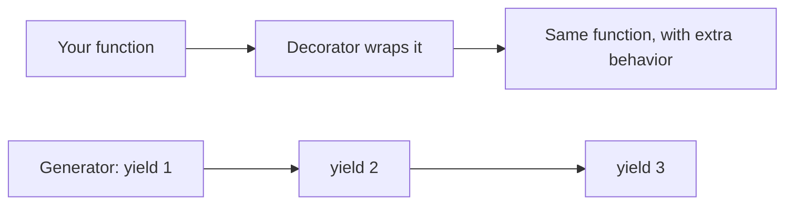
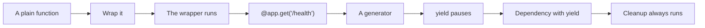
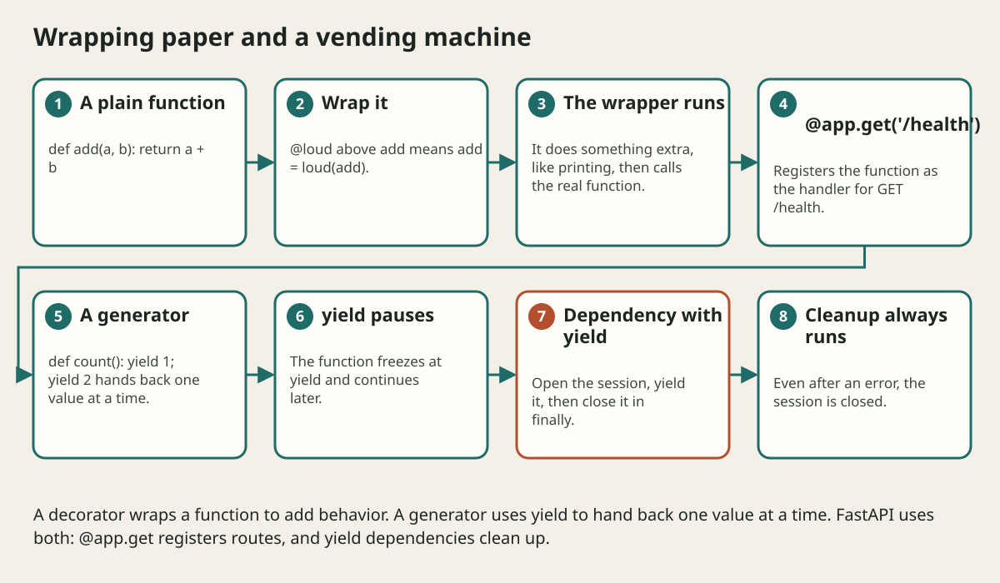

# Decorators And Generators Explained

## The big idea in plain words {#picture}

Imagine you give a gift to a friend. You can wrap it in pretty paper. The gift inside is the same, but now it has a ribbon. A **decorator** is wrapping paper for a function: it goes around the function and adds something, like a log message or a registration, without changing the function inside.

A **generator** is a vending machine that gives you one snack at a time instead of dumping all snacks at once. The magic word is `yield`: "here is one; I will remember where I stopped".



## What you will be able to do {#outcomes}

By the end of this lesson you will be able to:

- Explain what `@something` above a function does.
- Write a tiny decorator.
- Explain `yield` and how FastAPI uses it for cleanup.

## Words to know {#vocabulary}

- **decorator**: a function that wraps another function.
- **wrapper**: the new function that surrounds the old one.
- **generator**: a function that produces values one at a time.
- **yield**: give back one value and pause.
- **iterator**: something you can loop over one item at a time.
- **dependency with yield**: setup, then give, then cleanup.

## Why this idea exists {#history}

Two things in FastAPI look strange to beginners: the `@app.get(...)` lines and the `yield` in database dependencies. Once you know these two ideas, nothing in FastAPI is a mystery.

## Concept 1: A decorator is a wrapper {#concept-1}

```python
def loud(func):
    def wrapper(*args, **kwargs):
        print("calling", func.__name__)
        return func(*args, **kwargs)
    return wrapper

@loud
def add(a, b):
    return a + b

add(2, 3)     # prints "calling add", returns 5
```
`@loud` above `add` means `add = loud(add)`. We get a new `add` that prints first, then does the real work.

## Concept 2: @app.get is a decorator too {#concept-2}

`@app.get("/health")` takes your function and *registers* it: "when GET /health arrives, call this". The function itself is unchanged; FastAPI just remembers it. Decorators are a neat way to attach extra meaning to a function.

## Concept 3: Generators give one at a time {#concept-3}

```python
def count_to(n):
    i = 1
    while i <= n:
        yield i
        i += 1

for number in count_to(3):
    print(number)     # 1, 2, 3
```
Each time the loop asks for the next value, the function runs until `yield`, hands back the value, and freezes. Next time, it continues right after the `yield`. It never builds the full list, so it saves memory.

## Concept 4: yield in FastAPI dependencies {#concept-4}

```python
def get_session():
    session = open_session()
    try:
        yield session          # give it to the route
    finally:
        session.close()        # always runs afterwards
```
The route gets `session`, uses it, and when the request ends, FastAPI resumes the function after `yield`, and the `finally` block closes the session. This pattern is perfect for database sessions and any resource that needs cleanup.

## Timing a function {#example}

```python
import time
def timed(func):
    def wrapper(*a, **k):
        start = time.time()
        result = func(*a, **k)
        print(f"{func.__name__} took {time.time() - start:.3f}s")
        return result
    return wrapper
```
Put `@timed` above any function, and it prints how long that function took, without editing the function itself.

## Going deeper: the technical walkthrough {#walkthrough}

## Worked scenario {#worked-scenario}

You want a database session opened for each request and always closed afterwards, even after an error. What fits best?

The justified choice is **A dependency that uses yield and closes the session after it**. Select **yield-dependency** in the structured practical and explain why. Alternatives ignore a requirement, cross a trust boundary, or invent success.

### Structured decision contract

```json

{
  "decision": "yield-dependency",
  "justification": "The decorator and generator boundary must preserve the declared contract and ownership.",
  "failureBehavior": "Expose a safe failure and recover through the boundary owner."
}

```

Decision selects one declared behavior. Justification explains the boundary. FailureBehavior explains the observable error and recovery owner. These fields never execute commands. Required terms and minimum lengths form a basic practice rubric, not semantic grading.

## Step-by-step flow and matching picture {#flow}





## Three real-life uses {#use-cases}

1. A `@login_required` decorator that checks the user before running a route.
2. A generator that reads a huge file one line at a time.
3. A FastAPI dependency that opens and closes a database session.

## What can go wrong, and how to stay safe {#failure-security}

Mistakes: forgetting to `return` the result inside a wrapper (the function then returns nothing), forgetting `finally` so cleanup is skipped after an error, and thinking a generator is a list (you can only loop through it once). Convert with `list(...)` if you need a list.

## Practice lab and expected observation {#practice}

1. Predict the scenario decision before opening Practical. Explain each rejected alternative.
2. Run a relevant example above in an isolated exercise project. Record the expected result, then change one input to an invalid or boundary value. A failed assertion or deliberate error should replace silent success.
3. Submit the structured decision. Initially the checks fail. After selecting yield-dependency and writing an explanation and failure plan, all three pass. Follow the indicated review section for missed checks.

### Broken example to debug

```json

{"decision":"trust-client","justification":"","failureBehavior":""}

```

This ignores the responsible boundary and gives no reasoning or recovery. Correct the fields rather than changing the validator.

## Checkpoint and definition of done {#checkpoint}

- [ ] Define decorator and generator without looking.
- [ ] Trace input to owner and output.
- [ ] Explain one failure and one alternative.
- [ ] Pass at least four assignment questions.
- [ ] Pass every practical check and submit.
- [ ] Explain the concept again tomorrow.

## Sources, versions, and safe commands {#sources}

Python 3.11+; examples use Python 3.11 syntax and Pydantic 2 conventions. Review date: 2026-10-02. The supplied blueprint is the teaching source; official landing pages were checked where reachable. No provider or original TM Schedule deployment was tested.

- [Official reference](https://docs.python.org/3/tutorial/)

- [Official reference](https://fastapi.tiangolo.com/tutorial/)

[Course reading order](README.md) · [Previous lesson](08-exceptions-context-managers-and-errors.md) · [Next lesson](09-typing-dataclasses-and-model-design.md)

```study-quiz

{
  "schemaVersion": 1,
  "lessonId": "python-first-api/08a-decorators-and-generators-explained",
  "title": "Assignment: Decorators And Generators Explained",
  "passPercentage": 80,
  "questions": [
    {
      "id": "q1",
      "sectionId": "concept-1",
      "prompt": "In Decorators And Generators Explained, what does decorator mean?",
      "options": [
        {
          "id": "a",
          "text": "A permission granted by a hidden browser control",
          "explanation": "This changes the declared meaning or bypasses the responsible boundary."
        },
        {
          "id": "b",
          "text": "An unlimited provider operation with no ownership",
          "explanation": "This changes the declared meaning or bypasses the responsible boundary."
        },
        {
          "id": "c",
          "text": "A diagnostic credential intended for public logs",
          "explanation": "This changes the declared meaning or bypasses the responsible boundary."
        },
        {
          "id": "d",
          "text": "a label above a function that wraps it and adds behavior",
          "explanation": "This preserves the definition and boundary described in the lesson."
        }
      ],
      "correctOptionId": "d",
      "explanation": "decorator means a label above a function that wraps it and adds behavior.",
      "reviewLabel": "Review concept 1"
    },
    {
      "id": "q2",
      "sectionId": "concept-2",
      "prompt": "In Decorators And Generators Explained, which rule is correct for checkpoint 2?",
      "options": [
        {
          "id": "a",
          "text": "The line @app.get('/health') registers the function below it as the handler for that path.",
          "explanation": "This preserves the definition and boundary described in the lesson."
        },
        {
          "id": "b",
          "text": "Trust client-side checks instead of the server rule.",
          "explanation": "This changes the declared meaning or bypasses the responsible boundary."
        },
        {
          "id": "c",
          "text": "Hide the failure by returning a fabricated successful result.",
          "explanation": "This changes the declared meaning or bypasses the responsible boundary."
        },
        {
          "id": "d",
          "text": "Skip the stated boundary, limit, or ownership check.",
          "explanation": "This changes the declared meaning or bypasses the responsible boundary."
        }
      ],
      "correctOptionId": "a",
      "explanation": "The line @app.get('/health') registers the function below it as the handler for that path.",
      "reviewLabel": "Review concept 2"
    },
    {
      "id": "q3",
      "sectionId": "concept-3",
      "prompt": "In Decorators And Generators Explained, which rule is correct for checkpoint 3?",
      "options": [
        {
          "id": "a",
          "text": "Trust client-side checks instead of the server rule.",
          "explanation": "This changes the declared meaning or bypasses the responsible boundary."
        },
        {
          "id": "b",
          "text": "A generator produces values one at a time and uses little memory.",
          "explanation": "This preserves the definition and boundary described in the lesson."
        },
        {
          "id": "c",
          "text": "Hide the failure by returning a fabricated successful result.",
          "explanation": "This changes the declared meaning or bypasses the responsible boundary."
        },
        {
          "id": "d",
          "text": "Skip the stated boundary, limit, or ownership check.",
          "explanation": "This changes the declared meaning or bypasses the responsible boundary."
        }
      ],
      "correctOptionId": "b",
      "explanation": "A generator produces values one at a time and uses little memory.",
      "reviewLabel": "Review concept 3"
    },
    {
      "id": "q4",
      "sectionId": "concept-4",
      "prompt": "In Decorators And Generators Explained, which rule is correct for checkpoint 4?",
      "options": [
        {
          "id": "a",
          "text": "Trust client-side checks instead of the server rule.",
          "explanation": "This changes the declared meaning or bypasses the responsible boundary."
        },
        {
          "id": "b",
          "text": "Hide the failure by returning a fabricated successful result.",
          "explanation": "This changes the declared meaning or bypasses the responsible boundary."
        },
        {
          "id": "c",
          "text": "The yield keyword pauses the function and remembers where it stopped.",
          "explanation": "This preserves the definition and boundary described in the lesson."
        },
        {
          "id": "d",
          "text": "Skip the stated boundary, limit, or ownership check.",
          "explanation": "This changes the declared meaning or bypasses the responsible boundary."
        }
      ],
      "correctOptionId": "c",
      "explanation": "The yield keyword pauses the function and remembers where it stopped.",
      "reviewLabel": "Review concept 4"
    },
    {
      "id": "q5",
      "sectionId": "worked-scenario",
      "prompt": "You want a database session opened for each request and always closed afterwards, even after an error. What fits best?",
      "options": [
        {
          "id": "a",
          "text": "Open a global session once and never close it",
          "explanation": "This changes the declared meaning or bypasses the responsible boundary."
        },
        {
          "id": "b",
          "text": "Open the session inside every route by hand without closing",
          "explanation": "This changes the declared meaning or bypasses the responsible boundary."
        },
        {
          "id": "c",
          "text": "Skip the session",
          "explanation": "This changes the declared meaning or bypasses the responsible boundary."
        },
        {
          "id": "d",
          "text": "A dependency that uses yield and closes the session after it",
          "explanation": "This preserves the definition and boundary described in the lesson."
        }
      ],
      "correctOptionId": "d",
      "explanation": "A dependency that uses yield and closes the session after it. In FastAPI, a dependency that uses yield sets something up, gives it to the route, and then cleans up afterwards.",
      "reviewLabel": "Review the worked scenario"
    }
  ]
}

```

```study-practical

{
  "schemaVersion": 1,
  "challengeId": "python-first-api/08a-decorators-and-generators-explained/decision",
  "lessonId": "python-first-api/08a-decorators-and-generators-explained",
  "title": "Practical: Decorators And Generators Explained",
  "language": "json",
  "mode": "structured",
  "instructions": "You want a database session opened for each request and always closed afterwards, even after an error. What fits best? Return an object with decision (choose from yield-dependency, skip-check, unbounded-work, trust-client), justification (at least 40 characters; include decorator and generator), and failureBehavior (at least 25 characters; include failure and recover while explaining the error and recovery). These are structured reasoning checks, not code execution or an official grade.",
  "starterCode": "{\n  \"decision\": \"\",\n  \"justification\": \"\",\n  \"failureBehavior\": \"\"\n}",
  "entryPoint": "answer",
  "publicExamples": [
    {
      "input": {
        "decision": "skip-check",
        "justification": "",
        "failureBehavior": ""
      },
      "expected": {
        "passed": false
      }
    },
    {
      "input": {
        "decision": "yield-dependency",
        "justification": "The decorator and generator boundary must preserve the declared contract and ownership.",
        "failureBehavior": "Show a safe failure and recover through the responsible owner."
      },
      "expected": {
        "passed": true
      }
    }
  ],
  "publicTestIds": [
    "decision",
    "explanation",
    "failure-plan"
  ],
  "reviewSections": {
    "decision": "worked-scenario",
    "explanation": "concept-2",
    "failure-plan": "failure-security"
  },
  "limits": {
    "timeMs": 2000,
    "memoryMb": 128,
    "outputBytes": 20000
  }
}

```

