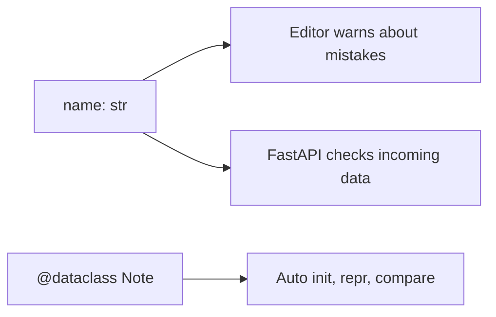
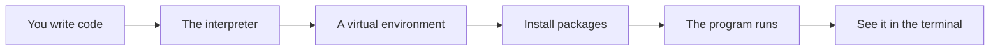

# Typing Dataclasses And Model Design

## The big idea in plain words {#picture}

Imagine labeling every box in your closet: "winter clothes", "toys", "books". Anyone, including future you, can see what is inside without opening it. Type hints are labels like that for your code: `name: str` says "this should be text".

Python does not force the labels, but helpers like your editor and FastAPI read them. And dataclasses are a quick way to make a "data card" class, with almost no code.



## What you will be able to do {#outcomes}

By the end of this lesson you will be able to:

- Write type hints for parameters and return values.
- Use `Optional`, unions, and generics in plain forms.
- Write a dataclass and know where Pydantic fits.

## Words to know {#vocabulary}

- **type hint**: a label for the type a value should have.
- **union**: "this or that", written `int | str`.
- **Optional**: "a value or None", written `str | None`.
- **dataclass**: a short way to define a class that holds data.
- **protocol**: a description of what methods an object must have.
- **runtime validation**: checking real data while the program runs.

## Why this idea exists {#history}

As programs grow, you forget what each function expects. Hints answer that question in the code itself, and tools can spot mistakes before you even run.

## Concept 1: Hints for functions {#concept-1}

```python
def total(prices: list[float], tax: float = 0.0) -> float:
    return sum(prices) * (1 + tax)
```
Parameters have `: type` and the answer has `-> type`. Hints are for people and tools. Python itself does not stop you if you break them.

## Concept 2: Maybe-values {#concept-2}

`title: str | None` means "text or nothing". When a value can be `None`, you must check before using it. Hints make that visible. Older code writes `Optional[str]`, which means the same.

## Concept 3: Dataclasses: data cards {#concept-3}

```python
from dataclasses import dataclass

@dataclass
class Note:
    id: int
    title: str
    pinned: bool = False
```
You get `__init__`, a readable printout, and `==` comparison for free. `Note(1, "Math")` just works. Add `frozen=True` to make it unchangeable.

## Concept 4: Hints are not checks {#concept-4}

Hints do not check the data that arrives from the outside, such as JSON from a client. For that you need runtime validation, which is exactly what Pydantic does in FastAPI (next lessons). Remember: hints help the programmer; Pydantic helps the program.

## A safe pair {#example}

```python
@dataclass(frozen=True)
class Point:
    x: int
    y: int

p = Point(3, 4)
print(p)          # Point(x=3, y=4)
print(p == Point(3, 4))   # True
```
Two points with the same numbers are equal, and since it is frozen you cannot change `p.x` by accident.

## Going deeper: the technical walkthrough {#walkthrough}

### Python foundations


### Values and collections

```python
name: str = "Asha"
count: int = 3
is_ready: bool = True
names: list[str] = ["Asha", "Sam"]
by_id: dict[int, str] = {1: "Asha"}
```

A type annotation tells a human and a type checker what a value should be. It
does not make untrusted web input safe by itself. Request models still need
runtime validation.

### Functions and decisions

```python
def clean_text(value: str | None) -> str | None:
    if value is None:
        return None
    cleaned = value.strip()
    return cleaned or None
```

A function should have one clear job. A route should not contain every database
query and business rule in one long block.

### Exceptions

```python
class ItemNotFound(Exception):
    """The requested item does not exist."""


def find_item(item_id: int) -> dict[str, object]:
    raise ItemNotFound from None
```

The API layer can translate a known exception to `404`. It should not return a
Python traceback, SQL statement, local path, or secret to a caller.

### Modules and virtual environments

Create an isolated environment so one project cannot break another project:

```bash
python3 -m venv .venv
source .venv/bin/activate
python -m pip install --upgrade pip
python -m pip install fastapi uvicorn pydantic pytest httpx
```

Keep dependencies in `pyproject.toml` or a locked requirements file. Do not
install into the system Python when the project is meant to be repeatable.


### Request and response models


```python
from pydantic import BaseModel, Field


class NoteCreate(BaseModel):
    title: str = Field(min_length=1, max_length=120)
    body: str = Field(min_length=1, max_length=20_000)
    topic: str = Field(min_length=1, max_length=60)


class Note(NoteCreate):
    id: int
```

The model checks shape and limits. The service still decides business meaning,
such as whether the topic is allowed or whether the caller owns the note.


### Focused implementation

A dataclass generates data-object methods. A Protocol describes structural behavior for adapters without requiring one inheritance hierarchy. An annotation aids static analysis; Pydantic or explicit checks validate runtime input. A union describes alternatives; omitted input is different from a required field whose value may be None.

```python

from dataclasses import dataclass
from typing import Protocol

@dataclass(frozen=True)
class Note:
    id: int
    title: str

class Notes(Protocol):
    def get(self, note_id: int) -> Note | None: ...

assert Note(1, "APIs") == Note(1, "APIs")

```

Read the imports, then the values and checks, then the operation, and finally the result or cleanup. Java Example programs compile as Example.java. Python uses Python 3.11+. JavaScript ESM runs as example.mjs. Framework snippets run inside the generated project.

## Worked scenario {#worked-scenario}

Someone sends a note title that is only spaces. What should the API do?

The justified choice is **Trim it, see it is empty, and reject it**. Select **reject-blank** in the structured practical and explain why. Alternatives ignore a requirement, cross a trust boundary, or invent success.

### Structured decision contract

```json

{
  "decision": "reject-blank",
  "justification": "The type and reference boundary must preserve the declared contract and ownership.",
  "failureBehavior": "Expose a safe failure and recover through the boundary owner."
}

```

Decision selects one declared behavior. Justification explains the boundary. FailureBehavior explains the observable error and recovery owner. These fields never execute commands. Required terms and minimum lengths form a basic practice rubric, not semantic grading.

## Step-by-step flow and matching picture {#flow}




## Three real-life uses {#use-cases}

1. A function that says in its hints that it needs a list of numbers.
2. A `Note` dataclass shared by the service and the tests.
3. FastAPI reading the hints on a route to check the incoming data.

## What can go wrong, and how to stay safe {#failure-security}

Mistakes: thinking hints are enforced at runtime, forgetting to handle `None` after writing `| None`, using a changeable default in a dataclass (use `field(default_factory=list)` instead), and confusing dataclasses with Pydantic models: they look alike but do different jobs.

## Practice lab and expected observation {#practice}

Implement valid to return true only when the numeric note ID is positive and the title is nonblank after trimming. This checks a value invariant, not authorization. Do not mutate or persist the input.

The language starter and public examples appear in Practical. Run is unavailable until a trusted isolated worker is configured. Reading and assignment review still work; this lesson does not claim code-test completion.

1. Predict the scenario decision before opening Practical. Explain each rejected alternative.
2. Run a relevant example above in an isolated exercise project. Record the expected result, then change one input to an invalid or boundary value. A failed assertion or deliberate error should replace silent success.
3. Submit the structured decision. Initially the checks fail. After selecting reject-blank and writing an explanation and failure plan, all three pass. Follow the indicated review section for missed checks.

### Broken example to debug

```json

{"decision":"trust-client","justification":"","failureBehavior":""}

```

This ignores the responsible boundary and gives no reasoning or recovery. Correct the fields rather than changing the validator.

## Checkpoint and definition of done {#checkpoint}

- [ ] Define type and reference without looking.
- [ ] Trace input to owner and output.
- [ ] Explain one failure and one alternative.
- [ ] Pass at least four assignment questions.
- [ ] Pass every practical check and submit.
- [ ] Explain the concept again tomorrow.

## Sources, versions, and safe commands {#sources}

Python 3.11+; examples use Python 3.11 syntax and Pydantic 2 conventions. Review date: 2026-10-02. The supplied blueprint is the teaching source; official landing pages were checked where reachable. No provider or original TM Schedule deployment was tested.

- [Official reference](https://docs.python.org/3/tutorial/)

- [Official reference](https://fastapi.tiangolo.com/tutorial/)

[Course reading order](README.md) · [Previous lesson](08a-decorators-and-generators-explained.md) · [Next lesson](10-files-paths-json-and-configuration.md)

```study-quiz

{
  "schemaVersion": 1,
  "lessonId": "python-first-api/09-typing-dataclasses-and-model-design",
  "title": "Assignment: Typing Dataclasses And Model Design",
  "passPercentage": 80,
  "questions": [
    {
      "id": "q1",
      "sectionId": "concept-1",
      "prompt": "In Typing Dataclasses And Model Design, what does type mean?",
      "options": [
        {
          "id": "a",
          "text": "a description of what kind of values are allowed",
          "explanation": "This preserves the definition and boundary described in the lesson."
        },
        {
          "id": "b",
          "text": "A permission granted by a hidden browser control",
          "explanation": "This changes the declared meaning or bypasses the responsible boundary."
        },
        {
          "id": "c",
          "text": "An unlimited provider operation with no ownership",
          "explanation": "This changes the declared meaning or bypasses the responsible boundary."
        },
        {
          "id": "d",
          "text": "A diagnostic credential intended for public logs",
          "explanation": "This changes the declared meaning or bypasses the responsible boundary."
        }
      ],
      "correctOptionId": "a",
      "explanation": "type means a description of what kind of values are allowed.",
      "reviewLabel": "Review concept 1"
    },
    {
      "id": "q2",
      "sectionId": "concept-2",
      "prompt": "In Typing Dataclasses And Model Design, which rule is correct for checkpoint 2?",
      "options": [
        {
          "id": "a",
          "text": "Trust client-side checks instead of the server rule.",
          "explanation": "This changes the declared meaning or bypasses the responsible boundary."
        },
        {
          "id": "b",
          "text": "Check unknown input before you use it.",
          "explanation": "This preserves the definition and boundary described in the lesson."
        },
        {
          "id": "c",
          "text": "Hide the failure by returning a fabricated successful result.",
          "explanation": "This changes the declared meaning or bypasses the responsible boundary."
        },
        {
          "id": "d",
          "text": "Skip the stated boundary, limit, or ownership check.",
          "explanation": "This changes the declared meaning or bypasses the responsible boundary."
        }
      ],
      "correctOptionId": "b",
      "explanation": "Check unknown input before you use it.",
      "reviewLabel": "Review concept 2"
    },
    {
      "id": "q3",
      "sectionId": "concept-3",
      "prompt": "In Typing Dataclasses And Model Design, which rule is correct for checkpoint 3?",
      "options": [
        {
          "id": "a",
          "text": "Trust client-side checks instead of the server rule.",
          "explanation": "This changes the declared meaning or bypasses the responsible boundary."
        },
        {
          "id": "b",
          "text": "Hide the failure by returning a fabricated successful result.",
          "explanation": "This changes the declared meaning or bypasses the responsible boundary."
        },
        {
          "id": "c",
          "text": "Equal values have the same content; the same object is the very same thing in memory.",
          "explanation": "This preserves the definition and boundary described in the lesson."
        },
        {
          "id": "d",
          "text": "Skip the stated boundary, limit, or ownership check.",
          "explanation": "This changes the declared meaning or bypasses the responsible boundary."
        }
      ],
      "correctOptionId": "c",
      "explanation": "Equal values have the same content; the same object is the very same thing in memory.",
      "reviewLabel": "Review concept 3"
    },
    {
      "id": "q4",
      "sectionId": "concept-4",
      "prompt": "In Typing Dataclasses And Model Design, which rule is correct for checkpoint 4?",
      "options": [
        {
          "id": "a",
          "text": "Trust client-side checks instead of the server rule.",
          "explanation": "This changes the declared meaning or bypasses the responsible boundary."
        },
        {
          "id": "b",
          "text": "Hide the failure by returning a fabricated successful result.",
          "explanation": "This changes the declared meaning or bypasses the responsible boundary."
        },
        {
          "id": "c",
          "text": "Skip the stated boundary, limit, or ownership check.",
          "explanation": "This changes the declared meaning or bypasses the responsible boundary."
        },
        {
          "id": "d",
          "text": "Missing, null, blank, and zero can all mean different things.",
          "explanation": "This preserves the definition and boundary described in the lesson."
        }
      ],
      "correctOptionId": "d",
      "explanation": "Missing, null, blank, and zero can all mean different things.",
      "reviewLabel": "Review concept 4"
    },
    {
      "id": "q5",
      "sectionId": "worked-scenario",
      "prompt": "Someone sends a note title that is only spaces. What should the API do?",
      "options": [
        {
          "id": "a",
          "text": "Trim it, see it is empty, and reject it",
          "explanation": "This preserves the definition and boundary described in the lesson."
        },
        {
          "id": "b",
          "text": "Trust the type label and accept it",
          "explanation": "This changes the declared meaning or bypasses the responsible boundary."
        },
        {
          "id": "c",
          "text": "Save the spaces as a real title",
          "explanation": "This changes the declared meaning or bypasses the responsible boundary."
        },
        {
          "id": "d",
          "text": "Crash and show a scary error",
          "explanation": "This changes the declared meaning or bypasses the responsible boundary."
        }
      ],
      "correctOptionId": "a",
      "explanation": "Trim it, see it is empty, and reject it. Refuse bad input before you save it.",
      "reviewLabel": "Review the worked scenario"
    }
  ]
}

```

```study-practical

{
  "schemaVersion": 1,
  "challengeId": "python-first-api/09-typing-dataclasses-and-model-design/coding",
  "lessonId": "python-first-api/09-typing-dataclasses-and-model-design",
  "title": "Practical: Validate a note value",
  "language": "python",
  "mode": "function",
  "instructions": "Implement valid to return true only when the numeric note ID is positive and the title is nonblank after trimming. This checks a value invariant, not authorization. Do not mutate or persist the input. A disposable isolated code runner is required; this installation never executes learner code on the host.",
  "starterCode": "def valid(note_id: int, title: str | None) -> bool:\n    return False\n",
  "entryPoint": "valid",
  "publicExamples": [
    {
      "input": {
        "id": 1,
        "title": "APIs"
      },
      "expected": true
    },
    {
      "input": {
        "id": 0,
        "title": "APIs"
      },
      "expected": false
    },
    {
      "input": {
        "id": 1,
        "title": " "
      },
      "expected": false
    }
  ],
  "publicTestIds": [
    "valid-note",
    "nonpositive-id",
    "blank-title"
  ],
  "reviewSections": {
    "valid-note": "walkthrough",
    "nonpositive-id": "walkthrough",
    "blank-title": "walkthrough"
  },
  "limits": {
    "timeMs": 2000,
    "memoryMb": 128,
    "outputBytes": 20000
  }
}

```

