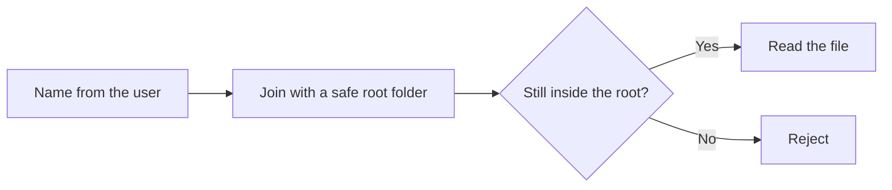
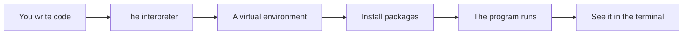

# Files Paths Json And Configuration

## The big idea in plain words {#picture}

Programs often need to read and save files, read settings, and talk in JSON, which is the common text format of the web. JSON looks like a Python dictionary: `{"title": "Math", "pinned": true}`.

Files can be risky. A visitor might try to ask for `../secret.txt` to climb out of the allowed folder. So we use careful tools: `pathlib` for paths, `json` for JSON, and environment variables for secrets.



## What you will be able to do {#outcomes}

By the end of this lesson you will be able to:

- Read and write files with `pathlib` and `with`.
- Read and write JSON.
- Use environment variables for settings and secrets.

## Words to know {#vocabulary}

- **path**: the address of a file.
- **pathlib**: Python's tidy tool for working with paths.
- **JSON**: a text format for data, like `{"a": 1}`.
- **encoding**: how text becomes bytes; use UTF-8.
- **environment variable**: a setting given to the program from outside.
- **secret**: a password or key that must not be shared.

## Why this idea exists {#history}

Real apps save data and need settings that change between your laptop and the real server. Doing this safely stops leaks and break-ins.

## Concept 1: Files with pathlib {#concept-1}

```python
from pathlib import Path

path = Path("notes") / "math.txt"
text = path.read_text(encoding="utf-8")
path.write_text("New text", encoding="utf-8")
```
The `/` joins path pieces on any computer. Always give the encoding so special letters work.

## Concept 2: Stay inside the fence {#concept-2}

```python
root = Path("notes").resolve()
target = (root / name).resolve()
if root not in target.parents:
    raise ValueError("Not allowed")
```
`resolve()` cleans up `..` tricks. We then check that the final path is still inside our root folder. Anything outside is refused before opening.

## Concept 3: JSON in and out {#concept-3}

```python
import json

data = json.loads('{"title": "Math"}')   # text to dict
text = json.dumps({"title": "Math"})     # dict to text
```
JSON `true` becomes Python `True`, `null` becomes `None`. It is how your API and its clients talk.

## Concept 4: Settings from outside {#concept-4}

```python
import os
DATABASE_URL = os.environ["DATABASE_URL"]
```
Passwords and addresses are kept in environment variables, not in the code. This way the same code runs on your laptop and on the real server, with different settings. If a needed setting is missing, fail at start with a clear message instead of pretending.

## A safe notes reader {#example}

```python
def read_note(name: str) -> str:
    root = Path("notes").resolve()
    target = (root / f"{name}.txt").resolve()
    if root not in target.parents:
        raise ValueError("Invalid note name")
    return target.read_text(encoding="utf-8")
```
`read_note("math")` works. `read_note("../../secret")` is refused.

## Going deeper: the technical walkthrough {#walkthrough}

### Python foundations


### Values and collections

```python
name: str = "Asha"
count: int = 3
is_ready: bool = True
names: list[str] = ["Asha", "Sam"]
by_id: dict[int, str] = {1: "Asha"}
```

A type annotation tells a human and a type checker what a value should be. It
does not make untrusted web input safe by itself. Request models still need
runtime validation.

### Functions and decisions

```python
def clean_text(value: str | None) -> str | None:
    if value is None:
        return None
    cleaned = value.strip()
    return cleaned or None
```

A function should have one clear job. A route should not contain every database
query and business rule in one long block.

### Exceptions

```python
class ItemNotFound(Exception):
    """The requested item does not exist."""


def find_item(item_id: int) -> dict[str, object]:
    raise ItemNotFound from None
```

The API layer can translate a known exception to `404`. It should not return a
Python traceback, SQL statement, local path, or secret to a caller.

### Modules and virtual environments

Create an isolated environment so one project cannot break another project:

```bash
python3 -m venv .venv
source .venv/bin/activate
python -m pip install --upgrade pip
python -m pip install fastapi uvicorn pydantic pytest httpx
```

Keep dependencies in `pyproject.toml` or a locked requirements file. Do not
install into the system Python when the project is meant to be repeatable.


### Errors and safe boundaries


Create a stable error shape such as:

```json
{
  "message": "The note was not found.",
  "code": "NOTE_NOT_FOUND",
  "requestId": "request-123"
}
```

Map errors deliberately:

- malformed input: `400`;
- missing authentication: `401`;
- insufficient permission: `403`;
- missing note: `404`;
- duplicate resource: `409`;
- too much input: `413`;
- dependency outage: `503`;
- unexpected failure: generic `500`.

Do not return `str(exception)` when it can contain a filesystem path, SQL,
provider response, or secret. Log diagnostic details on the server with a
request ID and redact private values.


## Worked scenario {#worked-scenario}

A caller asks the file API for ../private.key. What happens?

The justified choice is **Reject it before opening any file**. Select **reject-traversal** in the structured practical and explain why. Alternatives ignore a requirement, cross a trust boundary, or invent success.

### Structured decision contract

```json

{
  "decision": "reject-traversal",
  "justification": "The path and buffer boundary must preserve the declared contract and ownership.",
  "failureBehavior": "Expose a safe failure and recover through the boundary owner."
}

```

Decision selects one declared behavior. Justification explains the boundary. FailureBehavior explains the observable error and recovery owner. These fields never execute commands. Required terms and minimum lengths form a basic practice rubric, not semantic grading.

## Step-by-step flow and matching picture {#flow}




## Three real-life uses {#use-cases}

1. A script reads a list of names from a text file.
2. An app loads its database address from an environment variable.
3. An API saves a note as JSON in a file for a demo.

## What can go wrong, and how to stay safe {#failure-security}

Mistakes: building paths by gluing strings with `+`, opening a path from user input without checks, saving passwords in the code, and reading a huge file all at once. For big files, read a piece at a time.

## Practice lab and expected observation {#practice}

1. Predict the scenario decision before opening Practical. Explain each rejected alternative.
2. Run a relevant example above in an isolated exercise project. Record the expected result, then change one input to an invalid or boundary value. A failed assertion or deliberate error should replace silent success.
3. Submit the structured decision. Initially the checks fail. After selecting reject-traversal and writing an explanation and failure plan, all three pass. Follow the indicated review section for missed checks.

### Broken example to debug

```json

{"decision":"trust-client","justification":"","failureBehavior":""}

```

This ignores the responsible boundary and gives no reasoning or recovery. Correct the fields rather than changing the validator.

## Checkpoint and definition of done {#checkpoint}

- [ ] Define path and buffer without looking.
- [ ] Trace input to owner and output.
- [ ] Explain one failure and one alternative.
- [ ] Pass at least four assignment questions.
- [ ] Pass every practical check and submit.
- [ ] Explain the concept again tomorrow.

## Sources, versions, and safe commands {#sources}

Python 3.11+; examples use Python 3.11 syntax and Pydantic 2 conventions. Review date: 2026-10-02. The supplied blueprint is the teaching source; official landing pages were checked where reachable. No provider or original TM Schedule deployment was tested.

- [Official reference](https://docs.python.org/3/tutorial/)

- [Official reference](https://fastapi.tiangolo.com/tutorial/)

[Course reading order](README.md) · [Previous lesson](09-typing-dataclasses-and-model-design.md) · [Next lesson](11-http-urls-headers-and-json-contracts.md)

```study-quiz

{
  "schemaVersion": 1,
  "lessonId": "python-first-api/10-files-paths-json-and-configuration",
  "title": "Assignment: Files Paths Json And Configuration",
  "passPercentage": 80,
  "questions": [
    {
      "id": "q1",
      "sectionId": "concept-1",
      "prompt": "In Files Paths Json And Configuration, what does path mean?",
      "options": [
        {
          "id": "a",
          "text": "A permission granted by a hidden browser control",
          "explanation": "This changes the declared meaning or bypasses the responsible boundary."
        },
        {
          "id": "b",
          "text": "the address that points to a file",
          "explanation": "This preserves the definition and boundary described in the lesson."
        },
        {
          "id": "c",
          "text": "An unlimited provider operation with no ownership",
          "explanation": "This changes the declared meaning or bypasses the responsible boundary."
        },
        {
          "id": "d",
          "text": "A diagnostic credential intended for public logs",
          "explanation": "This changes the declared meaning or bypasses the responsible boundary."
        }
      ],
      "correctOptionId": "b",
      "explanation": "path means the address that points to a file.",
      "reviewLabel": "Review concept 1"
    },
    {
      "id": "q2",
      "sectionId": "concept-2",
      "prompt": "In Files Paths Json And Configuration, which rule is correct for checkpoint 2?",
      "options": [
        {
          "id": "a",
          "text": "Trust client-side checks instead of the server rule.",
          "explanation": "This changes the declared meaning or bypasses the responsible boundary."
        },
        {
          "id": "b",
          "text": "Hide the failure by returning a fabricated successful result.",
          "explanation": "This changes the declared meaning or bypasses the responsible boundary."
        },
        {
          "id": "c",
          "text": "A shortcut link (symlink) can fool a simple text check.",
          "explanation": "This preserves the definition and boundary described in the lesson."
        },
        {
          "id": "d",
          "text": "Skip the stated boundary, limit, or ownership check.",
          "explanation": "This changes the declared meaning or bypasses the responsible boundary."
        }
      ],
      "correctOptionId": "c",
      "explanation": "A shortcut link (symlink) can fool a simple text check.",
      "reviewLabel": "Review concept 2"
    },
    {
      "id": "q3",
      "sectionId": "concept-3",
      "prompt": "In Files Paths Json And Configuration, which rule is correct for checkpoint 3?",
      "options": [
        {
          "id": "a",
          "text": "Trust client-side checks instead of the server rule.",
          "explanation": "This changes the declared meaning or bypasses the responsible boundary."
        },
        {
          "id": "b",
          "text": "Hide the failure by returning a fabricated successful result.",
          "explanation": "This changes the declared meaning or bypasses the responsible boundary."
        },
        {
          "id": "c",
          "text": "Skip the stated boundary, limit, or ownership check.",
          "explanation": "This changes the declared meaning or bypasses the responsible boundary."
        },
        {
          "id": "d",
          "text": "Say which encoding to use when turning bytes into text.",
          "explanation": "This preserves the definition and boundary described in the lesson."
        }
      ],
      "correctOptionId": "d",
      "explanation": "Say which encoding to use when turning bytes into text.",
      "reviewLabel": "Review concept 3"
    },
    {
      "id": "q4",
      "sectionId": "concept-4",
      "prompt": "In Files Paths Json And Configuration, which rule is correct for checkpoint 4?",
      "options": [
        {
          "id": "a",
          "text": "Stream big files and slow the sender when needed.",
          "explanation": "This preserves the definition and boundary described in the lesson."
        },
        {
          "id": "b",
          "text": "Trust client-side checks instead of the server rule.",
          "explanation": "This changes the declared meaning or bypasses the responsible boundary."
        },
        {
          "id": "c",
          "text": "Hide the failure by returning a fabricated successful result.",
          "explanation": "This changes the declared meaning or bypasses the responsible boundary."
        },
        {
          "id": "d",
          "text": "Skip the stated boundary, limit, or ownership check.",
          "explanation": "This changes the declared meaning or bypasses the responsible boundary."
        }
      ],
      "correctOptionId": "a",
      "explanation": "Stream big files and slow the sender when needed.",
      "reviewLabel": "Review concept 4"
    },
    {
      "id": "q5",
      "sectionId": "worked-scenario",
      "prompt": "A caller asks the file API for ../private.key. What happens?",
      "options": [
        {
          "id": "a",
          "text": "Open it because it is valid text",
          "explanation": "This changes the declared meaning or bypasses the responsible boundary."
        },
        {
          "id": "b",
          "text": "Reject it before opening any file",
          "explanation": "This preserves the definition and boundary described in the lesson."
        },
        {
          "id": "c",
          "text": "Search the whole disk for the key",
          "explanation": "This changes the declared meaning or bypasses the responsible boundary."
        },
        {
          "id": "d",
          "text": "Return the full folder path in the error",
          "explanation": "This changes the declared meaning or bypasses the responsible boundary."
        }
      ],
      "correctOptionId": "b",
      "explanation": "Reject it before opening any file. Close files and delete temporary files, even when something fails.",
      "reviewLabel": "Review the worked scenario"
    }
  ]
}

```

```study-practical

{
  "schemaVersion": 1,
  "challengeId": "python-first-api/10-files-paths-json-and-configuration/decision",
  "lessonId": "python-first-api/10-files-paths-json-and-configuration",
  "title": "Practical: Files Paths Json And Configuration",
  "language": "json",
  "mode": "structured",
  "instructions": "A caller asks the file API for ../private.key. What happens? Return an object with decision (choose from reject-traversal, skip-check, unbounded-work, trust-client), justification (at least 40 characters; include path and buffer), and failureBehavior (at least 25 characters; include failure and recover while explaining the error and recovery). These are structured reasoning checks, not code execution or an official grade.",
  "starterCode": "{\n  \"decision\": \"\",\n  \"justification\": \"\",\n  \"failureBehavior\": \"\"\n}",
  "entryPoint": "answer",
  "publicExamples": [
    {
      "input": {
        "decision": "skip-check",
        "justification": "",
        "failureBehavior": ""
      },
      "expected": {
        "passed": false
      }
    },
    {
      "input": {
        "decision": "reject-traversal",
        "justification": "The path and buffer boundary must preserve the declared contract and ownership.",
        "failureBehavior": "Show a safe failure and recover through the responsible owner."
      },
      "expected": {
        "passed": true
      }
    }
  ],
  "publicTestIds": [
    "decision",
    "explanation",
    "failure-plan"
  ],
  "reviewSections": {
    "decision": "worked-scenario",
    "explanation": "concept-2",
    "failure-plan": "failure-security"
  },
  "limits": {
    "timeMs": 2000,
    "memoryMb": 128,
    "outputBytes": 20000
  }
}

```

