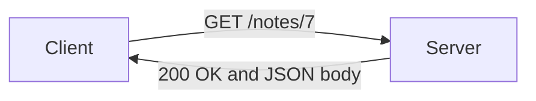
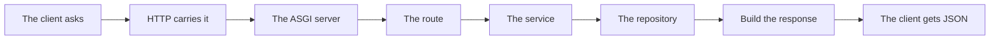

# Http Urls Headers And Json Contracts

## The big idea in plain words {#picture}

When your browser opens a website, it sends a message called an **HTTP request**. It is like a letter: it has an address (the URL), an action word (like GET), some notes on the envelope (headers), and sometimes a letter inside (the body). The server reads it and sends back a reply with a number (the status code) and its own content.

Most APIs send and receive **JSON**. When you understand this letter exchange, FastAPI is easy, because FastAPI is just a clever way of reading these letters for you.



## What you will be able to do {#outcomes}

By the end of this lesson you will be able to:

- Read a URL and name its parts.
- Use methods, status codes, headers, and JSON bodies correctly.
- Explain what a contract is and why retries need care.

## Words to know {#vocabulary}

- **URL**: the address of something on the web.
- **method**: the action: GET, POST, PUT, PATCH, DELETE.
- **status code**: a number telling how the request went.
- **header**: extra information about the message.
- **body**: the main content, often JSON.
- **contract**: the agreed shape of requests and replies.

## Why this idea exists {#history}

Clients and servers are written by different people at different times. A clear, shared agreement lets them work together without ever meeting.

## Concept 1: Parts of a URL {#concept-1}

`https://api.example.com/notes/7?show=full` has: the scheme (`https`), the host (`api.example.com`), the path (`/notes/7`), and the query (`show=full`). The path says *what*, the query adds *options*.

## Concept 2: Methods say what you want {#concept-2}

GET reads. POST creates. PUT replaces. PATCH changes part. DELETE removes. GET must not change anything, so it is safe to repeat.

## Concept 3: Status codes are traffic lights {#concept-3}

200 OK, 201 Created, 204 No Content, 400 Bad Request, 401 Not Signed In, 403 Not Allowed, 404 Not Found, 422 Invalid Data, 500 Server Problem. Using the right one tells the client what to do next.

## Concept 4: Headers, bodies, and retries {#concept-4}

`Content-Type: application/json` says the body is JSON. A body is only used with POST, PUT, and PATCH. If a POST times out, the client might retry and create a duplicate, so important creates need a unique request key. Lists should come in pages with a limit, like `?limit=20`.

## One full exchange {#example}

```text
POST /notes
Content-Type: application/json

{"title": "Math"}

--- reply ---
201 Created
{"id": 7, "title": "Math"}
```
The client asked to create a note. The server replied 201 and sent the new note with its id.

## Going deeper: the technical walkthrough {#walkthrough}

### HTTP and JSON


A request has a method, URL, headers, and sometimes a body. A response has a
status code, headers, and sometimes a body.

| Method | Meaning | Typical success |
| --- | --- | --- |
| `GET` | read | `200 OK` |
| `POST` | create or start work | `201 Created` or `202 Accepted` |
| `PUT` | replace one resource | `200 OK` |
| `PATCH` | change part of a resource | `200 OK` |
| `DELETE` | remove or disable | `204 No Content` |

Use nouns in paths, such as `/notes` and `/notes/{note_id}`. Put filtering in
query parameters, such as `/notes?topic=python&page=1`. JSON is data, not a
place to execute code.


## Worked scenario {#worked-scenario}

A client wants a page of notes and must not change anything. Which request fits?

The justified choice is **GET /notes?limit=20 returning a limited list**. Select **bounded-get** in the structured practical and explain why. Alternatives ignore a requirement, cross a trust boundary, or invent success.

### Structured decision contract

```json

{
  "decision": "bounded-get",
  "justification": "The method and header boundary must preserve the declared contract and ownership.",
  "failureBehavior": "Expose a safe failure and recover through the boundary owner."
}

```

Decision selects one declared behavior. Justification explains the boundary. FailureBehavior explains the observable error and recovery owner. These fields never execute commands. Required terms and minimum lengths form a basic practice rubric, not semantic grading.

## Step-by-step flow and matching picture {#flow}




## Three real-life uses {#use-cases}

1. A phone app requests `GET /weather?city=Paris`.
2. A signup form sends `POST /users` with JSON.
3. A page asks for `GET /notes?limit=20&offset=40` to see the third page.

## What can go wrong, and how to stay safe {#failure-security}

Mistakes: using GET to change data, always replying 200 even for errors, sending a list with no limit, and putting passwords in the URL, because URLs are saved in logs and history. Secrets go in headers or bodies over HTTPS.

## Practice lab and expected observation {#practice}

1. Predict the scenario decision before opening Practical. Explain each rejected alternative.
2. Run a relevant example above in an isolated exercise project. Record the expected result, then change one input to an invalid or boundary value. A failed assertion or deliberate error should replace silent success.
3. Submit the structured decision. Initially the checks fail. After selecting bounded-get and writing an explanation and failure plan, all three pass. Follow the indicated review section for missed checks.

### Broken example to debug

```json

{"decision":"trust-client","justification":"","failureBehavior":""}

```

This ignores the responsible boundary and gives no reasoning or recovery. Correct the fields rather than changing the validator.

## Checkpoint and definition of done {#checkpoint}

- [ ] Define method and header without looking.
- [ ] Trace input to owner and output.
- [ ] Explain one failure and one alternative.
- [ ] Pass at least four assignment questions.
- [ ] Pass every practical check and submit.
- [ ] Explain the concept again tomorrow.

## Sources, versions, and safe commands {#sources}

Python 3.11+; examples use Python 3.11 syntax and Pydantic 2 conventions. Review date: 2026-10-02. The supplied blueprint is the teaching source; official landing pages were checked where reachable. No provider or original TM Schedule deployment was tested.

- [Official reference](https://docs.python.org/3/tutorial/)

- [Official reference](https://fastapi.tiangolo.com/tutorial/)

[Course reading order](README.md) · [Previous lesson](10-files-paths-json-and-configuration.md) · [Next lesson](11a-calling-another-api-with-httpx.md)

```study-quiz

{
  "schemaVersion": 1,
  "lessonId": "python-first-api/11-http-urls-headers-and-json-contracts",
  "title": "Assignment: Http Urls Headers And Json Contracts",
  "passPercentage": 80,
  "questions": [
    {
      "id": "q1",
      "sectionId": "concept-1",
      "prompt": "In Http Urls Headers And Json Contracts, what does method mean?",
      "options": [
        {
          "id": "a",
          "text": "A permission granted by a hidden browser control",
          "explanation": "This changes the declared meaning or bypasses the responsible boundary."
        },
        {
          "id": "b",
          "text": "An unlimited provider operation with no ownership",
          "explanation": "This changes the declared meaning or bypasses the responsible boundary."
        },
        {
          "id": "c",
          "text": "the action word of a request, like GET or POST",
          "explanation": "This preserves the definition and boundary described in the lesson."
        },
        {
          "id": "d",
          "text": "A diagnostic credential intended for public logs",
          "explanation": "This changes the declared meaning or bypasses the responsible boundary."
        }
      ],
      "correctOptionId": "c",
      "explanation": "method means the action word of a request, like GET or POST.",
      "reviewLabel": "Review concept 1"
    },
    {
      "id": "q2",
      "sectionId": "concept-2",
      "prompt": "In Http Urls Headers And Json Contracts, which rule is correct for checkpoint 2?",
      "options": [
        {
          "id": "a",
          "text": "Trust client-side checks instead of the server rule.",
          "explanation": "This changes the declared meaning or bypasses the responsible boundary."
        },
        {
          "id": "b",
          "text": "Hide the failure by returning a fabricated successful result.",
          "explanation": "This changes the declared meaning or bypasses the responsible boundary."
        },
        {
          "id": "c",
          "text": "Skip the stated boundary, limit, or ownership check.",
          "explanation": "This changes the declared meaning or bypasses the responsible boundary."
        },
        {
          "id": "d",
          "text": "Creating something with POST usually answers 201 and points to the new item.",
          "explanation": "This preserves the definition and boundary described in the lesson."
        }
      ],
      "correctOptionId": "d",
      "explanation": "Creating something with POST usually answers 201 and points to the new item.",
      "reviewLabel": "Review concept 2"
    },
    {
      "id": "q3",
      "sectionId": "concept-3",
      "prompt": "In Http Urls Headers And Json Contracts, which rule is correct for checkpoint 3?",
      "options": [
        {
          "id": "a",
          "text": "Content-Type tells what kind of data is in the body.",
          "explanation": "This preserves the definition and boundary described in the lesson."
        },
        {
          "id": "b",
          "text": "Trust client-side checks instead of the server rule.",
          "explanation": "This changes the declared meaning or bypasses the responsible boundary."
        },
        {
          "id": "c",
          "text": "Hide the failure by returning a fabricated successful result.",
          "explanation": "This changes the declared meaning or bypasses the responsible boundary."
        },
        {
          "id": "d",
          "text": "Skip the stated boundary, limit, or ownership check.",
          "explanation": "This changes the declared meaning or bypasses the responsible boundary."
        }
      ],
      "correctOptionId": "a",
      "explanation": "Content-Type tells what kind of data is in the body.",
      "reviewLabel": "Review concept 3"
    },
    {
      "id": "q4",
      "sectionId": "concept-4",
      "prompt": "In Http Urls Headers And Json Contracts, which rule is correct for checkpoint 4?",
      "options": [
        {
          "id": "a",
          "text": "Trust client-side checks instead of the server rule.",
          "explanation": "This changes the declared meaning or bypasses the responsible boundary."
        },
        {
          "id": "b",
          "text": "Before retrying a write, decide how to avoid doing it twice.",
          "explanation": "This preserves the definition and boundary described in the lesson."
        },
        {
          "id": "c",
          "text": "Hide the failure by returning a fabricated successful result.",
          "explanation": "This changes the declared meaning or bypasses the responsible boundary."
        },
        {
          "id": "d",
          "text": "Skip the stated boundary, limit, or ownership check.",
          "explanation": "This changes the declared meaning or bypasses the responsible boundary."
        }
      ],
      "correctOptionId": "b",
      "explanation": "Before retrying a write, decide how to avoid doing it twice.",
      "reviewLabel": "Review concept 4"
    },
    {
      "id": "q5",
      "sectionId": "worked-scenario",
      "prompt": "A client wants a page of notes and must not change anything. Which request fits?",
      "options": [
        {
          "id": "a",
          "text": "POST /delete-everything",
          "explanation": "This changes the declared meaning or bypasses the responsible boundary."
        },
        {
          "id": "b",
          "text": "A GET that secretly changes data",
          "explanation": "This changes the declared meaning or bypasses the responsible boundary."
        },
        {
          "id": "c",
          "text": "GET /notes?limit=20 returning a limited list",
          "explanation": "This preserves the definition and boundary described in the lesson."
        },
        {
          "id": "d",
          "text": "A database password inside the URL",
          "explanation": "This changes the declared meaning or bypasses the responsible boundary."
        }
      ],
      "correctOptionId": "c",
      "explanation": "GET /notes?limit=20 returning a limited list. A list answer should be a limited page in a steady order.",
      "reviewLabel": "Review the worked scenario"
    }
  ]
}

```

```study-practical

{
  "schemaVersion": 1,
  "challengeId": "python-first-api/11-http-urls-headers-and-json-contracts/decision",
  "lessonId": "python-first-api/11-http-urls-headers-and-json-contracts",
  "title": "Practical: Http Urls Headers And Json Contracts",
  "language": "json",
  "mode": "structured",
  "instructions": "A client wants a page of notes and must not change anything. Which request fits? Return an object with decision (choose from bounded-get, skip-check, unbounded-work, trust-client), justification (at least 40 characters; include method and header), and failureBehavior (at least 25 characters; include failure and recover while explaining the error and recovery). These are structured reasoning checks, not code execution or an official grade.",
  "starterCode": "{\n  \"decision\": \"\",\n  \"justification\": \"\",\n  \"failureBehavior\": \"\"\n}",
  "entryPoint": "answer",
  "publicExamples": [
    {
      "input": {
        "decision": "skip-check",
        "justification": "",
        "failureBehavior": ""
      },
      "expected": {
        "passed": false
      }
    },
    {
      "input": {
        "decision": "bounded-get",
        "justification": "The method and header boundary must preserve the declared contract and ownership.",
        "failureBehavior": "Show a safe failure and recover through the responsible owner."
      },
      "expected": {
        "passed": true
      }
    }
  ],
  "publicTestIds": [
    "decision",
    "explanation",
    "failure-plan"
  ],
  "reviewSections": {
    "decision": "worked-scenario",
    "explanation": "concept-2",
    "failure-plan": "failure-security"
  },
  "limits": {
    "timeMs": 2000,
    "memoryMb": 128,
    "outputBytes": 20000
  }
}

```

