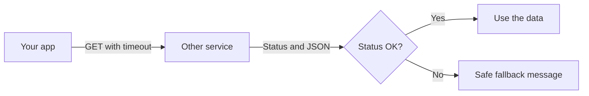
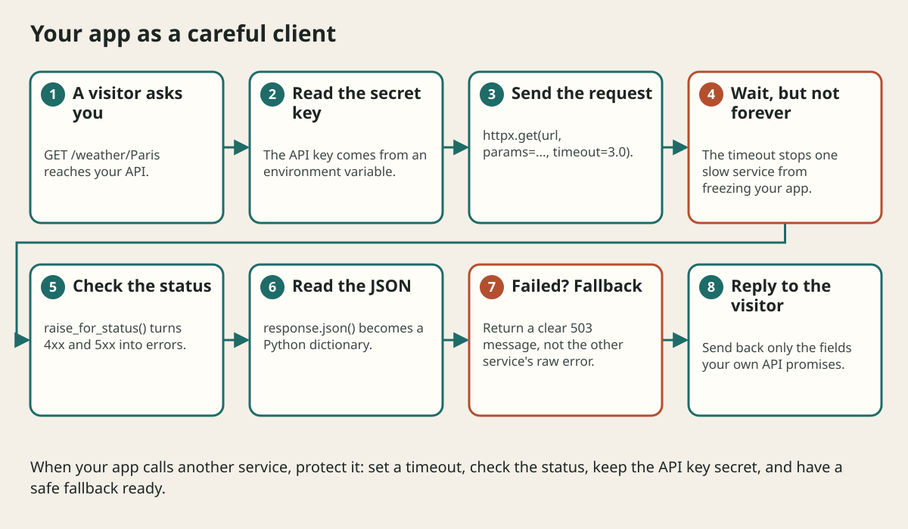

# Calling Another Api With Httpx

## The big idea in plain words {#picture}

Until now our API was the restaurant kitchen: others asked it for food. Now our program is the one that orders from another kitchen. Maybe it wants the weather, a map, or a payment. Our program becomes the **client**.

In Python, a friendly tool called `httpx` sends the request and brings back the answer. But the other kitchen can be slow, closed, or give a strange answer, so we protect ourselves with time limits and checks.



## What you will be able to do {#outcomes}

By the end of this lesson you will be able to:

- Send a GET and POST request with `httpx`.
- Read the status code and JSON reply.
- Use timeouts, error handling, and keep API keys secret.

## Words to know {#vocabulary}

- **client**: the program that sends the request.
- **httpx**: a Python library for sending web requests.
- **timeout**: the longest time we will wait.
- **status code**: the number in the reply that says how it went.
- **API key**: a secret code for using someone else's service.
- **fallback**: a safe plan when the call fails.

## Why this idea exists {#history}

Almost every app uses other services. If you call them carelessly, one slow service can freeze your whole app, and one mistake with a key can cost money or leak data.

## Concept 1: A simple GET {#concept-1}

```python
import httpx

response = httpx.get("https://api.example.com/weather", params={"city": "Paris"}, timeout=5.0)
response.raise_for_status()
data = response.json()
print(data["temperature"])
```
`params` adds `?city=Paris` to the address. `.json()` turns the reply into a dictionary. `raise_for_status()` raises an error if the status is 400 or higher.

## Concept 2: Always set a timeout {#concept-2}

Without `timeout`, a slow service can make your code wait for a very long time, and your own visitors wait with it. Five seconds is a common limit. When it passes, httpx raises `httpx.TimeoutException`, and you can answer, "weather not available right now".

## Concept 3: POST with JSON and a secret key {#concept-3}

```python
import os
key = os.environ["WEATHER_API_KEY"]
r = httpx.post("https://api.example.com/notes",
               json={"title": "Math"},
               headers={"Authorization": f"Bearer {key}"},
               timeout=5.0)
```
The key comes from an environment variable. It is never typed into the code, never printed, and never put into a log.

## Concept 4: Handle failures kindly {#concept-4}

```python
try:
    ...
except httpx.TimeoutException:
    return {"weather": "unavailable"}
except httpx.HTTPStatusError as err:
    log.warning("provider error %s", err.response.status_code)
    return {"weather": "unavailable"}
```
Catch the specific errors, log the facts (without secrets), and return a friendly fallback. Retry only calls that are safe to repeat, wait longer each time, and stop after a few tries.

## A weather route that never freezes {#example}

```python
@app.get("/weather/{city}")
def weather(city: str):
    try:
        r = httpx.get(PROVIDER, params={"city": city}, timeout=3.0)
        r.raise_for_status()
        return {"temperature": r.json()["temp"]}
    except (httpx.TimeoutException, httpx.HTTPStatusError):
        raise HTTPException(status_code=503, detail="Weather is not available right now")
```
If the provider is slow or broken, our visitors wait 3 seconds at most and get a clear message.

## Going deeper: the technical walkthrough {#walkthrough}

## Worked scenario {#worked-scenario}

A weather service sometimes takes a very long time to answer. What should your code do?

The justified choice is **Set a timeout and show a clear fallback message if it passes**. Select **set-timeout** in the structured practical and explain why. Alternatives ignore a requirement, cross a trust boundary, or invent success.

### Structured decision contract

```json

{
  "decision": "set-timeout",
  "justification": "The httpxClient and timeout boundary must preserve the declared contract and ownership.",
  "failureBehavior": "Expose a safe failure and recover through the boundary owner."
}

```

Decision selects one declared behavior. Justification explains the boundary. FailureBehavior explains the observable error and recovery owner. These fields never execute commands. Required terms and minimum lengths form a basic practice rubric, not semantic grading.

## Step-by-step flow and matching picture {#flow}




## Three real-life uses {#use-cases}

1. A shop calls a payment service to charge a card.
2. A news app fetches headlines from another API.
3. A school dashboard reads the weather for a trip.

## What can go wrong, and how to stay safe {#failure-security}

Mistakes: no timeout, trusting the reply without checking the status, printing API keys, retrying actions that are not safe to repeat (like charging a card), and letting the visitor see the other service's raw error text. Also, if a visitor can give you a web address to fetch, check it carefully, so your server is not tricked into visiting private places.

## Practice lab and expected observation {#practice}

1. Predict the scenario decision before opening Practical. Explain each rejected alternative.
2. Run a relevant example above in an isolated exercise project. Record the expected result, then change one input to an invalid or boundary value. A failed assertion or deliberate error should replace silent success.
3. Submit the structured decision. Initially the checks fail. After selecting set-timeout and writing an explanation and failure plan, all three pass. Follow the indicated review section for missed checks.

### Broken example to debug

```json

{"decision":"trust-client","justification":"","failureBehavior":""}

```

This ignores the responsible boundary and gives no reasoning or recovery. Correct the fields rather than changing the validator.

## Checkpoint and definition of done {#checkpoint}

- [ ] Define httpxClient and timeout without looking.
- [ ] Trace input to owner and output.
- [ ] Explain one failure and one alternative.
- [ ] Pass at least four assignment questions.
- [ ] Pass every practical check and submit.
- [ ] Explain the concept again tomorrow.

## Sources, versions, and safe commands {#sources}

Python 3.11+; examples use Python 3.11 syntax and Pydantic 2 conventions. Review date: 2026-10-02. The supplied blueprint is the teaching source; official landing pages were checked where reachable. No provider or original TM Schedule deployment was tested.

- [Official reference](https://docs.python.org/3/tutorial/)

- [Official reference](https://fastapi.tiangolo.com/tutorial/)

[Course reading order](README.md) · [Previous lesson](11-http-urls-headers-and-json-contracts.md) · [Next lesson](12-first-fastapi-application.md)

```study-quiz

{
  "schemaVersion": 1,
  "lessonId": "python-first-api/11a-calling-another-api-with-httpx",
  "title": "Assignment: Calling Another Api With Httpx",
  "passPercentage": 80,
  "questions": [
    {
      "id": "q1",
      "sectionId": "concept-1",
      "prompt": "In Calling Another Api With Httpx, what does httpxClient mean?",
      "options": [
        {
          "id": "a",
          "text": "A permission granted by a hidden browser control",
          "explanation": "This changes the declared meaning or bypasses the responsible boundary."
        },
        {
          "id": "b",
          "text": "An unlimited provider operation with no ownership",
          "explanation": "This changes the declared meaning or bypasses the responsible boundary."
        },
        {
          "id": "c",
          "text": "A diagnostic credential intended for public logs",
          "explanation": "This changes the declared meaning or bypasses the responsible boundary."
        },
        {
          "id": "d",
          "text": "a tool for sending web requests from Python",
          "explanation": "This preserves the definition and boundary described in the lesson."
        }
      ],
      "correctOptionId": "d",
      "explanation": "httpxClient means a tool for sending web requests from Python.",
      "reviewLabel": "Review concept 1"
    },
    {
      "id": "q2",
      "sectionId": "concept-2",
      "prompt": "In Calling Another Api With Httpx, which rule is correct for checkpoint 2?",
      "options": [
        {
          "id": "a",
          "text": "Always set a timeout so a slow service cannot freeze your app.",
          "explanation": "This preserves the definition and boundary described in the lesson."
        },
        {
          "id": "b",
          "text": "Trust client-side checks instead of the server rule.",
          "explanation": "This changes the declared meaning or bypasses the responsible boundary."
        },
        {
          "id": "c",
          "text": "Hide the failure by returning a fabricated successful result.",
          "explanation": "This changes the declared meaning or bypasses the responsible boundary."
        },
        {
          "id": "d",
          "text": "Skip the stated boundary, limit, or ownership check.",
          "explanation": "This changes the declared meaning or bypasses the responsible boundary."
        }
      ],
      "correctOptionId": "a",
      "explanation": "Always set a timeout so a slow service cannot freeze your app.",
      "reviewLabel": "Review concept 2"
    },
    {
      "id": "q3",
      "sectionId": "concept-3",
      "prompt": "In Calling Another Api With Httpx, which rule is correct for checkpoint 3?",
      "options": [
        {
          "id": "a",
          "text": "Trust client-side checks instead of the server rule.",
          "explanation": "This changes the declared meaning or bypasses the responsible boundary."
        },
        {
          "id": "b",
          "text": "Check the status code, because a reply can arrive and still be an error.",
          "explanation": "This preserves the definition and boundary described in the lesson."
        },
        {
          "id": "c",
          "text": "Hide the failure by returning a fabricated successful result.",
          "explanation": "This changes the declared meaning or bypasses the responsible boundary."
        },
        {
          "id": "d",
          "text": "Skip the stated boundary, limit, or ownership check.",
          "explanation": "This changes the declared meaning or bypasses the responsible boundary."
        }
      ],
      "correctOptionId": "b",
      "explanation": "Check the status code, because a reply can arrive and still be an error.",
      "reviewLabel": "Review concept 3"
    },
    {
      "id": "q4",
      "sectionId": "concept-4",
      "prompt": "In Calling Another Api With Httpx, which rule is correct for checkpoint 4?",
      "options": [
        {
          "id": "a",
          "text": "Trust client-side checks instead of the server rule.",
          "explanation": "This changes the declared meaning or bypasses the responsible boundary."
        },
        {
          "id": "b",
          "text": "Hide the failure by returning a fabricated successful result.",
          "explanation": "This changes the declared meaning or bypasses the responsible boundary."
        },
        {
          "id": "c",
          "text": "Keep API keys in environment variables, never in the code or in logs.",
          "explanation": "This preserves the definition and boundary described in the lesson."
        },
        {
          "id": "d",
          "text": "Skip the stated boundary, limit, or ownership check.",
          "explanation": "This changes the declared meaning or bypasses the responsible boundary."
        }
      ],
      "correctOptionId": "c",
      "explanation": "Keep API keys in environment variables, never in the code or in logs.",
      "reviewLabel": "Review concept 4"
    },
    {
      "id": "q5",
      "sectionId": "worked-scenario",
      "prompt": "A weather service sometimes takes a very long time to answer. What should your code do?",
      "options": [
        {
          "id": "a",
          "text": "Wait forever",
          "explanation": "This changes the declared meaning or bypasses the responsible boundary."
        },
        {
          "id": "b",
          "text": "Retry instantly in an endless loop",
          "explanation": "This changes the declared meaning or bypasses the responsible boundary."
        },
        {
          "id": "c",
          "text": "Invent a weather answer",
          "explanation": "This changes the declared meaning or bypasses the responsible boundary."
        },
        {
          "id": "d",
          "text": "Set a timeout and show a clear fallback message if it passes",
          "explanation": "This preserves the definition and boundary described in the lesson."
        }
      ],
      "correctOptionId": "d",
      "explanation": "Set a timeout and show a clear fallback message if it passes. Retry only calls that are safe to repeat, and wait a little longer each time.",
      "reviewLabel": "Review the worked scenario"
    }
  ]
}

```

```study-practical

{
  "schemaVersion": 1,
  "challengeId": "python-first-api/11a-calling-another-api-with-httpx/decision",
  "lessonId": "python-first-api/11a-calling-another-api-with-httpx",
  "title": "Practical: Calling Another Api With Httpx",
  "language": "json",
  "mode": "structured",
  "instructions": "A weather service sometimes takes a very long time to answer. What should your code do? Return an object with decision (choose from set-timeout, skip-check, unbounded-work, trust-client), justification (at least 40 characters; include httpxClient and timeout), and failureBehavior (at least 25 characters; include failure and recover while explaining the error and recovery). These are structured reasoning checks, not code execution or an official grade.",
  "starterCode": "{\n  \"decision\": \"\",\n  \"justification\": \"\",\n  \"failureBehavior\": \"\"\n}",
  "entryPoint": "answer",
  "publicExamples": [
    {
      "input": {
        "decision": "skip-check",
        "justification": "",
        "failureBehavior": ""
      },
      "expected": {
        "passed": false
      }
    },
    {
      "input": {
        "decision": "set-timeout",
        "justification": "The httpxClient and timeout boundary must preserve the declared contract and ownership.",
        "failureBehavior": "Show a safe failure and recover through the responsible owner."
      },
      "expected": {
        "passed": true
      }
    }
  ],
  "publicTestIds": [
    "decision",
    "explanation",
    "failure-plan"
  ],
  "reviewSections": {
    "decision": "worked-scenario",
    "explanation": "concept-2",
    "failure-plan": "failure-security"
  },
  "limits": {
    "timeMs": 2000,
    "memoryMb": 128,
    "outputBytes": 20000
  }
}

```

