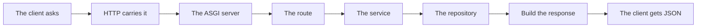
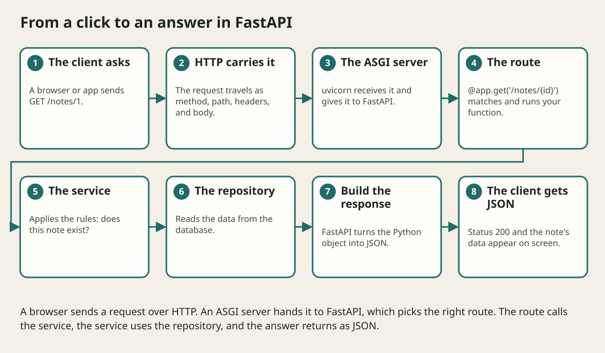
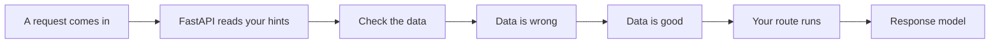

# First Fastapi Application

## The big idea in plain words {#picture}

Let us make our first web service! With FastAPI, a complete API can fit in a few lines. You write a function, add a label (called a decorator) that says "this answers GET requests at /health", and you are done.

A second program called **uvicorn** acts like a doorman: it listens for visitors and passes their requests to your FastAPI app. FastAPI even creates a free, clickable manual of your API at `/docs`.


## What you will be able to do {#outcomes}

By the end of this lesson you will be able to:

- Create a FastAPI app and a health route.
- Run it with uvicorn and open `/docs`.
- Understand startup and what a route function is.

## Words to know {#vocabulary}

- **FastAPI**: a Python tool for making web APIs.
- **uvicorn**: a server that runs your app.
- **route**: a path plus a method that runs a function.
- **decorator**: a label above a function, starting with `@`.
- **/docs**: the automatic interactive manual.
- **health endpoint**: a tiny route that says "I am alive".

## Why this idea exists {#history}

A first working request is a big win. Once that works, every other feature is a small step on top.

## Concept 1: The smallest app {#concept-1}

```python
from fastapi import FastAPI

app = FastAPI()

@app.get("/health")
def health():
    return {"status": "ok"}
```
`app` is your service. `@app.get("/health")` says: "when someone asks GET /health, run this function". The returned dictionary becomes JSON.

## Concept 2: Run it {#concept-2}

```text
uvicorn app.main:app --reload
```
`app.main:app` means "in the file `app/main.py`, use the variable `app`". `--reload` restarts the server when you edit code, which is great while learning. Visit `http://127.0.0.1:8000/health`.

## Concept 3: Free documentation {#concept-3}

Open `http://127.0.0.1:8000/docs`. FastAPI built a web page listing your routes, with a "Try it out" button for each. You never have to write it. It stays correct because it is made from your code.

## Concept 4: Startup and structure {#concept-4}

Put setup (like opening a database pool) in a lifespan or startup function, and keep routes thin: they receive a request and call other functions. As the app grows, you will split it into folders, which we do in later lessons.

## A greeting route {#example}

```python
@app.get("/hello/{name}")
def hello(name: str):
    return {"message": f"Hello, {name}!"}
```
Visit `/hello/Ava` and you get `{"message": "Hello, Ava!"}`. FastAPI took `Ava` from the URL and gave it to your function.

## Going deeper: the technical walkthrough {#walkthrough}

### The first FastAPI application


Create `app/main.py`:

```python
from fastapi import FastAPI

app = FastAPI(title="Study Notes API", version="1.0.0")


@app.get("/health")
def health() -> dict[str, str]:
    return {"status": "ok"}
```

Run it:

```bash
uvicorn app.main:app --reload --port 8000
```

Open `http://127.0.0.1:8000/docs` for interactive documentation. The API
contract is generated from the route and model declarations, but the generated
document still needs human review.


## Worked scenario {#worked-scenario}

A request body is bigger than the allowed upload size. What happens first?

The justified choice is **Stop it at the size limit before reading it all**. Select **reject-size** in the structured practical and explain why. Alternatives ignore a requirement, cross a trust boundary, or invent success.

### Structured decision contract

```json

{
  "decision": "reject-size",
  "justification": "The route and binding boundary must preserve the declared contract and ownership.",
  "failureBehavior": "Expose a safe failure and recover through the boundary owner."
}

```

Decision selects one declared behavior. Justification explains the boundary. FailureBehavior explains the observable error and recovery owner. These fields never execute commands. Required terms and minimum lengths form a basic practice rubric, not semantic grading.

## Step-by-step flow and matching picture {#flow}








## Three real-life uses {#use-cases}

1. A health route that a server uses to check the app is alive.
2. A school API with `GET /students`.
3. A tiny prototype to test an idea in ten minutes.

## What can go wrong, and how to stay safe {#failure-security}

Mistakes: running `python main.py` instead of uvicorn, forgetting to activate the venv, typing the wrong `module:variable` for uvicorn, and putting all logic inside route functions. Keep routes short.

## Practice lab and expected observation {#practice}

1. Predict the scenario decision before opening Practical. Explain each rejected alternative.
2. Run a relevant example above in an isolated exercise project. Record the expected result, then change one input to an invalid or boundary value. A failed assertion or deliberate error should replace silent success.
3. Submit the structured decision. Initially the checks fail. After selecting reject-size and writing an explanation and failure plan, all three pass. Follow the indicated review section for missed checks.

### Broken example to debug

```json

{"decision":"trust-client","justification":"","failureBehavior":""}

```

This ignores the responsible boundary and gives no reasoning or recovery. Correct the fields rather than changing the validator.

## Checkpoint and definition of done {#checkpoint}

- [ ] Define route and binding without looking.
- [ ] Trace input to owner and output.
- [ ] Explain one failure and one alternative.
- [ ] Pass at least four assignment questions.
- [ ] Pass every practical check and submit.
- [ ] Explain the concept again tomorrow.

## Sources, versions, and safe commands {#sources}

Python 3.11+; examples use Python 3.11 syntax and Pydantic 2 conventions. Review date: 2026-10-02. The supplied blueprint is the teaching source; official landing pages were checked where reachable. No provider or original TM Schedule deployment was tested.

- [Official reference](https://docs.python.org/3/tutorial/)

- [Official reference](https://fastapi.tiangolo.com/tutorial/)

[Course reading order](README.md) · [Previous lesson](11a-calling-another-api-with-httpx.md) · [Next lesson](13-pydantic-validation-and-schemas.md)

```study-quiz

{
  "schemaVersion": 1,
  "lessonId": "python-first-api/12-first-fastapi-application",
  "title": "Assignment: First Fastapi Application",
  "passPercentage": 80,
  "questions": [
    {
      "id": "q1",
      "sectionId": "concept-1",
      "prompt": "In First Fastapi Application, what does route mean?",
      "options": [
        {
          "id": "a",
          "text": "a rule that sends a method and a path to a piece of code",
          "explanation": "This preserves the definition and boundary described in the lesson."
        },
        {
          "id": "b",
          "text": "A permission granted by a hidden browser control",
          "explanation": "This changes the declared meaning or bypasses the responsible boundary."
        },
        {
          "id": "c",
          "text": "An unlimited provider operation with no ownership",
          "explanation": "This changes the declared meaning or bypasses the responsible boundary."
        },
        {
          "id": "d",
          "text": "A diagnostic credential intended for public logs",
          "explanation": "This changes the declared meaning or bypasses the responsible boundary."
        }
      ],
      "correctOptionId": "a",
      "explanation": "route means a rule that sends a method and a path to a piece of code.",
      "reviewLabel": "Review concept 1"
    },
    {
      "id": "q2",
      "sectionId": "concept-2",
      "prompt": "In First Fastapi Application, which rule is correct for checkpoint 2?",
      "options": [
        {
          "id": "a",
          "text": "Trust client-side checks instead of the server rule.",
          "explanation": "This changes the declared meaning or bypasses the responsible boundary."
        },
        {
          "id": "b",
          "text": "Knowing who someone is does not replace checking what they may touch.",
          "explanation": "This preserves the definition and boundary described in the lesson."
        },
        {
          "id": "c",
          "text": "Hide the failure by returning a fabricated successful result.",
          "explanation": "This changes the declared meaning or bypasses the responsible boundary."
        },
        {
          "id": "d",
          "text": "Skip the stated boundary, limit, or ownership check.",
          "explanation": "This changes the declared meaning or bypasses the responsible boundary."
        }
      ],
      "correctOptionId": "b",
      "explanation": "Knowing who someone is does not replace checking what they may touch.",
      "reviewLabel": "Review concept 2"
    },
    {
      "id": "q3",
      "sectionId": "concept-3",
      "prompt": "In First Fastapi Application, which rule is correct for checkpoint 3?",
      "options": [
        {
          "id": "a",
          "text": "Trust client-side checks instead of the server rule.",
          "explanation": "This changes the declared meaning or bypasses the responsible boundary."
        },
        {
          "id": "b",
          "text": "Hide the failure by returning a fabricated successful result.",
          "explanation": "This changes the declared meaning or bypasses the responsible boundary."
        },
        {
          "id": "c",
          "text": "Path parameters and query parameters play different roles.",
          "explanation": "This preserves the definition and boundary described in the lesson."
        },
        {
          "id": "d",
          "text": "Skip the stated boundary, limit, or ownership check.",
          "explanation": "This changes the declared meaning or bypasses the responsible boundary."
        }
      ],
      "correctOptionId": "c",
      "explanation": "Path parameters and query parameters play different roles.",
      "reviewLabel": "Review concept 3"
    },
    {
      "id": "q4",
      "sectionId": "concept-4",
      "prompt": "In First Fastapi Application, which rule is correct for checkpoint 4?",
      "options": [
        {
          "id": "a",
          "text": "Trust client-side checks instead of the server rule.",
          "explanation": "This changes the declared meaning or bypasses the responsible boundary."
        },
        {
          "id": "b",
          "text": "Hide the failure by returning a fabricated successful result.",
          "explanation": "This changes the declared meaning or bypasses the responsible boundary."
        },
        {
          "id": "c",
          "text": "Skip the stated boundary, limit, or ownership check.",
          "explanation": "This changes the declared meaning or bypasses the responsible boundary."
        },
        {
          "id": "d",
          "text": "A route handles the web side and passes business rules to a service.",
          "explanation": "This preserves the definition and boundary described in the lesson."
        }
      ],
      "correctOptionId": "d",
      "explanation": "A route handles the web side and passes business rules to a service.",
      "reviewLabel": "Review concept 4"
    },
    {
      "id": "q5",
      "sectionId": "worked-scenario",
      "prompt": "A request body is bigger than the allowed upload size. What happens first?",
      "options": [
        {
          "id": "a",
          "text": "Stop it at the size limit before reading it all",
          "explanation": "This preserves the definition and boundary described in the lesson."
        },
        {
          "id": "b",
          "text": "Load every byte into memory, then decide",
          "explanation": "This changes the declared meaning or bypasses the responsible boundary."
        },
        {
          "id": "c",
          "text": "Send it to every database table",
          "explanation": "This changes the declared meaning or bypasses the responsible boundary."
        },
        {
          "id": "d",
          "text": "Trust a hidden button in the page",
          "explanation": "This changes the declared meaning or bypasses the responsible boundary."
        }
      ],
      "correctOptionId": "a",
      "explanation": "Stop it at the size limit before reading it all. An unknown route should give a predictable 'not found' answer.",
      "reviewLabel": "Review the worked scenario"
    }
  ]
}

```

```study-practical

{
  "schemaVersion": 1,
  "challengeId": "python-first-api/12-first-fastapi-application/decision",
  "lessonId": "python-first-api/12-first-fastapi-application",
  "title": "Practical: First Fastapi Application",
  "language": "json",
  "mode": "structured",
  "instructions": "A request body is bigger than the allowed upload size. What happens first? Return an object with decision (choose from reject-size, skip-check, unbounded-work, trust-client), justification (at least 40 characters; include route and binding), and failureBehavior (at least 25 characters; include failure and recover while explaining the error and recovery). These are structured reasoning checks, not code execution or an official grade.",
  "starterCode": "{\n  \"decision\": \"\",\n  \"justification\": \"\",\n  \"failureBehavior\": \"\"\n}",
  "entryPoint": "answer",
  "publicExamples": [
    {
      "input": {
        "decision": "skip-check",
        "justification": "",
        "failureBehavior": ""
      },
      "expected": {
        "passed": false
      }
    },
    {
      "input": {
        "decision": "reject-size",
        "justification": "The route and binding boundary must preserve the declared contract and ownership.",
        "failureBehavior": "Show a safe failure and recover through the responsible owner."
      },
      "expected": {
        "passed": true
      }
    }
  ],
  "publicTestIds": [
    "decision",
    "explanation",
    "failure-plan"
  ],
  "reviewSections": {
    "decision": "worked-scenario",
    "explanation": "concept-2",
    "failure-plan": "failure-security"
  },
  "limits": {
    "timeMs": 2000,
    "memoryMb": 128,
    "outputBytes": 20000
  }
}

```

