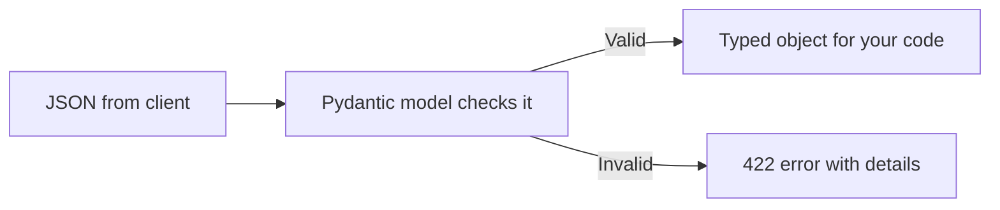
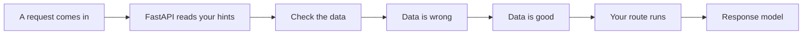
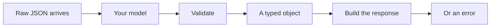
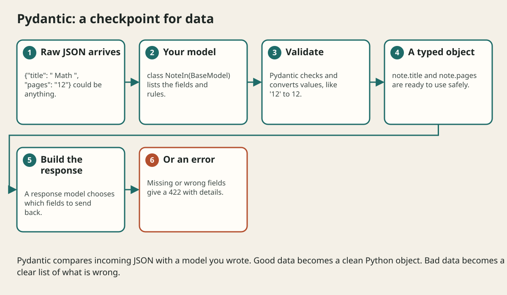

# Pydantic Validation And Schemas

## The big idea in plain words {#picture}

When a visitor fills out a form, they can type anything: a number where you want words, an empty title, a title as long as a book. Pydantic is like a careful librarian who looks at every form before it goes to the shelves. It checks each box against rules you wrote, fixes what it can ("12" becomes 12), and rejects what it cannot.

You describe the shape of your data once, as a class. FastAPI uses it to check incoming data, to shape the reply, and to write the documentation.



## What you will be able to do {#outcomes}

By the end of this lesson you will be able to:

- Write a Pydantic model with fields and limits.
- Use request models and response models.
- Read a 422 error message.

## Words to know {#vocabulary}

- **Pydantic**: a library that checks data against a model.
- **BaseModel**: the class you extend to make a model.
- **field**: one named piece of data with rules.
- **schema**: the written description of the shape and rules of data.
- **response model**: the shape of what you send back.
- **422**: the status for "your data is not valid".

## Why this idea exists {#history}

Never trust data from outside. Checking it by hand in every route is long and easy to forget. A model does it once, reliably.

## Concept 1: A model is a form template {#concept-1}

```python
from pydantic import BaseModel, Field

class NoteIn(BaseModel):
    title: str = Field(min_length=1, max_length=80)
    body: str = ""
    pinned: bool = False
```
This says: `title` must be 1 to 80 characters, `body` is optional text, `pinned` defaults to False.

## Concept 2: Use it in a route {#concept-2}

```python
@app.post("/notes", status_code=201)
def create_note(note: NoteIn):
    return {"id": 1, **note.model_dump()}
```
FastAPI reads the JSON body, checks it with `NoteIn`, and gives you a good, typed `note`. If the data is wrong, your function never runs.

## Concept 3: Read the error {#concept-3}

If a client sends `{"title": ""}`, FastAPI replies 422 with details such as `"String should have at least 1 character"` and the place (`body.title`). The error message tells the client exactly what to fix. You wrote no error code!

## Concept 4: Response models protect secrets {#concept-4}

```python
class NoteOut(BaseModel):
    id: int
    title: str

@app.get("/notes/{id}", response_model=NoteOut)
```
The reply includes only `id` and `title`, even if your internal object has other fields such as an owner's email or a password hash. This keeps private data from leaking by mistake.

## Whitespace title {#example}

A client sends `{"title": "   "}`. Length is 3, so the model accepts it. Add a validator that trims and rejects empty text: now `"   "` becomes `""` and is refused. Checks that depend on rules of your business belong in a service or validator, not just in the type.

## Going deeper: the technical walkthrough {#walkthrough}

### Request and response models


```python
from pydantic import BaseModel, Field


class NoteCreate(BaseModel):
    title: str = Field(min_length=1, max_length=120)
    body: str = Field(min_length=1, max_length=20_000)
    topic: str = Field(min_length=1, max_length=60)


class Note(NoteCreate):
    id: int
```

The model checks shape and limits. The service still decides business meaning,
such as whether the topic is allowed or whether the caller owns the note.


## Worked scenario {#worked-scenario}

A note ID is real but belongs to someone else. Which check blocks the read?

The justified choice is **Checking that the caller owns that record**. Select **check-ownership** in the structured practical and explain why. Alternatives ignore a requirement, cross a trust boundary, or invent success.

### Structured decision contract

```json

{
  "decision": "check-ownership",
  "justification": "The schema and businessRule boundary must preserve the declared contract and ownership.",
  "failureBehavior": "Expose a safe failure and recover through the boundary owner."
}

```

Decision selects one declared behavior. Justification explains the boundary. FailureBehavior explains the observable error and recovery owner. These fields never execute commands. Required terms and minimum lengths form a basic practice rubric, not semantic grading.

## Step-by-step flow and matching picture {#flow}








## Three real-life uses {#use-cases}

1. A signup route that checks email and password length.
2. A response model that hides an internal `owner_id`.
3. An API that reports exactly which field was wrong.

## What can go wrong, and how to stay safe {#failure-security}

Mistakes: using one model for everything (input, output, database) so secrets leak, no length limits so someone sends a million characters, trusting the type hint alone for business rules, and forgetting that a valid ID does not prove the user owns the record.

## Practice lab and expected observation {#practice}

1. Predict the scenario decision before opening Practical. Explain each rejected alternative.
2. Run a relevant example above in an isolated exercise project. Record the expected result, then change one input to an invalid or boundary value. A failed assertion or deliberate error should replace silent success.
3. Submit the structured decision. Initially the checks fail. After selecting check-ownership and writing an explanation and failure plan, all three pass. Follow the indicated review section for missed checks.

### Broken example to debug

```json

{"decision":"trust-client","justification":"","failureBehavior":""}

```

This ignores the responsible boundary and gives no reasoning or recovery. Correct the fields rather than changing the validator.

## Checkpoint and definition of done {#checkpoint}

- [ ] Define schema and businessRule without looking.
- [ ] Trace input to owner and output.
- [ ] Explain one failure and one alternative.
- [ ] Pass at least four assignment questions.
- [ ] Pass every practical check and submit.
- [ ] Explain the concept again tomorrow.

## Sources, versions, and safe commands {#sources}

Python 3.11+; examples use Python 3.11 syntax and Pydantic 2 conventions. Review date: 2026-10-02. The supplied blueprint is the teaching source; official landing pages were checked where reachable. No provider or original TM Schedule deployment was tested.

- [Official reference](https://docs.python.org/3/tutorial/)

- [Official reference](https://fastapi.tiangolo.com/tutorial/)

[Course reading order](README.md) · [Previous lesson](12-first-fastapi-application.md) · [Next lesson](14-dependency-injection-and-application-layers.md)

```study-quiz

{
  "schemaVersion": 1,
  "lessonId": "python-first-api/13-pydantic-validation-and-schemas",
  "title": "Assignment: Pydantic Validation And Schemas",
  "passPercentage": 80,
  "questions": [
    {
      "id": "q1",
      "sectionId": "concept-1",
      "prompt": "In Pydantic Validation And Schemas, what does schema mean?",
      "options": [
        {
          "id": "a",
          "text": "A permission granted by a hidden browser control",
          "explanation": "This changes the declared meaning or bypasses the responsible boundary."
        },
        {
          "id": "b",
          "text": "a written description of the shape and limits of data",
          "explanation": "This preserves the definition and boundary described in the lesson."
        },
        {
          "id": "c",
          "text": "An unlimited provider operation with no ownership",
          "explanation": "This changes the declared meaning or bypasses the responsible boundary."
        },
        {
          "id": "d",
          "text": "A diagnostic credential intended for public logs",
          "explanation": "This changes the declared meaning or bypasses the responsible boundary."
        }
      ],
      "correctOptionId": "b",
      "explanation": "schema means a written description of the shape and limits of data.",
      "reviewLabel": "Review concept 1"
    },
    {
      "id": "q2",
      "sectionId": "concept-2",
      "prompt": "In Pydantic Validation And Schemas, which rule is correct for checkpoint 2?",
      "options": [
        {
          "id": "a",
          "text": "Trust client-side checks instead of the server rule.",
          "explanation": "This changes the declared meaning or bypasses the responsible boundary."
        },
        {
          "id": "b",
          "text": "Hide the failure by returning a fabricated successful result.",
          "explanation": "This changes the declared meaning or bypasses the responsible boundary."
        },
        {
          "id": "c",
          "text": "Trimming can turn spaces into an empty title that must be rejected.",
          "explanation": "This preserves the definition and boundary described in the lesson."
        },
        {
          "id": "d",
          "text": "Skip the stated boundary, limit, or ownership check.",
          "explanation": "This changes the declared meaning or bypasses the responsible boundary."
        }
      ],
      "correctOptionId": "c",
      "explanation": "Trimming can turn spaces into an empty title that must be rejected.",
      "reviewLabel": "Review concept 2"
    },
    {
      "id": "q3",
      "sectionId": "concept-3",
      "prompt": "In Pydantic Validation And Schemas, which rule is correct for checkpoint 3?",
      "options": [
        {
          "id": "a",
          "text": "Trust client-side checks instead of the server rule.",
          "explanation": "This changes the declared meaning or bypasses the responsible boundary."
        },
        {
          "id": "b",
          "text": "Hide the failure by returning a fabricated successful result.",
          "explanation": "This changes the declared meaning or bypasses the responsible boundary."
        },
        {
          "id": "c",
          "text": "Skip the stated boundary, limit, or ownership check.",
          "explanation": "This changes the declared meaning or bypasses the responsible boundary."
        },
        {
          "id": "d",
          "text": "The service checks that the category is one it allows.",
          "explanation": "This preserves the definition and boundary described in the lesson."
        }
      ],
      "correctOptionId": "d",
      "explanation": "The service checks that the category is one it allows.",
      "reviewLabel": "Review concept 3"
    },
    {
      "id": "q4",
      "sectionId": "concept-4",
      "prompt": "In Pydantic Validation And Schemas, which rule is correct for checkpoint 4?",
      "options": [
        {
          "id": "a",
          "text": "A real note ID does not prove the caller owns that note.",
          "explanation": "This preserves the definition and boundary described in the lesson."
        },
        {
          "id": "b",
          "text": "Trust client-side checks instead of the server rule.",
          "explanation": "This changes the declared meaning or bypasses the responsible boundary."
        },
        {
          "id": "c",
          "text": "Hide the failure by returning a fabricated successful result.",
          "explanation": "This changes the declared meaning or bypasses the responsible boundary."
        },
        {
          "id": "d",
          "text": "Skip the stated boundary, limit, or ownership check.",
          "explanation": "This changes the declared meaning or bypasses the responsible boundary."
        }
      ],
      "correctOptionId": "a",
      "explanation": "A real note ID does not prove the caller owns that note.",
      "reviewLabel": "Review concept 4"
    },
    {
      "id": "q5",
      "sectionId": "worked-scenario",
      "prompt": "A note ID is real but belongs to someone else. Which check blocks the read?",
      "options": [
        {
          "id": "a",
          "text": "Only checking the JSON is well-formed",
          "explanation": "This changes the declared meaning or bypasses the responsible boundary."
        },
        {
          "id": "b",
          "text": "Checking that the caller owns that record",
          "explanation": "This preserves the definition and boundary described in the lesson."
        },
        {
          "id": "c",
          "text": "Only checking the secure connection worked",
          "explanation": "This changes the declared meaning or bypasses the responsible boundary."
        },
        {
          "id": "d",
          "text": "The color of the submit button",
          "explanation": "This changes the declared meaning or bypasses the responsible boundary."
        }
      ],
      "correctOptionId": "b",
      "explanation": "Checking that the caller owns that record. Check the data you send back as well as the data you receive.",
      "reviewLabel": "Review the worked scenario"
    }
  ]
}

```

```study-practical

{
  "schemaVersion": 1,
  "challengeId": "python-first-api/13-pydantic-validation-and-schemas/decision",
  "lessonId": "python-first-api/13-pydantic-validation-and-schemas",
  "title": "Practical: Pydantic Validation And Schemas",
  "language": "json",
  "mode": "structured",
  "instructions": "A note ID is real but belongs to someone else. Which check blocks the read? Return an object with decision (choose from check-ownership, skip-check, unbounded-work, trust-client), justification (at least 40 characters; include schema and businessRule), and failureBehavior (at least 25 characters; include failure and recover while explaining the error and recovery). These are structured reasoning checks, not code execution or an official grade.",
  "starterCode": "{\n  \"decision\": \"\",\n  \"justification\": \"\",\n  \"failureBehavior\": \"\"\n}",
  "entryPoint": "answer",
  "publicExamples": [
    {
      "input": {
        "decision": "skip-check",
        "justification": "",
        "failureBehavior": ""
      },
      "expected": {
        "passed": false
      }
    },
    {
      "input": {
        "decision": "check-ownership",
        "justification": "The schema and businessRule boundary must preserve the declared contract and ownership.",
        "failureBehavior": "Show a safe failure and recover through the responsible owner."
      },
      "expected": {
        "passed": true
      }
    }
  ],
  "publicTestIds": [
    "decision",
    "explanation",
    "failure-plan"
  ],
  "reviewSections": {
    "decision": "worked-scenario",
    "explanation": "concept-2",
    "failure-plan": "failure-security"
  },
  "limits": {
    "timeMs": 2000,
    "memoryMb": 128,
    "outputBytes": 20000
  }
}

```

