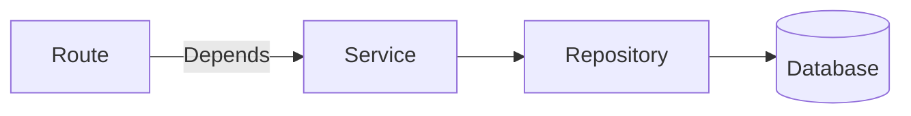
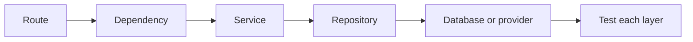

# Dependency Injection And Application Layers

## The big idea in plain words {#picture}

A restaurant has roles: a waiter (takes orders), a chef (cooks), and a pantry helper (fetches ingredients). FastAPI apps work best with the same split: **routes** talk to the web, **services** apply the rules, and **repositories** talk to the database.

FastAPI also has a neat helper called **dependency injection**: instead of each route building the things it needs, you declare what you need with `Depends(...)`, and FastAPI hands it over, just like a waiter who says "I need a chef" and one appears.



## What you will be able to do {#outcomes}

By the end of this lesson you will be able to:

- Split code into routes, services, and repositories.
- Use `Depends` to get a service or a database session.
- Override a dependency in tests.

## Words to know {#vocabulary}

- **dependency injection**: giving a function the things it needs instead of making them inside.
- **Depends**: FastAPI's way to ask for a dependency.
- **service**: the part that holds business rules.
- **repository**: the part that reads and writes data.
- **layer**: one level with one job.
- **override**: replace a dependency, usually in a test.

## Why this idea exists {#history}

If routes contain SQL and rules, you cannot test the rules without starting everything. Layers and injection make each part small and replaceable.

## Concept 1: Three layers {#concept-1}

The **route** receives the request and returns the reply. The **service** decides: "is the title valid? is this a duplicate?". The **repository** knows SQL. Each layer only calls the one below it.

## Concept 2: Depends hands things over {#concept-2}

```python
def get_service() -> NoteService:
    return NoteService(SqliteNoteRepository())

@app.get("/notes/{id}")
def read(id: int, service: NoteService = Depends(get_service)):
    return service.find(id)
```
The route asks for a `service`. FastAPI calls `get_service()` and passes the result in. The route never builds it.

## Concept 3: Swap parts in tests {#concept-3}

```python
app.dependency_overrides[get_service] = lambda: NoteService(FakeRepository())
```
In a test, tell FastAPI to use a fake repository. Now the route runs against a list in memory, with no database. Fast and safe.

## Concept 4: Own your transactions {#concept-4}

One request should use one database session, opened at the start and closed (or rolled back) at the end. Dependencies can do this with `yield`: set up, give it to the route, then clean up afterwards. This is better than opening connections everywhere.

## Why layers help {#example}

Your boss says: "Titles must not be longer than 80 characters." You change one line in the service. The route and repository do not change. A test for the service runs in one millisecond using a fake repository.

## Going deeper: the technical walkthrough {#walkthrough}

### Keep the layers understandable


Use this dependency direction:

```text
HTTP route -> service -> repository -> database or external API
```

- The route translates HTTP and declares request/response models.
- The service applies business rules and transaction decisions.
- The repository reads and writes data.
- The database stores durable records.

Do not let a route concatenate SQL. Do not let a browser receive database
credentials. Do not let a model invent a folder, SQL statement, or permission.


## Worked scenario {#worked-scenario}

You want to test your service while the PostgreSQL database is switched off. What helps?

The justified choice is **Give the service an in-memory stand-in for its repository**. Select **inject-repository** in the structured practical and explain why. Alternatives ignore a requirement, cross a trust boundary, or invent success.

### Structured decision contract

```json

{
  "decision": "inject-repository",
  "justification": "The interface and adapter boundary must preserve the declared contract and ownership.",
  "failureBehavior": "Expose a safe failure and recover through the boundary owner."
}

```

Decision selects one declared behavior. Justification explains the boundary. FailureBehavior explains the observable error and recovery owner. These fields never execute commands. Required terms and minimum lengths form a basic practice rubric, not semantic grading.

## Step-by-step flow and matching picture {#flow}




## Three real-life uses {#use-cases}

1. A service that is shared by a web route and a command-line tool.
2. A test that replaces the real database with an in-memory fake.
3. A dependency that checks the login and gives the route the current user.

## What can go wrong, and how to stay safe {#failure-security}

Mistakes: SQL inside routes, business rules inside repositories, global variables for the database, and a service that imports FastAPI (so it can no longer be tested alone). If a layer knows about two other layers, it is probably doing too much.

## Practice lab and expected observation {#practice}

1. Predict the scenario decision before opening Practical. Explain each rejected alternative.
2. Run a relevant example above in an isolated exercise project. Record the expected result, then change one input to an invalid or boundary value. A failed assertion or deliberate error should replace silent success.
3. Submit the structured decision. Initially the checks fail. After selecting inject-repository and writing an explanation and failure plan, all three pass. Follow the indicated review section for missed checks.

### Broken example to debug

```json

{"decision":"trust-client","justification":"","failureBehavior":""}

```

This ignores the responsible boundary and gives no reasoning or recovery. Correct the fields rather than changing the validator.

## Checkpoint and definition of done {#checkpoint}

- [ ] Define interface and adapter without looking.
- [ ] Trace input to owner and output.
- [ ] Explain one failure and one alternative.
- [ ] Pass at least four assignment questions.
- [ ] Pass every practical check and submit.
- [ ] Explain the concept again tomorrow.

## Sources, versions, and safe commands {#sources}

Python 3.11+; examples use Python 3.11 syntax and Pydantic 2 conventions. Review date: 2026-10-02. The supplied blueprint is the teaching source; official landing pages were checked where reachable. No provider or original TM Schedule deployment was tested.

- [Official reference](https://docs.python.org/3/tutorial/)

- [Official reference](https://fastapi.tiangolo.com/tutorial/)

[Course reading order](README.md) · [Previous lesson](13-pydantic-validation-and-schemas.md) · [Next lesson](15-routing-query-path-and-body-inputs.md)

```study-quiz

{
  "schemaVersion": 1,
  "lessonId": "python-first-api/14-dependency-injection-and-application-layers",
  "title": "Assignment: Dependency Injection And Application Layers",
  "passPercentage": 80,
  "questions": [
    {
      "id": "q1",
      "sectionId": "concept-1",
      "prompt": "In Dependency Injection And Application Layers, what does interface mean?",
      "options": [
        {
          "id": "a",
          "text": "A permission granted by a hidden browser control",
          "explanation": "This changes the declared meaning or bypasses the responsible boundary."
        },
        {
          "id": "b",
          "text": "An unlimited provider operation with no ownership",
          "explanation": "This changes the declared meaning or bypasses the responsible boundary."
        },
        {
          "id": "c",
          "text": "a list of actions that something promises to offer",
          "explanation": "This preserves the definition and boundary described in the lesson."
        },
        {
          "id": "d",
          "text": "A diagnostic credential intended for public logs",
          "explanation": "This changes the declared meaning or bypasses the responsible boundary."
        }
      ],
      "correctOptionId": "c",
      "explanation": "interface means a list of actions that something promises to offer.",
      "reviewLabel": "Review concept 1"
    },
    {
      "id": "q2",
      "sectionId": "concept-2",
      "prompt": "In Dependency Injection And Application Layers, which rule is correct for checkpoint 2?",
      "options": [
        {
          "id": "a",
          "text": "Trust client-side checks instead of the server rule.",
          "explanation": "This changes the declared meaning or bypasses the responsible boundary."
        },
        {
          "id": "b",
          "text": "Hide the failure by returning a fabricated successful result.",
          "explanation": "This changes the declared meaning or bypasses the responsible boundary."
        },
        {
          "id": "c",
          "text": "Skip the stated boundary, limit, or ownership check.",
          "explanation": "This changes the declared meaning or bypasses the responsible boundary."
        },
        {
          "id": "d",
          "text": "A fake in-memory version is handy for fast, safe tests.",
          "explanation": "This preserves the definition and boundary described in the lesson."
        }
      ],
      "correctOptionId": "d",
      "explanation": "A fake in-memory version is handy for fast, safe tests.",
      "reviewLabel": "Review concept 2"
    },
    {
      "id": "q3",
      "sectionId": "concept-3",
      "prompt": "In Dependency Injection And Application Layers, which rule is correct for checkpoint 3?",
      "options": [
        {
          "id": "a",
          "text": "A real database version must behave the same way as the fake one.",
          "explanation": "This preserves the definition and boundary described in the lesson."
        },
        {
          "id": "b",
          "text": "Trust client-side checks instead of the server rule.",
          "explanation": "This changes the declared meaning or bypasses the responsible boundary."
        },
        {
          "id": "c",
          "text": "Hide the failure by returning a fabricated successful result.",
          "explanation": "This changes the declared meaning or bypasses the responsible boundary."
        },
        {
          "id": "d",
          "text": "Skip the stated boundary, limit, or ownership check.",
          "explanation": "This changes the declared meaning or bypasses the responsible boundary."
        }
      ],
      "correctOptionId": "a",
      "explanation": "A real database version must behave the same way as the fake one.",
      "reviewLabel": "Review concept 3"
    },
    {
      "id": "q4",
      "sectionId": "concept-4",
      "prompt": "In Dependency Injection And Application Layers, which rule is correct for checkpoint 4?",
      "options": [
        {
          "id": "a",
          "text": "Trust client-side checks instead of the server rule.",
          "explanation": "This changes the declared meaning or bypasses the responsible boundary."
        },
        {
          "id": "b",
          "text": "A test double stands in for the outside world, not for the rule you are testing.",
          "explanation": "This preserves the definition and boundary described in the lesson."
        },
        {
          "id": "c",
          "text": "Hide the failure by returning a fabricated successful result.",
          "explanation": "This changes the declared meaning or bypasses the responsible boundary."
        },
        {
          "id": "d",
          "text": "Skip the stated boundary, limit, or ownership check.",
          "explanation": "This changes the declared meaning or bypasses the responsible boundary."
        }
      ],
      "correctOptionId": "b",
      "explanation": "A test double stands in for the outside world, not for the rule you are testing.",
      "reviewLabel": "Review concept 4"
    },
    {
      "id": "q5",
      "sectionId": "worked-scenario",
      "prompt": "You want to test your service while the PostgreSQL database is switched off. What helps?",
      "options": [
        {
          "id": "a",
          "text": "Catch every error and pretend the catalog is empty",
          "explanation": "This changes the declared meaning or bypasses the responsible boundary."
        },
        {
          "id": "b",
          "text": "Put the database password inside the test",
          "explanation": "This changes the declared meaning or bypasses the responsible boundary."
        },
        {
          "id": "c",
          "text": "Give the service an in-memory stand-in for its repository",
          "explanation": "This preserves the definition and boundary described in the lesson."
        },
        {
          "id": "d",
          "text": "Delete the service rules",
          "explanation": "This changes the declared meaning or bypasses the responsible boundary."
        }
      ],
      "correctOptionId": "c",
      "explanation": "Give the service an in-memory stand-in for its repository. An interface cannot fix pieces that behave differently from the promise.",
      "reviewLabel": "Review the worked scenario"
    }
  ]
}

```

```study-practical

{
  "schemaVersion": 1,
  "challengeId": "python-first-api/14-dependency-injection-and-application-layers/decision",
  "lessonId": "python-first-api/14-dependency-injection-and-application-layers",
  "title": "Practical: Dependency Injection And Application Layers",
  "language": "json",
  "mode": "structured",
  "instructions": "You want to test your service while the PostgreSQL database is switched off. What helps? Return an object with decision (choose from inject-repository, skip-check, unbounded-work, trust-client), justification (at least 40 characters; include interface and adapter), and failureBehavior (at least 25 characters; include failure and recover while explaining the error and recovery). These are structured reasoning checks, not code execution or an official grade.",
  "starterCode": "{\n  \"decision\": \"\",\n  \"justification\": \"\",\n  \"failureBehavior\": \"\"\n}",
  "entryPoint": "answer",
  "publicExamples": [
    {
      "input": {
        "decision": "skip-check",
        "justification": "",
        "failureBehavior": ""
      },
      "expected": {
        "passed": false
      }
    },
    {
      "input": {
        "decision": "inject-repository",
        "justification": "The interface and adapter boundary must preserve the declared contract and ownership.",
        "failureBehavior": "Show a safe failure and recover through the responsible owner."
      },
      "expected": {
        "passed": true
      }
    }
  ],
  "publicTestIds": [
    "decision",
    "explanation",
    "failure-plan"
  ],
  "reviewSections": {
    "decision": "worked-scenario",
    "explanation": "concept-2",
    "failure-plan": "failure-security"
  },
  "limits": {
    "timeMs": 2000,
    "memoryMb": 128,
    "outputBytes": 20000
  }
}

```

