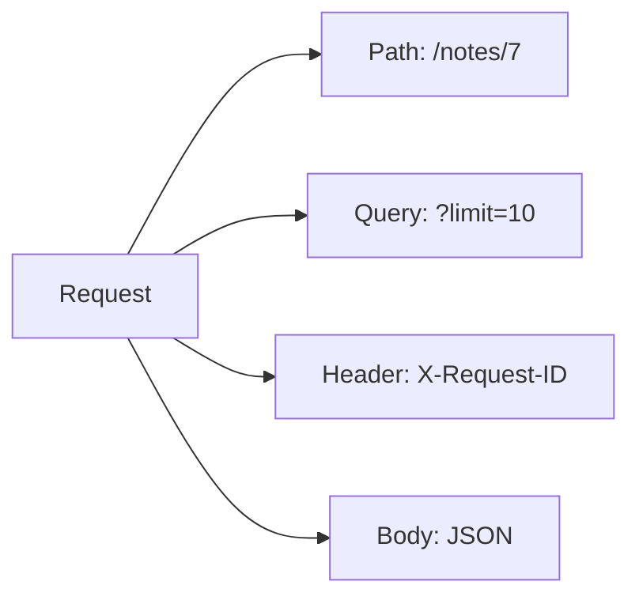
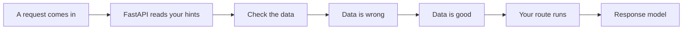
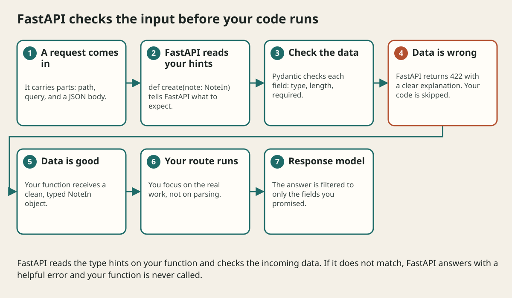

# Routing Query Path And Body Inputs

## The big idea in plain words {#picture}

A request carries information in several places, like a package with a label, a note on the outside, and a letter inside. FastAPI can read each place for you: the **path** (`/notes/7`), the **query** (`?limit=10`), the **headers**, and the **body** (JSON).

You just name the parameter and give it a type. FastAPI looks in the right place, converts the value, and refuses bad input.



## What you will be able to do {#outcomes}

By the end of this lesson you will be able to:

- Read path, query, header, and body inputs.
- Add pagination, filters, and sorting.
- Limit input sizes and think about API versions.

## Words to know {#vocabulary}

- **path parameter**: a variable part of the URL, like the 7 in `/notes/7`.
- **query parameter**: an option after `?`, like `limit=10`.
- **header**: extra information on the request.
- **body**: the main JSON content.
- **pagination**: giving long lists in small pages.
- **versioning**: putting `/v1/` in the path to allow changes later.

## Why this idea exists {#history}

Clients need many ways to say what they want. Putting each kind of information in its proper place keeps APIs predictable.

## Concept 1: Path and query {#concept-1}

```python
@app.get("/notes/{note_id}")
def get_note(note_id: int): ...

@app.get("/notes")
def list_notes(limit: int = 20, offset: int = 0): ...
```
`note_id` comes from the path and must be a whole number. `limit` and `offset` come from the query, with defaults. `GET /notes?limit=5&offset=10` works.

## Concept 2: Body and headers {#concept-2}

```python
@app.post("/notes")
def create(note: NoteIn, x_request_id: str | None = Header(default=None)): ...
```
A Pydantic model parameter is read from the JSON body. `Header(...)` reads a header. FastAPI knows where to look by the kind of parameter.

## Concept 3: Bound everything {#concept-3}

Always limit page size: `limit: int = Query(20, ge=1, le=100)` means between 1 and 100. Without a limit, someone asks for a million rows and your server struggles. Sort in a steady order so pages do not overlap.

## Concept 4: Version your API {#concept-4}

Put a version in the path, like `/v1/notes`. Later, `/v2/notes` can change things without breaking apps that still use v1. Add new fields freely, but removing or renaming is a breaking change.

## Filtered list {#example}

```python
@app.get("/v1/notes")
def list_notes(q: str | None = None, limit: int = Query(20, le=100)):
    return service.search(q, limit)
```
`GET /v1/notes?q=math&limit=5` returns up to 5 notes that match "math".

## Going deeper: the technical walkthrough {#walkthrough}

### Query parameters, pagination, and filtering


A list endpoint must have a limit so one request cannot accidentally load an
unbounded collection.

```python
from fastapi import Query


@app.get("/notes", response_model=list[Note])
def list_notes(
    topic: str | None = None,
    limit: int = Query(default=20, ge=1, le=100),
    offset: int = Query(default=0, ge=0),
) -> list[Note]:
    values = list(notes.values())
    if topic is not None:
        values = [note for note in values if note.topic == topic]
    return values[offset : offset + limit]
```

For a real database, use an indexed query and a stable ordering. Do not fetch
every row and filter a million records in Python.


## Worked scenario {#worked-scenario}

A client wants a page of notes and must not change anything. Which request fits?

The justified choice is **GET /notes?limit=20 returning a limited list**. Select **bounded-get** in the structured practical and explain why. Alternatives ignore a requirement, cross a trust boundary, or invent success.

### Structured decision contract

```json

{
  "decision": "bounded-get",
  "justification": "The method and header boundary must preserve the declared contract and ownership.",
  "failureBehavior": "Expose a safe failure and recover through the boundary owner."
}

```

Decision selects one declared behavior. Justification explains the boundary. FailureBehavior explains the observable error and recovery owner. These fields never execute commands. Required terms and minimum lengths form a basic practice rubric, not semantic grading.

## Step-by-step flow and matching picture {#flow}





## Three real-life uses {#use-cases}

1. A shop that lists products 20 at a time with `?page=2`.
2. A notes search that uses `?q=word`.
3. A mobile app that stays on `/v1` while a new `/v2` is tested.

## What can go wrong, and how to stay safe {#failure-security}

Mistakes: no limit on page size, putting secrets in query strings, changing the meaning of a field without a new version, and mixing up path and query (the path says *which one*, the query says *how to show*).

## Practice lab and expected observation {#practice}

1. Predict the scenario decision before opening Practical. Explain each rejected alternative.
2. Run a relevant example above in an isolated exercise project. Record the expected result, then change one input to an invalid or boundary value. A failed assertion or deliberate error should replace silent success.
3. Submit the structured decision. Initially the checks fail. After selecting bounded-get and writing an explanation and failure plan, all three pass. Follow the indicated review section for missed checks.

### Broken example to debug

```json

{"decision":"trust-client","justification":"","failureBehavior":""}

```

This ignores the responsible boundary and gives no reasoning or recovery. Correct the fields rather than changing the validator.

## Checkpoint and definition of done {#checkpoint}

- [ ] Define method and header without looking.
- [ ] Trace input to owner and output.
- [ ] Explain one failure and one alternative.
- [ ] Pass at least four assignment questions.
- [ ] Pass every practical check and submit.
- [ ] Explain the concept again tomorrow.

## Sources, versions, and safe commands {#sources}

Python 3.11+; examples use Python 3.11 syntax and Pydantic 2 conventions. Review date: 2026-10-02. The supplied blueprint is the teaching source; official landing pages were checked where reachable. No provider or original TM Schedule deployment was tested.

- [Official reference](https://docs.python.org/3/tutorial/)

- [Official reference](https://fastapi.tiangolo.com/tutorial/)

[Course reading order](README.md) · [Previous lesson](14-dependency-injection-and-application-layers.md) · [Next lesson](16-crud-services-and-safe-errors.md)

```study-quiz

{
  "schemaVersion": 1,
  "lessonId": "python-first-api/15-routing-query-path-and-body-inputs",
  "title": "Assignment: Routing Query Path And Body Inputs",
  "passPercentage": 80,
  "questions": [
    {
      "id": "q1",
      "sectionId": "concept-1",
      "prompt": "In Routing Query Path And Body Inputs, what does method mean?",
      "options": [
        {
          "id": "a",
          "text": "A permission granted by a hidden browser control",
          "explanation": "This changes the declared meaning or bypasses the responsible boundary."
        },
        {
          "id": "b",
          "text": "An unlimited provider operation with no ownership",
          "explanation": "This changes the declared meaning or bypasses the responsible boundary."
        },
        {
          "id": "c",
          "text": "A diagnostic credential intended for public logs",
          "explanation": "This changes the declared meaning or bypasses the responsible boundary."
        },
        {
          "id": "d",
          "text": "the action word of a request, like GET or POST",
          "explanation": "This preserves the definition and boundary described in the lesson."
        }
      ],
      "correctOptionId": "d",
      "explanation": "method means the action word of a request, like GET or POST.",
      "reviewLabel": "Review concept 1"
    },
    {
      "id": "q2",
      "sectionId": "concept-2",
      "prompt": "In Routing Query Path And Body Inputs, which rule is correct for checkpoint 2?",
      "options": [
        {
          "id": "a",
          "text": "Creating something with POST usually answers 201 and points to the new item.",
          "explanation": "This preserves the definition and boundary described in the lesson."
        },
        {
          "id": "b",
          "text": "Trust client-side checks instead of the server rule.",
          "explanation": "This changes the declared meaning or bypasses the responsible boundary."
        },
        {
          "id": "c",
          "text": "Hide the failure by returning a fabricated successful result.",
          "explanation": "This changes the declared meaning or bypasses the responsible boundary."
        },
        {
          "id": "d",
          "text": "Skip the stated boundary, limit, or ownership check.",
          "explanation": "This changes the declared meaning or bypasses the responsible boundary."
        }
      ],
      "correctOptionId": "a",
      "explanation": "Creating something with POST usually answers 201 and points to the new item.",
      "reviewLabel": "Review concept 2"
    },
    {
      "id": "q3",
      "sectionId": "concept-3",
      "prompt": "In Routing Query Path And Body Inputs, which rule is correct for checkpoint 3?",
      "options": [
        {
          "id": "a",
          "text": "Trust client-side checks instead of the server rule.",
          "explanation": "This changes the declared meaning or bypasses the responsible boundary."
        },
        {
          "id": "b",
          "text": "Content-Type tells what kind of data is in the body.",
          "explanation": "This preserves the definition and boundary described in the lesson."
        },
        {
          "id": "c",
          "text": "Hide the failure by returning a fabricated successful result.",
          "explanation": "This changes the declared meaning or bypasses the responsible boundary."
        },
        {
          "id": "d",
          "text": "Skip the stated boundary, limit, or ownership check.",
          "explanation": "This changes the declared meaning or bypasses the responsible boundary."
        }
      ],
      "correctOptionId": "b",
      "explanation": "Content-Type tells what kind of data is in the body.",
      "reviewLabel": "Review concept 3"
    },
    {
      "id": "q4",
      "sectionId": "concept-4",
      "prompt": "In Routing Query Path And Body Inputs, which rule is correct for checkpoint 4?",
      "options": [
        {
          "id": "a",
          "text": "Trust client-side checks instead of the server rule.",
          "explanation": "This changes the declared meaning or bypasses the responsible boundary."
        },
        {
          "id": "b",
          "text": "Hide the failure by returning a fabricated successful result.",
          "explanation": "This changes the declared meaning or bypasses the responsible boundary."
        },
        {
          "id": "c",
          "text": "Before retrying a write, decide how to avoid doing it twice.",
          "explanation": "This preserves the definition and boundary described in the lesson."
        },
        {
          "id": "d",
          "text": "Skip the stated boundary, limit, or ownership check.",
          "explanation": "This changes the declared meaning or bypasses the responsible boundary."
        }
      ],
      "correctOptionId": "c",
      "explanation": "Before retrying a write, decide how to avoid doing it twice.",
      "reviewLabel": "Review concept 4"
    },
    {
      "id": "q5",
      "sectionId": "worked-scenario",
      "prompt": "A client wants a page of notes and must not change anything. Which request fits?",
      "options": [
        {
          "id": "a",
          "text": "POST /delete-everything",
          "explanation": "This changes the declared meaning or bypasses the responsible boundary."
        },
        {
          "id": "b",
          "text": "A GET that secretly changes data",
          "explanation": "This changes the declared meaning or bypasses the responsible boundary."
        },
        {
          "id": "c",
          "text": "A database password inside the URL",
          "explanation": "This changes the declared meaning or bypasses the responsible boundary."
        },
        {
          "id": "d",
          "text": "GET /notes?limit=20 returning a limited list",
          "explanation": "This preserves the definition and boundary described in the lesson."
        }
      ],
      "correctOptionId": "d",
      "explanation": "GET /notes?limit=20 returning a limited list. A list answer should be a limited page in a steady order.",
      "reviewLabel": "Review the worked scenario"
    }
  ]
}

```

```study-practical

{
  "schemaVersion": 1,
  "challengeId": "python-first-api/15-routing-query-path-and-body-inputs/decision",
  "lessonId": "python-first-api/15-routing-query-path-and-body-inputs",
  "title": "Practical: Routing Query Path And Body Inputs",
  "language": "json",
  "mode": "structured",
  "instructions": "A client wants a page of notes and must not change anything. Which request fits? Return an object with decision (choose from bounded-get, skip-check, unbounded-work, trust-client), justification (at least 40 characters; include method and header), and failureBehavior (at least 25 characters; include failure and recover while explaining the error and recovery). These are structured reasoning checks, not code execution or an official grade.",
  "starterCode": "{\n  \"decision\": \"\",\n  \"justification\": \"\",\n  \"failureBehavior\": \"\"\n}",
  "entryPoint": "answer",
  "publicExamples": [
    {
      "input": {
        "decision": "skip-check",
        "justification": "",
        "failureBehavior": ""
      },
      "expected": {
        "passed": false
      }
    },
    {
      "input": {
        "decision": "bounded-get",
        "justification": "The method and header boundary must preserve the declared contract and ownership.",
        "failureBehavior": "Show a safe failure and recover through the responsible owner."
      },
      "expected": {
        "passed": true
      }
    }
  ],
  "publicTestIds": [
    "decision",
    "explanation",
    "failure-plan"
  ],
  "reviewSections": {
    "decision": "worked-scenario",
    "explanation": "concept-2",
    "failure-plan": "failure-security"
  },
  "limits": {
    "timeMs": 2000,
    "memoryMb": 128,
    "outputBytes": 20000
  }
}

```

