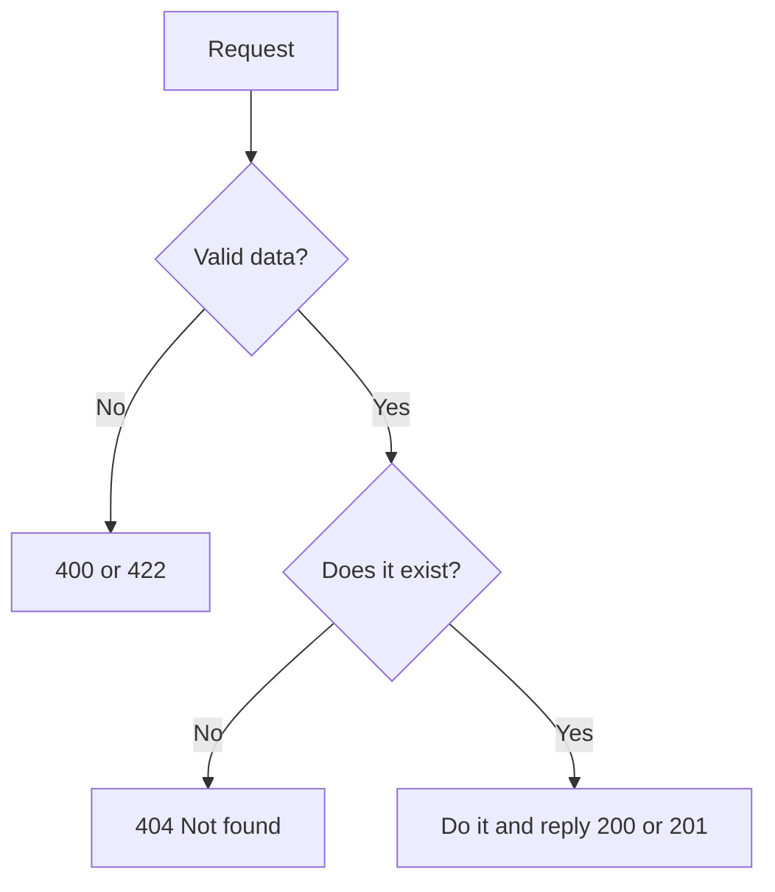
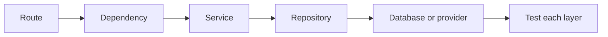
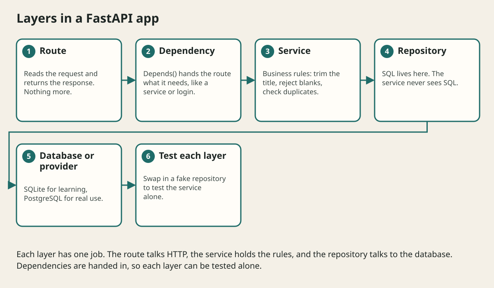

# Crud Services And Safe Errors

## The big idea in plain words {#picture}

CRUD stands for Create, Read, Update, Delete. These four actions are the heart of most apps: add a note, look at notes, edit a note, remove a note. In this lesson we build all four, and we plan carefully for the sad cases: the note is not there, the title is a duplicate, or something unexpected breaks.

Good APIs speak clearly even when things go wrong. They use the right status code, a short message, and a code that machines can understand.



## What you will be able to do {#outcomes}

By the end of this lesson you will be able to:

- Build create, read, update, and delete routes.
- Return not found, conflict, and unexpected errors safely.
- Add a request ID to every reply and log.

## Words to know {#vocabulary}

- **CRUD**: Create, Read, Update, Delete.
- **404**: not found.
- **409**: conflict, for example a duplicate title.
- **exception handler**: code that turns an exception into a reply.
- **request ID**: a unique number that follows one request.
- **normalization**: cleaning input into a standard form.

## Why this idea exists {#history}

CRUD is the foundation. Handling errors well is what separates a toy from something people can trust.

## Concept 1: The four routes {#concept-1}

`POST /notes` creates (201). `GET /notes/{id}` reads (200 or 404). `PUT` or `PATCH /notes/{id}` updates. `DELETE /notes/{id}` removes (204). Each route calls the service and nothing else.

## Concept 2: Clean input first {#concept-2}

Trim the title before checking it. `"  Math  "` becomes `"Math"`; `"   "` becomes `""` and is refused. Do this once in the service, so every route behaves the same.

## Concept 3: Specific errors {#concept-3}

Define your own errors: `NoteNotFound`, `DuplicateTitle`. A handler turns each into a reply: 404 and 409. For anything unexpected, return a general 500 with a request ID, and put the real details in the private log. Never show a stack trace.

## Concept 4: Request IDs {#concept-4}

Give each request an ID (a middleware can do this) and put it in the response header and in every log line. When a user says "it failed", they give you the ID and you find the exact story in seconds.

## A duplicate title {#example}

```python
@app.exception_handler(DuplicateTitle)
def handle_duplicate(request, exc):
    return JSONResponse(status_code=409, content={"code": "duplicate_title", "message": "A note with this title already exists."})
```
The client sees a clear 409 with a steady code `duplicate_title`, which the app can use to show a friendly message.

## Going deeper: the technical walkthrough {#walkthrough}

### CRUD with a small repository


```python
from fastapi import HTTPException

notes: dict[int, Note] = {}
next_id = 1


@app.get("/notes", response_model=list[Note])
def list_notes() -> list[Note]:
    return list(notes.values())


@app.post("/notes", response_model=Note, status_code=201)
def create_note(request: NoteCreate) -> Note:
    global next_id
    note = Note(id=next_id, **request.model_dump())
    notes[next_id] = note
    next_id += 1
    return note


@app.get("/notes/{note_id}", response_model=Note)
def get_note(note_id: int) -> Note:
    note = notes.get(note_id)
    if note is None:
        raise HTTPException(status_code=404, detail="Note not found")
    return note
```

This is useful for the first lesson, but global mutable state is not a durable
production store. A later version should inject a repository and use a database.


### Errors and safe boundaries


Create a stable error shape such as:

```json
{
  "message": "The note was not found.",
  "code": "NOTE_NOT_FOUND",
  "requestId": "request-123"
}
```

Map errors deliberately:

- malformed input: `400`;
- missing authentication: `401`;
- insufficient permission: `403`;
- missing note: `404`;
- duplicate resource: `409`;
- too much input: `413`;
- dependency outage: `503`;
- unexpected failure: generic `500`.

Do not return `str(exception)` when it can contain a filesystem path, SQL,
provider response, or secret. Log diagnostic details on the server with a
request ID and redact private values.


## Worked scenario {#worked-scenario}

A database error includes a private file path. What should the API send back?

The justified choice is **A general safe error with a steady code and a request ID**. Select **safe-error** in the structured practical and explain why. Alternatives ignore a requirement, cross a trust boundary, or invent success.

### Structured decision contract

```json

{
  "decision": "safe-error",
  "justification": "The exception and safeError boundary must preserve the declared contract and ownership.",
  "failureBehavior": "Expose a safe failure and recover through the boundary owner."
}

```

Decision selects one declared behavior. Justification explains the boundary. FailureBehavior explains the observable error and recovery owner. These fields never execute commands. Required terms and minimum lengths form a basic practice rubric, not semantic grading.

## Step-by-step flow and matching picture {#flow}





## Three real-life uses {#use-cases}

1. A notes app with add, list, edit, and delete.
2. A signup route that returns 409 when the email is already used.
3. A support team that asks for the request ID to find a problem.

## What can go wrong, and how to stay safe {#failure-security}

Mistakes: replying 200 with an error message inside, one catch-all error for everything, leaking exception text, and forgetting that "delete twice" should still behave sensibly. Decide: is the second delete a 404 or also a success? Write it down.

## Practice lab and expected observation {#practice}

Implement classify to return read for GET, write for POST/PUT/PATCH/DELETE, and unsupported for any other method. The input contract uses uppercase method strings. Do not perform an actual HTTP request.

The language starter and public examples appear in Practical. Run is unavailable until a trusted isolated worker is configured. Reading and assignment review still work; this lesson does not claim code-test completion.

1. Predict the scenario decision before opening Practical. Explain each rejected alternative.
2. Run a relevant example above in an isolated exercise project. Record the expected result, then change one input to an invalid or boundary value. A failed assertion or deliberate error should replace silent success.
3. Submit the structured decision. Initially the checks fail. After selecting safe-error and writing an explanation and failure plan, all three pass. Follow the indicated review section for missed checks.

### Broken example to debug

```json

{"decision":"trust-client","justification":"","failureBehavior":""}

```

This ignores the responsible boundary and gives no reasoning or recovery. Correct the fields rather than changing the validator.

## Checkpoint and definition of done {#checkpoint}

- [ ] Define exception and safeError without looking.
- [ ] Trace input to owner and output.
- [ ] Explain one failure and one alternative.
- [ ] Pass at least four assignment questions.
- [ ] Pass every practical check and submit.
- [ ] Explain the concept again tomorrow.

## Sources, versions, and safe commands {#sources}

Python 3.11+; examples use Python 3.11 syntax and Pydantic 2 conventions. Review date: 2026-10-02. The supplied blueprint is the teaching source; official landing pages were checked where reachable. No provider or original TM Schedule deployment was tested.

- [Official reference](https://docs.python.org/3/tutorial/)

- [Official reference](https://fastapi.tiangolo.com/tutorial/)

[Course reading order](README.md) · [Previous lesson](15-routing-query-path-and-body-inputs.md) · [Next lesson](17-sqlite-sql-and-repository-boundaries.md)

```study-quiz

{
  "schemaVersion": 1,
  "lessonId": "python-first-api/16-crud-services-and-safe-errors",
  "title": "Assignment: Crud Services And Safe Errors",
  "passPercentage": 80,
  "questions": [
    {
      "id": "q1",
      "sectionId": "concept-1",
      "prompt": "In Crud Services And Safe Errors, what does exception mean?",
      "options": [
        {
          "id": "a",
          "text": "a problem that interrupts the normal flow of a program",
          "explanation": "This preserves the definition and boundary described in the lesson."
        },
        {
          "id": "b",
          "text": "A permission granted by a hidden browser control",
          "explanation": "This changes the declared meaning or bypasses the responsible boundary."
        },
        {
          "id": "c",
          "text": "An unlimited provider operation with no ownership",
          "explanation": "This changes the declared meaning or bypasses the responsible boundary."
        },
        {
          "id": "d",
          "text": "A diagnostic credential intended for public logs",
          "explanation": "This changes the declared meaning or bypasses the responsible boundary."
        }
      ],
      "correctOptionId": "a",
      "explanation": "exception means a problem that interrupts the normal flow of a program.",
      "reviewLabel": "Review concept 1"
    },
    {
      "id": "q2",
      "sectionId": "concept-2",
      "prompt": "In Crud Services And Safe Errors, which rule is correct for checkpoint 2?",
      "options": [
        {
          "id": "a",
          "text": "Trust client-side checks instead of the server rule.",
          "explanation": "This changes the declared meaning or bypasses the responsible boundary."
        },
        {
          "id": "b",
          "text": "A validation problem must never turn into a fake success.",
          "explanation": "This preserves the definition and boundary described in the lesson."
        },
        {
          "id": "c",
          "text": "Hide the failure by returning a fabricated successful result.",
          "explanation": "This changes the declared meaning or bypasses the responsible boundary."
        },
        {
          "id": "d",
          "text": "Skip the stated boundary, limit, or ownership check.",
          "explanation": "This changes the declared meaning or bypasses the responsible boundary."
        }
      ],
      "correctOptionId": "b",
      "explanation": "A validation problem must never turn into a fake success.",
      "reviewLabel": "Review concept 2"
    },
    {
      "id": "q3",
      "sectionId": "concept-3",
      "prompt": "In Crud Services And Safe Errors, which rule is correct for checkpoint 3?",
      "options": [
        {
          "id": "a",
          "text": "Trust client-side checks instead of the server rule.",
          "explanation": "This changes the declared meaning or bypasses the responsible boundary."
        },
        {
          "id": "b",
          "text": "Hide the failure by returning a fabricated successful result.",
          "explanation": "This changes the declared meaning or bypasses the responsible boundary."
        },
        {
          "id": "c",
          "text": "Whoever opens a resource must close it, even when something fails.",
          "explanation": "This preserves the definition and boundary described in the lesson."
        },
        {
          "id": "d",
          "text": "Skip the stated boundary, limit, or ownership check.",
          "explanation": "This changes the declared meaning or bypasses the responsible boundary."
        }
      ],
      "correctOptionId": "c",
      "explanation": "Whoever opens a resource must close it, even when something fails.",
      "reviewLabel": "Review concept 3"
    },
    {
      "id": "q4",
      "sectionId": "concept-4",
      "prompt": "In Crud Services And Safe Errors, which rule is correct for checkpoint 4?",
      "options": [
        {
          "id": "a",
          "text": "Trust client-side checks instead of the server rule.",
          "explanation": "This changes the declared meaning or bypasses the responsible boundary."
        },
        {
          "id": "b",
          "text": "Hide the failure by returning a fabricated successful result.",
          "explanation": "This changes the declared meaning or bypasses the responsible boundary."
        },
        {
          "id": "c",
          "text": "Skip the stated boundary, limit, or ownership check.",
          "explanation": "This changes the declared meaning or bypasses the responsible boundary."
        },
        {
          "id": "d",
          "text": "Error messages for callers must not reveal SQL, file paths, secrets, or stack traces.",
          "explanation": "This preserves the definition and boundary described in the lesson."
        }
      ],
      "correctOptionId": "d",
      "explanation": "Error messages for callers must not reveal SQL, file paths, secrets, or stack traces.",
      "reviewLabel": "Review concept 4"
    },
    {
      "id": "q5",
      "sectionId": "worked-scenario",
      "prompt": "A database error includes a private file path. What should the API send back?",
      "options": [
        {
          "id": "a",
          "text": "A general safe error with a steady code and a request ID",
          "explanation": "This preserves the definition and boundary described in the lesson."
        },
        {
          "id": "b",
          "text": "The raw error text exactly as it came",
          "explanation": "This changes the declared meaning or bypasses the responsible boundary."
        },
        {
          "id": "c",
          "text": "An empty success answer",
          "explanation": "This changes the declared meaning or bypasses the responsible boundary."
        },
        {
          "id": "d",
          "text": "The private path, to help debugging",
          "explanation": "This changes the declared meaning or bypasses the responsible boundary."
        }
      ],
      "correctOptionId": "a",
      "explanation": "A general safe error with a steady code and a request ID. For surprises, send a general message and a request ID that your team can look up.",
      "reviewLabel": "Review the worked scenario"
    }
  ]
}

```

```study-practical

{
  "schemaVersion": 1,
  "challengeId": "python-first-api/16-crud-services-and-safe-errors/coding",
  "lessonId": "python-first-api/16-crud-services-and-safe-errors",
  "title": "Practical: Classify an HTTP method",
  "language": "python",
  "mode": "function",
  "instructions": "Implement classify to return read for GET, write for POST/PUT/PATCH/DELETE, and unsupported for any other method. The input contract uses uppercase method strings. Do not perform an actual HTTP request. A disposable isolated code runner is required; this installation never executes learner code on the host.",
  "starterCode": "def classify(method: str) -> str:\n    return ''\n",
  "entryPoint": "classify",
  "publicExamples": [
    {
      "input": "GET",
      "expected": "read"
    },
    {
      "input": "POST",
      "expected": "write"
    },
    {
      "input": "INVALID",
      "expected": "unsupported"
    }
  ],
  "publicTestIds": [
    "read-method",
    "write-methods",
    "invalid-method"
  ],
  "reviewSections": {
    "read-method": "worked-scenario",
    "write-methods": "worked-scenario",
    "invalid-method": "worked-scenario"
  },
  "limits": {
    "timeMs": 2000,
    "memoryMb": 128,
    "outputBytes": 20000
  }
}

```

