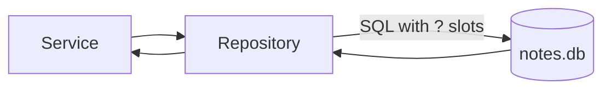
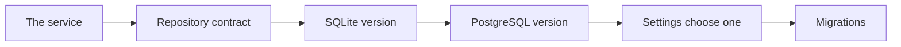

# Sqlite Sql And Repository Boundaries

## The big idea in plain words {#picture}

A database is a very organized filing cabinet. SQL is the language we use to ask it questions: "give me all notes where the title contains Math". SQLite is a tiny, friendly filing cabinet that lives in a single file on your computer, so you can learn without installing anything.

Rule number one: **never glue user text into a SQL command**. Always use `?` slots. It is the difference between a locked and an unlocked door.



## What you will be able to do {#outcomes}

By the end of this lesson you will be able to:

- Create a table and use `INSERT`, `SELECT`, `UPDATE`, and `DELETE`.
- Use parameters to avoid SQL injection.
- Keep SQL inside a repository and use transactions.

## Words to know {#vocabulary}

- **SQLite**: a small database stored in one file.
- **SQL**: the language for asking databases to store and find data.
- **table**: a grid of rows and columns.
- **index**: a quick-lookup list for a column.
- **parameter**: a safe slot (`?`) that holds a value.
- **transaction**: a group of changes that succeed or fail together.

## Why this idea exists {#history}

Data in a list or a variable disappears when the program stops. A database keeps it safe, lets many requests share it, and enforces rules.

## Concept 1: A table and basic SQL {#concept-1}

```sql
CREATE TABLE notes (
    id INTEGER PRIMARY KEY,
    title TEXT NOT NULL,
    body TEXT NOT NULL DEFAULT ''
);
INSERT INTO notes (title) VALUES (?);
SELECT id, title FROM notes WHERE id = ?;
```
`PRIMARY KEY` is the unique id. `NOT NULL` means the column must have a value. Those rules live in the database itself, so they hold even if the app has a bug.

## Concept 2: Use ? slots {#concept-2}

```python
cursor.execute("SELECT title FROM notes WHERE id = ?", (note_id,))
```
Never write `f"... WHERE id = {note_id}"`. If a user types `1 OR 1=1`, they might see everything. With `?`, the database knows the value is only data, never a command.

## Concept 3: Keep SQL in the repository {#concept-3}

```python
class NoteRepository:
    def find(self, note_id: int):
        row = self.conn.execute("SELECT id, title FROM notes WHERE id = ?", (note_id,)).fetchone()
        return None if row is None else Note(*row)
```
The service asks `repo.find(7)`, and never sees SQL. If you switch databases, only the repository changes.

## Concept 4: Transactions and indexes {#concept-4}

`with conn:` wraps changes in a transaction: success commits, a failure rolls back. Add an index on columns you search often, like `CREATE INDEX idx_notes_title ON notes(title);`. Indexes speed up searching but slow writes a little, so add only the ones you need.

## Save two things together {#example}

```python
with conn:
    conn.execute("INSERT INTO notes (title) VALUES (?)", (title,))
    conn.execute("INSERT INTO tags (note_id, tag) VALUES (?, ?)", (note_id, tag))
```
If the second insert fails, the first is undone. You never end up with a note that is half saved.

## Going deeper: the technical walkthrough {#walkthrough}

### Persistence choices


Start with a repository protocol:

```python
from typing import Protocol


class NoteRepository(Protocol):
    def list(self, limit: int, offset: int) -> list[Note]: ...
    def get(self, note_id: int) -> Note | None: ...
    def save(self, note: Note) -> Note: ...
```

SQLite is a good one-user local database. PostgreSQL is a better shared service
for concurrent clients, transactions, migrations, and future users. Store large
PDFs or images in files or private object storage; keep only metadata and a
relative key in the database.


### Focused implementation

A repository owns SQL and connection lifetime. Placeholders bind values, not SQL identifiers; choose identifiers from an allowlist. SQLite is useful for local teaching, with transactions and constraints. An in-memory database lives only as long as its connection, so connection ownership affects test correctness.

```python

import sqlite3

with sqlite3.connect(":memory:") as db:
    db.execute("CREATE TABLE notes(id INTEGER PRIMARY KEY, title TEXT NOT NULL)")
    db.execute("INSERT INTO notes(title) VALUES (?)", ("APIs",))
    title = db.execute("SELECT title FROM notes WHERE id = ?", (1,)).fetchone()[0]
    assert title == "APIs"
    print(title)

```

Read the imports, then the values and checks, then the operation, and finally the result or cleanup. Java Example programs compile as Example.java. Python uses Python 3.11+. JavaScript ESM runs as example.mjs. Framework snippets run inside the generated project.

## Worked scenario {#worked-scenario}

A note and its bookmark must be created together. How should storage behave?

The justified choice is **One transaction that undoes both if either fails**. Select **atomic-write** in the structured practical and explain why. Alternatives ignore a requirement, cross a trust boundary, or invent success.

### Structured decision contract

```json

{
  "decision": "atomic-write",
  "justification": "The transaction and index boundary must preserve the declared contract and ownership.",
  "failureBehavior": "Expose a safe failure and recover through the boundary owner."
}

```

Decision selects one declared behavior. Justification explains the boundary. FailureBehavior explains the observable error and recovery owner. These fields never execute commands. Required terms and minimum lengths form a basic practice rubric, not semantic grading.

## Step-by-step flow and matching picture {#flow}




## Three real-life uses {#use-cases}

1. A to-do app saves tasks in `todo.db`.
2. A test uses an in-memory SQLite database that disappears after the test.
3. A small site with one user saves data in a single file.

## What can go wrong, and how to stay safe {#failure-security}

Mistakes: building SQL by joining strings, keeping a connection open forever, sharing one connection between many threads without care, forgetting to commit, and putting SQL in routes. SQLite is great for learning and small apps. Bigger apps with many users usually move to PostgreSQL.

## Practice lab and expected observation {#practice}

1. Predict the scenario decision before opening Practical. Explain each rejected alternative.
2. Run a relevant example above in an isolated exercise project. Record the expected result, then change one input to an invalid or boundary value. A failed assertion or deliberate error should replace silent success.
3. Submit the structured decision. Initially the checks fail. After selecting atomic-write and writing an explanation and failure plan, all three pass. Follow the indicated review section for missed checks.

### Broken example to debug

```json

{"decision":"trust-client","justification":"","failureBehavior":""}

```

This ignores the responsible boundary and gives no reasoning or recovery. Correct the fields rather than changing the validator.

## Checkpoint and definition of done {#checkpoint}

- [ ] Define transaction and index without looking.
- [ ] Trace input to owner and output.
- [ ] Explain one failure and one alternative.
- [ ] Pass at least four assignment questions.
- [ ] Pass every practical check and submit.
- [ ] Explain the concept again tomorrow.

## Sources, versions, and safe commands {#sources}

Python 3.11+; examples use Python 3.11 syntax and Pydantic 2 conventions. Review date: 2026-10-02. The supplied blueprint is the teaching source; official landing pages were checked where reachable. No provider or original TM Schedule deployment was tested.

- [Official reference](https://docs.python.org/3/tutorial/)

- [Official reference](https://fastapi.tiangolo.com/tutorial/)

[Course reading order](README.md) · [Previous lesson](16-crud-services-and-safe-errors.md) · [Next lesson](18-postgresql-migrations-and-transactions.md)

```study-quiz

{
  "schemaVersion": 1,
  "lessonId": "python-first-api/17-sqlite-sql-and-repository-boundaries",
  "title": "Assignment: Sqlite Sql And Repository Boundaries",
  "passPercentage": 80,
  "questions": [
    {
      "id": "q1",
      "sectionId": "concept-1",
      "prompt": "In Sqlite Sql And Repository Boundaries, what does transaction mean?",
      "options": [
        {
          "id": "a",
          "text": "A permission granted by a hidden browser control",
          "explanation": "This changes the declared meaning or bypasses the responsible boundary."
        },
        {
          "id": "b",
          "text": "a group of changes that all succeed or all get undone",
          "explanation": "This preserves the definition and boundary described in the lesson."
        },
        {
          "id": "c",
          "text": "An unlimited provider operation with no ownership",
          "explanation": "This changes the declared meaning or bypasses the responsible boundary."
        },
        {
          "id": "d",
          "text": "A diagnostic credential intended for public logs",
          "explanation": "This changes the declared meaning or bypasses the responsible boundary."
        }
      ],
      "correctOptionId": "b",
      "explanation": "transaction means a group of changes that all succeed or all get undone.",
      "reviewLabel": "Review concept 1"
    },
    {
      "id": "q2",
      "sectionId": "concept-2",
      "prompt": "In Sqlite Sql And Repository Boundaries, which rule is correct for checkpoint 2?",
      "options": [
        {
          "id": "a",
          "text": "Trust client-side checks instead of the server rule.",
          "explanation": "This changes the declared meaning or bypasses the responsible boundary."
        },
        {
          "id": "b",
          "text": "Hide the failure by returning a fabricated successful result.",
          "explanation": "This changes the declared meaning or bypasses the responsible boundary."
        },
        {
          "id": "c",
          "text": "A database rule keeps data safe even when many writes happen at once.",
          "explanation": "This preserves the definition and boundary described in the lesson."
        },
        {
          "id": "d",
          "text": "Skip the stated boundary, limit, or ownership check.",
          "explanation": "This changes the declared meaning or bypasses the responsible boundary."
        }
      ],
      "correctOptionId": "c",
      "explanation": "A database rule keeps data safe even when many writes happen at once.",
      "reviewLabel": "Review concept 2"
    },
    {
      "id": "q3",
      "sectionId": "concept-3",
      "prompt": "In Sqlite Sql And Repository Boundaries, which rule is correct for checkpoint 3?",
      "options": [
        {
          "id": "a",
          "text": "Trust client-side checks instead of the server rule.",
          "explanation": "This changes the declared meaning or bypasses the responsible boundary."
        },
        {
          "id": "b",
          "text": "Hide the failure by returning a fabricated successful result.",
          "explanation": "This changes the declared meaning or bypasses the responsible boundary."
        },
        {
          "id": "c",
          "text": "Skip the stated boundary, limit, or ownership check.",
          "explanation": "This changes the declared meaning or bypasses the responsible boundary."
        },
        {
          "id": "d",
          "text": "An index speeds some reads but costs space and slows writes a little.",
          "explanation": "This preserves the definition and boundary described in the lesson."
        }
      ],
      "correctOptionId": "d",
      "explanation": "An index speeds some reads but costs space and slows writes a little.",
      "reviewLabel": "Review concept 3"
    },
    {
      "id": "q4",
      "sectionId": "concept-4",
      "prompt": "In Sqlite Sql And Repository Boundaries, which rule is correct for checkpoint 4?",
      "options": [
        {
          "id": "a",
          "text": "Give a borrowed connection back when the request ends.",
          "explanation": "This preserves the definition and boundary described in the lesson."
        },
        {
          "id": "b",
          "text": "Trust client-side checks instead of the server rule.",
          "explanation": "This changes the declared meaning or bypasses the responsible boundary."
        },
        {
          "id": "c",
          "text": "Hide the failure by returning a fabricated successful result.",
          "explanation": "This changes the declared meaning or bypasses the responsible boundary."
        },
        {
          "id": "d",
          "text": "Skip the stated boundary, limit, or ownership check.",
          "explanation": "This changes the declared meaning or bypasses the responsible boundary."
        }
      ],
      "correctOptionId": "a",
      "explanation": "Give a borrowed connection back when the request ends.",
      "reviewLabel": "Review concept 4"
    },
    {
      "id": "q5",
      "sectionId": "worked-scenario",
      "prompt": "A note and its bookmark must be created together. How should storage behave?",
      "options": [
        {
          "id": "a",
          "text": "Two separate writes with no recovery plan",
          "explanation": "This changes the declared meaning or bypasses the responsible boundary."
        },
        {
          "id": "b",
          "text": "One transaction that undoes both if either fails",
          "explanation": "This preserves the definition and boundary described in the lesson."
        },
        {
          "id": "c",
          "text": "Send the database password to the browser",
          "explanation": "This changes the declared meaning or bypasses the responsible boundary."
        },
        {
          "id": "d",
          "text": "A giant global list that only pretends to save",
          "explanation": "This changes the declared meaning or bypasses the responsible boundary."
        }
      ],
      "correctOptionId": "b",
      "explanation": "One transaction that undoes both if either fails. Keep big files outside the database rows and store only a pointer.",
      "reviewLabel": "Review the worked scenario"
    }
  ]
}

```

```study-practical

{
  "schemaVersion": 1,
  "challengeId": "python-first-api/17-sqlite-sql-and-repository-boundaries/decision",
  "lessonId": "python-first-api/17-sqlite-sql-and-repository-boundaries",
  "title": "Practical: Sqlite Sql And Repository Boundaries",
  "language": "json",
  "mode": "structured",
  "instructions": "A note and its bookmark must be created together. How should storage behave? Return an object with decision (choose from atomic-write, skip-check, unbounded-work, trust-client), justification (at least 40 characters; include transaction and index), and failureBehavior (at least 25 characters; include failure and recover while explaining the error and recovery). These are structured reasoning checks, not code execution or an official grade.",
  "starterCode": "{\n  \"decision\": \"\",\n  \"justification\": \"\",\n  \"failureBehavior\": \"\"\n}",
  "entryPoint": "answer",
  "publicExamples": [
    {
      "input": {
        "decision": "skip-check",
        "justification": "",
        "failureBehavior": ""
      },
      "expected": {
        "passed": false
      }
    },
    {
      "input": {
        "decision": "atomic-write",
        "justification": "The transaction and index boundary must preserve the declared contract and ownership.",
        "failureBehavior": "Show a safe failure and recover through the responsible owner."
      },
      "expected": {
        "passed": true
      }
    }
  ],
  "publicTestIds": [
    "decision",
    "explanation",
    "failure-plan"
  ],
  "reviewSections": {
    "decision": "worked-scenario",
    "explanation": "concept-2",
    "failure-plan": "failure-security"
  },
  "limits": {
    "timeMs": 2000,
    "memoryMb": 128,
    "outputBytes": 20000
  }
}

```

