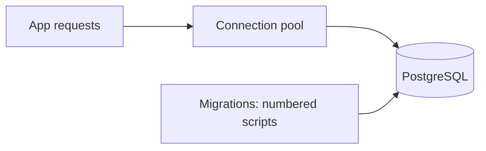
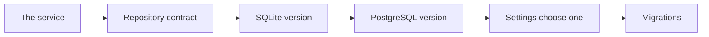
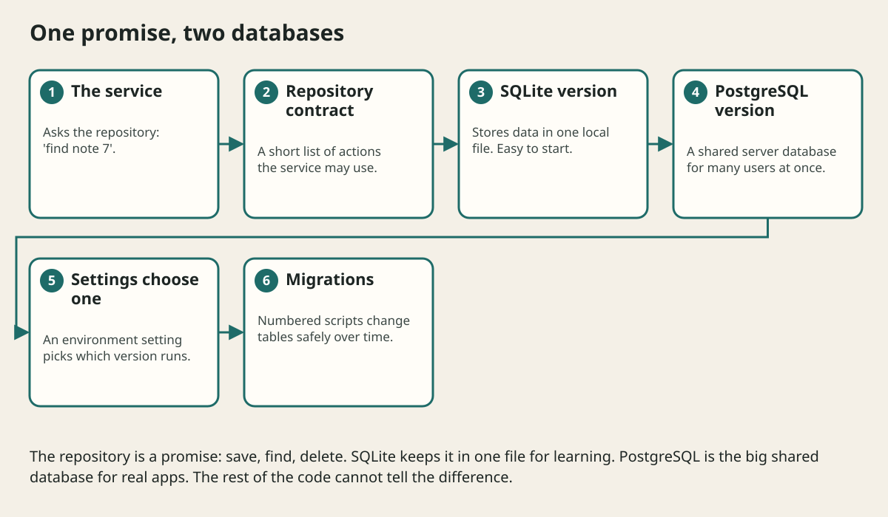

# Postgresql Migrations And Transactions

## The big idea in plain words {#picture}

SQLite is a notebook you keep in your bag. PostgreSQL is a big public library with many librarians: it can serve hundreds of people at once, has strong rules, and does not lose your books when the power goes out. Real apps with many users use PostgreSQL.

Two ideas matter here. First, **connection pools**: a set of ready connections that requests borrow and return. Second, **migrations**: numbered change scripts that update the table design in small, safe steps.



## What you will be able to do {#outcomes}

By the end of this lesson you will be able to:

- Explain why a real app moves from SQLite to PostgreSQL.
- Use a pool, and migrations to change tables safely.
- Know what isolation and concurrency mean.

## Words to know {#vocabulary}

- **PostgreSQL**: a powerful database server for many users.
- **connection pool**: a set of reusable database connections.
- **migration**: a numbered script that changes the database design.
- **isolation**: how separate transactions stay out of each other's way.
- **concurrency**: many things happening at once.
- **object storage**: a place for big files, with only a link in the database.

## Why this idea exists {#history}

When many people use the app at once, you need a database built for that. And as the app changes, the database design changes too, which must happen safely on every computer.

## Concept 1: A pool saves time {#concept-1}

Opening a database connection takes time. A pool opens a few and lends them out: a request borrows one, uses it, and returns it. The pool has a maximum size, so the database is never swamped. If you forget to return one, the pool runs dry and requests wait.

## Concept 2: Migrations are numbered steps {#concept-2}

```text
001_create_notes.sql
002_add_pinned_column.sql
003_add_title_index.sql
```
A tool applies them in order and remembers which ones ran. Never edit the database by hand in production. Every computer, from your laptop to the real server, follows the same steps.

## Concept 3: Concurrency and isolation {#concept-3}

Two requests may update the same note at once. A transaction with the right isolation level keeps them from corrupting each other. A version column helps: "update only if the version is still 3". If someone else changed it, your update does nothing, and you can tell the user.

## Concept 4: Big files do not go in rows {#concept-4}

Store photos and PDFs in object storage and keep only a link and a few facts (name, size) in the table. This keeps the database fast and the backups small. Check the sizes and types of uploads before saving.

## Adding a column safely {#example}

You want a `pinned` column. Migration 002: `ALTER TABLE notes ADD COLUMN pinned BOOLEAN NOT NULL DEFAULT FALSE;`. You first deploy this migration, and old code still works because the new column has a default. Later you deploy the new code that uses it.

## Going deeper: the technical walkthrough {#walkthrough}

### Persistence choices


Start with a repository protocol:

```python
from typing import Protocol


class NoteRepository(Protocol):
    def list(self, limit: int, offset: int) -> list[Note]: ...
    def get(self, note_id: int) -> Note | None: ...
    def save(self, note: Note) -> Note: ...
```

SQLite is a good one-user local database. PostgreSQL is a better shared service
for concurrent clients, transactions, migrations, and future users. Store large
PDFs or images in files or private object storage; keep only metadata and a
relative key in the database.


### OpenAPI, logging, and operations


FastAPI can produce OpenAPI JSON and a browser documentation page. Treat that
contract as an artifact: review paths, schemas, security requirements, and
error responses before sharing it.

Useful operational signals include:

- request count and latency by route;
- `4xx` and `5xx` counts;
- database latency and pool exhaustion;
- queue depth and job age;
- structured logs with request IDs;
- traces for calls that cross services.

A health endpoint should distinguish process health from dependency readiness.
Do not report a green library when the database or object store is unavailable.


## Worked scenario {#worked-scenario}

A note and its bookmark must be created together. How should storage behave?

The justified choice is **One transaction that undoes both if either fails**. Select **atomic-write** in the structured practical and explain why. Alternatives ignore a requirement, cross a trust boundary, or invent success.

### Structured decision contract

```json

{
  "decision": "atomic-write",
  "justification": "The transaction and index boundary must preserve the declared contract and ownership.",
  "failureBehavior": "Expose a safe failure and recover through the boundary owner."
}

```

Decision selects one declared behavior. Justification explains the boundary. FailureBehavior explains the observable error and recovery owner. These fields never execute commands. Required terms and minimum lengths form a basic practice rubric, not semantic grading.

## Step-by-step flow and matching picture {#flow}





## Three real-life uses {#use-cases}

1. A school platform with thousands of students uses PostgreSQL.
2. A team runs migrations automatically during every release.
3. A photo app stores files in object storage and links in PostgreSQL.

## What can go wrong, and how to stay safe {#failure-security}

Mistakes: forgetting to give connections back, editing the live database by hand, a migration that locks a huge table for minutes, and storing big files in the database. Always test a migration on a copy first.

## Practice lab and expected observation {#practice}

1. Predict the scenario decision before opening Practical. Explain each rejected alternative.
2. Run a relevant example above in an isolated exercise project. Record the expected result, then change one input to an invalid or boundary value. A failed assertion or deliberate error should replace silent success.
3. Submit the structured decision. Initially the checks fail. After selecting atomic-write and writing an explanation and failure plan, all three pass. Follow the indicated review section for missed checks.

### Broken example to debug

```json

{"decision":"trust-client","justification":"","failureBehavior":""}

```

This ignores the responsible boundary and gives no reasoning or recovery. Correct the fields rather than changing the validator.

## Checkpoint and definition of done {#checkpoint}

- [ ] Define transaction and index without looking.
- [ ] Trace input to owner and output.
- [ ] Explain one failure and one alternative.
- [ ] Pass at least four assignment questions.
- [ ] Pass every practical check and submit.
- [ ] Explain the concept again tomorrow.

## Sources, versions, and safe commands {#sources}

Python 3.11+; examples use Python 3.11 syntax and Pydantic 2 conventions. Review date: 2026-10-02. The supplied blueprint is the teaching source; official landing pages were checked where reachable. No provider or original TM Schedule deployment was tested.

- [Official reference](https://docs.python.org/3/tutorial/)

- [Official reference](https://fastapi.tiangolo.com/tutorial/)

[Course reading order](README.md) · [Previous lesson](17-sqlite-sql-and-repository-boundaries.md) · [Next lesson](19-authentication-authorization-and-api-security.md)

```study-quiz

{
  "schemaVersion": 1,
  "lessonId": "python-first-api/18-postgresql-migrations-and-transactions",
  "title": "Assignment: Postgresql Migrations And Transactions",
  "passPercentage": 80,
  "questions": [
    {
      "id": "q1",
      "sectionId": "concept-1",
      "prompt": "In Postgresql Migrations And Transactions, what does transaction mean?",
      "options": [
        {
          "id": "a",
          "text": "A permission granted by a hidden browser control",
          "explanation": "This changes the declared meaning or bypasses the responsible boundary."
        },
        {
          "id": "b",
          "text": "An unlimited provider operation with no ownership",
          "explanation": "This changes the declared meaning or bypasses the responsible boundary."
        },
        {
          "id": "c",
          "text": "a group of changes that all succeed or all get undone",
          "explanation": "This preserves the definition and boundary described in the lesson."
        },
        {
          "id": "d",
          "text": "A diagnostic credential intended for public logs",
          "explanation": "This changes the declared meaning or bypasses the responsible boundary."
        }
      ],
      "correctOptionId": "c",
      "explanation": "transaction means a group of changes that all succeed or all get undone.",
      "reviewLabel": "Review concept 1"
    },
    {
      "id": "q2",
      "sectionId": "concept-2",
      "prompt": "In Postgresql Migrations And Transactions, which rule is correct for checkpoint 2?",
      "options": [
        {
          "id": "a",
          "text": "Trust client-side checks instead of the server rule.",
          "explanation": "This changes the declared meaning or bypasses the responsible boundary."
        },
        {
          "id": "b",
          "text": "Hide the failure by returning a fabricated successful result.",
          "explanation": "This changes the declared meaning or bypasses the responsible boundary."
        },
        {
          "id": "c",
          "text": "Skip the stated boundary, limit, or ownership check.",
          "explanation": "This changes the declared meaning or bypasses the responsible boundary."
        },
        {
          "id": "d",
          "text": "A database rule keeps data safe even when many writes happen at once.",
          "explanation": "This preserves the definition and boundary described in the lesson."
        }
      ],
      "correctOptionId": "d",
      "explanation": "A database rule keeps data safe even when many writes happen at once.",
      "reviewLabel": "Review concept 2"
    },
    {
      "id": "q3",
      "sectionId": "concept-3",
      "prompt": "In Postgresql Migrations And Transactions, which rule is correct for checkpoint 3?",
      "options": [
        {
          "id": "a",
          "text": "An index speeds some reads but costs space and slows writes a little.",
          "explanation": "This preserves the definition and boundary described in the lesson."
        },
        {
          "id": "b",
          "text": "Trust client-side checks instead of the server rule.",
          "explanation": "This changes the declared meaning or bypasses the responsible boundary."
        },
        {
          "id": "c",
          "text": "Hide the failure by returning a fabricated successful result.",
          "explanation": "This changes the declared meaning or bypasses the responsible boundary."
        },
        {
          "id": "d",
          "text": "Skip the stated boundary, limit, or ownership check.",
          "explanation": "This changes the declared meaning or bypasses the responsible boundary."
        }
      ],
      "correctOptionId": "a",
      "explanation": "An index speeds some reads but costs space and slows writes a little.",
      "reviewLabel": "Review concept 3"
    },
    {
      "id": "q4",
      "sectionId": "concept-4",
      "prompt": "In Postgresql Migrations And Transactions, which rule is correct for checkpoint 4?",
      "options": [
        {
          "id": "a",
          "text": "Trust client-side checks instead of the server rule.",
          "explanation": "This changes the declared meaning or bypasses the responsible boundary."
        },
        {
          "id": "b",
          "text": "Give a borrowed connection back when the request ends.",
          "explanation": "This preserves the definition and boundary described in the lesson."
        },
        {
          "id": "c",
          "text": "Hide the failure by returning a fabricated successful result.",
          "explanation": "This changes the declared meaning or bypasses the responsible boundary."
        },
        {
          "id": "d",
          "text": "Skip the stated boundary, limit, or ownership check.",
          "explanation": "This changes the declared meaning or bypasses the responsible boundary."
        }
      ],
      "correctOptionId": "b",
      "explanation": "Give a borrowed connection back when the request ends.",
      "reviewLabel": "Review concept 4"
    },
    {
      "id": "q5",
      "sectionId": "worked-scenario",
      "prompt": "A note and its bookmark must be created together. How should storage behave?",
      "options": [
        {
          "id": "a",
          "text": "Two separate writes with no recovery plan",
          "explanation": "This changes the declared meaning or bypasses the responsible boundary."
        },
        {
          "id": "b",
          "text": "Send the database password to the browser",
          "explanation": "This changes the declared meaning or bypasses the responsible boundary."
        },
        {
          "id": "c",
          "text": "One transaction that undoes both if either fails",
          "explanation": "This preserves the definition and boundary described in the lesson."
        },
        {
          "id": "d",
          "text": "A giant global list that only pretends to save",
          "explanation": "This changes the declared meaning or bypasses the responsible boundary."
        }
      ],
      "correctOptionId": "c",
      "explanation": "One transaction that undoes both if either fails. Keep big files outside the database rows and store only a pointer.",
      "reviewLabel": "Review the worked scenario"
    }
  ]
}

```

```study-practical

{
  "schemaVersion": 1,
  "challengeId": "python-first-api/18-postgresql-migrations-and-transactions/decision",
  "lessonId": "python-first-api/18-postgresql-migrations-and-transactions",
  "title": "Practical: Postgresql Migrations And Transactions",
  "language": "json",
  "mode": "structured",
  "instructions": "A note and its bookmark must be created together. How should storage behave? Return an object with decision (choose from atomic-write, skip-check, unbounded-work, trust-client), justification (at least 40 characters; include transaction and index), and failureBehavior (at least 25 characters; include failure and recover while explaining the error and recovery). These are structured reasoning checks, not code execution or an official grade.",
  "starterCode": "{\n  \"decision\": \"\",\n  \"justification\": \"\",\n  \"failureBehavior\": \"\"\n}",
  "entryPoint": "answer",
  "publicExamples": [
    {
      "input": {
        "decision": "skip-check",
        "justification": "",
        "failureBehavior": ""
      },
      "expected": {
        "passed": false
      }
    },
    {
      "input": {
        "decision": "atomic-write",
        "justification": "The transaction and index boundary must preserve the declared contract and ownership.",
        "failureBehavior": "Show a safe failure and recover through the responsible owner."
      },
      "expected": {
        "passed": true
      }
    }
  ],
  "publicTestIds": [
    "decision",
    "explanation",
    "failure-plan"
  ],
  "reviewSections": {
    "decision": "worked-scenario",
    "explanation": "concept-2",
    "failure-plan": "failure-security"
  },
  "limits": {
    "timeMs": 2000,
    "memoryMb": 128,
    "outputBytes": 20000
  }
}

```

