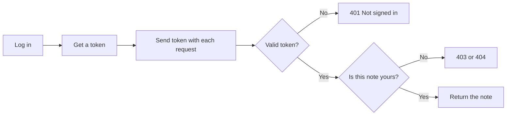
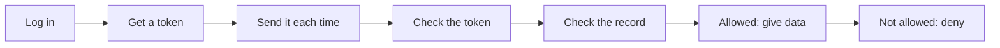
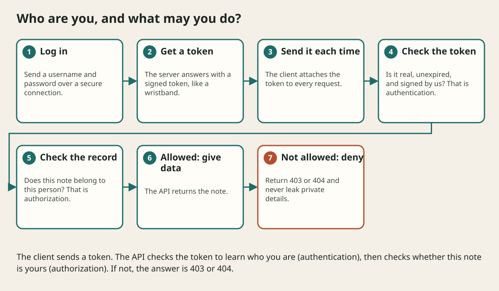

# Authentication Authorization And Api Security

## The big idea in plain words {#picture}

When you enter a school, a guard checks your ID (authentication). Then you can only go to your own classroom, not the principal's office (authorization). A web API needs both checks, on every request.

The usual way: you log in once and get a **token**, like a wristband. On each request you show the wristband. The API checks that the wristband is real, not expired, and then checks that the thing you ask for belongs to you.



## What you will be able to do {#outcomes}

By the end of this lesson you will be able to:

- Tell authentication from authorization.
- Understand tokens, scopes, and password hashing.
- Know about HTTPS, CORS, CSRF, rate limits, and secrets.

## Words to know {#vocabulary}

- **authentication**: proving who you are.
- **authorization**: checking what you may do.
- **token**: a signed pass the client sends with each request.
- **hashing**: scrambling a password so it cannot be read back.
- **CORS**: browser rules about which websites may call your API.
- **rate limit**: a cap on how often someone can ask.

## Why this idea exists {#history}

APIs hold private things. One missing check can show one person's notes to a stranger. Security is not an extra: it is part of the design.

## Concept 1: Authentication: who are you? {#concept-1}

The client sends a username and password over HTTPS. The server checks them (comparing against a **hashed** password, never a plain one) and gives back a token. Passwords are hashed with a slow, salted method such as bcrypt or argon2, so even if the database leaks, the passwords are not readable.

## Concept 2: Authorization: may you do this? {#concept-2}

```python
note = service.find(note_id)
if note.owner_id != current_user.id:
    raise HTTPException(status_code=404)
```
A valid token does not prove that the note is yours. Check ownership on every request. Many APIs answer 404 instead of 403, so strangers cannot even tell that the note exists.

## Concept 3: The web's safety rules {#concept-3}

Use **HTTPS** always, so nobody can read traffic. **CORS** says which websites' scripts may call your API: allow only the ones you trust. **Rate limits** stop robots from guessing passwords. Put secret keys in environment settings and rotate them if they leak.

## Concept 4: Least privilege {#concept-4}

Give each token only the **scopes** it needs: `notes:read` for a reader, `notes:write` for an editor. A service that only reads should not be able to delete. If something is stolen, the damage stays small.

## Dependency for the current user {#example}

```python
def current_user(token: str = Depends(oauth2_scheme)) -> User:
    user = decode_and_check(token)
    if user is None:
        raise HTTPException(status_code=401, detail="Please sign in")
    return user

@app.get("/notes/{id}")
def read(id: int, user: User = Depends(current_user)): ...
```
Every route that needs a signed-in user declares `Depends(current_user)`, and the check happens in one place.

## Going deeper: the technical walkthrough {#walkthrough}

### Authentication and authorization


Authentication asks, "Who are you?" Authorization asks, "What may you do?"
They are different questions.

For a real API:

- use HTTPS;
- keep signing keys and database passwords in the server environment;
- validate the token at the API boundary;
- authorize access to the specific note or category;
- use short-lived access tokens or secure sessions;
- rate-limit login and sensitive actions;
- never trust a hidden button as a permission check.

A learning project can use a fake user ID. It must label the fake behavior and
must not pretend that a hard-coded password is production security.


## Worked scenario {#worked-scenario}

A signed-in student asks for another student's private note. What should happen?

The justified choice is **Say no, because the ownership check fails**. Select **deny-cross-user** in the structured practical and explain why. Alternatives ignore a requirement, cross a trust boundary, or invent success.

### Structured decision contract

```json

{
  "decision": "deny-cross-user",
  "justification": "The authentication and authorization boundary must preserve the declared contract and ownership.",
  "failureBehavior": "Expose a safe failure and recover through the boundary owner."
}

```

Decision selects one declared behavior. Justification explains the boundary. FailureBehavior explains the observable error and recovery owner. These fields never execute commands. Required terms and minimum lengths form a basic practice rubric, not semantic grading.

## Step-by-step flow and matching picture {#flow}





## Three real-life uses {#use-cases}

1. A notes app where each person sees only their own notes.
2. A login route that limits attempts to 5 per minute.
3. A reader token that can read but cannot delete.

## What can go wrong, and how to stay safe {#failure-security}

Mistakes: storing plain passwords, putting secrets in code or logs, trusting a role the client claims, forgetting ownership checks, allowing every website in CORS, and tokens that never expire. Security checks must happen on the server, never only in the browser.

## Practice lab and expected observation {#practice}

1. Predict the scenario decision before opening Practical. Explain each rejected alternative.
2. Run a relevant example above in an isolated exercise project. Record the expected result, then change one input to an invalid or boundary value. A failed assertion or deliberate error should replace silent success.
3. Submit the structured decision. Initially the checks fail. After selecting deny-cross-user and writing an explanation and failure plan, all three pass. Follow the indicated review section for missed checks.

### Broken example to debug

```json

{"decision":"trust-client","justification":"","failureBehavior":""}

```

This ignores the responsible boundary and gives no reasoning or recovery. Correct the fields rather than changing the validator.

## Checkpoint and definition of done {#checkpoint}

- [ ] Define authentication and authorization without looking.
- [ ] Trace input to owner and output.
- [ ] Explain one failure and one alternative.
- [ ] Pass at least four assignment questions.
- [ ] Pass every practical check and submit.
- [ ] Explain the concept again tomorrow.

## Sources, versions, and safe commands {#sources}

Python 3.11+; examples use Python 3.11 syntax and Pydantic 2 conventions. Review date: 2026-10-02. The supplied blueprint is the teaching source; official landing pages were checked where reachable. No provider or original TM Schedule deployment was tested.

- [Official reference](https://docs.python.org/3/tutorial/)

- [Official reference](https://fastapi.tiangolo.com/tutorial/)

[Course reading order](README.md) · [Previous lesson](18-postgresql-migrations-and-transactions.md) · [Next lesson](20-async-work-workers-and-background-jobs.md)

```study-quiz

{
  "schemaVersion": 1,
  "lessonId": "python-first-api/19-authentication-authorization-and-api-security",
  "title": "Assignment: Authentication Authorization And Api Security",
  "passPercentage": 80,
  "questions": [
    {
      "id": "q1",
      "sectionId": "concept-1",
      "prompt": "In Authentication Authorization And Api Security, what does authentication mean?",
      "options": [
        {
          "id": "a",
          "text": "A permission granted by a hidden browser control",
          "explanation": "This changes the declared meaning or bypasses the responsible boundary."
        },
        {
          "id": "b",
          "text": "An unlimited provider operation with no ownership",
          "explanation": "This changes the declared meaning or bypasses the responsible boundary."
        },
        {
          "id": "c",
          "text": "A diagnostic credential intended for public logs",
          "explanation": "This changes the declared meaning or bypasses the responsible boundary."
        },
        {
          "id": "d",
          "text": "proving who someone is",
          "explanation": "This preserves the definition and boundary described in the lesson."
        }
      ],
      "correctOptionId": "d",
      "explanation": "authentication means proving who someone is.",
      "reviewLabel": "Review concept 1"
    },
    {
      "id": "q2",
      "sectionId": "concept-2",
      "prompt": "In Authentication Authorization And Api Security, which rule is correct for checkpoint 2?",
      "options": [
        {
          "id": "a",
          "text": "Hiding a button does not protect anything.",
          "explanation": "This preserves the definition and boundary described in the lesson."
        },
        {
          "id": "b",
          "text": "Trust client-side checks instead of the server rule.",
          "explanation": "This changes the declared meaning or bypasses the responsible boundary."
        },
        {
          "id": "c",
          "text": "Hide the failure by returning a fabricated successful result.",
          "explanation": "This changes the declared meaning or bypasses the responsible boundary."
        },
        {
          "id": "d",
          "text": "Skip the stated boundary, limit, or ownership check.",
          "explanation": "This changes the declared meaning or bypasses the responsible boundary."
        }
      ],
      "correctOptionId": "a",
      "explanation": "Hiding a button does not protect anything.",
      "reviewLabel": "Review concept 2"
    },
    {
      "id": "q3",
      "sectionId": "concept-3",
      "prompt": "In Authentication Authorization And Api Security, which rule is correct for checkpoint 3?",
      "options": [
        {
          "id": "a",
          "text": "Trust client-side checks instead of the server rule.",
          "explanation": "This changes the declared meaning or bypasses the responsible boundary."
        },
        {
          "id": "b",
          "text": "Keep passwords and keys in protected server settings.",
          "explanation": "This preserves the definition and boundary described in the lesson."
        },
        {
          "id": "c",
          "text": "Hide the failure by returning a fabricated successful result.",
          "explanation": "This changes the declared meaning or bypasses the responsible boundary."
        },
        {
          "id": "d",
          "text": "Skip the stated boundary, limit, or ownership check.",
          "explanation": "This changes the declared meaning or bypasses the responsible boundary."
        }
      ],
      "correctOptionId": "b",
      "explanation": "Keep passwords and keys in protected server settings.",
      "reviewLabel": "Review concept 3"
    },
    {
      "id": "q4",
      "sectionId": "concept-4",
      "prompt": "In Authentication Authorization And Api Security, which rule is correct for checkpoint 4?",
      "options": [
        {
          "id": "a",
          "text": "Trust client-side checks instead of the server rule.",
          "explanation": "This changes the declared meaning or bypasses the responsible boundary."
        },
        {
          "id": "b",
          "text": "Hide the failure by returning a fabricated successful result.",
          "explanation": "This changes the declared meaning or bypasses the responsible boundary."
        },
        {
          "id": "c",
          "text": "If users can give a link, control where the server is allowed to go.",
          "explanation": "This preserves the definition and boundary described in the lesson."
        },
        {
          "id": "d",
          "text": "Skip the stated boundary, limit, or ownership check.",
          "explanation": "This changes the declared meaning or bypasses the responsible boundary."
        }
      ],
      "correctOptionId": "c",
      "explanation": "If users can give a link, control where the server is allowed to go.",
      "reviewLabel": "Review concept 4"
    },
    {
      "id": "q5",
      "sectionId": "worked-scenario",
      "prompt": "A signed-in student asks for another student's private note. What should happen?",
      "options": [
        {
          "id": "a",
          "text": "Allow it because any login is enough",
          "explanation": "This changes the declared meaning or bypasses the responsible boundary."
        },
        {
          "id": "b",
          "text": "Believe the role the student claims",
          "explanation": "This changes the declared meaning or bypasses the responsible boundary."
        },
        {
          "id": "c",
          "text": "Send a secret so they can sign in",
          "explanation": "This changes the declared meaning or bypasses the responsible boundary."
        },
        {
          "id": "d",
          "text": "Say no, because the ownership check fails",
          "explanation": "This preserves the definition and boundary described in the lesson."
        }
      ],
      "correctOptionId": "d",
      "explanation": "Say no, because the ownership check fails. Logs must hide passwords and private content.",
      "reviewLabel": "Review the worked scenario"
    }
  ]
}

```

```study-practical

{
  "schemaVersion": 1,
  "challengeId": "python-first-api/19-authentication-authorization-and-api-security/decision",
  "lessonId": "python-first-api/19-authentication-authorization-and-api-security",
  "title": "Practical: Authentication Authorization And Api Security",
  "language": "json",
  "mode": "structured",
  "instructions": "A signed-in student asks for another student's private note. What should happen? Return an object with decision (choose from deny-cross-user, skip-check, unbounded-work, trust-client), justification (at least 40 characters; include authentication and authorization), and failureBehavior (at least 25 characters; include failure and recover while explaining the error and recovery). These are structured reasoning checks, not code execution or an official grade.",
  "starterCode": "{\n  \"decision\": \"\",\n  \"justification\": \"\",\n  \"failureBehavior\": \"\"\n}",
  "entryPoint": "answer",
  "publicExamples": [
    {
      "input": {
        "decision": "skip-check",
        "justification": "",
        "failureBehavior": ""
      },
      "expected": {
        "passed": false
      }
    },
    {
      "input": {
        "decision": "deny-cross-user",
        "justification": "The authentication and authorization boundary must preserve the declared contract and ownership.",
        "failureBehavior": "Show a safe failure and recover through the responsible owner."
      },
      "expected": {
        "passed": true
      }
    }
  ],
  "publicTestIds": [
    "decision",
    "explanation",
    "failure-plan"
  ],
  "reviewSections": {
    "decision": "worked-scenario",
    "explanation": "concept-2",
    "failure-plan": "failure-security"
  },
  "limits": {
    "timeMs": 2000,
    "memoryMb": 128,
    "outputBytes": 20000
  }
}

```

