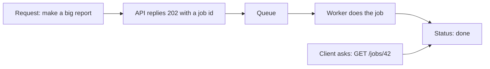
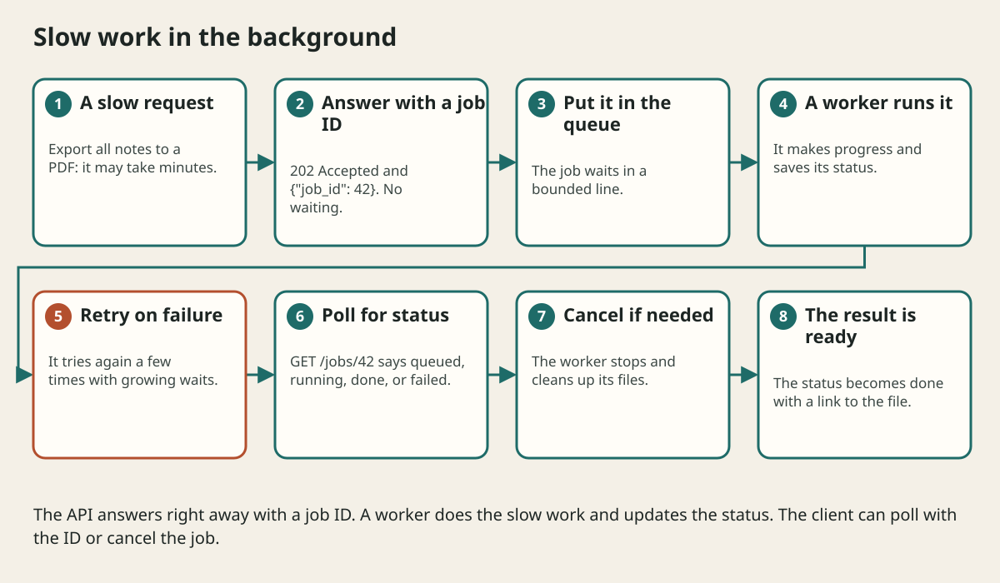

# Async Work Workers And Background Jobs

## The big idea in plain words {#picture}

Imagine a waiter in a restaurant. A slow waiter takes your order, walks to the kitchen, stands there until your food is ready, then walks back. Nobody else can order. A smart waiter takes your order, gives it to the kitchen, and goes to serve other tables while the food cooks.

That is what `async` does in Python. When your code has to wait (for a database or another web service), it says `await`, and Python uses the time to handle other requests. For really long jobs, like making a big report, we use a **background worker** and give the visitor a ticket number.



## What you will be able to do {#outcomes}

By the end of this lesson you will be able to:

- Explain `async` and `await` with the waiter story.
- Know when async helps and when it does not.
- Design a background job with a status, retries, and a limit.

## Words to know {#vocabulary}

- **async**: marks a function that can pause while waiting.
- **await**: "pause here until this finishes, and let others run".
- **event loop**: the manager that switches between waiting tasks.
- **worker**: a separate process that does jobs from a queue.
- **idempotent**: safe to repeat.
- **cancellation**: asking a task to stop and clean up.

## Why this idea exists {#history}

A server that waits for one slow thing at a time can serve only a few visitors. Async lets one process juggle many waiting tasks. Workers take heavy jobs away from the web process entirely.

## Concept 1: async and await {#concept-1}

```python
@app.get("/weather")
async def weather():
    data = await client.get("https://example.com/weather")
    return data.json()
```
`await` means "I will wait here, but go ahead and serve other requests meanwhile". Use it with libraries made for async (async database drivers, `httpx`).

## Concept 2: Async does not make heavy math fast {#concept-2}

If your function does long calculations, it keeps the chair and nobody else gets a turn. Async helps with *waiting*, not with *working*. For heavy work, use a separate worker process. And never call a slow blocking function (like `time.sleep`) inside `async def`.

## Concept 3: Background jobs with tickets {#concept-3}

The API answers right away with `202 Accepted` and a job id. A worker picks the job from a queue, runs it, and updates the status: queued, running, done, failed. The client asks `GET /jobs/42` to see how it is going.

## Concept 4: Retries, limits, and cancelling {#concept-4}

Workers retry failed jobs a few times with growing waits, and give up to a "failed" list. Jobs must be safe to repeat. Limit the queue size so it cannot fill the memory. When a job is cancelled, it stops and cleans up its files.

## A report job {#example}

```python
@app.post("/reports", status_code=202)
def start_report(background: BackgroundTasks):
    job_id = create_job_row()
    background.add_task(build_report, job_id)
    return {"job_id": job_id, "status": "queued"}
```
The visitor gets `{"job_id": 42, "status": "queued"}` in a blink. `build_report` runs afterwards. For serious work, use a real queue like Celery or RQ, so jobs survive a restart.

## Going deeper: the technical walkthrough {#walkthrough}

### Async work and background jobs


Use `async def` when the framework and libraries are doing non-blocking I/O.
Do not make CPU-heavy parsing magically fast by adding `async`.

For long work:

```text
POST /exports -> 202 + job_id
queue -> worker creates the file
GET /exports/{job_id} -> pending, running, complete, or failed
```

A worker needs retries, a time limit, idempotency, a dead-letter path, and a
way for the user to see failure. Do not process a huge book or video inside a
short HTTP request without a measured reason.


## Worked scenario {#worked-scenario}

A PDF export takes minutes and blocks quick requests. What is a good design?

The justified choice is **Put it in a limited queue and give a status ID to check**. Select **queue-job** in the structured practical and explain why. Alternatives ignore a requirement, cross a trust boundary, or invent success.

### Structured decision contract

```json

{
  "decision": "queue-job",
  "justification": "The eventLoop and queue boundary must preserve the declared contract and ownership.",
  "failureBehavior": "Expose a safe failure and recover through the boundary owner."
}

```

Decision selects one declared behavior. Justification explains the boundary. FailureBehavior explains the observable error and recovery owner. These fields never execute commands. Required terms and minimum lengths form a basic practice rubric, not semantic grading.

## Step-by-step flow and matching picture {#flow}




## Three real-life uses {#use-cases}

1. An API that calls a weather service using `await`.
2. A PDF export that runs as a background job.
3. A nightly job that sends email reminders.

## What can go wrong, and how to stay safe {#failure-security}

Mistakes: blocking calls inside `async def`, thinking `async` makes heavy calculations faster, no limit on the queue, jobs that are not safe to repeat, and no status so the user keeps clicking. Also, background tasks inside the web process are lost if the server restarts, so important jobs need a real queue.

## Practice lab and expected observation {#practice}

1. Predict the scenario decision before opening Practical. Explain each rejected alternative.
2. Run a relevant example above in an isolated exercise project. Record the expected result, then change one input to an invalid or boundary value. A failed assertion or deliberate error should replace silent success.
3. Submit the structured decision. Initially the checks fail. After selecting queue-job and writing an explanation and failure plan, all three pass. Follow the indicated review section for missed checks.

### Broken example to debug

```json

{"decision":"trust-client","justification":"","failureBehavior":""}

```

This ignores the responsible boundary and gives no reasoning or recovery. Correct the fields rather than changing the validator.

## Checkpoint and definition of done {#checkpoint}

- [ ] Define eventLoop and queue without looking.
- [ ] Trace input to owner and output.
- [ ] Explain one failure and one alternative.
- [ ] Pass at least four assignment questions.
- [ ] Pass every practical check and submit.
- [ ] Explain the concept again tomorrow.

## Sources, versions, and safe commands {#sources}

Python 3.11+; examples use Python 3.11 syntax and Pydantic 2 conventions. Review date: 2026-10-02. The supplied blueprint is the teaching source; official landing pages were checked where reachable. No provider or original TM Schedule deployment was tested.

- [Official reference](https://docs.python.org/3/tutorial/)

- [Official reference](https://fastapi.tiangolo.com/tutorial/)

[Course reading order](README.md) · [Previous lesson](19-authentication-authorization-and-api-security.md) · [Next lesson](21-testing-openapi-and-contracts.md)

```study-quiz

{
  "schemaVersion": 1,
  "lessonId": "python-first-api/20-async-work-workers-and-background-jobs",
  "title": "Assignment: Async Work Workers And Background Jobs",
  "passPercentage": 80,
  "questions": [
    {
      "id": "q1",
      "sectionId": "concept-1",
      "prompt": "In Async Work Workers And Background Jobs, what does eventLoop mean?",
      "options": [
        {
          "id": "a",
          "text": "the manager that decides what runs next while others wait",
          "explanation": "This preserves the definition and boundary described in the lesson."
        },
        {
          "id": "b",
          "text": "A permission granted by a hidden browser control",
          "explanation": "This changes the declared meaning or bypasses the responsible boundary."
        },
        {
          "id": "c",
          "text": "An unlimited provider operation with no ownership",
          "explanation": "This changes the declared meaning or bypasses the responsible boundary."
        },
        {
          "id": "d",
          "text": "A diagnostic credential intended for public logs",
          "explanation": "This changes the declared meaning or bypasses the responsible boundary."
        }
      ],
      "correctOptionId": "a",
      "explanation": "eventLoop means the manager that decides what runs next while others wait.",
      "reviewLabel": "Review concept 1"
    },
    {
      "id": "q2",
      "sectionId": "concept-2",
      "prompt": "In Async Work Workers And Background Jobs, which rule is correct for checkpoint 2?",
      "options": [
        {
          "id": "a",
          "text": "Trust client-side checks instead of the server rule.",
          "explanation": "This changes the declared meaning or bypasses the responsible boundary."
        },
        {
          "id": "b",
          "text": "For work done later, answer 202 with a task ID.",
          "explanation": "This preserves the definition and boundary described in the lesson."
        },
        {
          "id": "c",
          "text": "Hide the failure by returning a fabricated successful result.",
          "explanation": "This changes the declared meaning or bypasses the responsible boundary."
        },
        {
          "id": "d",
          "text": "Skip the stated boundary, limit, or ownership check.",
          "explanation": "This changes the declared meaning or bypasses the responsible boundary."
        }
      ],
      "correctOptionId": "b",
      "explanation": "For work done later, answer 202 with a task ID.",
      "reviewLabel": "Review concept 2"
    },
    {
      "id": "q3",
      "sectionId": "concept-3",
      "prompt": "In Async Work Workers And Background Jobs, which rule is correct for checkpoint 3?",
      "options": [
        {
          "id": "a",
          "text": "Trust client-side checks instead of the server rule.",
          "explanation": "This changes the declared meaning or bypasses the responsible boundary."
        },
        {
          "id": "b",
          "text": "Hide the failure by returning a fabricated successful result.",
          "explanation": "This changes the declared meaning or bypasses the responsible boundary."
        },
        {
          "id": "c",
          "text": "Workers need a retry limit and a place for jobs that keep failing.",
          "explanation": "This preserves the definition and boundary described in the lesson."
        },
        {
          "id": "d",
          "text": "Skip the stated boundary, limit, or ownership check.",
          "explanation": "This changes the declared meaning or bypasses the responsible boundary."
        }
      ],
      "correctOptionId": "c",
      "explanation": "Workers need a retry limit and a place for jobs that keep failing.",
      "reviewLabel": "Review concept 3"
    },
    {
      "id": "q4",
      "sectionId": "concept-4",
      "prompt": "In Async Work Workers And Background Jobs, which rule is correct for checkpoint 4?",
      "options": [
        {
          "id": "a",
          "text": "Trust client-side checks instead of the server rule.",
          "explanation": "This changes the declared meaning or bypasses the responsible boundary."
        },
        {
          "id": "b",
          "text": "Hide the failure by returning a fabricated successful result.",
          "explanation": "This changes the declared meaning or bypasses the responsible boundary."
        },
        {
          "id": "c",
          "text": "Skip the stated boundary, limit, or ownership check.",
          "explanation": "This changes the declared meaning or bypasses the responsible boundary."
        },
        {
          "id": "d",
          "text": "Cancelling must release whatever the job was holding.",
          "explanation": "This preserves the definition and boundary described in the lesson."
        }
      ],
      "correctOptionId": "d",
      "explanation": "Cancelling must release whatever the job was holding.",
      "reviewLabel": "Review concept 4"
    },
    {
      "id": "q5",
      "sectionId": "worked-scenario",
      "prompt": "A PDF export takes minutes and blocks quick requests. What is a good design?",
      "options": [
        {
          "id": "a",
          "text": "Put it in a limited queue and give a status ID to check",
          "explanation": "This preserves the definition and boundary described in the lesson."
        },
        {
          "id": "b",
          "text": "Add the async keyword to a heavy loop",
          "explanation": "This changes the declared meaning or bypasses the responsible boundary."
        },
        {
          "id": "c",
          "text": "Keep unlimited requests waiting forever",
          "explanation": "This changes the declared meaning or bypasses the responsible boundary."
        },
        {
          "id": "d",
          "text": "Install random packages on every request",
          "explanation": "This changes the declared meaning or bypasses the responsible boundary."
        }
      ],
      "correctOptionId": "a",
      "explanation": "Put it in a limited queue and give a status ID to check. Limit the queue so memory does not grow forever.",
      "reviewLabel": "Review the worked scenario"
    }
  ]
}

```

```study-practical

{
  "schemaVersion": 1,
  "challengeId": "python-first-api/20-async-work-workers-and-background-jobs/decision",
  "lessonId": "python-first-api/20-async-work-workers-and-background-jobs",
  "title": "Practical: Async Work Workers And Background Jobs",
  "language": "json",
  "mode": "structured",
  "instructions": "A PDF export takes minutes and blocks quick requests. What is a good design? Return an object with decision (choose from queue-job, skip-check, unbounded-work, trust-client), justification (at least 40 characters; include eventLoop and queue), and failureBehavior (at least 25 characters; include failure and recover while explaining the error and recovery). These are structured reasoning checks, not code execution or an official grade.",
  "starterCode": "{\n  \"decision\": \"\",\n  \"justification\": \"\",\n  \"failureBehavior\": \"\"\n}",
  "entryPoint": "answer",
  "publicExamples": [
    {
      "input": {
        "decision": "skip-check",
        "justification": "",
        "failureBehavior": ""
      },
      "expected": {
        "passed": false
      }
    },
    {
      "input": {
        "decision": "queue-job",
        "justification": "The eventLoop and queue boundary must preserve the declared contract and ownership.",
        "failureBehavior": "Show a safe failure and recover through the responsible owner."
      },
      "expected": {
        "passed": true
      }
    }
  ],
  "publicTestIds": [
    "decision",
    "explanation",
    "failure-plan"
  ],
  "reviewSections": {
    "decision": "worked-scenario",
    "explanation": "concept-2",
    "failure-plan": "failure-security"
  },
  "limits": {
    "timeMs": 2000,
    "memoryMb": 128,
    "outputBytes": 20000
  }
}

```

