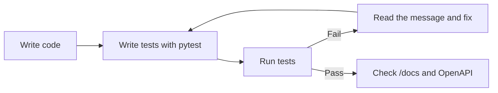
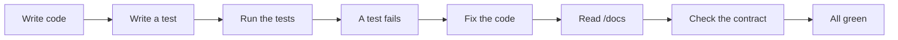
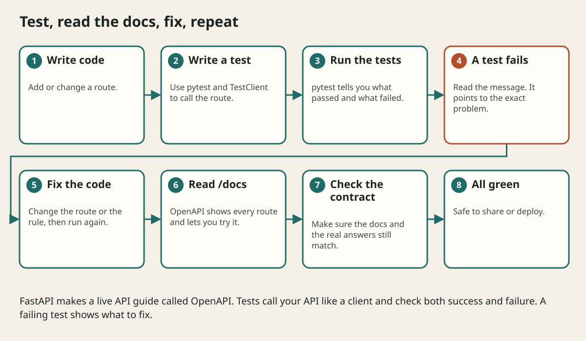

# Testing Openapi And Contracts

## The big idea in plain words {#picture}

Before a magician performs for a crowd, they practice many times, including what to do if a trick goes wrong. Tests are your practice. You write small programs that call your API as if they were a real client and check the answers.

FastAPI helps twice: it comes with a test client, and it writes an **OpenAPI** document describing every route. That document is a contract: clients can read it, and tests can compare against it.



## What you will be able to do {#outcomes}

By the end of this lesson you will be able to:

- Write tests with pytest and `TestClient`.
- Test both success and failure paths.
- Use fixtures, fake dependencies, and check OpenAPI.

## Words to know {#vocabulary}

- **pytest**: a popular Python testing tool.
- **TestClient**: a fake client that calls your app without a real server.
- **fixture**: reusable setup for tests.
- **mock**: a fake helper used in a test.
- **OpenAPI**: a machine-readable description of your API.
- **contract test**: a test that checks replies match the described shape.

## Why this idea exists {#history}

Changing code without tests is like walking in the dark. Tests tell you in seconds if something broke, so you can change things with confidence.

## Concept 1: A first test {#concept-1}

```python
from fastapi.testclient import TestClient
from app.main import app

client = TestClient(app)

def test_health():
    response = client.get("/health")
    assert response.status_code == 200
    assert response.json() == {"status": "ok"}
```
`assert` says "this must be true". If not, the test fails and shows you what differed.

## Concept 2: Test the sad paths {#concept-2}

```python
def test_create_note_rejects_blank_title():
    response = client.post("/notes", json={"title": "   "})
    assert response.status_code == 422
```
Also test: unknown id (404), duplicate (409), too long, not signed in (401), and someone else's note. Bugs love the unusual cases.

## Concept 3: Fixtures and fakes {#concept-3}

```python
@pytest.fixture
def client():
    app.dependency_overrides[get_repo] = lambda: FakeRepository()
    yield TestClient(app)
    app.dependency_overrides.clear()
```
A fixture prepares a clean app with a fake repository for each test and cleans up after. Use made-up data and a separate test database, never the real one.

## Concept 4: OpenAPI is your contract {#concept-4}

Visit `/openapi.json`: FastAPI describes every route, input, and output. Clients can generate code from it. A contract test checks that real replies match. When you change a route, the document changes, which makes accidental breaking changes visible.

## Bug found by a test {#example}

You change the title limit to 80 and forget to update the service. Your test `test_title_81_chars_rejected` fails: "expected 422, got 201". Before any user sees it, you fix the service. The test paid for itself.

## Going deeper: the technical walkthrough {#walkthrough}

### Testing


Test behavior at the boundary:

```python
from fastapi.testclient import TestClient

from app.main import app

client = TestClient(app)


def test_health() -> None:
    response = client.get("/health")
    assert response.status_code == 200
    assert response.json() == {"status": "ok"}
```

Add tests for valid input, missing input, oversized input, unknown IDs,
duplicate creates, authorization failures, database failures, and repeated
writes. Unit-test service rules separately from route binding. Use a temporary
or mocked database; never run tests against a personal production catalog.


### OpenAPI, logging, and operations


FastAPI can produce OpenAPI JSON and a browser documentation page. Treat that
contract as an artifact: review paths, schemas, security requirements, and
error responses before sharing it.

Useful operational signals include:

- request count and latency by route;
- `4xx` and `5xx` counts;
- database latency and pool exhaustion;
- queue depth and job age;
- structured logs with request IDs;
- traces for calls that cross services.

A health endpoint should distinguish process health from dependency readiness.
Do not report a green library when the database or object store is unavailable.


## Worked scenario {#worked-scenario}

A controller test uses the real production database. What should replace it?

The justified choice is **A separate test database with made-up data that is cleaned afterwards**. Select **isolated-fixtures** in the structured practical and explain why. Alternatives ignore a requirement, cross a trust boundary, or invent success.

### Structured decision contract

```json

{
  "decision": "isolated-fixtures",
  "justification": "The fixture and unitTest boundary must preserve the declared contract and ownership.",
  "failureBehavior": "Expose a safe failure and recover through the boundary owner."
}

```

Decision selects one declared behavior. Justification explains the boundary. FailureBehavior explains the observable error and recovery owner. These fields never execute commands. Required terms and minimum lengths form a basic practice rubric, not semantic grading.

## Step-by-step flow and matching picture {#flow}





## Three real-life uses {#use-cases}

1. Every pull request runs all tests automatically.
2. A mobile team generates its client from the OpenAPI document.
3. A test uses a fake email sender so no emails are really sent.

## What can go wrong, and how to stay safe {#failure-security}

Mistakes: only testing the happy path, tests that share state and depend on order, using the real database, tests with no `assert`, and treating a coverage number as proof. A mock cannot prove the real SQL works, so keep a few tests with a real test database.

## Practice lab and expected observation {#practice}

1. Predict the scenario decision before opening Practical. Explain each rejected alternative.
2. Run a relevant example above in an isolated exercise project. Record the expected result, then change one input to an invalid or boundary value. A failed assertion or deliberate error should replace silent success.
3. Submit the structured decision. Initially the checks fail. After selecting isolated-fixtures and writing an explanation and failure plan, all three pass. Follow the indicated review section for missed checks.

### Broken example to debug

```json

{"decision":"trust-client","justification":"","failureBehavior":""}

```

This ignores the responsible boundary and gives no reasoning or recovery. Correct the fields rather than changing the validator.

## Checkpoint and definition of done {#checkpoint}

- [ ] Define fixture and unitTest without looking.
- [ ] Trace input to owner and output.
- [ ] Explain one failure and one alternative.
- [ ] Pass at least four assignment questions.
- [ ] Pass every practical check and submit.
- [ ] Explain the concept again tomorrow.

## Sources, versions, and safe commands {#sources}

Python 3.11+; examples use Python 3.11 syntax and Pydantic 2 conventions. Review date: 2026-10-02. The supplied blueprint is the teaching source; official landing pages were checked where reachable. No provider or original TM Schedule deployment was tested.

- [Official reference](https://docs.python.org/3/tutorial/)

- [Official reference](https://fastapi.tiangolo.com/tutorial/)

[Course reading order](README.md) · [Previous lesson](20-async-work-workers-and-background-jobs.md) · [Next lesson](22-logging-observability-docker-and-deployment.md)

```study-quiz

{
  "schemaVersion": 1,
  "lessonId": "python-first-api/21-testing-openapi-and-contracts",
  "title": "Assignment: Testing Openapi And Contracts",
  "passPercentage": 80,
  "questions": [
    {
      "id": "q1",
      "sectionId": "concept-1",
      "prompt": "In Testing Openapi And Contracts, what does fixture mean?",
      "options": [
        {
          "id": "a",
          "text": "A permission granted by a hidden browser control",
          "explanation": "This changes the declared meaning or bypasses the responsible boundary."
        },
        {
          "id": "b",
          "text": "prepared test data or setup",
          "explanation": "This preserves the definition and boundary described in the lesson."
        },
        {
          "id": "c",
          "text": "An unlimited provider operation with no ownership",
          "explanation": "This changes the declared meaning or bypasses the responsible boundary."
        },
        {
          "id": "d",
          "text": "A diagnostic credential intended for public logs",
          "explanation": "This changes the declared meaning or bypasses the responsible boundary."
        }
      ],
      "correctOptionId": "b",
      "explanation": "fixture means prepared test data or setup.",
      "reviewLabel": "Review concept 1"
    },
    {
      "id": "q2",
      "sectionId": "concept-2",
      "prompt": "In Testing Openapi And Contracts, which rule is correct for checkpoint 2?",
      "options": [
        {
          "id": "a",
          "text": "Trust client-side checks instead of the server rule.",
          "explanation": "This changes the declared meaning or bypasses the responsible boundary."
        },
        {
          "id": "b",
          "text": "Hide the failure by returning a fabricated successful result.",
          "explanation": "This changes the declared meaning or bypasses the responsible boundary."
        },
        {
          "id": "c",
          "text": "Check both the status code and the shape of the answer.",
          "explanation": "This preserves the definition and boundary described in the lesson."
        },
        {
          "id": "d",
          "text": "Skip the stated boundary, limit, or ownership check.",
          "explanation": "This changes the declared meaning or bypasses the responsible boundary."
        }
      ],
      "correctOptionId": "c",
      "explanation": "Check both the status code and the shape of the answer.",
      "reviewLabel": "Review concept 2"
    },
    {
      "id": "q3",
      "sectionId": "concept-3",
      "prompt": "In Testing Openapi And Contracts, which rule is correct for checkpoint 3?",
      "options": [
        {
          "id": "a",
          "text": "Trust client-side checks instead of the server rule.",
          "explanation": "This changes the declared meaning or bypasses the responsible boundary."
        },
        {
          "id": "b",
          "text": "Hide the failure by returning a fabricated successful result.",
          "explanation": "This changes the declared meaning or bypasses the responsible boundary."
        },
        {
          "id": "c",
          "text": "Skip the stated boundary, limit, or ownership check.",
          "explanation": "This changes the declared meaning or bypasses the responsible boundary."
        },
        {
          "id": "d",
          "text": "Test bad input and broken helpers too.",
          "explanation": "This preserves the definition and boundary described in the lesson."
        }
      ],
      "correctOptionId": "d",
      "explanation": "Test bad input and broken helpers too.",
      "reviewLabel": "Review concept 3"
    },
    {
      "id": "q4",
      "sectionId": "concept-4",
      "prompt": "In Testing Openapi And Contracts, which rule is correct for checkpoint 4?",
      "options": [
        {
          "id": "a",
          "text": "A mock isolates a helper but cannot prove the real SQL works.",
          "explanation": "This preserves the definition and boundary described in the lesson."
        },
        {
          "id": "b",
          "text": "Trust client-side checks instead of the server rule.",
          "explanation": "This changes the declared meaning or bypasses the responsible boundary."
        },
        {
          "id": "c",
          "text": "Hide the failure by returning a fabricated successful result.",
          "explanation": "This changes the declared meaning or bypasses the responsible boundary."
        },
        {
          "id": "d",
          "text": "Skip the stated boundary, limit, or ownership check.",
          "explanation": "This changes the declared meaning or bypasses the responsible boundary."
        }
      ],
      "correctOptionId": "a",
      "explanation": "A mock isolates a helper but cannot prove the real SQL works.",
      "reviewLabel": "Review concept 4"
    },
    {
      "id": "q5",
      "sectionId": "worked-scenario",
      "prompt": "A controller test uses the real production database. What should replace it?",
      "options": [
        {
          "id": "a",
          "text": "The same database with a different log color",
          "explanation": "This changes the declared meaning or bypasses the responsible boundary."
        },
        {
          "id": "b",
          "text": "A separate test database with made-up data that is cleaned afterwards",
          "explanation": "This preserves the definition and boundary described in the lesson."
        },
        {
          "id": "c",
          "text": "A public copy of everyone's data",
          "explanation": "This changes the declared meaning or bypasses the responsible boundary."
        },
        {
          "id": "d",
          "text": "A test with no checks",
          "explanation": "This changes the declared meaning or bypasses the responsible boundary."
        }
      ],
      "correctOptionId": "b",
      "explanation": "A separate test database with made-up data that is cleaned afterwards. A coverage percentage shows what code ran, not that it is correct.",
      "reviewLabel": "Review the worked scenario"
    }
  ]
}

```

```study-practical

{
  "schemaVersion": 1,
  "challengeId": "python-first-api/21-testing-openapi-and-contracts/decision",
  "lessonId": "python-first-api/21-testing-openapi-and-contracts",
  "title": "Practical: Testing Openapi And Contracts",
  "language": "json",
  "mode": "structured",
  "instructions": "A controller test uses the real production database. What should replace it? Return an object with decision (choose from isolated-fixtures, skip-check, unbounded-work, trust-client), justification (at least 40 characters; include fixture and unitTest), and failureBehavior (at least 25 characters; include failure and recover while explaining the error and recovery). These are structured reasoning checks, not code execution or an official grade.",
  "starterCode": "{\n  \"decision\": \"\",\n  \"justification\": \"\",\n  \"failureBehavior\": \"\"\n}",
  "entryPoint": "answer",
  "publicExamples": [
    {
      "input": {
        "decision": "skip-check",
        "justification": "",
        "failureBehavior": ""
      },
      "expected": {
        "passed": false
      }
    },
    {
      "input": {
        "decision": "isolated-fixtures",
        "justification": "The fixture and unitTest boundary must preserve the declared contract and ownership.",
        "failureBehavior": "Show a safe failure and recover through the responsible owner."
      },
      "expected": {
        "passed": true
      }
    }
  ],
  "publicTestIds": [
    "decision",
    "explanation",
    "failure-plan"
  ],
  "reviewSections": {
    "decision": "worked-scenario",
    "explanation": "concept-2",
    "failure-plan": "failure-security"
  },
  "limits": {
    "timeMs": 2000,
    "memoryMb": 128,
    "outputBytes": 20000
  }
}

```

