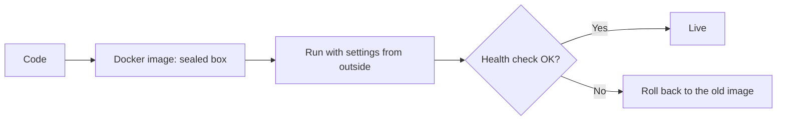
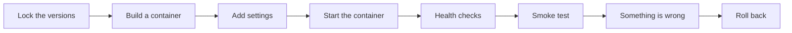

# Logging Observability Docker And Deployment

## The big idea in plain words {#picture}

Once your app runs on a real server, you cannot look at it directly. You need a dashboard. **Logs** are a diary of what happened. **Metrics** are a scoreboard of numbers. **Health checks** say whether the app is alive and ready.

And to move the app from your laptop to a server without surprises, you pack it into a **Docker container**: a sealed box with your app and everything it needs. The same box runs the same way everywhere.



## What you will be able to do {#outcomes}

By the end of this lesson you will be able to:

- Write structured logs with request IDs.
- Add liveness and readiness endpoints.
- Package the app with Docker and plan a rollback and backups.

## Words to know {#vocabulary}

- **log**: a written note about an event.
- **structured log**: a log written as fields, like JSON, so tools can search it.
- **metric**: a number measured over time.
- **liveness**: "is the program running?".
- **readiness**: "can it serve visitors, with its database?".
- **Docker image**: a packaged app and its tools.

## Why this idea exists {#history}

Problems on a real server cannot be seen directly. Good signals show you what happened, and a repeatable package means you can fix or undo a release quickly.

## Concept 1: Logs you can search {#concept-1}

```python
logger.info("note_created", extra={"request_id": rid, "note_id": 7})
```
Write what happened and the request id, as fields. Never write passwords, tokens, or private note text in a log. Many people can read logs.

## Concept 2: Two health checks {#concept-2}

`GET /health` returns OK if the process is alive. `GET /ready` checks the database too and returns 503 if it cannot connect. A load balancer uses readiness to stop sending visitors to a server that is not ready.

## Concept 3: A container {#concept-3}

```text
FROM python:3.12-slim
COPY requirements.txt .
RUN pip install -r requirements.txt
COPY app app
CMD ["uvicorn", "app.main:app", "--host", "0.0.0.0", "--port", "8000"]
```
This recipe builds an image. Settings like the database address come from environment variables when you run it, not from inside the image. Never put secrets in the image.

## Concept 4: Roll back and back up {#concept-4}

Keep the previous image so you can switch back if the new one fails its health check. Back up the database regularly, and **practice restoring**. A backup you have never restored is only a hope. Also measure: requests per minute, errors, and slow requests.

## A bad release {#example}

You deploy version 12 and `/ready` returns 503. Your deploy script sees the failure, stops the rollout, and starts version 11 again. Logs with the request id show the new version could not find a setting called DATABASE_URL. You fix the settings and release again.

## Going deeper: the technical walkthrough {#walkthrough}

### OpenAPI, logging, and operations


FastAPI can produce OpenAPI JSON and a browser documentation page. Treat that
contract as an artifact: review paths, schemas, security requirements, and
error responses before sharing it.

Useful operational signals include:

- request count and latency by route;
- `4xx` and `5xx` counts;
- database latency and pool exhaustion;
- queue depth and job age;
- structured logs with request IDs;
- traces for calls that cross services.

A health endpoint should distinguish process health from dependency readiness.
Do not report a green library when the database or object store is unavailable.


## Worked scenario {#worked-scenario}

A new release fails its readiness check. What should you do?

The justified choice is **Stop the rollout and go back to the version that worked**. Select **rollback-release** in the structured practical and explain why. Alternatives ignore a requirement, cross a trust boundary, or invent success.

### Structured decision contract

```json

{
  "decision": "rollback-release",
  "justification": "The artifact and rollback boundary must preserve the declared contract and ownership.",
  "failureBehavior": "Expose a safe failure and recover through the boundary owner."
}

```

Decision selects one declared behavior. Justification explains the boundary. FailureBehavior explains the observable error and recovery owner. These fields never execute commands. Required terms and minimum lengths form a basic practice rubric, not semantic grading.

## Step-by-step flow and matching picture {#flow}




## Three real-life uses {#use-cases}

1. A dashboard shows errors per minute and the slowest routes.
2. A hosting platform restarts the app if `/health` fails.
3. A team practices restoring a backup every month.

## What can go wrong, and how to stay safe {#failure-security}

Mistakes: logging secrets, only one health check that says "ok" even when the database is down, secrets inside the Docker image, running as the all-powerful root user, and never testing backups. A `latest` tag for images can hide which version is running, so use version numbers.

## Practice lab and expected observation {#practice}

1. Predict the scenario decision before opening Practical. Explain each rejected alternative.
2. Run a relevant example above in an isolated exercise project. Record the expected result, then change one input to an invalid or boundary value. A failed assertion or deliberate error should replace silent success.
3. Submit the structured decision. Initially the checks fail. After selecting rollback-release and writing an explanation and failure plan, all three pass. Follow the indicated review section for missed checks.

### Broken example to debug

```json

{"decision":"trust-client","justification":"","failureBehavior":""}

```

This ignores the responsible boundary and gives no reasoning or recovery. Correct the fields rather than changing the validator.

## Checkpoint and definition of done {#checkpoint}

- [ ] Define artifact and rollback without looking.
- [ ] Trace input to owner and output.
- [ ] Explain one failure and one alternative.
- [ ] Pass at least four assignment questions.
- [ ] Pass every practical check and submit.
- [ ] Explain the concept again tomorrow.

## Sources, versions, and safe commands {#sources}

Python 3.11+; examples use Python 3.11 syntax and Pydantic 2 conventions. Review date: 2026-10-02. The supplied blueprint is the teaching source; official landing pages were checked where reachable. No provider or original TM Schedule deployment was tested.

- [Official reference](https://docs.python.org/3/tutorial/)

- [Official reference](https://fastapi.tiangolo.com/tutorial/)

[Course reading order](README.md) · [Previous lesson](21-testing-openapi-and-contracts.md) · [Next lesson](23-capstone-study-notes-api.md)

```study-quiz

{
  "schemaVersion": 1,
  "lessonId": "python-first-api/22-logging-observability-docker-and-deployment",
  "title": "Assignment: Logging Observability Docker And Deployment",
  "passPercentage": 80,
  "questions": [
    {
      "id": "q1",
      "sectionId": "concept-1",
      "prompt": "In Logging Observability Docker And Deployment, what does artifact mean?",
      "options": [
        {
          "id": "a",
          "text": "A permission granted by a hidden browser control",
          "explanation": "This changes the declared meaning or bypasses the responsible boundary."
        },
        {
          "id": "b",
          "text": "An unlimited provider operation with no ownership",
          "explanation": "This changes the declared meaning or bypasses the responsible boundary."
        },
        {
          "id": "c",
          "text": "the finished, versioned package made by a build",
          "explanation": "This preserves the definition and boundary described in the lesson."
        },
        {
          "id": "d",
          "text": "A diagnostic credential intended for public logs",
          "explanation": "This changes the declared meaning or bypasses the responsible boundary."
        }
      ],
      "correctOptionId": "c",
      "explanation": "artifact means the finished, versioned package made by a build.",
      "reviewLabel": "Review concept 1"
    },
    {
      "id": "q2",
      "sectionId": "concept-2",
      "prompt": "In Logging Observability Docker And Deployment, which rule is correct for checkpoint 2?",
      "options": [
        {
          "id": "a",
          "text": "Trust client-side checks instead of the server rule.",
          "explanation": "This changes the declared meaning or bypasses the responsible boundary."
        },
        {
          "id": "b",
          "text": "Hide the failure by returning a fabricated successful result.",
          "explanation": "This changes the declared meaning or bypasses the responsible boundary."
        },
        {
          "id": "c",
          "text": "Skip the stated boundary, limit, or ownership check.",
          "explanation": "This changes the declared meaning or bypasses the responsible boundary."
        },
        {
          "id": "d",
          "text": "Keep secrets in the deployment settings, not in the code.",
          "explanation": "This preserves the definition and boundary described in the lesson."
        }
      ],
      "correctOptionId": "d",
      "explanation": "Keep secrets in the deployment settings, not in the code.",
      "reviewLabel": "Review concept 2"
    },
    {
      "id": "q3",
      "sectionId": "concept-3",
      "prompt": "In Logging Observability Docker And Deployment, which rule is correct for checkpoint 3?",
      "options": [
        {
          "id": "a",
          "text": "Run quick smoke checks right after a release.",
          "explanation": "This preserves the definition and boundary described in the lesson."
        },
        {
          "id": "b",
          "text": "Trust client-side checks instead of the server rule.",
          "explanation": "This changes the declared meaning or bypasses the responsible boundary."
        },
        {
          "id": "c",
          "text": "Hide the failure by returning a fabricated successful result.",
          "explanation": "This changes the declared meaning or bypasses the responsible boundary."
        },
        {
          "id": "d",
          "text": "Skip the stated boundary, limit, or ownership check.",
          "explanation": "This changes the declared meaning or bypasses the responsible boundary."
        }
      ],
      "correctOptionId": "a",
      "explanation": "Run quick smoke checks right after a release.",
      "reviewLabel": "Review concept 3"
    },
    {
      "id": "q4",
      "sectionId": "concept-4",
      "prompt": "In Logging Observability Docker And Deployment, which rule is correct for checkpoint 4?",
      "options": [
        {
          "id": "a",
          "text": "Trust client-side checks instead of the server rule.",
          "explanation": "This changes the declared meaning or bypasses the responsible boundary."
        },
        {
          "id": "b",
          "text": "A backup only counts if you have practiced restoring it.",
          "explanation": "This preserves the definition and boundary described in the lesson."
        },
        {
          "id": "c",
          "text": "Hide the failure by returning a fabricated successful result.",
          "explanation": "This changes the declared meaning or bypasses the responsible boundary."
        },
        {
          "id": "d",
          "text": "Skip the stated boundary, limit, or ownership check.",
          "explanation": "This changes the declared meaning or bypasses the responsible boundary."
        }
      ],
      "correctOptionId": "b",
      "explanation": "A backup only counts if you have practiced restoring it.",
      "reviewLabel": "Review concept 4"
    },
    {
      "id": "q5",
      "sectionId": "worked-scenario",
      "prompt": "A new release fails its readiness check. What should you do?",
      "options": [
        {
          "id": "a",
          "text": "Delete the backups",
          "explanation": "This changes the declared meaning or bypasses the responsible boundary."
        },
        {
          "id": "b",
          "text": "Hide the health page",
          "explanation": "This changes the declared meaning or bypasses the responsible boundary."
        },
        {
          "id": "c",
          "text": "Stop the rollout and go back to the version that worked",
          "explanation": "This preserves the definition and boundary described in the lesson."
        },
        {
          "id": "d",
          "text": "Update every library to 'latest'",
          "explanation": "This changes the declared meaning or bypasses the responsible boundary."
        }
      ],
      "correctOptionId": "c",
      "explanation": "Stop the rollout and go back to the version that worked. Change databases in steps that old and new code can both handle.",
      "reviewLabel": "Review the worked scenario"
    }
  ]
}

```

```study-practical

{
  "schemaVersion": 1,
  "challengeId": "python-first-api/22-logging-observability-docker-and-deployment/decision",
  "lessonId": "python-first-api/22-logging-observability-docker-and-deployment",
  "title": "Practical: Logging Observability Docker And Deployment",
  "language": "json",
  "mode": "structured",
  "instructions": "A new release fails its readiness check. What should you do? Return an object with decision (choose from rollback-release, skip-check, unbounded-work, trust-client), justification (at least 40 characters; include artifact and rollback), and failureBehavior (at least 25 characters; include failure and recover while explaining the error and recovery). These are structured reasoning checks, not code execution or an official grade.",
  "starterCode": "{\n  \"decision\": \"\",\n  \"justification\": \"\",\n  \"failureBehavior\": \"\"\n}",
  "entryPoint": "answer",
  "publicExamples": [
    {
      "input": {
        "decision": "skip-check",
        "justification": "",
        "failureBehavior": ""
      },
      "expected": {
        "passed": false
      }
    },
    {
      "input": {
        "decision": "rollback-release",
        "justification": "The artifact and rollback boundary must preserve the declared contract and ownership.",
        "failureBehavior": "Show a safe failure and recover through the responsible owner."
      },
      "expected": {
        "passed": true
      }
    }
  ],
  "publicTestIds": [
    "decision",
    "explanation",
    "failure-plan"
  ],
  "reviewSections": {
    "decision": "worked-scenario",
    "explanation": "concept-2",
    "failure-plan": "failure-security"
  },
  "limits": {
    "timeMs": 2000,
    "memoryMb": 128,
    "outputBytes": 20000
  }
}

```

