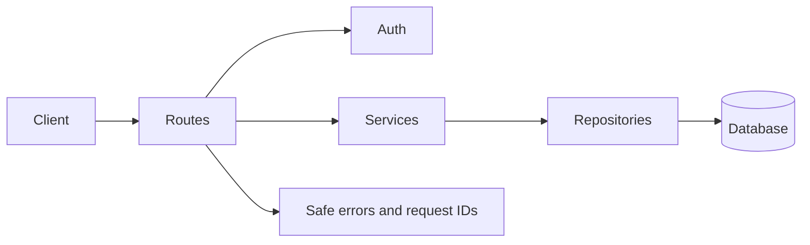
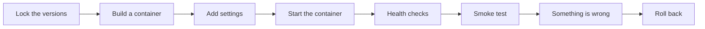
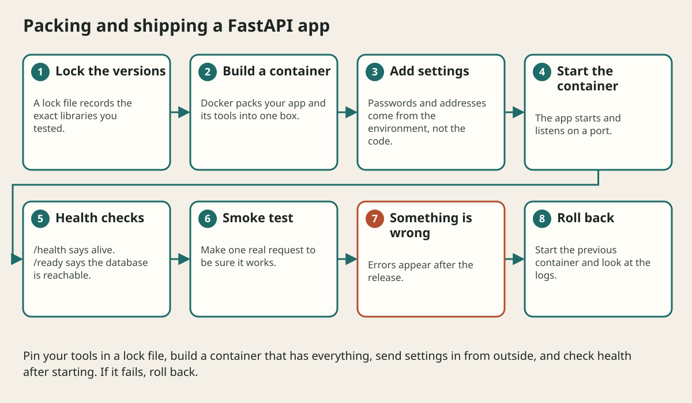

# Capstone Study Notes Api

## The big idea in plain words {#picture}

It is time for the big project! You will build a **Study Notes API**: people can create notes, put them in categories, bookmark them, and mark them complete. The API checks logins, saves in a database, has tests, and can be deployed.

Think of it as your final science fair project: it uses everything you learned, one piece at a time, and it works as a whole.



## What you will be able to do {#outcomes}

By the end of this lesson you will be able to:

- Plan and build a complete notes API.
- Combine routes, services, repositories, auth, tests, and deployment.
- Know how to extend and review it.

## Words to know {#vocabulary}

- **capstone**: a big final project that uses all your skills.
- **bookmark**: a note you want to find again quickly.
- **category**: a group name for notes.
- **auth boundary**: the place where we check who is asking.
- **persistence**: saving data so it survives restarts.
- **definition of done**: a list that says when the work is finished.

## Why this idea exists {#history}

Knowing pieces is not the same as using them together. A capstone shows you the gaps and proves that the pieces fit.

## Concept 1: Plan on paper {#concept-1}

Write the requirements: create, list, update, delete, search, categories, bookmark, complete, and per-user privacy. Write numbers: 100 users, 20 notes each. Draw the layers. Then pick the simplest tools: FastAPI and SQLite first.

## Concept 2: Build in layers {#concept-2}

Start with models and the repository with tests. Add the service and its rules. Then routes. Then login and ownership checks. At every step, a test proves that the new layer works before you go on.

## Concept 3: Handle the sad paths {#concept-3}

Blank title: 422. Unknown note: 404. Duplicate: 409. Not signed in: 401. Someone else's note: 404. Database down: 503. Each has a steady error code and a request id. No stack traces ever reach the user.

## Concept 4: Ship and review {#concept-4}

Add `/health` and `/ready`, put settings in environment variables, move to PostgreSQL with migrations, build a Docker image, and write the rollback plan. Then review the checklist: does every route have a limit, a test, and an ownership check?

## The first working slice {#example}

`POST /notes` with `{"title": "Fractions"}` returns `201` and `{"id": 1, "title": "Fractions"}`. Then `GET /notes/1` returns the same note, and `GET /notes/999` returns `404`. Three requests prove the core idea works. Everything after is making it safer and richer.

## Going deeper: the technical walkthrough {#walkthrough}

### CRUD with a small repository


```python
from fastapi import HTTPException

notes: dict[int, Note] = {}
next_id = 1


@app.get("/notes", response_model=list[Note])
def list_notes() -> list[Note]:
    return list(notes.values())


@app.post("/notes", response_model=Note, status_code=201)
def create_note(request: NoteCreate) -> Note:
    global next_id
    note = Note(id=next_id, **request.model_dump())
    notes[next_id] = note
    next_id += 1
    return note


@app.get("/notes/{note_id}", response_model=Note)
def get_note(note_id: int) -> Note:
    note = notes.get(note_id)
    if note is None:
        raise HTTPException(status_code=404, detail="Note not found")
    return note
```

This is useful for the first lesson, but global mutable state is not a durable
production store. A later version should inject a repository and use a database.


### Practice labs


### Lab 1: Python warm-up

Write `clean_text` tests for `None`, empty text, spaces, and a name with spaces.
Explain why normalization at the boundary reduces later branches.

### Lab 2: First route

Add `/health` and `/about`. Write down the method, path, status, and JSON shape.

### Lab 3: Note CRUD

Create, list, read, update, and delete one synthetic note. Add a test for an
unknown ID and a test for a title longer than the allowed limit.

### Lab 4: Service boundary

Move the note dictionary behind a repository class. Keep the route behavior the
same. Explain what the service owns.

### Lab 5: Storage failure

Make the repository raise a controlled exception. Return `503` with a safe code
and prove that the response does not contain a local path or traceback.

### Lab 6: Capstone

Build a study-note API with categories, pagination, bookmarks, and completion
state. Write the API contract first. Add authorization rules before the UI.


## Worked scenario {#worked-scenario}

A small team builds a simple CRUD app and has no separate scaling problem. What should it start with?

The justified choice is **A modular monolith with clear ports**. Select **modular-monolith** in the structured practical and explain why. Alternatives ignore a requirement, cross a trust boundary, or invent success.

### Structured decision contract

```json

{
  "decision": "modular-monolith",
  "justification": "The monolith and port boundary must preserve the declared contract and ownership.",
  "failureBehavior": "Expose a safe failure and recover through the boundary owner."
}

```

Decision selects one declared behavior. Justification explains the boundary. FailureBehavior explains the observable error and recovery owner. These fields never execute commands. Required terms and minimum lengths form a basic practice rubric, not semantic grading.

## Step-by-step flow and matching picture {#flow}





## Three real-life uses {#use-cases}

1. A student turns this into a portfolio project.
2. A team copies the structure for a tasks API.
3. A teacher uses it to see which lessons a student should review.

## What can go wrong, and how to stay safe {#failure-security}

Mistakes: building everything before testing anything, forgetting the privacy checks, using real people's data in tests, and skipping the deployment plan. Remember: the capstone uses made-up data only.

## Practice lab and expected observation {#practice}

1. Predict the scenario decision before opening Practical. Explain each rejected alternative.
2. Run a relevant example above in an isolated exercise project. Record the expected result, then change one input to an invalid or boundary value. A failed assertion or deliberate error should replace silent success.
3. Submit the structured decision. Initially the checks fail. After selecting modular-monolith and writing an explanation and failure plan, all three pass. Follow the indicated review section for missed checks.

### Broken example to debug

```json

{"decision":"trust-client","justification":"","failureBehavior":""}

```

This ignores the responsible boundary and gives no reasoning or recovery. Correct the fields rather than changing the validator.

## Checkpoint and definition of done {#checkpoint}

- [ ] Define monolith and port without looking.
- [ ] Trace input to owner and output.
- [ ] Explain one failure and one alternative.
- [ ] Pass at least four assignment questions.
- [ ] Pass every practical check and submit.
- [ ] Explain the concept again tomorrow.

## Sources, versions, and safe commands {#sources}

Python 3.11+; examples use Python 3.11 syntax and Pydantic 2 conventions. Review date: 2026-10-02. The supplied blueprint is the teaching source; official landing pages were checked where reachable. No provider or original TM Schedule deployment was tested.

- [Official reference](https://docs.python.org/3/tutorial/)

- [Official reference](https://fastapi.tiangolo.com/tutorial/)

[Course reading order](README.md) · [Previous lesson](22-logging-observability-docker-and-deployment.md) · [Next lesson](24-glossary-practice-and-checklist.md)

```study-quiz

{
  "schemaVersion": 1,
  "lessonId": "python-first-api/23-capstone-study-notes-api",
  "title": "Assignment: Capstone Study Notes Api",
  "passPercentage": 80,
  "questions": [
    {
      "id": "q1",
      "sectionId": "concept-1",
      "prompt": "In Capstone Study Notes Api, what does monolith mean?",
      "options": [
        {
          "id": "a",
          "text": "A permission granted by a hidden browser control",
          "explanation": "This changes the declared meaning or bypasses the responsible boundary."
        },
        {
          "id": "b",
          "text": "An unlimited provider operation with no ownership",
          "explanation": "This changes the declared meaning or bypasses the responsible boundary."
        },
        {
          "id": "c",
          "text": "A diagnostic credential intended for public logs",
          "explanation": "This changes the declared meaning or bypasses the responsible boundary."
        },
        {
          "id": "d",
          "text": "an app that is built and shipped as one piece",
          "explanation": "This preserves the definition and boundary described in the lesson."
        }
      ],
      "correctOptionId": "d",
      "explanation": "monolith means an app that is built and shipped as one piece.",
      "reviewLabel": "Review concept 1"
    },
    {
      "id": "q2",
      "sectionId": "concept-2",
      "prompt": "In Capstone Study Notes Api, which rule is correct for checkpoint 2?",
      "options": [
        {
          "id": "a",
          "text": "Split into a service only when you truly need to scale or release it separately.",
          "explanation": "This preserves the definition and boundary described in the lesson."
        },
        {
          "id": "b",
          "text": "Trust client-side checks instead of the server rule.",
          "explanation": "This changes the declared meaning or bypasses the responsible boundary."
        },
        {
          "id": "c",
          "text": "Hide the failure by returning a fabricated successful result.",
          "explanation": "This changes the declared meaning or bypasses the responsible boundary."
        },
        {
          "id": "d",
          "text": "Skip the stated boundary, limit, or ownership check.",
          "explanation": "This changes the declared meaning or bypasses the responsible boundary."
        }
      ],
      "correctOptionId": "a",
      "explanation": "Split into a service only when you truly need to scale or release it separately.",
      "reviewLabel": "Review concept 2"
    },
    {
      "id": "q3",
      "sectionId": "concept-3",
      "prompt": "In Capstone Study Notes Api, which rule is correct for checkpoint 3?",
      "options": [
        {
          "id": "a",
          "text": "Trust client-side checks instead of the server rule.",
          "explanation": "This changes the declared meaning or bypasses the responsible boundary."
        },
        {
          "id": "b",
          "text": "An outbox keeps messages safe until they are sent.",
          "explanation": "This preserves the definition and boundary described in the lesson."
        },
        {
          "id": "c",
          "text": "Hide the failure by returning a fabricated successful result.",
          "explanation": "This changes the declared meaning or bypasses the responsible boundary."
        },
        {
          "id": "d",
          "text": "Skip the stated boundary, limit, or ownership check.",
          "explanation": "This changes the declared meaning or bypasses the responsible boundary."
        }
      ],
      "correctOptionId": "b",
      "explanation": "An outbox keeps messages safe until they are sent.",
      "reviewLabel": "Review concept 3"
    },
    {
      "id": "q4",
      "sectionId": "concept-4",
      "prompt": "In Capstone Study Notes Api, which rule is correct for checkpoint 4?",
      "options": [
        {
          "id": "a",
          "text": "Trust client-side checks instead of the server rule.",
          "explanation": "This changes the declared meaning or bypasses the responsible boundary."
        },
        {
          "id": "b",
          "text": "Hide the failure by returning a fabricated successful result.",
          "explanation": "This changes the declared meaning or bypasses the responsible boundary."
        },
        {
          "id": "c",
          "text": "CQRS splits reading and writing, and brings extra coordination.",
          "explanation": "This preserves the definition and boundary described in the lesson."
        },
        {
          "id": "d",
          "text": "Skip the stated boundary, limit, or ownership check.",
          "explanation": "This changes the declared meaning or bypasses the responsible boundary."
        }
      ],
      "correctOptionId": "c",
      "explanation": "CQRS splits reading and writing, and brings extra coordination.",
      "reviewLabel": "Review concept 4"
    },
    {
      "id": "q5",
      "sectionId": "worked-scenario",
      "prompt": "A small team builds a simple CRUD app and has no separate scaling problem. What should it start with?",
      "options": [
        {
          "id": "a",
          "text": "One service for every class",
          "explanation": "This changes the declared meaning or bypasses the responsible boundary."
        },
        {
          "id": "b",
          "text": "Distributed transactions for every read",
          "explanation": "This changes the declared meaning or bypasses the responsible boundary."
        },
        {
          "id": "c",
          "text": "A database that every browser can reach directly",
          "explanation": "This changes the declared meaning or bypasses the responsible boundary."
        },
        {
          "id": "d",
          "text": "A modular monolith with clear ports",
          "explanation": "This preserves the definition and boundary described in the lesson."
        }
      ],
      "correctOptionId": "d",
      "explanation": "A modular monolith with clear ports. A saga fixes mistakes with undo steps, not one magic rollback.",
      "reviewLabel": "Review the worked scenario"
    }
  ]
}

```

```study-practical

{
  "schemaVersion": 1,
  "challengeId": "python-first-api/23-capstone-study-notes-api/decision",
  "lessonId": "python-first-api/23-capstone-study-notes-api",
  "title": "Practical: Capstone Study Notes Api",
  "language": "json",
  "mode": "structured",
  "instructions": "A small team builds a simple CRUD app and has no separate scaling problem. What should it start with? Return an object with decision (choose from modular-monolith, skip-check, unbounded-work, trust-client), justification (at least 40 characters; include monolith and port), and failureBehavior (at least 25 characters; include failure and recover while explaining the error and recovery). These are structured reasoning checks, not code execution or an official grade.",
  "starterCode": "{\n  \"decision\": \"\",\n  \"justification\": \"\",\n  \"failureBehavior\": \"\"\n}",
  "entryPoint": "answer",
  "publicExamples": [
    {
      "input": {
        "decision": "skip-check",
        "justification": "",
        "failureBehavior": ""
      },
      "expected": {
        "passed": false
      }
    },
    {
      "input": {
        "decision": "modular-monolith",
        "justification": "The monolith and port boundary must preserve the declared contract and ownership.",
        "failureBehavior": "Show a safe failure and recover through the responsible owner."
      },
      "expected": {
        "passed": true
      }
    }
  ],
  "publicTestIds": [
    "decision",
    "explanation",
    "failure-plan"
  ],
  "reviewSections": {
    "decision": "worked-scenario",
    "explanation": "concept-2",
    "failure-plan": "failure-security"
  },
  "limits": {
    "timeMs": 2000,
    "memoryMb": 128,
    "outputBytes": 20000
  }
}

```

