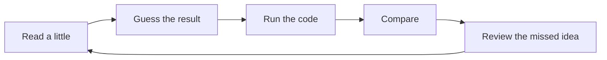
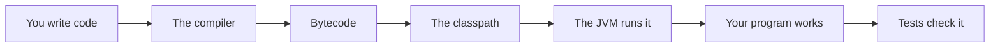

# Learning Map

## The big idea in plain words {#picture}

Learning Java is like learning to ride a bike. You do not read a book about bikes for a month and then ride. You get on, wobble, fall, and try again. Every small ride teaches your body something new.

This course works the same way. In every lesson you read a little, guess what a piece of code will do, run it, and see if you were right. When you are wrong, that is the best moment to learn, because now you know exactly which idea is missing.



## What you will be able to do {#outcomes}

By the end of this lesson you will be able to:

- Follow the study loop: read, guess, run, compare, review.
- Know the order of the topics and why that order helps.
- Know what you will have built at the end.

## Words to know {#vocabulary}

- **program**: a list of instructions a computer follows.
- **code**: the words we write to make the program.
- **run**: tell the computer to follow the instructions.
- **bug**: a mistake in the code. Every programmer makes them!
- **prerequisite**: something to learn first.

## Why this idea exists {#history}

Trying to memorize everything at once does not work. Small loops of "try, check, fix" build real skill, and you remember much longer than if you only read.

## Concept 1: Start with tiny programs {#concept-1}

Your first programs will be just a few lines. That is perfect. Small programs are easy to understand, and when something breaks, there are only a few places to look.

## Concept 2: Guess before you run {#concept-2}

Before pressing run, say what you think will happen. If you are right, great! If you are wrong, you just found something to learn. Guessing makes your brain pay attention.

## Concept 3: Errors are helpers {#concept-3}

When Java prints an error, it is not scolding you. It is pointing at the line where something is wrong. Read it slowly: it often tells you almost exactly what to fix.

## Concept 4: Come back later {#concept-4}

Your brain keeps what it needs. Look at old lessons after a day, a week, and a month. Try the exercise again without peeking. The little struggle of remembering is what makes it stick.

## Your first guess {#example}

Look at this line: `System.out.println(2 + 3);` What will it print? If you guessed 5, you are right. What about `System.out.println("2" + "3");`? It prints 23, because the quote marks make them words, and words are joined side by side. If you guessed wrong, that is great. Now you know the difference between numbers and text.

## Going deeper: the technical walkthrough {#walkthrough}

### Audience and prerequisites


You need a terminal, a text editor, Java 17 or newer, and curiosity. You do not
need to know Spring, Oracle, or object-oriented programming first. Learn the
language in small steps and run every example.


### Outcomes


You will be able to:

- install a JDK and explain the JVM;
- write variables, conditions, loops, methods, and classes;
- read records, interfaces, collections, generics, and lambdas;
- handle `null`, exceptions, dates, and files;
- understand packages, visibility, memory, and threads;
- write unit tests and build a JAR;
- read a Spring Boot controller, service, and repository;
- keep domain rules separate from HTTP and SQL.


### Recommended order


1. Install the JDK and run one class.
2. Learn values, variables, operators, conditions, and loops.
3. Write methods and small tests.
4. Learn classes, objects, encapsulation, records, and interfaces.
5. Learn collections, generics, exceptions, dates, and streams.
6. Learn packages, Gradle, JSON, HTTP, JDBC, and concurrency concepts.
7. Read a Spring Boot vertical slice.
8. Build a small typed service and test its rules.


## Worked scenario {#worked-scenario}

You understand how to ask for data with GET, but you cannot explain how the server checks incoming data. What should you study next?

The justified choice is **Practice sending bad data and see how the server checks it**. Select **review-validation** in the structured practical and explain why. Alternatives ignore a requirement, cross a trust boundary, or invent success.

### Structured decision contract

```json

{
  "decision": "review-validation",
  "justification": "The prerequisite and checkpoint boundary must preserve the declared contract and ownership.",
  "failureBehavior": "Expose a safe failure and recover through the boundary owner."
}

```

Decision selects one declared behavior. Justification explains the boundary. FailureBehavior explains the observable error and recovery owner. These fields never execute commands. Required terms and minimum lengths form a basic practice rubric, not semantic grading.

## Step-by-step flow and matching picture {#flow}




## Three real-life uses {#use-cases}

1. A student writes a small program that adds up prices in a shopping list.
2. A teacher uses a short program to calculate class averages.
3. A game uses many little rules, each written and tested on its own.

## What can go wrong, and how to stay safe {#failure-security}

The biggest mistake is copying code without understanding it. It works today and breaks tomorrow, and you will not know why. Another mistake is skipping the exercises. Reading feels like learning, but trying is what makes it real.

## Practice lab and expected observation {#practice}

1. Predict the scenario decision before opening Practical. Explain each rejected alternative.
2. Run a relevant example above in an isolated exercise project. Record the expected result, then change one input to an invalid or boundary value. A failed assertion or deliberate error should replace silent success.
3. Submit the structured decision. Initially the checks fail. After selecting review-validation and writing an explanation and failure plan, all three pass. Follow the indicated review section for missed checks.

### Broken example to debug

```json

{"decision":"trust-client","justification":"","failureBehavior":""}

```

This ignores the responsible boundary and gives no reasoning or recovery. Correct the fields rather than changing the validator.

## Checkpoint and definition of done {#checkpoint}

- [ ] Define prerequisite and checkpoint without looking.
- [ ] Trace input to owner and output.
- [ ] Explain one failure and one alternative.
- [ ] Pass at least four assignment questions.
- [ ] Pass every practical check and submit.
- [ ] Explain the concept again tomorrow.

## Sources, versions, and safe commands {#sources}

Java 17 baseline; installed validation JDK may be newer. Review date: 2026-10-02. The supplied blueprint is the teaching source; official landing pages were checked where reachable. No provider or original TM Schedule deployment was tested.

- [Official reference](https://docs.oracle.com/en/java/javase/17/)

[Course reading order](README.md) · [Next lesson](02-why-java-and-language-history.md)

```study-quiz

{
  "schemaVersion": 1,
  "lessonId": "java/01-learning-map",
  "title": "Assignment: Learning Map",
  "passPercentage": 80,
  "questions": [
    {
      "id": "q1",
      "sectionId": "concept-1",
      "prompt": "In Learning Map, what does prerequisite mean?",
      "options": [
        {
          "id": "a",
          "text": "something you need to know first, before the next thing makes sense",
          "explanation": "This preserves the definition and boundary described in the lesson."
        },
        {
          "id": "b",
          "text": "A permission granted by a hidden browser control",
          "explanation": "This changes the declared meaning or bypasses the responsible boundary."
        },
        {
          "id": "c",
          "text": "An unlimited provider operation with no ownership",
          "explanation": "This changes the declared meaning or bypasses the responsible boundary."
        },
        {
          "id": "d",
          "text": "A diagnostic credential intended for public logs",
          "explanation": "This changes the declared meaning or bypasses the responsible boundary."
        }
      ],
      "correctOptionId": "a",
      "explanation": "prerequisite means something you need to know first, before the next thing makes sense.",
      "reviewLabel": "Review concept 1"
    },
    {
      "id": "q2",
      "sectionId": "concept-2",
      "prompt": "In Learning Map, which rule is correct for checkpoint 2?",
      "options": [
        {
          "id": "a",
          "text": "Trust client-side checks instead of the server rule.",
          "explanation": "This changes the declared meaning or bypasses the responsible boundary."
        },
        {
          "id": "b",
          "text": "Guess the output first, then look at the answer.",
          "explanation": "This preserves the definition and boundary described in the lesson."
        },
        {
          "id": "c",
          "text": "Hide the failure by returning a fabricated successful result.",
          "explanation": "This changes the declared meaning or bypasses the responsible boundary."
        },
        {
          "id": "d",
          "text": "Skip the stated boundary, limit, or ownership check.",
          "explanation": "This changes the declared meaning or bypasses the responsible boundary."
        }
      ],
      "correctOptionId": "b",
      "explanation": "Guess the output first, then look at the answer.",
      "reviewLabel": "Review concept 2"
    },
    {
      "id": "q3",
      "sectionId": "concept-3",
      "prompt": "In Learning Map, which rule is correct for checkpoint 3?",
      "options": [
        {
          "id": "a",
          "text": "Trust client-side checks instead of the server rule.",
          "explanation": "This changes the declared meaning or bypasses the responsible boundary."
        },
        {
          "id": "b",
          "text": "Hide the failure by returning a fabricated successful result.",
          "explanation": "This changes the declared meaning or bypasses the responsible boundary."
        },
        {
          "id": "c",
          "text": "When a test fails, it points to the idea you are missing.",
          "explanation": "This preserves the definition and boundary described in the lesson."
        },
        {
          "id": "d",
          "text": "Skip the stated boundary, limit, or ownership check.",
          "explanation": "This changes the declared meaning or bypasses the responsible boundary."
        }
      ],
      "correctOptionId": "c",
      "explanation": "When a test fails, it points to the idea you are missing.",
      "reviewLabel": "Review concept 3"
    },
    {
      "id": "q4",
      "sectionId": "concept-4",
      "prompt": "In Learning Map, which rule is correct for checkpoint 4?",
      "options": [
        {
          "id": "a",
          "text": "Trust client-side checks instead of the server rule.",
          "explanation": "This changes the declared meaning or bypasses the responsible boundary."
        },
        {
          "id": "b",
          "text": "Hide the failure by returning a fabricated successful result.",
          "explanation": "This changes the declared meaning or bypasses the responsible boundary."
        },
        {
          "id": "c",
          "text": "Skip the stated boundary, limit, or ownership check.",
          "explanation": "This changes the declared meaning or bypasses the responsible boundary."
        },
        {
          "id": "d",
          "text": "A practice score in this app is just a helper, not an official exam grade.",
          "explanation": "This preserves the definition and boundary described in the lesson."
        }
      ],
      "correctOptionId": "d",
      "explanation": "A practice score in this app is just a helper, not an official exam grade.",
      "reviewLabel": "Review concept 4"
    },
    {
      "id": "q5",
      "sectionId": "worked-scenario",
      "prompt": "You understand how to ask for data with GET, but you cannot explain how the server checks incoming data. What should you study next?",
      "options": [
        {
          "id": "a",
          "text": "Practice sending bad data and see how the server checks it",
          "explanation": "This preserves the definition and boundary described in the lesson."
        },
        {
          "id": "b",
          "text": "Jump straight to advanced deployment",
          "explanation": "This changes the declared meaning or bypasses the responsible boundary."
        },
        {
          "id": "c",
          "text": "Copy an answer without trying it",
          "explanation": "This changes the declared meaning or bypasses the responsible boundary."
        },
        {
          "id": "d",
          "text": "Switch frameworks so the problem goes away",
          "explanation": "This changes the declared meaning or bypasses the responsible boundary."
        }
      ],
      "correctOptionId": "a",
      "explanation": "Practice sending bad data and see how the server checks it. Come back to a topic after a break; remembering it is better practice than just re-reading it.",
      "reviewLabel": "Review the worked scenario"
    }
  ]
}

```

```study-practical

{
  "schemaVersion": 1,
  "challengeId": "java/01-learning-map/decision",
  "lessonId": "java/01-learning-map",
  "title": "Practical: Learning Map",
  "language": "json",
  "mode": "structured",
  "instructions": "You understand how to ask for data with GET, but you cannot explain how the server checks incoming data. What should you study next? Return an object with decision (choose from review-validation, skip-check, unbounded-work, trust-client), justification (at least 40 characters; include prerequisite and checkpoint), and failureBehavior (at least 25 characters; include failure and recover while explaining the error and recovery). These are structured reasoning checks, not code execution or an official grade.",
  "starterCode": "{\n  \"decision\": \"\",\n  \"justification\": \"\",\n  \"failureBehavior\": \"\"\n}",
  "entryPoint": "answer",
  "publicExamples": [
    {
      "input": {
        "decision": "skip-check",
        "justification": "",
        "failureBehavior": ""
      },
      "expected": {
        "passed": false
      }
    },
    {
      "input": {
        "decision": "review-validation",
        "justification": "The prerequisite and checkpoint boundary must preserve the declared contract and ownership.",
        "failureBehavior": "Show a safe failure and recover through the responsible owner."
      },
      "expected": {
        "passed": true
      }
    }
  ],
  "publicTestIds": [
    "decision",
    "explanation",
    "failure-plan"
  ],
  "reviewSections": {
    "decision": "worked-scenario",
    "explanation": "concept-2",
    "failure-plan": "failure-security"
  },
  "limits": {
    "timeMs": 2000,
    "memoryMb": 128,
    "outputBytes": 20000
  }
}

```

