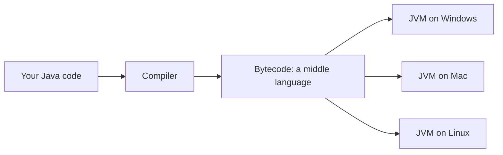
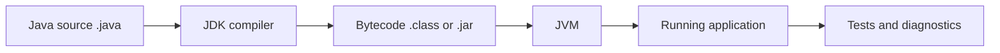
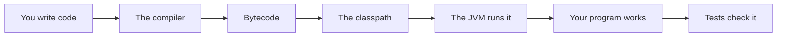

# Why Java And Language History

## The big idea in plain words {#picture}

Long ago, if you wrote a program for one kind of computer, it would not work on another. It was like a book written in a language only one town understood. Programmers had to rewrite everything for every kind of machine.

Java had a clever idea: "Write once, run anywhere." You write your program in Java. Java turns it into a special middle language. Then a small helper program on each computer, the **JVM**, understands the middle language. The same program runs on Windows, Mac, and Linux.



## What you will be able to do {#outcomes}

By the end of this lesson you will be able to:

- Explain the problem Java was made to solve.
- Say what portable, compiled, and typed mean in simple words.
- Know when another language might be a better choice.

## Words to know {#vocabulary}

- **portable**: able to run on many kinds of computers.
- **JVM**: the Java Virtual Machine, the helper that runs Java programs.
- **bytecode**: the middle language Java is turned into.
- **compiled**: translated before running.
- **typed language**: every value has a label for what kind of thing it is.
- **release**: a new version of Java, which comes out twice a year.

## Why this idea exists {#history}

Programs get big, and people on big teams need a language that catches mistakes early and works everywhere. Java was designed for that.

## Concept 1: Write once, run anywhere {#concept-1}

Java does not make a program for one computer. It makes bytecode, which any computer with a JVM can run. Think of it like a recipe written in one language and a cook in each kitchen who understands it.

## Concept 2: Java checks your work early {#concept-2}

Java is a typed language. If you try to put a word into a box meant for numbers, Java tells you before the program starts. It is like a teacher checking your homework before you hand it in.

## Concept 3: Java takes care of memory {#concept-3}

In some older languages the programmer had to clean up memory by hand and forgetting caused crashes. Java has a garbage collector that tidies up memory that is no longer used, like a helper who throws away old papers.

## Concept 4: No language is best for everything {#concept-4}

Java is great for big, long-lasting programs like banking, online shops, and Android apps. Python is nice for quick scripts and data work. JavaScript is for web pages. Choose the tool that fits the job, and remember that all of them are good at something.

## The same file on two computers {#example}

Anna writes `Hello.java` on a Windows laptop. She turns it into `Hello.class`. She emails the `.class` file to Ben, who uses a Mac. Ben runs it with the JVM and sees the same message, without Anna changing anything.

## Going deeper: the technical walkthrough {#walkthrough}

### The one-minute picture


Java is a language for giving careful instructions to a computer. The Java
compiler checks the instructions and makes bytecode. The Java Virtual Machine,
or JVM, runs that bytecode.



For backend work, Java is usually joined with a build tool such as Gradle, a
web framework such as Spring Boot, a database driver, and a test framework.


### First Java program


```java
public class HelloStudy {
    public static void main(String[] args) {
        String subject = "Java";
        System.out.println("Learning " + subject);
    }
}
```

Compile and run:

```bash
javac HelloStudy.java
java HelloStudy
```

`main` is the starting method for this small program. A Spring Boot application
has a different-looking entry point, but it still needs a starting point.


## Worked scenario {#worked-scenario}

A small team spends most of its time writing the same route and checking code over and over. What is a good reason to add a framework?

The justified choice is **It removes repeated setup while the team still writes its own permission rules**. Select **reduce-setup** in the structured practical and explain why. Alternatives ignore a requirement, cross a trust boundary, or invent success.

### Structured decision contract

```json

{
  "decision": "reduce-setup",
  "justification": "The runtime and framework boundary must preserve the declared contract and ownership.",
  "failureBehavior": "Expose a safe failure and recover through the boundary owner."
}

```

Decision selects one declared behavior. Justification explains the boundary. FailureBehavior explains the observable error and recovery owner. These fields never execute commands. Required terms and minimum lengths form a basic practice rubric, not semantic grading.

## Step-by-step flow and matching picture {#flow}




## Three real-life uses {#use-cases}

1. A bank uses Java for programs that must run reliably for many years.
2. Many Android phone apps are written in Java or Kotlin, which also uses the JVM.
3. Big online shops use Java for their servers.

## What can go wrong, and how to stay safe {#failure-security}

Mistakes: thinking Java and JavaScript are the same (they are very different languages with similar names), thinking a program runs without the JVM installed, and picking Java for a tiny one-time script when a simple script language would be quicker.

## Practice lab and expected observation {#practice}

1. Predict the scenario decision before opening Practical. Explain each rejected alternative.
2. Run a relevant example above in an isolated exercise project. Record the expected result, then change one input to an invalid or boundary value. A failed assertion or deliberate error should replace silent success.
3. Submit the structured decision. Initially the checks fail. After selecting reduce-setup and writing an explanation and failure plan, all three pass. Follow the indicated review section for missed checks.

### Broken example to debug

```json

{"decision":"trust-client","justification":"","failureBehavior":""}

```

This ignores the responsible boundary and gives no reasoning or recovery. Correct the fields rather than changing the validator.

## Checkpoint and definition of done {#checkpoint}

- [ ] Define runtime and framework without looking.
- [ ] Trace input to owner and output.
- [ ] Explain one failure and one alternative.
- [ ] Pass at least four assignment questions.
- [ ] Pass every practical check and submit.
- [ ] Explain the concept again tomorrow.

## Sources, versions, and safe commands {#sources}

Java 17 baseline; installed validation JDK may be newer. Review date: 2026-10-02. The supplied blueprint is the teaching source; official landing pages were checked where reachable. No provider or original TM Schedule deployment was tested.

- [Official reference](https://docs.oracle.com/en/java/javase/17/)

[Course reading order](README.md) · [Previous lesson](01-learning-map.md) · [Next lesson](03-jdk-jvm-compiler-and-first-program.md)

```study-quiz

{
  "schemaVersion": 1,
  "lessonId": "java/02-why-java-and-language-history",
  "title": "Assignment: Why Java And Language History",
  "passPercentage": 80,
  "questions": [
    {
      "id": "q1",
      "sectionId": "concept-1",
      "prompt": "In Why Java And Language History, what does runtime mean?",
      "options": [
        {
          "id": "a",
          "text": "A permission granted by a hidden browser control",
          "explanation": "This changes the declared meaning or bypasses the responsible boundary."
        },
        {
          "id": "b",
          "text": "the helper program that actually runs your code",
          "explanation": "This preserves the definition and boundary described in the lesson."
        },
        {
          "id": "c",
          "text": "An unlimited provider operation with no ownership",
          "explanation": "This changes the declared meaning or bypasses the responsible boundary."
        },
        {
          "id": "d",
          "text": "A diagnostic credential intended for public logs",
          "explanation": "This changes the declared meaning or bypasses the responsible boundary."
        }
      ],
      "correctOptionId": "b",
      "explanation": "runtime means the helper program that actually runs your code.",
      "reviewLabel": "Review concept 1"
    },
    {
      "id": "q2",
      "sectionId": "concept-2",
      "prompt": "In Why Java And Language History, which rule is correct for checkpoint 2?",
      "options": [
        {
          "id": "a",
          "text": "Trust client-side checks instead of the server rule.",
          "explanation": "This changes the declared meaning or bypasses the responsible boundary."
        },
        {
          "id": "b",
          "text": "Hide the failure by returning a fabricated successful result.",
          "explanation": "This changes the declared meaning or bypasses the responsible boundary."
        },
        {
          "id": "c",
          "text": "A framework saves setup work, but it does not decide who is allowed to do what.",
          "explanation": "This preserves the definition and boundary described in the lesson."
        },
        {
          "id": "d",
          "text": "Skip the stated boundary, limit, or ownership check.",
          "explanation": "This changes the declared meaning or bypasses the responsible boundary."
        }
      ],
      "correctOptionId": "c",
      "explanation": "A framework saves setup work, but it does not decide who is allowed to do what.",
      "reviewLabel": "Review concept 2"
    },
    {
      "id": "q3",
      "sectionId": "concept-3",
      "prompt": "In Why Java And Language History, which rule is correct for checkpoint 3?",
      "options": [
        {
          "id": "a",
          "text": "Trust client-side checks instead of the server rule.",
          "explanation": "This changes the declared meaning or bypasses the responsible boundary."
        },
        {
          "id": "b",
          "text": "Hide the failure by returning a fabricated successful result.",
          "explanation": "This changes the declared meaning or bypasses the responsible boundary."
        },
        {
          "id": "c",
          "text": "Skip the stated boundary, limit, or ownership check.",
          "explanation": "This changes the declared meaning or bypasses the responsible boundary."
        },
        {
          "id": "d",
          "text": "Code that is compiled once to portable bytecode still needs a matching runtime on each computer.",
          "explanation": "This preserves the definition and boundary described in the lesson."
        }
      ],
      "correctOptionId": "d",
      "explanation": "Code that is compiled once to portable bytecode still needs a matching runtime on each computer.",
      "reviewLabel": "Review concept 3"
    },
    {
      "id": "q4",
      "sectionId": "concept-4",
      "prompt": "In Why Java And Language History, which rule is correct for checkpoint 4?",
      "options": [
        {
          "id": "a",
          "text": "Non-blocking input and output helps when your program mostly waits; it does not make heavy math faster.",
          "explanation": "This preserves the definition and boundary described in the lesson."
        },
        {
          "id": "b",
          "text": "Trust client-side checks instead of the server rule.",
          "explanation": "This changes the declared meaning or bypasses the responsible boundary."
        },
        {
          "id": "c",
          "text": "Hide the failure by returning a fabricated successful result.",
          "explanation": "This changes the declared meaning or bypasses the responsible boundary."
        },
        {
          "id": "d",
          "text": "Skip the stated boundary, limit, or ownership check.",
          "explanation": "This changes the declared meaning or bypasses the responsible boundary."
        }
      ],
      "correctOptionId": "a",
      "explanation": "Non-blocking input and output helps when your program mostly waits; it does not make heavy math faster.",
      "reviewLabel": "Review concept 4"
    },
    {
      "id": "q5",
      "sectionId": "worked-scenario",
      "prompt": "A small team spends most of its time writing the same route and checking code over and over. What is a good reason to add a framework?",
      "options": [
        {
          "id": "a",
          "text": "It guarantees every database query is fast",
          "explanation": "This changes the declared meaning or bypasses the responsible boundary."
        },
        {
          "id": "b",
          "text": "It removes repeated setup while the team still writes its own permission rules",
          "explanation": "This preserves the definition and boundary described in the lesson."
        },
        {
          "id": "c",
          "text": "It means you no longer need tests",
          "explanation": "This changes the declared meaning or bypasses the responsible boundary."
        },
        {
          "id": "d",
          "text": "It automatically decides who is allowed to do what",
          "explanation": "This changes the declared meaning or bypasses the responsible boundary."
        }
      ],
      "correctOptionId": "b",
      "explanation": "It removes repeated setup while the team still writes its own permission rules. When you pick a technology, say which need it meets and which cost you accept.",
      "reviewLabel": "Review the worked scenario"
    }
  ]
}

```

```study-practical

{
  "schemaVersion": 1,
  "challengeId": "java/02-why-java-and-language-history/decision",
  "lessonId": "java/02-why-java-and-language-history",
  "title": "Practical: Why Java And Language History",
  "language": "json",
  "mode": "structured",
  "instructions": "A small team spends most of its time writing the same route and checking code over and over. What is a good reason to add a framework? Return an object with decision (choose from reduce-setup, skip-check, unbounded-work, trust-client), justification (at least 40 characters; include runtime and framework), and failureBehavior (at least 25 characters; include failure and recover while explaining the error and recovery). These are structured reasoning checks, not code execution or an official grade.",
  "starterCode": "{\n  \"decision\": \"\",\n  \"justification\": \"\",\n  \"failureBehavior\": \"\"\n}",
  "entryPoint": "answer",
  "publicExamples": [
    {
      "input": {
        "decision": "skip-check",
        "justification": "",
        "failureBehavior": ""
      },
      "expected": {
        "passed": false
      }
    },
    {
      "input": {
        "decision": "reduce-setup",
        "justification": "The runtime and framework boundary must preserve the declared contract and ownership.",
        "failureBehavior": "Show a safe failure and recover through the responsible owner."
      },
      "expected": {
        "passed": true
      }
    }
  ],
  "publicTestIds": [
    "decision",
    "explanation",
    "failure-plan"
  ],
  "reviewSections": {
    "decision": "worked-scenario",
    "explanation": "concept-2",
    "failure-plan": "failure-security"
  },
  "limits": {
    "timeMs": 2000,
    "memoryMb": 128,
    "outputBytes": 20000
  }
}

```

