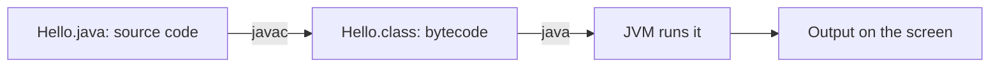
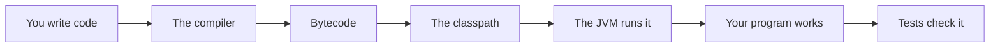

# Jdk Jvm Compiler And First Program

## The big idea in plain words {#picture}

Imagine you write a story in English and want a friend in another country to read it. You give it to a translator, who writes it in a common language. Your friend has a reader that understands that common language.

Java works the same. You write **source code** in a `.java` file. The **compiler** (`javac`) translates it into a `.class` file of **bytecode**. The **JVM** (`java`) reads the bytecode and does what it says. All of the tools together, plus helpers, are the **JDK**.



## What you will be able to do {#outcomes}

By the end of this lesson you will be able to:

- Tell the JDK, the JVM, and the compiler apart.
- Compile and run a first program.
- Explain `main`, the classpath, and a JAR file.

## Words to know {#vocabulary}

- **JDK**: the Java Development Kit, all the tools you need to write and run Java.
- **JVM**: the program that runs bytecode.
- **compiler**: the translator from source code to bytecode.
- **main**: the starting point of a Java program.
- **classpath**: the list of places where Java looks for finished code.
- **JAR**: a zip-like file holding many class files.

## Why this idea exists {#history}

When something fails, you need to know which step failed: writing, translating, or running. Knowing the three steps makes mistakes much easier to find.

## Concept 1: JDK, JVM, compiler: who does what {#concept-1}

The **JDK** is the full toolbox. Inside is the **compiler** (`javac`), which translates, and the **JVM** (`java`), which runs. If you only want to run Java programs, you need the JVM. To write them, you need the whole JDK.

## Concept 2: The first program {#concept-2}

Every Java program begins at a method called `main`. When you run a class, Java looks for `main` and starts there. This is like the first page of a book: reading starts here.

## Concept 3: Bytecode is the middle language {#concept-3}

`javac` checks your code for mistakes. If all is well, it creates `.class` files. These are not meant for humans. They are the instructions in a form the JVM loves.

## Concept 4: Classpath and JAR files {#concept-4}

When your program uses code that lives elsewhere, Java needs to know where to look. The classpath is that list of places. A JAR file bundles many `.class` files into one tidy package so it is easy to share.

## Your first program {#example}

```java
public class Hello {
    public static void main(String[] args) {
        System.out.println("Hello, world!");
    }
}
```
Save it as `Hello.java`. In the terminal type `javac Hello.java` to compile, then `java Hello` to run. You should see `Hello, world!`. The file name must match the class name, and capital letters matter!

## Going deeper: the technical walkthrough {#walkthrough}

### First Java program


```java
public class HelloStudy {
    public static void main(String[] args) {
        String subject = "Java";
        System.out.println("Learning " + subject);
    }
}
```

Compile and run:

```bash
javac HelloStudy.java
java HelloStudy
```

`main` is the starting method for this small program. A Spring Boot application
has a different-looking entry point, but it still needs a starting point.


## Worked scenario {#worked-scenario}

A small team spends most of its time writing the same route and checking code over and over. What is a good reason to add a framework?

The justified choice is **It removes repeated setup while the team still writes its own permission rules**. Select **reduce-setup** in the structured practical and explain why. Alternatives ignore a requirement, cross a trust boundary, or invent success.

### Structured decision contract

```json

{
  "decision": "reduce-setup",
  "justification": "The runtime and framework boundary must preserve the declared contract and ownership.",
  "failureBehavior": "Expose a safe failure and recover through the boundary owner."
}

```

Decision selects one declared behavior. Justification explains the boundary. FailureBehavior explains the observable error and recovery owner. These fields never execute commands. Required terms and minimum lengths form a basic practice rubric, not semantic grading.

## Step-by-step flow and matching picture {#flow}




## Three real-life uses {#use-cases}

1. A student compiles and runs a first program to print their name.
2. A team packs their finished program into a JAR file and sends it to a server.
3. A teacher gives students a JAR of a game that runs on any computer with Java installed.

## What can go wrong, and how to stay safe {#failure-security}

Common mistakes: the file name does not match the class name, forgetting a semicolon (`;`) at the end of a line, mixing up capital and small letters (`Main` is not `main`), and trying to run `java Hello.java` before understanding what compiled means. Read the first error message. It is usually the real one.

## Practice lab and expected observation {#practice}

1. Predict the scenario decision before opening Practical. Explain each rejected alternative.
2. Run a relevant example above in an isolated exercise project. Record the expected result, then change one input to an invalid or boundary value. A failed assertion or deliberate error should replace silent success.
3. Submit the structured decision. Initially the checks fail. After selecting reduce-setup and writing an explanation and failure plan, all three pass. Follow the indicated review section for missed checks.

### Broken example to debug

```json

{"decision":"trust-client","justification":"","failureBehavior":""}

```

This ignores the responsible boundary and gives no reasoning or recovery. Correct the fields rather than changing the validator.

## Checkpoint and definition of done {#checkpoint}

- [ ] Define runtime and framework without looking.
- [ ] Trace input to owner and output.
- [ ] Explain one failure and one alternative.
- [ ] Pass at least four assignment questions.
- [ ] Pass every practical check and submit.
- [ ] Explain the concept again tomorrow.

## Sources, versions, and safe commands {#sources}

Java 17 baseline; installed validation JDK may be newer. Review date: 2026-10-02. The supplied blueprint is the teaching source; official landing pages were checked where reachable. No provider or original TM Schedule deployment was tested.

- [Official reference](https://docs.oracle.com/en/java/javase/17/)

[Course reading order](README.md) · [Previous lesson](02-why-java-and-language-history.md) · [Next lesson](03a-reading-error-messages-and-stack-traces.md)

```study-quiz

{
  "schemaVersion": 1,
  "lessonId": "java/03-jdk-jvm-compiler-and-first-program",
  "title": "Assignment: Jdk Jvm Compiler And First Program",
  "passPercentage": 80,
  "questions": [
    {
      "id": "q1",
      "sectionId": "concept-1",
      "prompt": "In Jdk Jvm Compiler And First Program, what does runtime mean?",
      "options": [
        {
          "id": "a",
          "text": "A permission granted by a hidden browser control",
          "explanation": "This changes the declared meaning or bypasses the responsible boundary."
        },
        {
          "id": "b",
          "text": "An unlimited provider operation with no ownership",
          "explanation": "This changes the declared meaning or bypasses the responsible boundary."
        },
        {
          "id": "c",
          "text": "the helper program that actually runs your code",
          "explanation": "This preserves the definition and boundary described in the lesson."
        },
        {
          "id": "d",
          "text": "A diagnostic credential intended for public logs",
          "explanation": "This changes the declared meaning or bypasses the responsible boundary."
        }
      ],
      "correctOptionId": "c",
      "explanation": "runtime means the helper program that actually runs your code.",
      "reviewLabel": "Review concept 1"
    },
    {
      "id": "q2",
      "sectionId": "concept-2",
      "prompt": "In Jdk Jvm Compiler And First Program, which rule is correct for checkpoint 2?",
      "options": [
        {
          "id": "a",
          "text": "Trust client-side checks instead of the server rule.",
          "explanation": "This changes the declared meaning or bypasses the responsible boundary."
        },
        {
          "id": "b",
          "text": "Hide the failure by returning a fabricated successful result.",
          "explanation": "This changes the declared meaning or bypasses the responsible boundary."
        },
        {
          "id": "c",
          "text": "Skip the stated boundary, limit, or ownership check.",
          "explanation": "This changes the declared meaning or bypasses the responsible boundary."
        },
        {
          "id": "d",
          "text": "A framework saves setup work, but it does not decide who is allowed to do what.",
          "explanation": "This preserves the definition and boundary described in the lesson."
        }
      ],
      "correctOptionId": "d",
      "explanation": "A framework saves setup work, but it does not decide who is allowed to do what.",
      "reviewLabel": "Review concept 2"
    },
    {
      "id": "q3",
      "sectionId": "concept-3",
      "prompt": "In Jdk Jvm Compiler And First Program, which rule is correct for checkpoint 3?",
      "options": [
        {
          "id": "a",
          "text": "Code that is compiled once to portable bytecode still needs a matching runtime on each computer.",
          "explanation": "This preserves the definition and boundary described in the lesson."
        },
        {
          "id": "b",
          "text": "Trust client-side checks instead of the server rule.",
          "explanation": "This changes the declared meaning or bypasses the responsible boundary."
        },
        {
          "id": "c",
          "text": "Hide the failure by returning a fabricated successful result.",
          "explanation": "This changes the declared meaning or bypasses the responsible boundary."
        },
        {
          "id": "d",
          "text": "Skip the stated boundary, limit, or ownership check.",
          "explanation": "This changes the declared meaning or bypasses the responsible boundary."
        }
      ],
      "correctOptionId": "a",
      "explanation": "Code that is compiled once to portable bytecode still needs a matching runtime on each computer.",
      "reviewLabel": "Review concept 3"
    },
    {
      "id": "q4",
      "sectionId": "concept-4",
      "prompt": "In Jdk Jvm Compiler And First Program, which rule is correct for checkpoint 4?",
      "options": [
        {
          "id": "a",
          "text": "Trust client-side checks instead of the server rule.",
          "explanation": "This changes the declared meaning or bypasses the responsible boundary."
        },
        {
          "id": "b",
          "text": "Non-blocking input and output helps when your program mostly waits; it does not make heavy math faster.",
          "explanation": "This preserves the definition and boundary described in the lesson."
        },
        {
          "id": "c",
          "text": "Hide the failure by returning a fabricated successful result.",
          "explanation": "This changes the declared meaning or bypasses the responsible boundary."
        },
        {
          "id": "d",
          "text": "Skip the stated boundary, limit, or ownership check.",
          "explanation": "This changes the declared meaning or bypasses the responsible boundary."
        }
      ],
      "correctOptionId": "b",
      "explanation": "Non-blocking input and output helps when your program mostly waits; it does not make heavy math faster.",
      "reviewLabel": "Review concept 4"
    },
    {
      "id": "q5",
      "sectionId": "worked-scenario",
      "prompt": "A small team spends most of its time writing the same route and checking code over and over. What is a good reason to add a framework?",
      "options": [
        {
          "id": "a",
          "text": "It guarantees every database query is fast",
          "explanation": "This changes the declared meaning or bypasses the responsible boundary."
        },
        {
          "id": "b",
          "text": "It means you no longer need tests",
          "explanation": "This changes the declared meaning or bypasses the responsible boundary."
        },
        {
          "id": "c",
          "text": "It removes repeated setup while the team still writes its own permission rules",
          "explanation": "This preserves the definition and boundary described in the lesson."
        },
        {
          "id": "d",
          "text": "It automatically decides who is allowed to do what",
          "explanation": "This changes the declared meaning or bypasses the responsible boundary."
        }
      ],
      "correctOptionId": "c",
      "explanation": "It removes repeated setup while the team still writes its own permission rules. When you pick a technology, say which need it meets and which cost you accept.",
      "reviewLabel": "Review the worked scenario"
    }
  ]
}

```

```study-practical

{
  "schemaVersion": 1,
  "challengeId": "java/03-jdk-jvm-compiler-and-first-program/decision",
  "lessonId": "java/03-jdk-jvm-compiler-and-first-program",
  "title": "Practical: Jdk Jvm Compiler And First Program",
  "language": "json",
  "mode": "structured",
  "instructions": "A small team spends most of its time writing the same route and checking code over and over. What is a good reason to add a framework? Return an object with decision (choose from reduce-setup, skip-check, unbounded-work, trust-client), justification (at least 40 characters; include runtime and framework), and failureBehavior (at least 25 characters; include failure and recover while explaining the error and recovery). These are structured reasoning checks, not code execution or an official grade.",
  "starterCode": "{\n  \"decision\": \"\",\n  \"justification\": \"\",\n  \"failureBehavior\": \"\"\n}",
  "entryPoint": "answer",
  "publicExamples": [
    {
      "input": {
        "decision": "skip-check",
        "justification": "",
        "failureBehavior": ""
      },
      "expected": {
        "passed": false
      }
    },
    {
      "input": {
        "decision": "reduce-setup",
        "justification": "The runtime and framework boundary must preserve the declared contract and ownership.",
        "failureBehavior": "Show a safe failure and recover through the responsible owner."
      },
      "expected": {
        "passed": true
      }
    }
  ],
  "publicTestIds": [
    "decision",
    "explanation",
    "failure-plan"
  ],
  "reviewSections": {
    "decision": "worked-scenario",
    "explanation": "concept-2",
    "failure-plan": "failure-security"
  },
  "limits": {
    "timeMs": 2000,
    "memoryMb": 128,
    "outputBytes": 20000
  }
}

```

