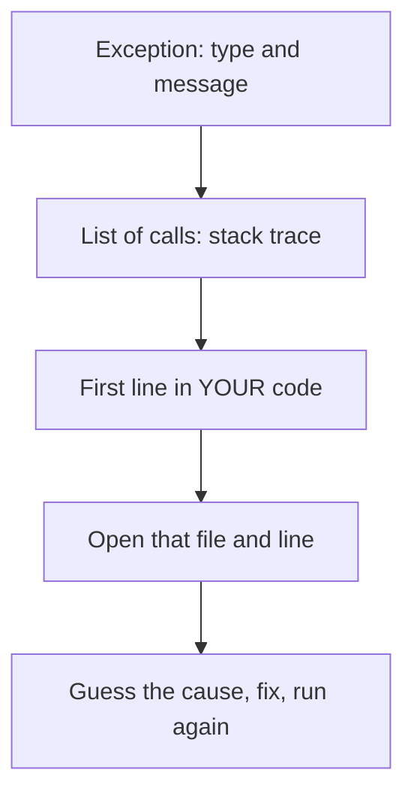
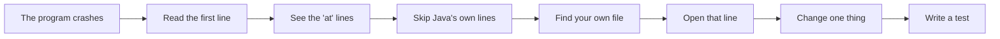
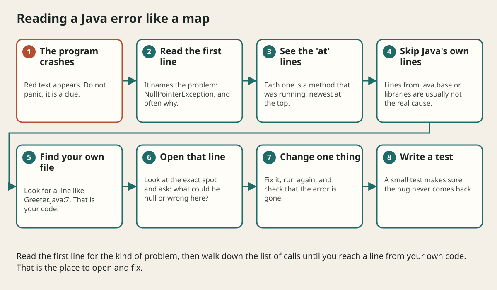

# Reading Error Messages And Stack Traces

## The big idea in plain words {#picture}

When a car shows a warning light, it does not mean the car hates you. It is giving you a clue. Java error messages are the same. They are the program's way of saying, "Here is exactly where I got confused."

At first the red text looks like a scary wall. But it has a simple shape: the **kind of problem**, a **short message**, and a **list of places** the program was visiting. Once you know where to look, you can fix most bugs in minutes.



## What you will be able to do {#outcomes}

By the end of this lesson you will be able to:

- Tell a compile error from a runtime error.
- Read a stack trace from the top and find your own code.
- Follow a calm four-step method to fix a bug.

## Words to know {#vocabulary}

- **compile error**: Java found a mistake before running.
- **runtime exception**: a problem that happens while running.
- **stack trace**: the list of calls that led to the error.
- **line number**: the spot in a file where the problem was noticed.
- **debugger**: a tool that lets you pause a program and look inside.
- **reproduce**: make the bug happen again on purpose so you can study it.

## Why this idea exists {#history}

Beginners often panic or guess wildly. Programmers who read the message first fix problems in a fraction of the time, and they learn from every bug.

## Concept 1: Compile errors: found early {#concept-1}

```text
Hello.java:3: error: ';' expected
    System.out.println("Hi")
                            ^
```
It names the file, the line, and even points with `^`. The error is often on the line just before the point shown, as a missing semicolon. Fix the first error first, because later ones may just be echoes.

## Concept 2: Runtime errors: found while running {#concept-2}

```text
Exception in thread "main" java.lang.NullPointerException:
    Cannot invoke "String.length()" because "name" is null
    at Greeter.greet(Greeter.java:7)
    at Main.main(Main.java:4)
```
The first line says what and why: `name` was null. The lines starting with `at` show where.

## Concept 3: Reading a stack trace {#concept-3}

The top `at` line is where it happened. The next is who called that, and so on, down to `main`. Look for the first line with your own class names (like `Greeter.java:7`). Lines from Java's own packages (`java.base`, `org.springframework`) are usually not the real problem.

## Concept 4: A calm debugging method {#concept-4}

1) Read the message. 2) Open the file and line. 3) Make a guess about the cause and test it with a print statement or a debugger. 4) Change one thing and run again. If you change five things at once, you cannot tell which one helped.

## Fix the greeting {#example}

Above, line 7 of `Greeter.java` uses `name.length()`, and `name` is null because `Main` passed nothing. Either check `if (name == null)` first or pass a real name from `Main`. After the change, the program prints `Hello, Ava!` and the error is gone.

## Going deeper: the technical walkthrough {#walkthrough}

## Worked scenario {#worked-scenario}

Your program crashes with a long red stack trace. Where do you look first?

The justified choice is **At the error type and message, then at the first line that names your own file and line number**. Select **read-trace** in the structured practical and explain why. Alternatives ignore a requirement, cross a trust boundary, or invent success.

### Structured decision contract

```json

{
  "decision": "read-trace",
  "justification": "The compileError and runtimeError boundary must preserve the declared contract and ownership.",
  "failureBehavior": "Expose a safe failure and recover through the boundary owner."
}

```

Decision selects one declared behavior. Justification explains the boundary. FailureBehavior explains the observable error and recovery owner. These fields never execute commands. Required terms and minimum lengths form a basic practice rubric, not semantic grading.

## Step-by-step flow and matching picture {#flow}





## Three real-life uses {#use-cases}

1. A student finds a missing semicolon by reading the compile error.
2. A developer follows a stack trace to a line where a list was empty.
3. A team adds a request ID to errors so they can find the right stack trace in the logs.

## What can go wrong, and how to stay safe {#failure-security}

Mistakes: ignoring the message, fixing the last error instead of the first, changing many things at once, and deleting code until the error "goes away" without knowing why. Another trap: swallowing the exception with an empty `catch`, which hides the very clue you needed.

## Practice lab and expected observation {#practice}

1. Predict the scenario decision before opening Practical. Explain each rejected alternative.
2. Run a relevant example above in an isolated exercise project. Record the expected result, then change one input to an invalid or boundary value. A failed assertion or deliberate error should replace silent success.
3. Submit the structured decision. Initially the checks fail. After selecting read-trace and writing an explanation and failure plan, all three pass. Follow the indicated review section for missed checks.

### Broken example to debug

```json

{"decision":"trust-client","justification":"","failureBehavior":""}

```

This ignores the responsible boundary and gives no reasoning or recovery. Correct the fields rather than changing the validator.

## Checkpoint and definition of done {#checkpoint}

- [ ] Define compileError and runtimeError without looking.
- [ ] Trace input to owner and output.
- [ ] Explain one failure and one alternative.
- [ ] Pass at least four assignment questions.
- [ ] Pass every practical check and submit.
- [ ] Explain the concept again tomorrow.

## Sources, versions, and safe commands {#sources}

Java 17 baseline; installed validation JDK may be newer. Review date: 2026-10-02. The supplied blueprint is the teaching source; official landing pages were checked where reachable. No provider or original TM Schedule deployment was tested.

- [Official reference](https://docs.oracle.com/en/java/javase/17/)

[Course reading order](README.md) · [Previous lesson](03-jdk-jvm-compiler-and-first-program.md) · [Next lesson](04-variables-types-and-operators.md)

```study-quiz

{
  "schemaVersion": 1,
  "lessonId": "java/03a-reading-error-messages-and-stack-traces",
  "title": "Assignment: Reading Error Messages And Stack Traces",
  "passPercentage": 80,
  "questions": [
    {
      "id": "q1",
      "sectionId": "concept-1",
      "prompt": "In Reading Error Messages And Stack Traces, what does compileError mean?",
      "options": [
        {
          "id": "a",
          "text": "A permission granted by a hidden browser control",
          "explanation": "This changes the declared meaning or bypasses the responsible boundary."
        },
        {
          "id": "b",
          "text": "An unlimited provider operation with no ownership",
          "explanation": "This changes the declared meaning or bypasses the responsible boundary."
        },
        {
          "id": "c",
          "text": "A diagnostic credential intended for public logs",
          "explanation": "This changes the declared meaning or bypasses the responsible boundary."
        },
        {
          "id": "d",
          "text": "a mistake Java finds before the program runs",
          "explanation": "This preserves the definition and boundary described in the lesson."
        }
      ],
      "correctOptionId": "d",
      "explanation": "compileError means a mistake Java finds before the program runs.",
      "reviewLabel": "Review concept 1"
    },
    {
      "id": "q2",
      "sectionId": "concept-2",
      "prompt": "In Reading Error Messages And Stack Traces, which rule is correct for checkpoint 2?",
      "options": [
        {
          "id": "a",
          "text": "A runtime exception happens while the program runs, such as dividing by zero or using null.",
          "explanation": "This preserves the definition and boundary described in the lesson."
        },
        {
          "id": "b",
          "text": "Trust client-side checks instead of the server rule.",
          "explanation": "This changes the declared meaning or bypasses the responsible boundary."
        },
        {
          "id": "c",
          "text": "Hide the failure by returning a fabricated successful result.",
          "explanation": "This changes the declared meaning or bypasses the responsible boundary."
        },
        {
          "id": "d",
          "text": "Skip the stated boundary, limit, or ownership check.",
          "explanation": "This changes the declared meaning or bypasses the responsible boundary."
        }
      ],
      "correctOptionId": "a",
      "explanation": "A runtime exception happens while the program runs, such as dividing by zero or using null.",
      "reviewLabel": "Review concept 2"
    },
    {
      "id": "q3",
      "sectionId": "concept-3",
      "prompt": "In Reading Error Messages And Stack Traces, which rule is correct for checkpoint 3?",
      "options": [
        {
          "id": "a",
          "text": "Trust client-side checks instead of the server rule.",
          "explanation": "This changes the declared meaning or bypasses the responsible boundary."
        },
        {
          "id": "b",
          "text": "A stack trace lists the calls from the newest at the top to the oldest at the bottom.",
          "explanation": "This preserves the definition and boundary described in the lesson."
        },
        {
          "id": "c",
          "text": "Hide the failure by returning a fabricated successful result.",
          "explanation": "This changes the declared meaning or bypasses the responsible boundary."
        },
        {
          "id": "d",
          "text": "Skip the stated boundary, limit, or ownership check.",
          "explanation": "This changes the declared meaning or bypasses the responsible boundary."
        }
      ],
      "correctOptionId": "b",
      "explanation": "A stack trace lists the calls from the newest at the top to the oldest at the bottom.",
      "reviewLabel": "Review concept 3"
    },
    {
      "id": "q4",
      "sectionId": "concept-4",
      "prompt": "In Reading Error Messages And Stack Traces, which rule is correct for checkpoint 4?",
      "options": [
        {
          "id": "a",
          "text": "Trust client-side checks instead of the server rule.",
          "explanation": "This changes the declared meaning or bypasses the responsible boundary."
        },
        {
          "id": "b",
          "text": "Hide the failure by returning a fabricated successful result.",
          "explanation": "This changes the declared meaning or bypasses the responsible boundary."
        },
        {
          "id": "c",
          "text": "The most useful line is usually the first one that mentions your own code.",
          "explanation": "This preserves the definition and boundary described in the lesson."
        },
        {
          "id": "d",
          "text": "Skip the stated boundary, limit, or ownership check.",
          "explanation": "This changes the declared meaning or bypasses the responsible boundary."
        }
      ],
      "correctOptionId": "c",
      "explanation": "The most useful line is usually the first one that mentions your own code.",
      "reviewLabel": "Review concept 4"
    },
    {
      "id": "q5",
      "sectionId": "worked-scenario",
      "prompt": "Your program crashes with a long red stack trace. Where do you look first?",
      "options": [
        {
          "id": "a",
          "text": "At the very last line only",
          "explanation": "This changes the declared meaning or bypasses the responsible boundary."
        },
        {
          "id": "b",
          "text": "Nowhere, just rewrite everything",
          "explanation": "This changes the declared meaning or bypasses the responsible boundary."
        },
        {
          "id": "c",
          "text": "At the color of the text",
          "explanation": "This changes the declared meaning or bypasses the responsible boundary."
        },
        {
          "id": "d",
          "text": "At the error type and message, then at the first line that names your own file and line number",
          "explanation": "This preserves the definition and boundary described in the lesson."
        }
      ],
      "correctOptionId": "d",
      "explanation": "At the error type and message, then at the first line that names your own file and line number. Change one thing at a time when fixing a bug, and run the program again after each change.",
      "reviewLabel": "Review the worked scenario"
    }
  ]
}

```

```study-practical

{
  "schemaVersion": 1,
  "challengeId": "java/03a-reading-error-messages-and-stack-traces/decision",
  "lessonId": "java/03a-reading-error-messages-and-stack-traces",
  "title": "Practical: Reading Error Messages And Stack Traces",
  "language": "json",
  "mode": "structured",
  "instructions": "Your program crashes with a long red stack trace. Where do you look first? Return an object with decision (choose from read-trace, skip-check, unbounded-work, trust-client), justification (at least 40 characters; include compileError and runtimeError), and failureBehavior (at least 25 characters; include failure and recover while explaining the error and recovery). These are structured reasoning checks, not code execution or an official grade.",
  "starterCode": "{\n  \"decision\": \"\",\n  \"justification\": \"\",\n  \"failureBehavior\": \"\"\n}",
  "entryPoint": "answer",
  "publicExamples": [
    {
      "input": {
        "decision": "skip-check",
        "justification": "",
        "failureBehavior": ""
      },
      "expected": {
        "passed": false
      }
    },
    {
      "input": {
        "decision": "read-trace",
        "justification": "The compileError and runtimeError boundary must preserve the declared contract and ownership.",
        "failureBehavior": "Show a safe failure and recover through the responsible owner."
      },
      "expected": {
        "passed": true
      }
    }
  ],
  "publicTestIds": [
    "decision",
    "explanation",
    "failure-plan"
  ],
  "reviewSections": {
    "decision": "worked-scenario",
    "explanation": "concept-2",
    "failure-plan": "failure-security"
  },
  "limits": {
    "timeMs": 2000,
    "memoryMb": 128,
    "outputBytes": 20000
  }
}

```

