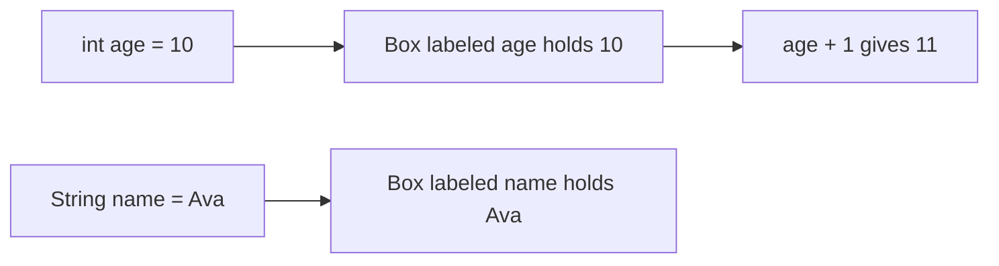
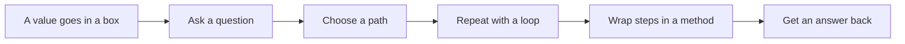

# Variables Types And Operators

## The big idea in plain words {#picture}

A variable is a labeled box. On the label you write the name, and you also write what kind of thing it may hold: `int age` is a box for whole numbers, `String name` is a box for words. Put something in, take it out, change it, or look at it.

Java is strict about labels. You cannot put a word into a number box. This strictness is a gift: Java stops many mistakes before the program even runs.



## What you will be able to do {#outcomes}

By the end of this lesson you will be able to:

- Make variables and pick the right type for each.
- Use math, comparison, and logic operators.
- Explain the difference between `==` and `.equals`.

## Words to know {#vocabulary}

- **variable**: a labeled box that holds a value.
- **type**: what kind of value a variable can hold, like `int` or `String`.
- **primitive**: a basic value like a number or true/false.
- **reference**: a pointer to an object, like a street address to a house.
- **operator**: a symbol that does something, like `+` or `==`.
- **cast**: changing a value from one type to another.

## Why this idea exists {#history}

Computers are fast but not smart. They need us to say exactly what each piece of data is. Types prevent silly mistakes, like adding a name to a price.

## Concept 1: Basic types {#concept-1}

`int` is for whole numbers like 7. `double` is for numbers with decimals like 3.14. `boolean` is for true or false. `char` is for a single letter. `String` is for words. Pick the one that matches what you are storing.

## Concept 2: Operators do work {#concept-2}

`+ - * /` do math. `==` asks "are these the same?" and `&&` means "and" while `||` means "or". Be careful: `7 / 2` is `3` with `int`, because whole-number math drops the leftover. Use `7 / 2.0` to get `3.5`.

## Concept 3: Primitive or reference? {#concept-3}

A primitive like `int` holds the value itself. A reference, like for `String` or any object, holds an address that points to the object. This explains why `==` on two strings can say "no" even when the words are the same: it checks if the addresses are the same. To compare the words, use `.equals`.

## Concept 4: Casting and safe changes {#concept-4}

Putting a small box into a bigger one is easy: `double d = 5;`. Going the other way loses information, so you must say so: `int n = (int) 3.9;` gives `3`, not 4. Casting cuts off the decimal part. Java makes you say it out loud so it is not an accident.

## Words and numbers {#example}

```java
int apples = 3;
int oranges = 4;
int fruit = apples + oranges;       // 7
String a = new String("hi");
String b = new String("hi");
System.out.println(a == b);         // false: different objects
System.out.println(a.equals(b));    // true: same words
```
Two different notebooks can both say "hi". They are not the same notebook (`==`), but they have the same words (`.equals`).

## Going deeper: the technical walkthrough {#walkthrough}

### Values, variables, and operators


```java
String title = "HTTP basics";
int lessonNumber = 1;
boolean complete = false;
LocalDate published = LocalDate.of(2026, 10, 2);
```

Java is statically typed. The compiler knows the intended type before the
program runs. Use `.equals` for object value comparison:

```java
if (title.equals("HTTP basics")) {
    System.out.println("Found the lesson");
}
```

Use `Objects.equals(a, b)` when either object may be `null`.


## Worked scenario {#worked-scenario}

Someone sends a note title that is only spaces. What should the API do?

The justified choice is **Trim it, see it is empty, and reject it**. Select **reject-blank** in the structured practical and explain why. Alternatives ignore a requirement, cross a trust boundary, or invent success.

### Structured decision contract

```json

{
  "decision": "reject-blank",
  "justification": "The type and reference boundary must preserve the declared contract and ownership.",
  "failureBehavior": "Expose a safe failure and recover through the boundary owner."
}

```

Decision selects one declared behavior. Justification explains the boundary. FailureBehavior explains the observable error and recovery owner. These fields never execute commands. Required terms and minimum lengths form a basic practice rubric, not semantic grading.

## Step-by-step flow and matching picture {#flow}




## Three real-life uses {#use-cases}

1. A shop program stores prices as numbers and names as text.
2. A game keeps a `boolean isAlive` that is true or false.
3. A school app divides total points by the count to find an average, using decimals.

## What can go wrong, and how to stay safe {#failure-security}

Mistakes: comparing strings with `==`, dividing two whole numbers and expecting decimals, using a variable before giving it a value, and using a number box that is too small (an `int` cannot hold a huge number). When unsure, print the value and look at it.

## Practice lab and expected observation {#practice}

Implement normalize so null or whitespace-only input returns null, and a nonblank string returns its trimmed value. Preserve internal spaces. The caller translates null to a deliberate validation error instead of saving a blank note.

The language starter and public examples appear in Practical. Run is unavailable until a trusted isolated worker is configured. Reading and assignment review still work; this lesson does not claim code-test completion.

1. Predict the scenario decision before opening Practical. Explain each rejected alternative.
2. Run a relevant example above in an isolated exercise project. Record the expected result, then change one input to an invalid or boundary value. A failed assertion or deliberate error should replace silent success.
3. Submit the structured decision. Initially the checks fail. After selecting reject-blank and writing an explanation and failure plan, all three pass. Follow the indicated review section for missed checks.

### Broken example to debug

```json

{"decision":"trust-client","justification":"","failureBehavior":""}

```

This ignores the responsible boundary and gives no reasoning or recovery. Correct the fields rather than changing the validator.

## Checkpoint and definition of done {#checkpoint}

- [ ] Define type and reference without looking.
- [ ] Trace input to owner and output.
- [ ] Explain one failure and one alternative.
- [ ] Pass at least four assignment questions.
- [ ] Pass every practical check and submit.
- [ ] Explain the concept again tomorrow.

## Sources, versions, and safe commands {#sources}

Java 17 baseline; installed validation JDK may be newer. Review date: 2026-10-02. The supplied blueprint is the teaching source; official landing pages were checked where reachable. No provider or original TM Schedule deployment was tested.

- [Official reference](https://docs.oracle.com/en/java/javase/17/)

[Course reading order](README.md) · [Previous lesson](03a-reading-error-messages-and-stack-traces.md) · [Next lesson](05-control-flow-and-methods.md)

```study-quiz

{
  "schemaVersion": 1,
  "lessonId": "java/04-variables-types-and-operators",
  "title": "Assignment: Variables Types And Operators",
  "passPercentage": 80,
  "questions": [
    {
      "id": "q1",
      "sectionId": "concept-1",
      "prompt": "In Variables Types And Operators, what does type mean?",
      "options": [
        {
          "id": "a",
          "text": "a description of what kind of values are allowed",
          "explanation": "This preserves the definition and boundary described in the lesson."
        },
        {
          "id": "b",
          "text": "A permission granted by a hidden browser control",
          "explanation": "This changes the declared meaning or bypasses the responsible boundary."
        },
        {
          "id": "c",
          "text": "An unlimited provider operation with no ownership",
          "explanation": "This changes the declared meaning or bypasses the responsible boundary."
        },
        {
          "id": "d",
          "text": "A diagnostic credential intended for public logs",
          "explanation": "This changes the declared meaning or bypasses the responsible boundary."
        }
      ],
      "correctOptionId": "a",
      "explanation": "type means a description of what kind of values are allowed.",
      "reviewLabel": "Review concept 1"
    },
    {
      "id": "q2",
      "sectionId": "concept-2",
      "prompt": "In Variables Types And Operators, which rule is correct for checkpoint 2?",
      "options": [
        {
          "id": "a",
          "text": "Trust client-side checks instead of the server rule.",
          "explanation": "This changes the declared meaning or bypasses the responsible boundary."
        },
        {
          "id": "b",
          "text": "Check unknown input before you use it.",
          "explanation": "This preserves the definition and boundary described in the lesson."
        },
        {
          "id": "c",
          "text": "Hide the failure by returning a fabricated successful result.",
          "explanation": "This changes the declared meaning or bypasses the responsible boundary."
        },
        {
          "id": "d",
          "text": "Skip the stated boundary, limit, or ownership check.",
          "explanation": "This changes the declared meaning or bypasses the responsible boundary."
        }
      ],
      "correctOptionId": "b",
      "explanation": "Check unknown input before you use it.",
      "reviewLabel": "Review concept 2"
    },
    {
      "id": "q3",
      "sectionId": "concept-3",
      "prompt": "In Variables Types And Operators, which rule is correct for checkpoint 3?",
      "options": [
        {
          "id": "a",
          "text": "Trust client-side checks instead of the server rule.",
          "explanation": "This changes the declared meaning or bypasses the responsible boundary."
        },
        {
          "id": "b",
          "text": "Hide the failure by returning a fabricated successful result.",
          "explanation": "This changes the declared meaning or bypasses the responsible boundary."
        },
        {
          "id": "c",
          "text": "Equal values have the same content; the same object is the very same thing in memory.",
          "explanation": "This preserves the definition and boundary described in the lesson."
        },
        {
          "id": "d",
          "text": "Skip the stated boundary, limit, or ownership check.",
          "explanation": "This changes the declared meaning or bypasses the responsible boundary."
        }
      ],
      "correctOptionId": "c",
      "explanation": "Equal values have the same content; the same object is the very same thing in memory.",
      "reviewLabel": "Review concept 3"
    },
    {
      "id": "q4",
      "sectionId": "concept-4",
      "prompt": "In Variables Types And Operators, which rule is correct for checkpoint 4?",
      "options": [
        {
          "id": "a",
          "text": "Trust client-side checks instead of the server rule.",
          "explanation": "This changes the declared meaning or bypasses the responsible boundary."
        },
        {
          "id": "b",
          "text": "Hide the failure by returning a fabricated successful result.",
          "explanation": "This changes the declared meaning or bypasses the responsible boundary."
        },
        {
          "id": "c",
          "text": "Skip the stated boundary, limit, or ownership check.",
          "explanation": "This changes the declared meaning or bypasses the responsible boundary."
        },
        {
          "id": "d",
          "text": "Missing, null, blank, and zero can all mean different things.",
          "explanation": "This preserves the definition and boundary described in the lesson."
        }
      ],
      "correctOptionId": "d",
      "explanation": "Missing, null, blank, and zero can all mean different things.",
      "reviewLabel": "Review concept 4"
    },
    {
      "id": "q5",
      "sectionId": "worked-scenario",
      "prompt": "Someone sends a note title that is only spaces. What should the API do?",
      "options": [
        {
          "id": "a",
          "text": "Trim it, see it is empty, and reject it",
          "explanation": "This preserves the definition and boundary described in the lesson."
        },
        {
          "id": "b",
          "text": "Trust the type label and accept it",
          "explanation": "This changes the declared meaning or bypasses the responsible boundary."
        },
        {
          "id": "c",
          "text": "Save the spaces as a real title",
          "explanation": "This changes the declared meaning or bypasses the responsible boundary."
        },
        {
          "id": "d",
          "text": "Crash and show a scary error",
          "explanation": "This changes the declared meaning or bypasses the responsible boundary."
        }
      ],
      "correctOptionId": "a",
      "explanation": "Trim it, see it is empty, and reject it. Refuse bad input before you save it.",
      "reviewLabel": "Review the worked scenario"
    }
  ]
}

```

```study-practical

{
  "schemaVersion": 1,
  "challengeId": "java/04-variables-types-and-operators/coding",
  "lessonId": "java/04-variables-types-and-operators",
  "title": "Practical: Normalize a note title",
  "language": "java",
  "mode": "function",
  "instructions": "Implement normalize so null or whitespace-only input returns null, and a nonblank string returns its trimmed value. Preserve internal spaces. The caller translates null to a deliberate validation error instead of saving a blank note. A disposable isolated code runner is required; this installation never executes learner code on the host.",
  "starterCode": "public class Solution {\n  public static String normalize(String value) {\n    return value;\n  }\n}",
  "entryPoint": "normalize",
  "publicExamples": [
    {
      "input": "  APIs  ",
      "expected": "APIs"
    },
    {
      "input": "   ",
      "expected": null
    },
    {
      "input": null,
      "expected": null
    }
  ],
  "publicTestIds": [
    "trim-title",
    "blank-title",
    "missing-title",
    "preserve-inner-spaces"
  ],
  "reviewSections": {
    "trim-title": "walkthrough",
    "blank-title": "walkthrough",
    "missing-title": "walkthrough",
    "preserve-inner-spaces": "walkthrough"
  },
  "limits": {
    "timeMs": 2000,
    "memoryMb": 128,
    "outputBytes": 20000
  }
}

```

