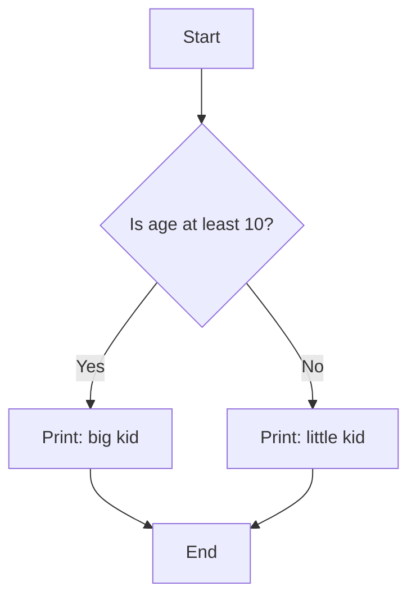
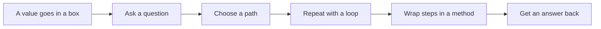
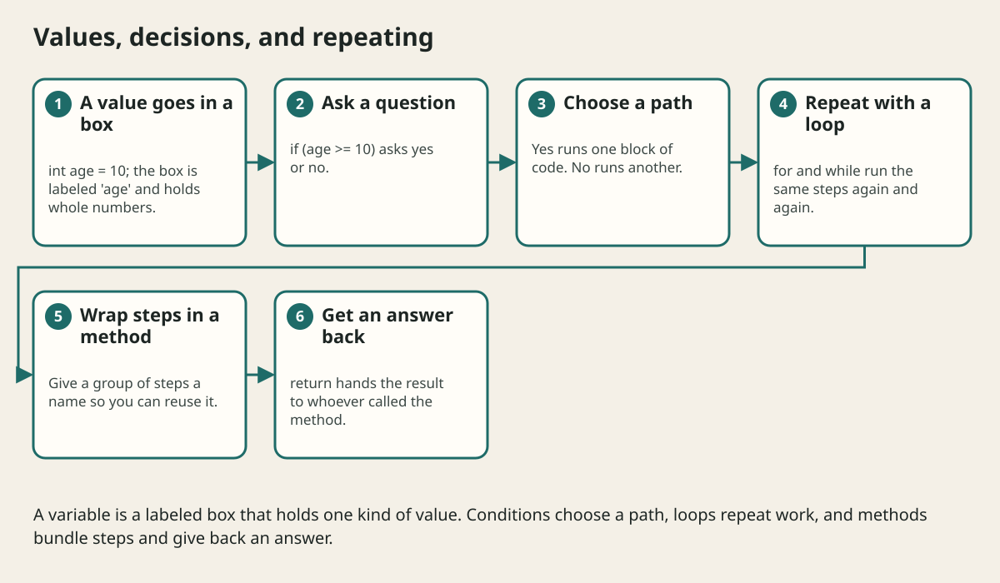

# Control Flow And Methods

## The big idea in plain words {#picture}

Think of making a sandwich. You follow steps in order. *If* there is no bread, you stop. *For each* slice, you add butter. When you do the same thing again and again, you use a loop. And when you make a sandwich often, you give the whole job a name: "makeSandwich". That name is a method.

Control flow is how a program decides and repeats. Methods are named groups of steps you can use again and again.



## What you will be able to do {#outcomes}

By the end of this lesson you will be able to:

- Choose paths with `if` and `switch`.
- Repeat work with `for` and `while`.
- Write and call methods with parameters and return values.

## Words to know {#vocabulary}

- **condition**: a question with a yes or no answer.
- **loop**: repeating steps again and again.
- **method**: a named group of steps.
- **parameter**: a named slot for an input to a method.
- **return value**: the answer a method gives back.
- **recursion**: a method that calls itself.

## Why this idea exists {#history}

Without choices and repeats, programs would only do the same thing in the same order. With them, programs can react, count, and work with lists of any size.

## Concept 1: if: choose a path {#concept-1}

`if (age >= 10) { ... } else { ... }`. Java checks the condition. If it is true, it does the first block. Otherwise it does the second. You can chain choices with `else if`. `switch` is handy when you pick among many fixed options, like days of the week.

## Concept 2: Loops repeat work {#concept-2}

`for (int i = 1; i <= 5; i++)` counts from 1 to 5. `while (condition)` repeats as long as the condition stays true. Always make sure something inside the loop eventually makes the condition false, or the loop never ends!

## Concept 3: Methods give names to steps {#concept-3}

```java
static int add(int a, int b) {
    return a + b;
}
```
`a` and `b` are parameters. `return` sends back the answer. Then `add(2, 3)` gives `5`. You can reuse `add` as often as you like, and fix a mistake in only one place.

## Concept 4: Keep methods small {#concept-4}

A good method does one job and has a clear name like `calculateTotal`. Small methods are easy to test and understand. A method that calls itself is recursion: useful, but make sure it has a stopping point, like a countdown that ends at zero.

## Counting down {#example}

```java
for (int i = 3; i >= 1; i--) {
    System.out.println(i);
}
System.out.println("Go!");
```
This prints 3, 2, 1, and then Go! The loop starts at 3 and subtracts one each time. When `i` becomes 0, the condition `i >= 1` is false and the loop stops.

## Going deeper: the technical walkthrough {#walkthrough}

### Decisions and loops


```java
if (lessonNumber > 0 && !complete) {
    System.out.println("Keep studying");
}

for (String word : List.of("request", "response")) {
    System.out.println(word);
}
```

Use a `switch` when named alternatives make the rule clearer:

```java
String label = switch (status) {
    case "new" -> "Not started";
    case "done" -> "Finished";
    default -> "Unknown";
};
```


### Methods and clean boundaries


```java
static String cleanText(String value) {
    String cleaned = value == null ? "" : value.trim();
    return cleaned;
}
```

A method should have one understandable job. If a method validates HTTP input,
executes SQL, formats a screen message, and sends email, it is doing too much.
Separate those responsibilities behind clear methods or classes.


## Worked scenario {#worked-scenario}

Three routes all clean up a note title in slightly different ways. What fixes this?

The justified choice is **Move the cleanup into one tested function that all three use**. Select **extract-rule** in the structured practical and explain why. Alternatives ignore a requirement, cross a trust boundary, or invent success.

### Structured decision contract

```json

{
  "decision": "extract-rule",
  "justification": "The parameter and return boundary must preserve the declared contract and ownership.",
  "failureBehavior": "Expose a safe failure and recover through the boundary owner."
}

```

Decision selects one declared behavior. Justification explains the boundary. FailureBehavior explains the observable error and recovery owner. These fields never execute commands. Required terms and minimum lengths form a basic practice rubric, not semantic grading.

## Step-by-step flow and matching picture {#flow}





## Three real-life uses {#use-cases}

1. A program decides if a student passes: if score is at least 50, print "Pass".
2. A loop adds up every price in a shopping list.
3. A method `isLeapYear(year)` is used in many places, written only once.

## What can go wrong, and how to stay safe {#failure-security}

Mistakes: an endless loop because the counter never changes, being off by one (`<` versus `<=`), a very long method that does ten jobs, and forgetting `return`, so the method gives nothing back. When a loop misbehaves, print the counter on each turn to watch it.

## Practice lab and expected observation {#practice}

Implement normalize so null or whitespace-only input returns null, and a nonblank string returns its trimmed value. Preserve internal spaces. The caller translates null to a deliberate validation error instead of saving a blank note.

The language starter and public examples appear in Practical. Run is unavailable until a trusted isolated worker is configured. Reading and assignment review still work; this lesson does not claim code-test completion.

1. Predict the scenario decision before opening Practical. Explain each rejected alternative.
2. Run a relevant example above in an isolated exercise project. Record the expected result, then change one input to an invalid or boundary value. A failed assertion or deliberate error should replace silent success.
3. Submit the structured decision. Initially the checks fail. After selecting extract-rule and writing an explanation and failure plan, all three pass. Follow the indicated review section for missed checks.

### Broken example to debug

```json

{"decision":"trust-client","justification":"","failureBehavior":""}

```

This ignores the responsible boundary and gives no reasoning or recovery. Correct the fields rather than changing the validator.

## Checkpoint and definition of done {#checkpoint}

- [ ] Define parameter and return without looking.
- [ ] Trace input to owner and output.
- [ ] Explain one failure and one alternative.
- [ ] Pass at least four assignment questions.
- [ ] Pass every practical check and submit.
- [ ] Explain the concept again tomorrow.

## Sources, versions, and safe commands {#sources}

Java 17 baseline; installed validation JDK may be newer. Review date: 2026-10-02. The supplied blueprint is the teaching source; official landing pages were checked where reachable. No provider or original TM Schedule deployment was tested.

- [Official reference](https://docs.oracle.com/en/java/javase/17/)

[Course reading order](README.md) · [Previous lesson](04-variables-types-and-operators.md) · [Next lesson](05a-arrays-and-looping-over-data.md)

```study-quiz

{
  "schemaVersion": 1,
  "lessonId": "java/05-control-flow-and-methods",
  "title": "Assignment: Control Flow And Methods",
  "passPercentage": 80,
  "questions": [
    {
      "id": "q1",
      "sectionId": "concept-1",
      "prompt": "In Control Flow And Methods, what does parameter mean?",
      "options": [
        {
          "id": "a",
          "text": "A permission granted by a hidden browser control",
          "explanation": "This changes the declared meaning or bypasses the responsible boundary."
        },
        {
          "id": "b",
          "text": "a named slot where a function receives an input",
          "explanation": "This preserves the definition and boundary described in the lesson."
        },
        {
          "id": "c",
          "text": "An unlimited provider operation with no ownership",
          "explanation": "This changes the declared meaning or bypasses the responsible boundary."
        },
        {
          "id": "d",
          "text": "A diagnostic credential intended for public logs",
          "explanation": "This changes the declared meaning or bypasses the responsible boundary."
        }
      ],
      "correctOptionId": "b",
      "explanation": "parameter means a named slot where a function receives an input.",
      "reviewLabel": "Review concept 1"
    },
    {
      "id": "q2",
      "sectionId": "concept-2",
      "prompt": "In Control Flow And Methods, which rule is correct for checkpoint 2?",
      "options": [
        {
          "id": "a",
          "text": "Trust client-side checks instead of the server rule.",
          "explanation": "This changes the declared meaning or bypasses the responsible boundary."
        },
        {
          "id": "b",
          "text": "Hide the failure by returning a fabricated successful result.",
          "explanation": "This changes the declared meaning or bypasses the responsible boundary."
        },
        {
          "id": "c",
          "text": "A pure function only works with what you give it and changes nothing outside.",
          "explanation": "This preserves the definition and boundary described in the lesson."
        },
        {
          "id": "d",
          "text": "Skip the stated boundary, limit, or ownership check.",
          "explanation": "This changes the declared meaning or bypasses the responsible boundary."
        }
      ],
      "correctOptionId": "c",
      "explanation": "A pure function only works with what you give it and changes nothing outside.",
      "reviewLabel": "Review concept 2"
    },
    {
      "id": "q3",
      "sectionId": "concept-3",
      "prompt": "In Control Flow And Methods, which rule is correct for checkpoint 3?",
      "options": [
        {
          "id": "a",
          "text": "Trust client-side checks instead of the server rule.",
          "explanation": "This changes the declared meaning or bypasses the responsible boundary."
        },
        {
          "id": "b",
          "text": "Hide the failure by returning a fabricated successful result.",
          "explanation": "This changes the declared meaning or bypasses the responsible boundary."
        },
        {
          "id": "c",
          "text": "Skip the stated boundary, limit, or ownership check.",
          "explanation": "This changes the declared meaning or bypasses the responsible boundary."
        },
        {
          "id": "d",
          "text": "Do not hide a shared changeable list inside a default value.",
          "explanation": "This preserves the definition and boundary described in the lesson."
        }
      ],
      "correctOptionId": "d",
      "explanation": "Do not hide a shared changeable list inside a default value.",
      "reviewLabel": "Review concept 3"
    },
    {
      "id": "q4",
      "sectionId": "concept-4",
      "prompt": "In Control Flow And Methods, which rule is correct for checkpoint 4?",
      "options": [
        {
          "id": "a",
          "text": "Returning a value lets the caller decide what to do with it.",
          "explanation": "This preserves the definition and boundary described in the lesson."
        },
        {
          "id": "b",
          "text": "Trust client-side checks instead of the server rule.",
          "explanation": "This changes the declared meaning or bypasses the responsible boundary."
        },
        {
          "id": "c",
          "text": "Hide the failure by returning a fabricated successful result.",
          "explanation": "This changes the declared meaning or bypasses the responsible boundary."
        },
        {
          "id": "d",
          "text": "Skip the stated boundary, limit, or ownership check.",
          "explanation": "This changes the declared meaning or bypasses the responsible boundary."
        }
      ],
      "correctOptionId": "a",
      "explanation": "Returning a value lets the caller decide what to do with it.",
      "reviewLabel": "Review concept 4"
    },
    {
      "id": "q5",
      "sectionId": "worked-scenario",
      "prompt": "Three routes all clean up a note title in slightly different ways. What fixes this?",
      "options": [
        {
          "id": "a",
          "text": "Copy all the routes again",
          "explanation": "This changes the declared meaning or bypasses the responsible boundary."
        },
        {
          "id": "b",
          "text": "Move the cleanup into one tested function that all three use",
          "explanation": "This preserves the definition and boundary described in the lesson."
        },
        {
          "id": "c",
          "text": "Only check the title in the user interface",
          "explanation": "This changes the declared meaning or bypasses the responsible boundary."
        },
        {
          "id": "d",
          "text": "Return success even when there is no title",
          "explanation": "This changes the declared meaning or bypasses the responsible boundary."
        }
      ],
      "correctOptionId": "b",
      "explanation": "Move the cleanup into one tested function that all three use. A small function can be tested without starting a whole web server.",
      "reviewLabel": "Review the worked scenario"
    }
  ]
}

```

```study-practical

{
  "schemaVersion": 1,
  "challengeId": "java/05-control-flow-and-methods/coding",
  "lessonId": "java/05-control-flow-and-methods",
  "title": "Practical: Normalize a note title",
  "language": "java",
  "mode": "function",
  "instructions": "Implement normalize so null or whitespace-only input returns null, and a nonblank string returns its trimmed value. Preserve internal spaces. The caller translates null to a deliberate validation error instead of saving a blank note. A disposable isolated code runner is required; this installation never executes learner code on the host.",
  "starterCode": "public class Solution {\n  public static String normalize(String value) {\n    return value;\n  }\n}",
  "entryPoint": "normalize",
  "publicExamples": [
    {
      "input": "  APIs  ",
      "expected": "APIs"
    },
    {
      "input": "   ",
      "expected": null
    },
    {
      "input": null,
      "expected": null
    }
  ],
  "publicTestIds": [
    "trim-title",
    "blank-title",
    "missing-title",
    "preserve-inner-spaces"
  ],
  "reviewSections": {
    "trim-title": "walkthrough",
    "blank-title": "walkthrough",
    "missing-title": "walkthrough",
    "preserve-inner-spaces": "walkthrough"
  },
  "limits": {
    "timeMs": 2000,
    "memoryMb": 128,
    "outputBytes": 20000
  }
}

```

