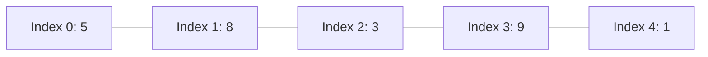
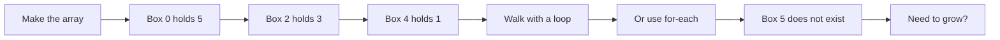
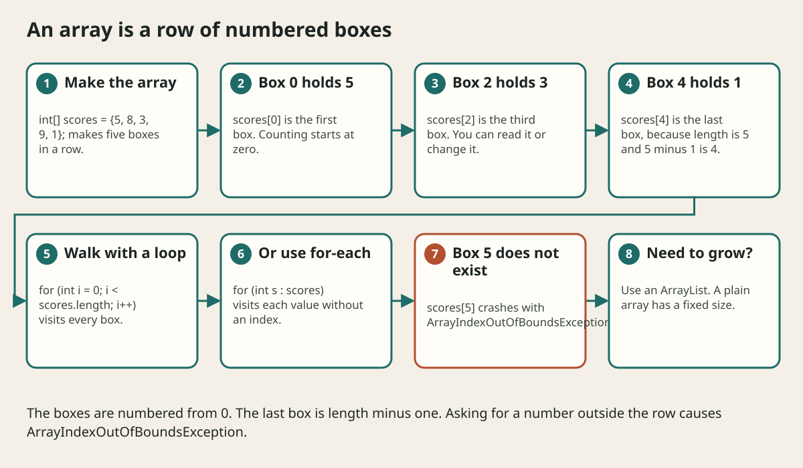

# Arrays And Looping Over Data

## The big idea in plain words {#picture}

Picture an egg carton with six cups in a row. Each cup holds one egg, and each cup has a position: first, second, third... Programmers count from zero, so the first cup is number 0, and the last is number 5.

An **array** is that egg carton. All the cups hold the same kind of thing, and the carton's size is fixed when you buy it. You can look into any cup quickly if you know its number.



## What you will be able to do {#outcomes}

By the end of this lesson you will be able to:

- Create arrays and read or change items by index.
- Loop with `for` and with for-each.
- Avoid off-by-one mistakes and know when to use a List.

## Words to know {#vocabulary}

- **array**: a fixed-size row of boxes holding the same type.
- **index**: the number of a box, starting at 0.
- **length**: the number of boxes (`array.length`, with no parentheses).
- **for-each loop**: a loop that visits every item for you.
- **2D array**: an array of arrays, like a grid or a chessboard.
- **off-by-one error**: going one box too far or stopping one too soon.

## Why this idea exists {#history}

Almost every program works with many similar things: scores, prices, pixels, names. Arrays and loops are the first and simplest way to handle them.

## Concept 1: Make an array and use it {#concept-1}

```java
int[] scores = {5, 8, 3, 9, 1};
System.out.println(scores[0]);      // 5, the first
scores[2] = 10;                      // change the third box
System.out.println(scores.length);  // 5
```
The square brackets say "array". `scores[2]` means "the box with index 2".

## Concept 2: Walk through with a loop {#concept-2}

```java
for (int i = 0; i < scores.length; i++) {
    System.out.println(scores[i]);
}
```
The loop starts at 0 and stops before `length`. Notice `<` and not `<=`. The last valid index is `length - 1`.

## Concept 3: For-each is simpler {#concept-3}

```java
int total = 0;
for (int score : scores) {
    total += score;
}
```
Read it as "for each score in scores". No index to get wrong. Use it whenever you only need the values, not the positions.

## Concept 4: Fixed size, or a List? {#concept-4}

An array cannot grow. If you need to add or remove items, use `ArrayList`. A 2D array, such as `int[][] grid = new int[3][3];`, is like a tic-tac-toe board: `grid[row][column]`. And remember the `ArrayIndexOutOfBoundsException`: it means you looked in a box that does not exist.

## Find the biggest score {#example}

```java
int best = scores[0];
for (int s : scores) {
    if (s > best) best = s;
}
System.out.println("Best: " + best);
```
Start by assuming the first one is the best. Then check every score, and if one is bigger, it becomes the new best. At the end `best` holds the biggest.

## Going deeper: the technical walkthrough {#walkthrough}

## Worked scenario {#worked-scenario}

An array has 5 items and your loop runs while i <= 5. What happens?

The justified choice is **It crashes with an index out of bounds error at i equal to 5**. Select **avoid-off-by-one** in the structured practical and explain why. Alternatives ignore a requirement, cross a trust boundary, or invent success.

### Structured decision contract

```json

{
  "decision": "avoid-off-by-one",
  "justification": "The array and index boundary must preserve the declared contract and ownership.",
  "failureBehavior": "Expose a safe failure and recover through the boundary owner."
}

```

Decision selects one declared behavior. Justification explains the boundary. FailureBehavior explains the observable error and recovery owner. These fields never execute commands. Required terms and minimum lengths form a basic practice rubric, not semantic grading.

## Step-by-step flow and matching picture {#flow}





## Three real-life uses {#use-cases}

1. A class stores 30 test scores and finds the average.
2. A game uses a 2D array for the squares of a board.
3. A weather program keeps daily temperatures in an array and finds the hottest day.

## What can go wrong, and how to stay safe {#failure-security}

Mistakes: using `<=` instead of `<` and falling off the end (off-by-one), forgetting that counting starts at zero, trying to make an array longer, and writing `length()` instead of `length` for arrays. For text, `length()` has parentheses, but for arrays it does not.

## Practice lab and expected observation {#practice}

1. Predict the scenario decision before opening Practical. Explain each rejected alternative.
2. Run a relevant example above in an isolated exercise project. Record the expected result, then change one input to an invalid or boundary value. A failed assertion or deliberate error should replace silent success.
3. Submit the structured decision. Initially the checks fail. After selecting avoid-off-by-one and writing an explanation and failure plan, all three pass. Follow the indicated review section for missed checks.

### Broken example to debug

```json

{"decision":"trust-client","justification":"","failureBehavior":""}

```

This ignores the responsible boundary and gives no reasoning or recovery. Correct the fields rather than changing the validator.

## Checkpoint and definition of done {#checkpoint}

- [ ] Define array and index without looking.
- [ ] Trace input to owner and output.
- [ ] Explain one failure and one alternative.
- [ ] Pass at least four assignment questions.
- [ ] Pass every practical check and submit.
- [ ] Explain the concept again tomorrow.

## Sources, versions, and safe commands {#sources}

Java 17 baseline; installed validation JDK may be newer. Review date: 2026-10-02. The supplied blueprint is the teaching source; official landing pages were checked where reachable. No provider or original TM Schedule deployment was tested.

- [Official reference](https://docs.oracle.com/en/java/javase/17/)

[Course reading order](README.md) · [Previous lesson](05-control-flow-and-methods.md) · [Next lesson](06-classes-objects-and-encapsulation.md)

```study-quiz

{
  "schemaVersion": 1,
  "lessonId": "java/05a-arrays-and-looping-over-data",
  "title": "Assignment: Arrays And Looping Over Data",
  "passPercentage": 80,
  "questions": [
    {
      "id": "q1",
      "sectionId": "concept-1",
      "prompt": "In Arrays And Looping Over Data, what does array mean?",
      "options": [
        {
          "id": "a",
          "text": "A permission granted by a hidden browser control",
          "explanation": "This changes the declared meaning or bypasses the responsible boundary."
        },
        {
          "id": "b",
          "text": "An unlimited provider operation with no ownership",
          "explanation": "This changes the declared meaning or bypasses the responsible boundary."
        },
        {
          "id": "c",
          "text": "a row of boxes of the same type, each with a number called an index",
          "explanation": "This preserves the definition and boundary described in the lesson."
        },
        {
          "id": "d",
          "text": "A diagnostic credential intended for public logs",
          "explanation": "This changes the declared meaning or bypasses the responsible boundary."
        }
      ],
      "correctOptionId": "c",
      "explanation": "array means a row of boxes of the same type, each with a number called an index.",
      "reviewLabel": "Review concept 1"
    },
    {
      "id": "q2",
      "sectionId": "concept-2",
      "prompt": "In Arrays And Looping Over Data, which rule is correct for checkpoint 2?",
      "options": [
        {
          "id": "a",
          "text": "Trust client-side checks instead of the server rule.",
          "explanation": "This changes the declared meaning or bypasses the responsible boundary."
        },
        {
          "id": "b",
          "text": "Hide the failure by returning a fabricated successful result.",
          "explanation": "This changes the declared meaning or bypasses the responsible boundary."
        },
        {
          "id": "c",
          "text": "Skip the stated boundary, limit, or ownership check.",
          "explanation": "This changes the declared meaning or bypasses the responsible boundary."
        },
        {
          "id": "d",
          "text": "The first box has index 0, and the last box has index length minus one.",
          "explanation": "This preserves the definition and boundary described in the lesson."
        }
      ],
      "correctOptionId": "d",
      "explanation": "The first box has index 0, and the last box has index length minus one.",
      "reviewLabel": "Review concept 2"
    },
    {
      "id": "q3",
      "sectionId": "concept-3",
      "prompt": "In Arrays And Looping Over Data, which rule is correct for checkpoint 3?",
      "options": [
        {
          "id": "a",
          "text": "Using an index outside the array throws ArrayIndexOutOfBoundsException.",
          "explanation": "This preserves the definition and boundary described in the lesson."
        },
        {
          "id": "b",
          "text": "Trust client-side checks instead of the server rule.",
          "explanation": "This changes the declared meaning or bypasses the responsible boundary."
        },
        {
          "id": "c",
          "text": "Hide the failure by returning a fabricated successful result.",
          "explanation": "This changes the declared meaning or bypasses the responsible boundary."
        },
        {
          "id": "d",
          "text": "Skip the stated boundary, limit, or ownership check.",
          "explanation": "This changes the declared meaning or bypasses the responsible boundary."
        }
      ],
      "correctOptionId": "a",
      "explanation": "Using an index outside the array throws ArrayIndexOutOfBoundsException.",
      "reviewLabel": "Review concept 3"
    },
    {
      "id": "q4",
      "sectionId": "concept-4",
      "prompt": "In Arrays And Looping Over Data, which rule is correct for checkpoint 4?",
      "options": [
        {
          "id": "a",
          "text": "Trust client-side checks instead of the server rule.",
          "explanation": "This changes the declared meaning or bypasses the responsible boundary."
        },
        {
          "id": "b",
          "text": "A for-each loop is the simplest way to visit every item when you do not need the index.",
          "explanation": "This preserves the definition and boundary described in the lesson."
        },
        {
          "id": "c",
          "text": "Hide the failure by returning a fabricated successful result.",
          "explanation": "This changes the declared meaning or bypasses the responsible boundary."
        },
        {
          "id": "d",
          "text": "Skip the stated boundary, limit, or ownership check.",
          "explanation": "This changes the declared meaning or bypasses the responsible boundary."
        }
      ],
      "correctOptionId": "b",
      "explanation": "A for-each loop is the simplest way to visit every item when you do not need the index.",
      "reviewLabel": "Review concept 4"
    },
    {
      "id": "q5",
      "sectionId": "worked-scenario",
      "prompt": "An array has 5 items and your loop runs while i <= 5. What happens?",
      "options": [
        {
          "id": "a",
          "text": "It prints 6 items",
          "explanation": "This changes the declared meaning or bypasses the responsible boundary."
        },
        {
          "id": "b",
          "text": "It silently skips the last item",
          "explanation": "This changes the declared meaning or bypasses the responsible boundary."
        },
        {
          "id": "c",
          "text": "It crashes with an index out of bounds error at i equal to 5",
          "explanation": "This preserves the definition and boundary described in the lesson."
        },
        {
          "id": "d",
          "text": "It makes the array bigger",
          "explanation": "This changes the declared meaning or bypasses the responsible boundary."
        }
      ],
      "correctOptionId": "c",
      "explanation": "It crashes with an index out of bounds error at i equal to 5. When the size needs to grow or shrink, use a List such as ArrayList.",
      "reviewLabel": "Review the worked scenario"
    }
  ]
}

```

```study-practical

{
  "schemaVersion": 1,
  "challengeId": "java/05a-arrays-and-looping-over-data/decision",
  "lessonId": "java/05a-arrays-and-looping-over-data",
  "title": "Practical: Arrays And Looping Over Data",
  "language": "json",
  "mode": "structured",
  "instructions": "An array has 5 items and your loop runs while i <= 5. What happens? Return an object with decision (choose from avoid-off-by-one, skip-check, unbounded-work, trust-client), justification (at least 40 characters; include array and index), and failureBehavior (at least 25 characters; include failure and recover while explaining the error and recovery). These are structured reasoning checks, not code execution or an official grade.",
  "starterCode": "{\n  \"decision\": \"\",\n  \"justification\": \"\",\n  \"failureBehavior\": \"\"\n}",
  "entryPoint": "answer",
  "publicExamples": [
    {
      "input": {
        "decision": "skip-check",
        "justification": "",
        "failureBehavior": ""
      },
      "expected": {
        "passed": false
      }
    },
    {
      "input": {
        "decision": "avoid-off-by-one",
        "justification": "The array and index boundary must preserve the declared contract and ownership.",
        "failureBehavior": "Show a safe failure and recover through the responsible owner."
      },
      "expected": {
        "passed": true
      }
    }
  ],
  "publicTestIds": [
    "decision",
    "explanation",
    "failure-plan"
  ],
  "reviewSections": {
    "decision": "worked-scenario",
    "explanation": "concept-2",
    "failure-plan": "failure-security"
  },
  "limits": {
    "timeMs": 2000,
    "memoryMb": 128,
    "outputBytes": 20000
  }
}

```

