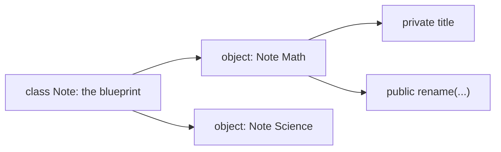
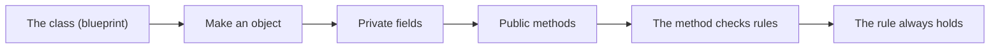
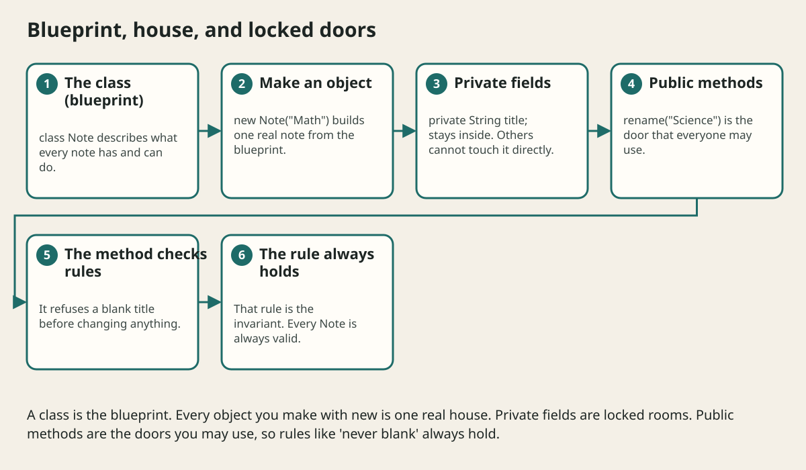

# Classes Objects And Encapsulation

## The big idea in plain words {#picture}

A class is a blueprint for a house. It says: "Every house has a color, a door, and a way to open the door." An object is one real house built from the blueprint. You can build many houses from one blueprint, and each one can have its own color.

In Java, **fields** are what the object knows (its color), and **methods** are what it can do (open the door). By hiding the fields behind methods, we keep objects safe: nobody can paint the door a color that does not exist.



## What you will be able to do {#outcomes}

By the end of this lesson you will be able to:

- Write a class with fields, a constructor, and methods.
- Create objects with `new`.
- Use `private` and methods to protect rules.

## Words to know {#vocabulary}

- **class**: a blueprint that describes what something knows and can do.
- **object**: one real thing made from a class.
- **field**: a variable that belongs to an object.
- **constructor**: a special method that builds a new object.
- **encapsulation**: hiding the inside and offering safe doors.
- **invariant**: a rule that must always be true, like "a title is never blank".

## Why this idea exists {#history}

If anyone can change anything inside an object, rules get broken and bugs are hard to find. Hiding the data and offering safe methods means that the object protects itself.

## Concept 1: Classes and objects {#concept-1}

`class Note { ... }` describes notes. `new Note("Math")` makes one. Each object has its own copy of the fields. Changing one note does not change another, just like painting one house does not paint the whole street.

## Concept 2: The constructor builds a good object {#concept-2}

The constructor runs when you use `new`. Its job is to make sure the new object starts out valid. If the title is blank, it can refuse by throwing an error. Then no broken note can ever exist.

## Concept 3: Private fields, public methods {#concept-3}

Mark fields `private` so only the class itself can touch them. Offer `public` methods for the safe actions. `rename("Science")` can check for a blank title before changing, so the rule can never be skipped.

## Concept 4: Objects have a life {#concept-4}

An object is created, used, and eventually forgotten. When nothing points to it anymore, Java's garbage collector cleans it up. Whoever creates something special, like a file connection, must also close it.

## A safe Note {#example}

```java
public class Note {
    private String title;

    public Note(String title) {
        rename(title);
    }

    public void rename(String newTitle) {
        if (newTitle == null || newTitle.isBlank()) {
            throw new IllegalArgumentException("Title cannot be blank");
        }
        this.title = newTitle.trim();
    }

    public String title() { return title; }
}
```
Whether you create a note or rename it, the same check runs. A note with a blank title can never exist.

## Going deeper: the technical walkthrough {#walkthrough}

### Classes and encapsulation


```java
public final class Counter {
    private int value;

    public void increment() {
        value += 1;
    }

    public int value() {
        return value;
    }
}
```

The field is private. Callers cannot change it directly. Encapsulation protects
invariants, such as never letting a counter become negative.


## Worked scenario {#worked-scenario}

A note must never have an empty title. Where should the object protect that rule?

The justified choice is **When it is created and whenever the title changes**. Select **protect-invariant** in the structured practical and explain why. Alternatives ignore a requirement, cross a trust boundary, or invent success.

### Structured decision contract

```json

{
  "decision": "protect-invariant",
  "justification": "The class and object boundary must preserve the declared contract and ownership.",
  "failureBehavior": "Expose a safe failure and recover through the boundary owner."
}

```

Decision selects one declared behavior. Justification explains the boundary. FailureBehavior explains the observable error and recovery owner. These fields never execute commands. Required terms and minimum lengths form a basic practice rubric, not semantic grading.

## Step-by-step flow and matching picture {#flow}





## Three real-life uses {#use-cases}

1. A `BankAccount` object that refuses to let the balance go below zero.
2. A `Student` class with a name and a list of grades.
3. A game's `Player` object that keeps its health between 0 and 100.

## What can go wrong, and how to stay safe {#failure-security}

Mistakes: making every field public so any code can break the rules, forgetting to check the input in the constructor, and building giant classes that do everything. If a class has more than one clear job, split it.

## Practice lab and expected observation {#practice}

1. Predict the scenario decision before opening Practical. Explain each rejected alternative.
2. Run a relevant example above in an isolated exercise project. Record the expected result, then change one input to an invalid or boundary value. A failed assertion or deliberate error should replace silent success.
3. Submit the structured decision. Initially the checks fail. After selecting protect-invariant and writing an explanation and failure plan, all three pass. Follow the indicated review section for missed checks.

### Broken example to debug

```json

{"decision":"trust-client","justification":"","failureBehavior":""}

```

This ignores the responsible boundary and gives no reasoning or recovery. Correct the fields rather than changing the validator.

## Checkpoint and definition of done {#checkpoint}

- [ ] Define class and object without looking.
- [ ] Trace input to owner and output.
- [ ] Explain one failure and one alternative.
- [ ] Pass at least four assignment questions.
- [ ] Pass every practical check and submit.
- [ ] Explain the concept again tomorrow.

## Sources, versions, and safe commands {#sources}

Java 17 baseline; installed validation JDK may be newer. Review date: 2026-10-02. The supplied blueprint is the teaching source; official landing pages were checked where reachable. No provider or original TM Schedule deployment was tested.

- [Official reference](https://docs.oracle.com/en/java/javase/17/)

[Course reading order](README.md) · [Previous lesson](05a-arrays-and-looping-over-data.md) · [Next lesson](06a-static-final-and-this-explained.md)

```study-quiz

{
  "schemaVersion": 1,
  "lessonId": "java/06-classes-objects-and-encapsulation",
  "title": "Assignment: Classes Objects And Encapsulation",
  "passPercentage": 80,
  "questions": [
    {
      "id": "q1",
      "sectionId": "concept-1",
      "prompt": "In Classes Objects And Encapsulation, what does class mean?",
      "options": [
        {
          "id": "a",
          "text": "A permission granted by a hidden browser control",
          "explanation": "This changes the declared meaning or bypasses the responsible boundary."
        },
        {
          "id": "b",
          "text": "An unlimited provider operation with no ownership",
          "explanation": "This changes the declared meaning or bypasses the responsible boundary."
        },
        {
          "id": "c",
          "text": "A diagnostic credential intended for public logs",
          "explanation": "This changes the declared meaning or bypasses the responsible boundary."
        },
        {
          "id": "d",
          "text": "a blueprint that describes the data and actions of something",
          "explanation": "This preserves the definition and boundary described in the lesson."
        }
      ],
      "correctOptionId": "d",
      "explanation": "class means a blueprint that describes the data and actions of something.",
      "reviewLabel": "Review concept 1"
    },
    {
      "id": "q2",
      "sectionId": "concept-2",
      "prompt": "In Classes Objects And Encapsulation, which rule is correct for checkpoint 2?",
      "options": [
        {
          "id": "a",
          "text": "Private data is changed only through carefully written methods.",
          "explanation": "This preserves the definition and boundary described in the lesson."
        },
        {
          "id": "b",
          "text": "Trust client-side checks instead of the server rule.",
          "explanation": "This changes the declared meaning or bypasses the responsible boundary."
        },
        {
          "id": "c",
          "text": "Hide the failure by returning a fabricated successful result.",
          "explanation": "This changes the declared meaning or bypasses the responsible boundary."
        },
        {
          "id": "d",
          "text": "Skip the stated boundary, limit, or ownership check.",
          "explanation": "This changes the declared meaning or bypasses the responsible boundary."
        }
      ],
      "correctOptionId": "a",
      "explanation": "Private data is changed only through carefully written methods.",
      "reviewLabel": "Review concept 2"
    },
    {
      "id": "q3",
      "sectionId": "concept-3",
      "prompt": "In Classes Objects And Encapsulation, which rule is correct for checkpoint 3?",
      "options": [
        {
          "id": "a",
          "text": "Trust client-side checks instead of the server rule.",
          "explanation": "This changes the declared meaning or bypasses the responsible boundary."
        },
        {
          "id": "b",
          "text": "Composition means one object uses another object to help it.",
          "explanation": "This preserves the definition and boundary described in the lesson."
        },
        {
          "id": "c",
          "text": "Hide the failure by returning a fabricated successful result.",
          "explanation": "This changes the declared meaning or bypasses the responsible boundary."
        },
        {
          "id": "d",
          "text": "Skip the stated boundary, limit, or ownership check.",
          "explanation": "This changes the declared meaning or bypasses the responsible boundary."
        }
      ],
      "correctOptionId": "b",
      "explanation": "Composition means one object uses another object to help it.",
      "reviewLabel": "Review concept 3"
    },
    {
      "id": "q4",
      "sectionId": "concept-4",
      "prompt": "In Classes Objects And Encapsulation, which rule is correct for checkpoint 4?",
      "options": [
        {
          "id": "a",
          "text": "Trust client-side checks instead of the server rule.",
          "explanation": "This changes the declared meaning or bypasses the responsible boundary."
        },
        {
          "id": "b",
          "text": "Hide the failure by returning a fabricated successful result.",
          "explanation": "This changes the declared meaning or bypasses the responsible boundary."
        },
        {
          "id": "c",
          "text": "A child class should keep the promises of its parent class.",
          "explanation": "This preserves the definition and boundary described in the lesson."
        },
        {
          "id": "d",
          "text": "Skip the stated boundary, limit, or ownership check.",
          "explanation": "This changes the declared meaning or bypasses the responsible boundary."
        }
      ],
      "correctOptionId": "c",
      "explanation": "A child class should keep the promises of its parent class.",
      "reviewLabel": "Review concept 4"
    },
    {
      "id": "q5",
      "sectionId": "worked-scenario",
      "prompt": "A note must never have an empty title. Where should the object protect that rule?",
      "options": [
        {
          "id": "a",
          "text": "Only in a color on the screen",
          "explanation": "This changes the declared meaning or bypasses the responsible boundary."
        },
        {
          "id": "b",
          "text": "Only in a comment in the database",
          "explanation": "This changes the declared meaning or bypasses the responsible boundary."
        },
        {
          "id": "c",
          "text": "Only in a log message",
          "explanation": "This changes the declared meaning or bypasses the responsible boundary."
        },
        {
          "id": "d",
          "text": "When it is created and whenever the title changes",
          "explanation": "This preserves the definition and boundary described in the lesson."
        }
      ],
      "correctOptionId": "d",
      "explanation": "When it is created and whenever the title changes. A record is a simple value holder, but things inside it can still be changeable.",
      "reviewLabel": "Review the worked scenario"
    }
  ]
}

```

```study-practical

{
  "schemaVersion": 1,
  "challengeId": "java/06-classes-objects-and-encapsulation/decision",
  "lessonId": "java/06-classes-objects-and-encapsulation",
  "title": "Practical: Classes Objects And Encapsulation",
  "language": "json",
  "mode": "structured",
  "instructions": "A note must never have an empty title. Where should the object protect that rule? Return an object with decision (choose from protect-invariant, skip-check, unbounded-work, trust-client), justification (at least 40 characters; include class and object), and failureBehavior (at least 25 characters; include failure and recover while explaining the error and recovery). These are structured reasoning checks, not code execution or an official grade.",
  "starterCode": "{\n  \"decision\": \"\",\n  \"justification\": \"\",\n  \"failureBehavior\": \"\"\n}",
  "entryPoint": "answer",
  "publicExamples": [
    {
      "input": {
        "decision": "skip-check",
        "justification": "",
        "failureBehavior": ""
      },
      "expected": {
        "passed": false
      }
    },
    {
      "input": {
        "decision": "protect-invariant",
        "justification": "The class and object boundary must preserve the declared contract and ownership.",
        "failureBehavior": "Show a safe failure and recover through the responsible owner."
      },
      "expected": {
        "passed": true
      }
    }
  ],
  "publicTestIds": [
    "decision",
    "explanation",
    "failure-plan"
  ],
  "reviewSections": {
    "decision": "worked-scenario",
    "explanation": "concept-2",
    "failure-plan": "failure-security"
  },
  "limits": {
    "timeMs": 2000,
    "memoryMb": 128,
    "outputBytes": 20000
  }
}

```

